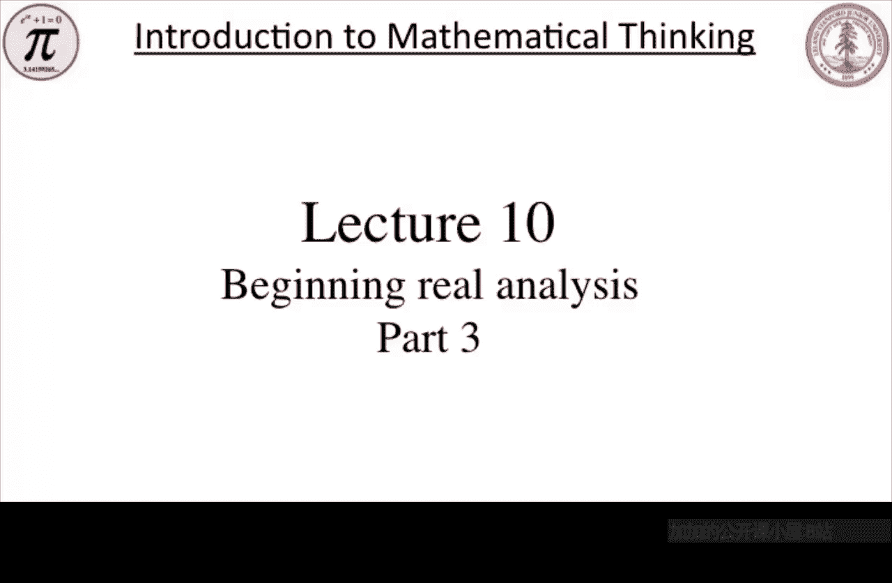
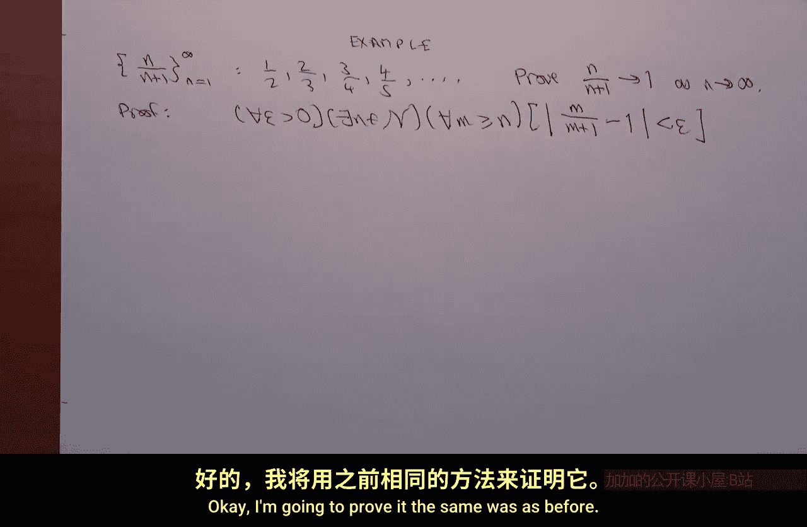
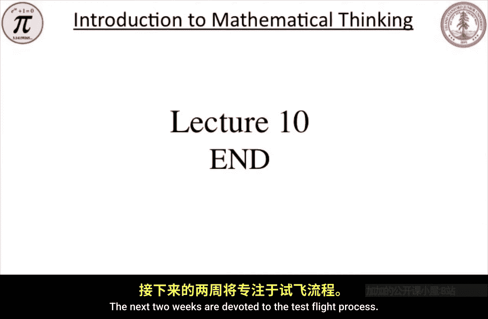

# 035：实分析深化3



在本节课中，我们将学习数列极限的**正式定义**。我们将理解这个定义如何精确地捕捉“数列项无限趋近于某个固定值”的直观概念，并通过具体例子来掌握如何运用这个定义进行严谨证明。

---

上一节我们讨论了数列极限的直观概念。本节中，我们将正式引入极限的数学定义。

## 极限的正式定义 🎯

考虑一个数列 **{a_n}**，其中 **n** 从 **1** 到 **∞**。我们说数列 **{a_n}** 的极限是 **A**，当 **n** 趋于无穷大时，记作：

**lim (n→∞) a_n = A**

其**正式定义**如下：

> 对于**任意**实数 **ε > 0**，**存在**一个自然数 **N**，使得对于**所有**满足 **m ≥ N** 的自然数 **m**，都有 **|a_m - A| < ε**。

这个定义的核心在于量词的顺序：**“对于任意 ε，存在 N”**。**N** 的选择依赖于 **ε** 的值。

## 理解定义背后的几何直观 📐

为了理解这个定义如何捕捉“无限趋近”的直观，我们可以进行几何想象。

假设我们有一个极限值 **A** 和一个给定的正数 **ε**。我们可以构造一个以 **A** 为中心、半径为 **ε** 的区间：**(A - ε, A + ε)**。

定义中“存在 N”的部分意味着，从数列的某一项 **a_N** 开始，**之后的所有项**（即 **a_N, a_{N+1}, a_{N+2}, ...**）都落在这个区间内部。

而“对于任意 ε > 0”则意味着，无论这个区间（即容忍的误差范围）被取得多小（**ε** 多接近 0），我们总能找到这样一个起点 **N**，使得数列的“尾巴”完全进入该区间。这正是“无限趋近”的精确描述。

## 应用定义：两个例子 🔧

以下是两个运用极限定义进行证明的简单例子。

### 例子 1：证明 lim (n→∞) 1/n = 0

我们需要证明：对于任意 **ε > 0**，存在自然数 **N**，使得当 **m ≥ N** 时，有 **|1/m - 0| = 1/m < ε**。



**证明过程如下：**
1.  给定任意 **ε > 0**。
2.  根据实数的阿基米德性质，我们总能选择一个自然数 **N**，使得 **N > 1/ε**。
3.  那么，对于任何 **m ≥ N**，我们有：
    **1/m ≤ 1/N < ε**。
4.  因此，**|1/m - 0| < ε** 成立。

证明完成。注意，这里 **N** 的选择（**N > 1/ε**）明确依赖于 **ε**。

### 例子 2：证明 lim (n→∞) n/(n+1) = 1

我们需要证明：对于任意 **ε > 0**，存在自然数 **N**，使得当 **m ≥ N** 时，有 **|m/(m+1) - 1| < ε**。

**证明过程如下：**
1.  给定任意 **ε > 0**。
2.  选择 **N > 1/ε**。
3.  对于任何 **m ≥ N**，我们进行如下推导：
    ```
    |m/(m+1) - 1| = |(m - (m+1))/(m+1)| = | -1/(m+1) | = 1/(m+1)
    ```
    由于 **m ≥ N**，所以 **1/(m+1) < 1/m ≤ 1/N**。
    又因为 **N > 1/ε**，所以 **1/N < ε**。
4.  综上，**|m/(m+1) - 1| < 1/N < ε**。

证明完成。同样，**N** 的选择依赖于 **ε**。

---



本节课中我们一起学习了数列极限的 **ε-N 定义**。这个定义是实分析、微积分乃至整个现代数学相关领域的基石。它的精妙之处在于用精确的量化语言（量词）捕捉了“无限趋近”的动态过程。掌握这个定义的关键在于理解 **“对于任意 ε，存在 N”** 这一量词顺序的重要性，以及 **N 对 ε 的依赖性**。通过练习运用该定义进行证明，你将能更深入地理解极限的本质。