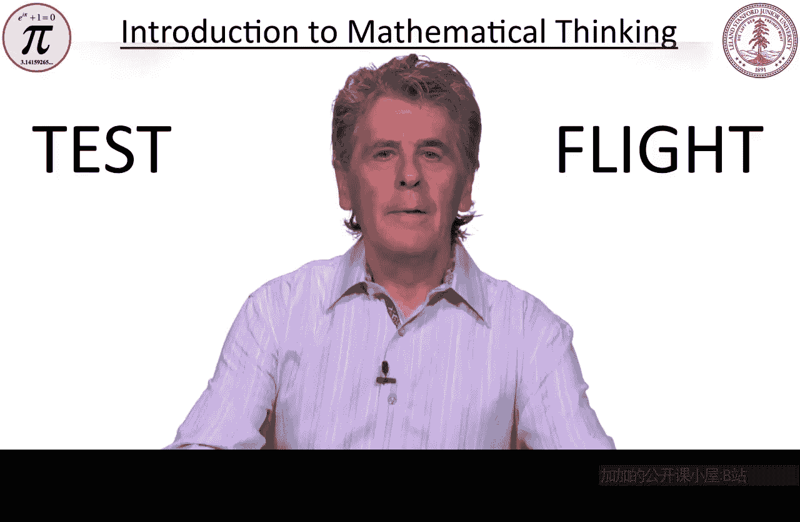
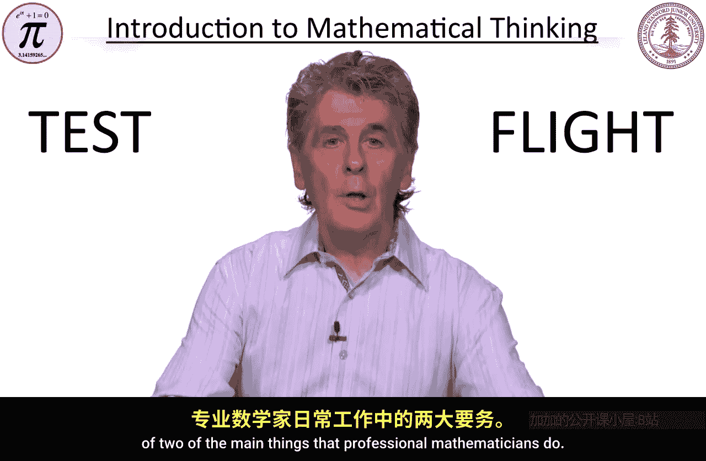
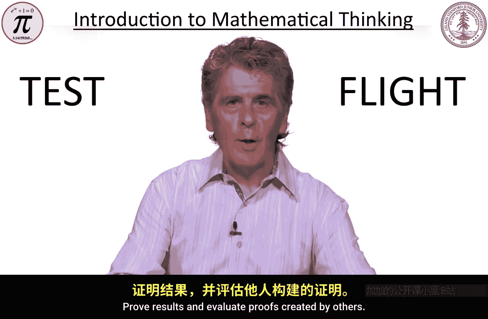

# 038：试飞简介 ✈️

在本节课中，我们将通过“试飞”环节，初步体验专业数学家的两项核心工作：证明数学结果，以及评估他人撰写的证明。本节旨在提供一个简短的实践机会，帮助你理解数学思维的实践过程。

## 试飞的目的

上一节我们介绍了数学思维的基本概念，本节中我们来看看一个具体的实践环节——“试飞”。其核心理念是让你亲身体验专业数学家的两项主要工作。

## 专业数学家的核心工作

以下是专业数学家日常从事的两项核心活动：

1.  **证明结果**：即运用逻辑推理，从已知的公理、定义和定理出发，严谨地推导出新的结论。其过程可抽象为：
    **已知条件 + 逻辑推理 → 新结论**

2.  **评估他人的证明**：即审阅他人完成的证明过程，判断其逻辑是否严密、每一步推导是否有效、结论是否成立。

## 本节总结

本节课中我们一起学习了“试飞”环节的设计目的。我们了解到，数学不仅仅是计算，更核心的是进行**证明**与**评估证明**。这为我们后续深入具体的证明方法与逻辑评估练习奠定了基础。