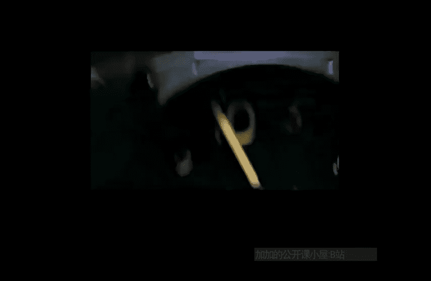
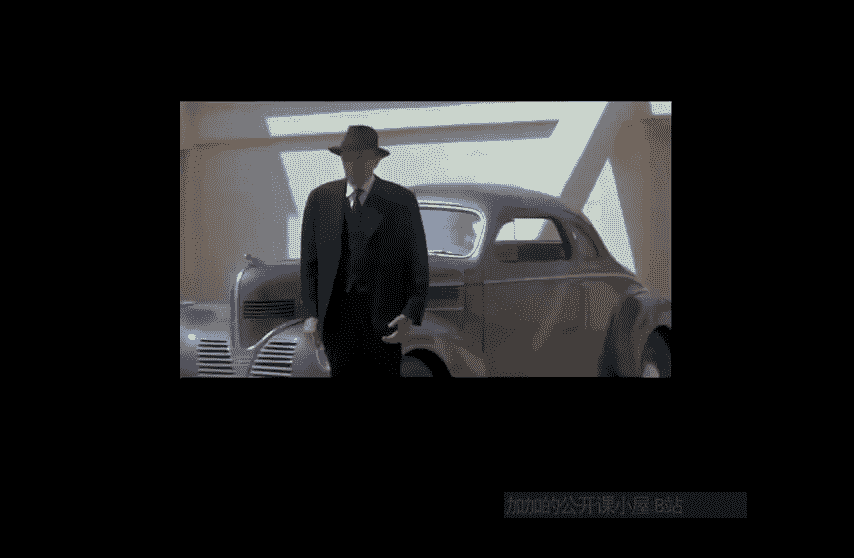
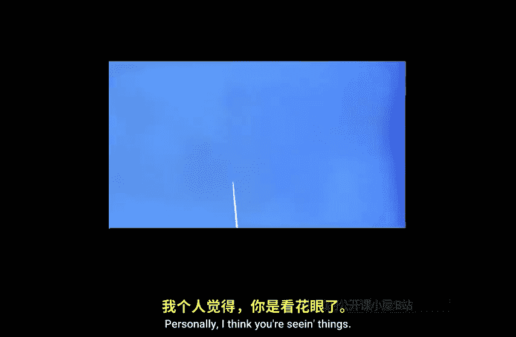
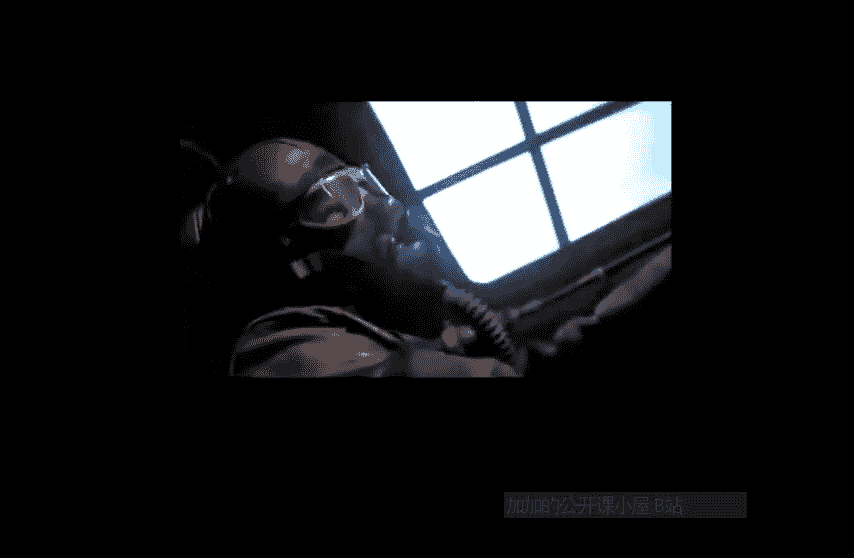
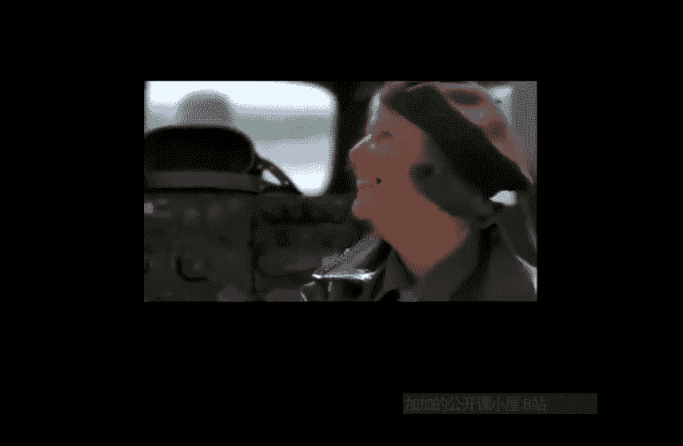
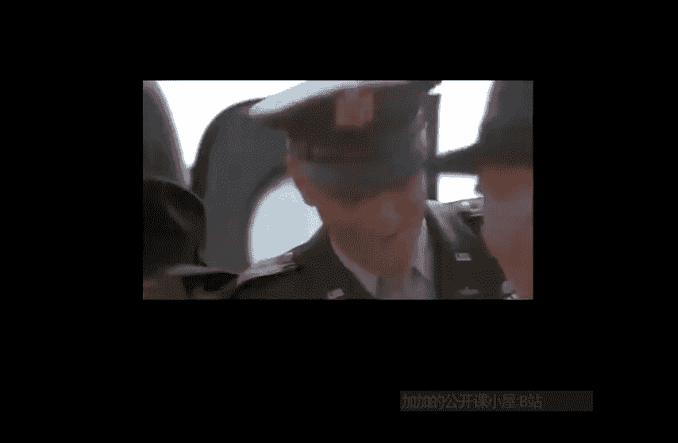
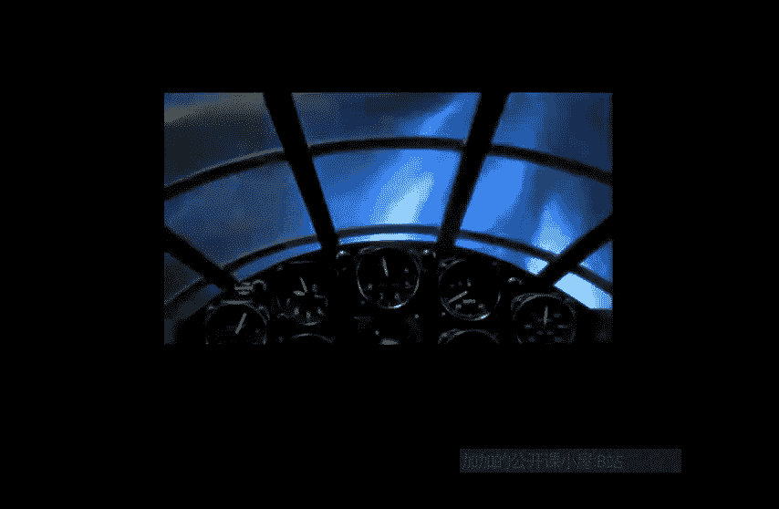

# 042：突破音障 🚀

在本节课中，我们将通过一个关于“音障”的阅读材料，学习如何运用数学思维来分析和解决复杂问题。我们将重点关注从失败中汲取经验、重新审视假设，并最终实现突破的过程。

---

上一节我们讨论了面对复杂问题时可能遇到的困境。本节中，我们来看看一个具体的突破过程。

我们回到了起点。

等一下。

这里需要再做一个记录。这个旧的模拟社区肯定有严重的问题。

仪表读数爆表了。这有点超出我的掌控。

你去把它弄坏，我们会亲自修复它。我认为你看到了某些东西。

是的，有可能。楼上的数据仍在疯狂增长，像失控的风扇。

嘿嘿。

我们终于突破了音障。

---

本节课中我们一起学习了如何通过数学思维应对挑战。关键步骤包括：承认并回到起点、识别系统中的根本问题、在压力下进行观察与调整，并最终实现关键性突破。这个过程强调了**坚持不懈的分析**和**勇于修正假设**在解决问题中的重要性。