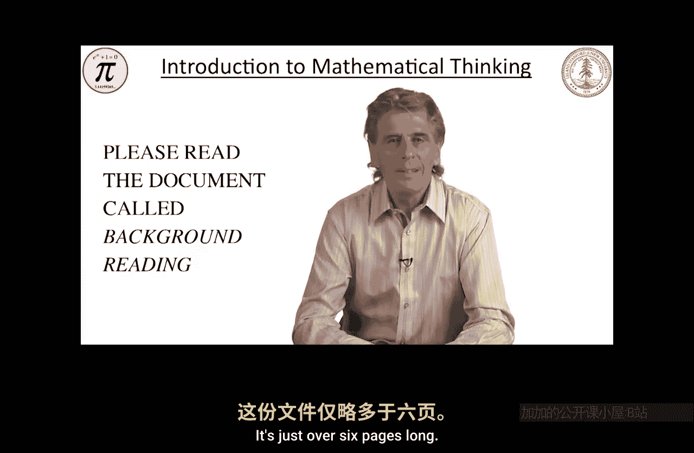
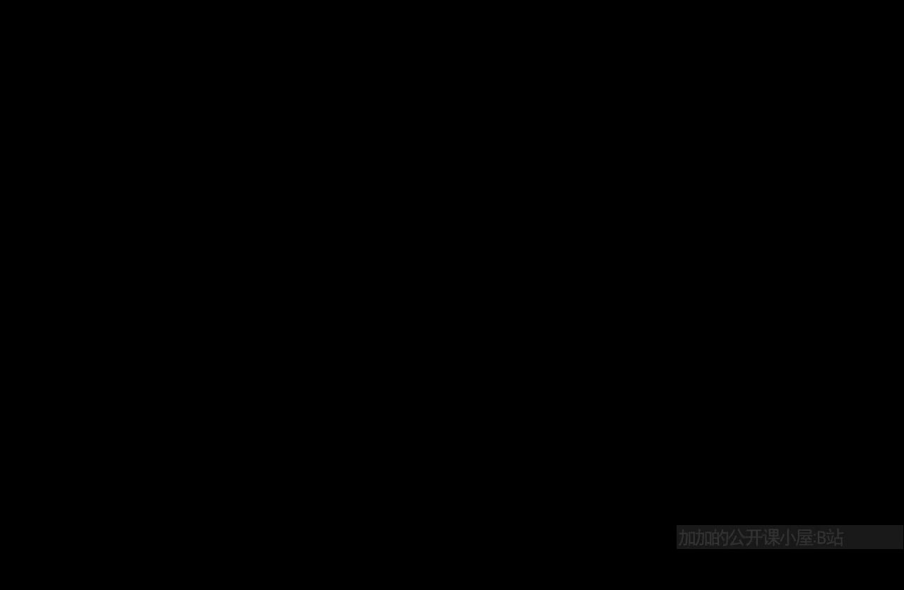

# 斯坦福大学【中英⚡数学思维导论｜Introduction to Mathematical Thinking】 p01 P1 01_讲座0-欢迎 -BV1D44dzxEa7_p1-

Hello， I'm Keith Devlin。Welcome to this online course on mathematical thinkinging。

The goal of the course is to help you develop a valuable mental ability。😊。

A powerful way of thinking that people have developed to over 3000 years。

What I want to do today is get you ready for the course and tell you a little bit about the way the course will work。

I'm doing this because for most of you， this will be a very different perspective on what mathematics is。

😊，Apart from the final two lectures， there's very little mathematical content in the course。😊。

And you won't learn any new mathematical procedures。

But mathematical thinking is essential if you want to make the transition from high school math to university level mathematics。

😊，The quickest way to learn what mathematical thinking is is to take a course like this。😊。

So by the time we're finished， you should know what it is。😊，But for now。Let me give you an analogy。

If we compare mathematics with the automotive world， school math corresponds to learning to drive。😊。

In the automotive equivalent to college mathematics， in contrast。😊，You learn how a car works。

 how to maintain and repair it， and if you pursue the subject far enough。

 how to design and build your own car。😊，The only prerequisite for the course is completion or pending completion of high school mathematics。

😊，That means many people could take the course and find it valuable。In particular。

 a key feature of mathematical thinking is thinking outside the box。😊，In contrast。

 the key to success in high school math was to learn to think inside the box。😊。

It's because thinking outside the box is such a valuable ability in today's world。😊。

That this course could be valuable to many people。But my primary student is someone in their final year of high school or their first year at college or university whoses thinking of majoring in mathematics or a math dependent subject。

If that's you。😮，Then you'll probably find the transition from high school mathematics to college level。

 pure， abstract mathematics difficult。😊，I certainly did， and so did most mathematicians I know。😊。

Not because the mathematics gets harder。😮，Once you've successfully made the transition？😮。

I think you'll agree that college math is in many ways easier。😊。

What causes the problem is the change in emphasis。At high school。

 the focus is primarily on mastering procedures to solve various kinds of problems。😊。

That gives the subject very much the flavour of a cookbook full of mathematical recipes。😊。

Thinking inside boxes。At university， the focus is on learning to think a different way to think like a mathematician。

😊，Thinking outside the box。That's not true of all college math courses。😊。

Those designed for science and engineering students are often very much in the same vein as the courses you had in high school。

😊，It's the courses that form the bulk of the mathematics merger that are different。

But some of those courses are usually required from our advanced work in science and engineering。😊。

So if you are a student in those disciplines， you may also find yourself faced with this different kind of mathematics。

If you did well at math in school， you probably got good at recognizing different kinds of problems。

So you can apply different techniques you land。😊，At university。

 you have to learn how to approach a new problem， one that doesn't quite fit any template you're familiar with。

😊，It comes down to learning how to think about a problem in a certain way。

The first key step is learn to stop looking for a formula to apply of a procedure to follow。

Approaching a new problem by looking for a template。

A worked example in a textbook or presented on YouTube。

 and then just changing the numbers often won't work。Sometimes it will。

So all that work you did at high school won't go to waste。

But it isn't enough for many of your college math courses。

If you can't solve a problem by looking for a template to follow or a formula to plug some numbers into or a procedure to apply。

What do you do？The answer is you think about the problem a certain way。Not the farm of the problem。

That's probably what you were taught to do at school， and it served you well there。Rather。

 you have to look at what the problem actually says。That sounds as though it ought to be easy。

 but most of us initially find it extremely hard and very frustrating。😊。

It doesn't come quickly or easily， you have to work at it。😊。

You're going to have to accept going a lot slower than you're used to。Most of the time。

 you won't feel as though you are making any progress。Your goal has to be understanding。Not doing。

You should definitely try all the exercises。 They're there to aid your understanding。

You should also work with others。Few of us can master this crucial shift in thinking on our own。

That path's crucial。A lot of what we'll be doing is not so much focused on right and wrong。

 but on learning how to think about a problem。 Yeah， sure。 At the end of the day。

 solutions are right or wrong。But usually there are many different right answers or different ways to the right answer。

And many wrong ones。When you're learning how to think mathematically。

 it's how and why you've got something right and wrong that's important。

The only way to find that out， to find out how well you are doing is for somebody else to look at your attempt and critique your work。

It's not possible to automate the grading process。😡，Maybe one day。

 artificial intelligence will have advanced far enough for a course like this to be automated。

 though， frankly， I doubt it。But right now， you need feedback from other people。

For a regular class here at Stanford， to professor and the graduate student Cas。

 grade students work and provide feedback。With an open online course like this。

Where there are many thousands of students， that's not possible。

So we have to go about things a different way。😊，I've designed the course so that the benefit comes primarily from doing the work and discussing it with other students。

Getting it right is important in mathematics。😊，But in a massively open online course。

 a MOOC like this。😊，There's no way to guarantee that。Incidentally。

Not being sure if we are right until others have seen our work is very familiar to we mathematicians。

😡，Even very famous mathematicians have had the experience of thinking they have solved a problem。

And writing it up， writing up their solution and sending it off for publication。

Only for an anonymous referee to find an error。In mathematics。

 there is such a thing as right and wrong。But deciding between them can be very difficult。

So even the professionals have to live with never being sure。Whether they're right or not。

Part of this introductory session is a reading assignment。

It gives you a bit of a history that should explain why today's mathematics students need a course such as this。

In lecture1， there'll be a short quiz on the reading。😡，Let me say a few words about the quizzes。😡。

If you were in one of my regular physical classes， I'd talk with you to find out if you had understood the material sufficiently to progress。

But with a massively open online course， a MOO， that's not possible。You have to monitor yourself。😊。

The quizzes are one way to help you do that。I'll see a little bit more about the quizzes later。

But before you start lecture1， please read a file called background Reading。

It's just over six pages long。

It's a PDF file so you can download it and read it offline。

