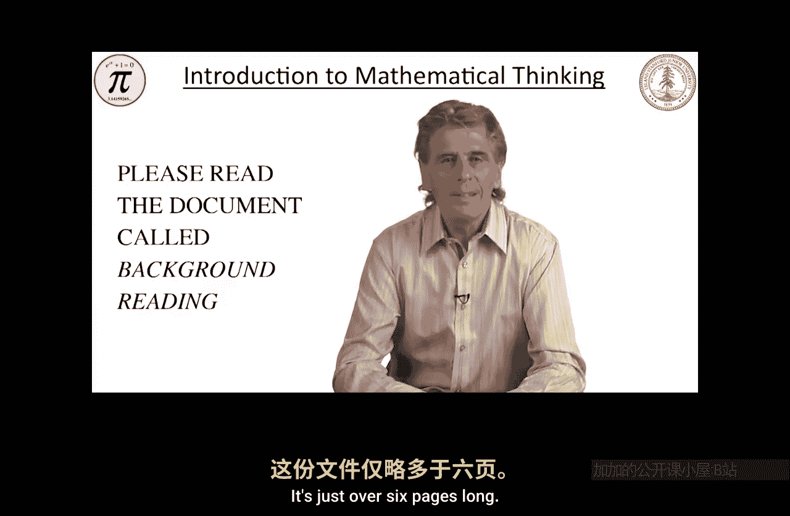

# 数学思维导论：0：欢迎与课程介绍 🎯

在本节课中，我们将了解这门课程的目标、结构以及它为何对从高中向大学数学过渡至关重要。课程的核心是帮助你发展一种全新的思维方式，而非学习具体的数学公式或技巧。

大家好，我是基思·德夫林。欢迎参加这门关于数学思维的在线课程。

本课程的目标是帮助你发展一种宝贵的思维能力。这是一种强大的思维方式，人类已经发展了超过3000年。

今天我想让你为课程做好准备，并简要介绍课程的运作方式。我这样做是因为对你们大多数人来说，这将是对“数学是什么”的一种非常不同的视角。

除了最后两节课，本课程几乎没有数学内容。你也不会学习任何新的数学解题步骤。

但如果你想从高中数学过渡到大学水平的数学，数学思维是必不可少的。了解数学思维是什么的最快方法就是参加这样一门课程。所以当我们结束时，你应该会明白它是什么。但现在，让我给你一个类比。

如果我们将数学与汽车世界相比较，学校数学相当于学习驾驶。相比之下，大学数学的汽车类比是，你学习汽车的工作原理、如何维护和修理它，如果你深入研究得足够远，还会学习如何设计和制造你自己的汽车。

本课程的唯一先决条件是完成或即将完成高中数学。这意味着许多人可以参加这门课程并发现其价值。特别是，数学思维的一个关键特征是跳出框框思考。相比之下，高中数学成功的关键是学会在框框内思考。

正是因为跳出框框思考在当今世界是一种如此宝贵的能力，这门课程对许多人才有价值。但我主要的学生群体是那些高中最后一年或大学第一年、正在考虑主修数学或依赖数学的学科的人。

如果是你，那么你可能会发现从高中数学到大学水平的、纯粹的、抽象的数学的过渡是困难的。我当然经历过，我认识的大多数数学家也是如此。不是因为数学本身变得更难。一旦你成功完成了过渡，我想你会同意大学数学在很多方面其实更容易。

造成问题的是侧重点的改变。在高中，重点主要是掌握解决各类问题的步骤。这使得这门学科非常像一本充满数学食谱的烹饪书，即“在框框内思考”。在大学，重点是学习以不同的方式思考，像数学家一样思考，即“跳出框框思考”。并非所有大学数学课程都是如此。为理工科学生设计的课程通常与你在高中上的课程非常相似。不同的是构成数学专业主体的那些课程。但其中一些课程通常是理工科高级课程所要求的。所以如果你是这些学科的学生，你可能也会发现自己面临这种不同类型的数学。

如果你在学校数学成绩很好，你可能擅长识别不同类型的问题，从而应用不同的技巧。在大学，你必须学习如何处理一个新问题，一个不完全符合你熟悉的任何模板的问题。这归结为学习如何以某种方式思考问题。

第一个关键步骤是学会停止寻找可以应用的公式或可以遵循的步骤。通过寻找模板、教科书中的例题或YouTube上展示的例子，然后仅仅改变数字来处理新问题，这通常行不通。有时可以，所以你在高中所做的所有努力不会白费。但对于你的许多大学数学课程来说，这还不够。

如果你不能通过寻找可以遵循的模板、可以代入数字的公式或可以应用的步骤来解决问题，你该怎么办？答案是，你需要以某种方式思考这个问题。不是问题的形式。那可能是你在学校被教导的方式，并且在那里对你很有效。相反，你必须看问题实际说了什么。这听起来似乎应该很容易，但我们大多数人最初发现它极其困难且令人沮丧。它不会很快或轻易地到来，你必须为之努力。

你将不得不接受比你习惯的慢得多的进度。大多数时候，你不会感觉自己有任何进展。你的目标必须是理解，而不是完成。你绝对应该尝试所有的练习。它们是为了帮助你理解而存在的。你也应该与他人合作。我们中很少有人能独自掌握这种关键的思维转变。这一点至关重要。我们将要做的很多事情，重点不在于对与错，而在于学习如何思考问题。当然，归根结底，解决方案有对有错。但通常有许多不同的正确答案或通往正确答案的不同方法，以及许多错误的方法。当你学习如何进行数学思考时，重要的是你如何以及为何做对或做错。找出答案、了解你做得如何的唯一方法，是让其他人查看你的尝试并评论你的工作。

自动化评分过程是不可能的。也许有一天，人工智能会发展到足以让这样的课程自动化，但坦率地说，我对此表示怀疑。但现在，你需要来自他人的反馈。对于斯坦福这里的常规课程，教授和研究生助教会批改学生作业并提供反馈。对于像这样有成千上万学生的开放在线课程，这是不可能的。所以我们必须以不同的方式来处理事情。我设计了这门课程，使其益处主要来自完成作业并与其他学生讨论。

在数学中，做对很重要。但在像这样的大规模开放在线课程中，无法保证这一点。顺便说一下，在别人看到我们的工作之前不确定我们是否正确，这对我们数学家来说非常熟悉。即使是著名的数学家也有过这样的经历：认为自己解决了问题，写下解决方案并送去发表，结果匿名的审稿人发现了错误。在数学中，确实存在对与错。但区分它们可能非常困难。所以即使是专业人士也不得不接受永远不确定自己是否正确。

本次介绍课的一部分是一项阅读作业。它提供了一些历史背景，应该能解释为什么今天的数学学生需要这样一门课程。在第一讲中，会有一个关于阅读内容的简短测验。让我谈谈关于测验的一些话。如果你在我的一门常规实体课程中，我会与你交谈，以了解你是否充分理解了材料以便继续学习。但对于大规模开放在线课程，这是不可能的。你必须自我监控。测验是帮助你做到这一点的一种方式。稍后我会再谈一点关于测验的内容。

但在你开始第一讲之前，请阅读一个名为“背景阅读”的文件。它只有六页多一点。它是一个PDF文件，所以你可以下载并离线阅读。

---

本节课中我们一起学习了这门数学思维课程的目标和结构。我们了解到，课程的重点不是学习具体的数学知识，而是培养一种“跳出框框”的抽象思维能力，这对于从高中到大学数学的顺利过渡至关重要。我们还明确了课程的学习方式：注重理解、与他人讨论、接受缓慢的进步，并通过阅读和测验来辅助学习。