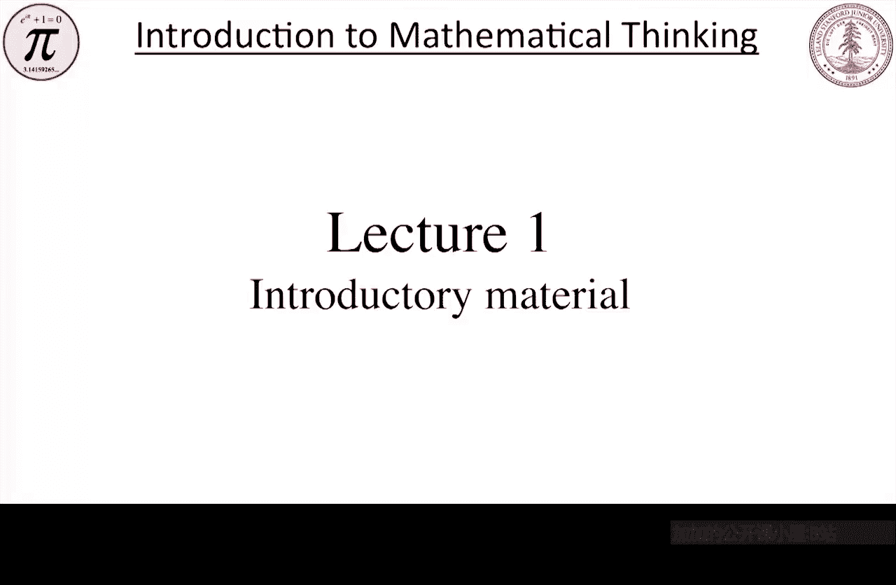
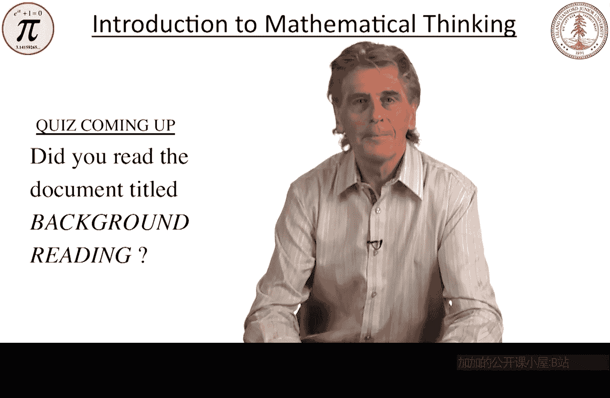
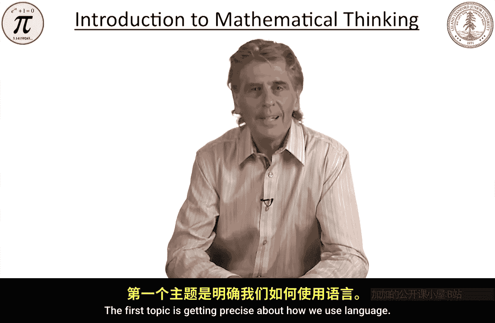
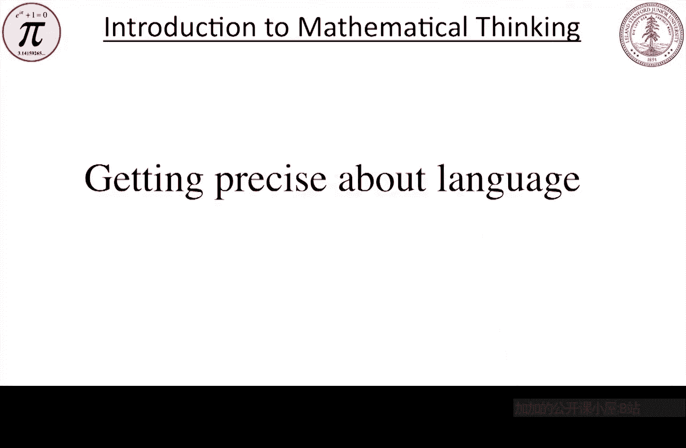
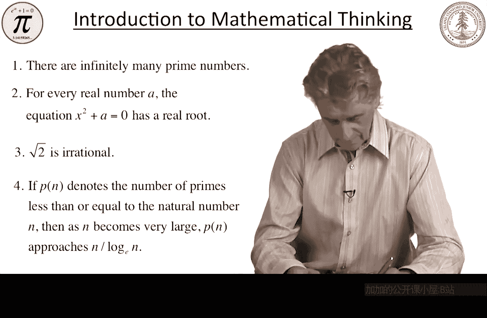
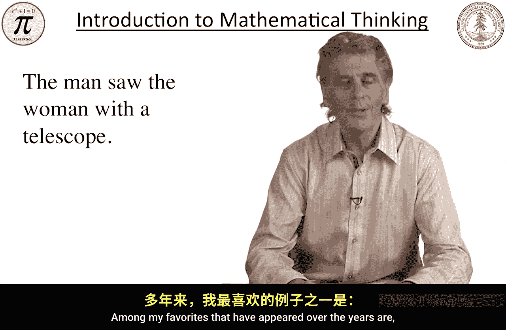
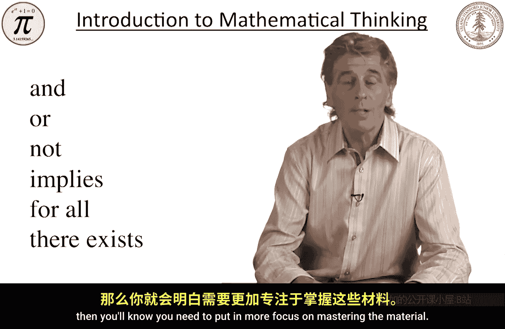
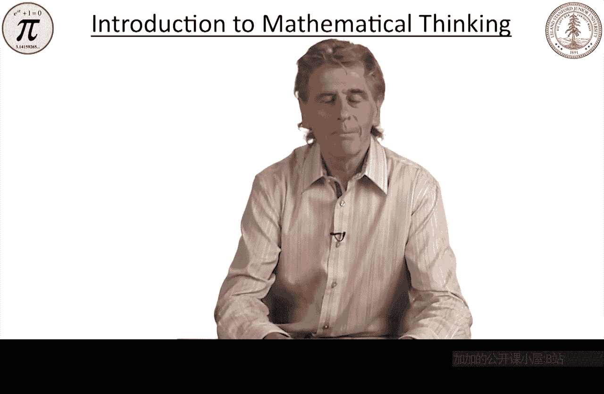

# 斯坦福大学【中英⚡数学思维导论｜Introduction to Mathematical Thinking】 p02 P2 02_讲座1-引言材料 -BV1D44dzxEa7_p2-

I'm going to start off with a question。What is mathematics？😮。

That might seem strange given you've probably spent several years being taught math。

But for all the time， schools devote to the teaching of mathematics。 very little， if any。

 is spent trying to convey just what the subject is about。Instead。

 the focus is on learning and applying various procedures。😊，To solve math problems。Well。

 that's a bit late explaining soccer by saying it's a series of maneuverres you execute to get the ball into the goal。

😊，Both accurately describe various key features。But they missed the Wats and the why of the big picture。

If all you want to do is learn new mathematical techniques to apply in different circumstances。

Then you can probably get by without knowing what math is really about。😡，But if that's the case。

 then this isn't the cost for you。😊，One thing you should realise is that a lot of school mathematics dates back to medieval times。

With pretty well all arrest coming from the 17th century at the very latest。

Virtually nothing from the last 300 years has found its way into the classroom。

Yet the world we live in has changed dramatically in the last 10 years， let alone the last 300。😊。

Most of the changes in mathematics over the centuries were just expansion。😊，But in the 19th century。

 there was a major change in the nature of mathematics。First。It became much more abstract。Second。

 the primary focus shifted from calculation and following procedures。

To one of analyzing relationships。The change in emphasis wasn't arbitrary。

It came about through the increasing complexity of what became the world we are familiar with。

Procedures and computation did not go away。 This still important。But in today's world。

 they're not enough。 You need understanding。In our education system。

 the change in emphasis in mathematics usually comes when you transition from high school to university。

In the 1980s， I was one of a number of mathematicians who advocated a new meme to capture what mathematics is today。

The signs of patterns。According to that description。

The mathematician identifies and analyzes abstract patterns。There can be numerical patterns。

 patterns of shave， patterns of motion， patterns of behavior， voting patterns in a population。

 patterns of repeating chance events and so on。They can be either real or imagined patterns。

 visual or mental， static or dynamic， qualitative or quantitative， utilitarian or recreational。

They can arise from the world around us。From the pursuit of science。

Or on the inner workings of the human mind。Different kinds of pattern give rise to different branches of mathematics。

For example。Arithmetic and number theory study the patterns of counting and number。

Geometry studies the patterns of shape。Calculus allows us to handle patterns of motion。

Logic studies patterns of reasoning。😡，Probability theory deals with patterns of chance。

Tology studies patterns of closeness and position。Fracal geometrytry studies the self similarity found in the natural world。

And so on and so on and so on。One major consequence of the increasing abstraction and complexity of the mathematics in the 19th century。

Was that methods developed to solve important real world problems had consequences that were counterintuitive。

Let me give you one example。It's called the Barak Tsky paradox。It says you can， in theory。

 take a sphere。😮，And cut it up in such a way that you can reassemble it to form two identical spheres。

 each the same size as the original one。And that wasn't the only surprise。

Mathematicians had to learn to trust the mathematics above our intuitions。

Just as physicists did with the discovery of relativity theory and quantum mechanics。Of course。

 if you are going to trust mathematics above intuition and common sense。

 you'd better be sure the math is right。This is why the mathematicians in the 19th and early 20th centuries。

Develop the precise way of thinking I calling mathematical thinking。What this course is about。

Now for that quiz， I promised you during my course introduction。

Did you read that short document called background reading？If not。

I suggest you pause the video right now and then come back after you've looked at it。😊。

Well the correct answer is money for the first question。People certainly measured land。

 and they use various kinds of yardstick， but they didn't use numbers。

 and they' certainly counted seasons， but you can count without numbers。

 You can count with notches in sticks， and you can count with with pebbles and so forth。

Our ancestors only invented abstract numbers in order to get money。

 at least that's the best available evidence that we have。

 And that that we think happened about 10000 years ago。For the second question。

 topology studies patterns of closeness。If you thought it was geographical terrain。

 you were confusing topology with topography。How did you do Well， for this one？

The main focus in the 19th century became concepts and relationships。

 It was a revolution in mathematics that took place in Germany。And for this question。

At least according to me and many of my colleagues， I should point out。

The main mathematical ability today。Is being able to adapt old methods or develop new ones。Yes。

 use of technology is important。 Yes， you need mastery of basic skills。

 but the crucial ability in today's world is adapting old methods or developing new ones。Okay。

 how did you do on that quiz？Yep， I know it wasn't a math quiz。😊。

It was really there just to get you used to the in lecture quiz format。😡。

I gave the rationale for those quizzes on that very first quiz。😊，As I wrote there。

 the intention is that you should find the answers to the quizzes immediately obvious。If you do。

 that's a sign that you are sufficiently engaged and not trying to move too fast。

If you find you have to spend time on a quiz question， I'll go back and look at the lecture again。

Then you will know that you are not engaging sufficiently closely， and you need to slow down。

The secret to this entire course is reflection， not completion。

Without the regular feedback from an instructor or a TA。

 neither of which is possible with a course having many thousands of students。

The individual student has to monitor her own progress。The quizzes， though simple。

 have proved to be very useful in that regard。You should definitely try to do the quizzes as close in time to watching the lecture。

As that will help you decide if you are moving at a good pace。

Which for this course means not too fast。We professional mathematicians despair at school systems that impose tight time limits on completing mathematics tests and encourage fast working。

Real math takes time。Before I dive into the first topic。

 let me say a couple of things about what to expect as we get into the course。

The main thing to realize is that a lot of what we do probably won't seem like doing math。

Since the focus is on how to think mathematically。Not how to apply standard techniques to solve problems。

For most of you， if you've had a fairly standard high school mathematics education。

This is a big shift。 Second， even when we do math that looks familiar to you。

 you'll spend most of the time thinking rather than writing things down。If at all possible。

 you should work with somebody else or in a small group。

Learning to think a different way is a lot harder than learning a new technique。

 and few of us can do it alone。If you find you need help。

 or if you think there's a mistake in something I've said orve written。The first thing to do。

Is discuss it with your study group or in the course discussion forum them。If， after discussion。

Your group thinks there's a mistake。Posted on the forum to see what others think。Okay。

 now we've gotten you orientated and disposed of the preliminaries。😊。

Let's get down to work in earnest。The first topic is getting precise about how we use language。

The American Melanoma Foundation in its 2009 fact sheet， states that。

One American dies of melanoma almost every hour。😡，Like many mathematicians。

 I can't help being amused by such claims。Not because we mathematicians lack sympathy for a tragic loss of life。

😊，What we find amusing is that if you take the sentence literally。

It does not at all mean what the AM MF intended。What that sentence actually claims。

Is that there is one American。 Let's call this person X。

 who has the misfortune to say nothing of the remarkable ability of almost instant resurrection to die of melanoma every hour。

The sentence the AMF writer should have written is this。Almost every hour。

 an American dies of melanoma。😊，You see the difference？

Misuses of language like this are fairly common， so much so that they really aren't misuses。😊。

Everybody reads the first sentence as having the meaning captured accurately by the second。

Such sentences have become figures of speech。Apart from mathematicians and others whose profession requires precision of language。

Hardly any one ever notices that the first sentence when read literally。

 actually makes an absurd claim。When people use language in everyday context to talk about everyday circumstances。

They share a common knowledge of the world。And that common knowledge can be relied upon to determine the intended meaning。

But when mathematicians use language in their work， there often is no shared common understanding。

Moreover， in mathematics， the need for precision is paramount。😊。

That means that when mathematicians use language in doing mathematics。

 they rely upon the literal meaning。They have to。As a result。

Mathematicians have to be aware of the literal meaning of the language they use。

This is why beginning students of mathematics in college are generally given a crash course in the precise use of language。

Yeah， that might sound like a huge undertaking， given the enormous breadth of language。😊。

But the use of language in mathematics is so constrained that the task actually turns out to be relatively small。

Modern pure mathematics is primarily concerned with precise statements about mathematical objects。

Mathematical objects are things like integers， real numbers， sets， functions， etc。

Here are some mathematical statements。There were infinitely many prime numbers。

For every real number A， the equation x squared plus say equals 0 has a real root。

The square root of two is irrational。If PN denotes the number of primes less than or equal to the natural number N。

Then， as M becomes very large。P of n approaches n divided log E of n。

Not only are mathematicians interested in statements like these。They are， above all。

 interested in knowing which statements are true and which are false。😊。

The truth or falterity in each case is demonstrated not by observation or measurement or experiment。

 as in the natural sciences。But by a proof。In this course。

 we look at some different ways of proving statements。In the case of my four examples， one。

 three and four were two。But two is false。Let me show you a proof of the fair statement。

It's due to the ancient Greek mathematician Euclid， who lived around 350 BC C， E。

We're sure that if we list the primes， P1， P2， P3， et cetera， the list continues forever。Well。

 suppose we've reached some stage N。 So we've listed P1， P2， P3 up to P N。

 Can we find another prime to continue the list。If we can always find another prime。

 then the list goes on forever ever。 And we've shown that there were infinitely many primes。Well。

 can we。Well， here's a clever trick。😊，That Euclid described in his famous book elements in 350 B。

Look at the number N。Dfined as follows。Set N equal to P1 times P2 times P3 all the way up to P N。

 multiply them all together。And had won。Clearly， N is bigger than PN。So if N happens to be prime。

 we found a prime number bigger than PM， and we can continue the list。If n is not prime。

 then it's going to be divisible by a prime， say P。Now P cannot be any of the primes P1， P2。

 P3 up to PN。Because if you divide any of those primes into N。

That prime will divideour into this part and then there a remainder of one。

So P cannot be any of those。Why？Because dividing them leaves a remainder of one。

So P is bigger than P N。That means we've found a prime number bigger than PM。😮，Either way。

 if any is prime。Or if it's not prime， we've shown that there's a bigger prime than PM。

Which means the list can always be continued。And that proves that there were infinitely many primes。

Let's just take another look at what we've done。We start with a list of all of the primes。

 and we try to list all of the primes。 We have to show that we can do that and keep going。 Okay。

 so we start with a list of the primes。 We assume we've reached some stage end and could be a 10。

 a million， a billion， a trillion， whatever。 We've reached some stage。

And we show that we can always find another prime。Bigger than the last one。How do we do that？

What is a clever idea。 We look at this number big n。

 which means you multiply the first little n primes。 That's a little n there。

 You multiply them together， and you add one。Any is certainly bigger than the last one in that sequence。

So if big N is prime， then it's a prime bigger than P。 Now。

 we're not seeing that big N would be the next prime after PM。 In fact。

 it almost certainly wouldn't be。Because big N is a lot bigger than these numbers。

 So this number is a lot bigger than PM。 So this isn't going to be the next prime。All a set。

But that doesn't matter。 We're shown that there is another prime。And whatever the next prime is。

 we'll put it onto the list。The alternative was that N wasn't Rome。In which case。

 it's divisible by a prime， and we call it P。Now， that prime P can't be any of these。 Why， well。

 this is why would you find end the way we did。If you defy， if you divide N by any of these primes。

 you left with a remainder of one。So the prime that divides N can't be any of these。

 It must be a different one。 If it's a different one， it's bigger than P N。 So， again。

 weve found a prime that's bigger than P N。Is this prime P the next prime after PM， Well it might be。

 But there's no reason to assume it is。 And it doesn't matter。 The point is。

 we found a prime bigger than PM。 So once again， the list can be continued。Either way。

 the list can be continued。This is the clever trick that makes it work。Defining end that way。

 And we define end that way。To make sure that if there's a prime divide in Big N。

 it won't be equal to any of those。Th was proved。There were infinitely many crimes。😊，How about that。

So with proved the first of our four examples， there were infinitely many prime numbers。

That one's true。What about the second one。Well， it says that for every real number a。

 the equation x squared plus equals 0 has a real root。That turns out to be false。

To show that it's false， all you need to do is find a single real number a。

For which the equation does not have a railro。Well。Why that we just take。A equals one。Then we know。

That the equation。X squared plus 1 equals 0。Does not have a root because there's no number that you can square。

 No real number that you can square， such that when you add one to it， you get 0。

 the square of any real number is positive。 and you take a positive number and add one。

 You end up with a positive number。Because there is a real number A for which the equation does not have a root。

That shows that the statement that for every rail number， there's a route。Is false。

What about number 3。Well， that one turns out to be true。

 And we're going to prove that's true later in the course。The fourth one。

 this rather complicated looking statement about the distribution of the prime numbers。

Thus' a very famous result that was proved at the Oh。

 about just over 100 years ago at the end of the 19th century。It's known as the prime number theorem。

 So this one is true。 the prime number theorem。 And there we are。Where the correct answer is false。

The poof certainly involved looking at this number。But it didn't require that this number be prime。

 It was。 it was， It was rather different。 So if you got the， if you thought the answer was true here。

 I would strongly advise you to go back and look at that proof again。

 because we most definitely did not assume that this number was prime。Clearly。

Before we can whether a certain statement is true or false。

 we must be able to understand precisely what the statement says。Above all。

 mathematics is a very precise subject where exactness of expression is required。

This already creates a difficulty， since words tend to be ambiguous。 and in real life。

 our use of language is rarely precise。In particular， when we use language in an everyday setting。

 we often rely on context to determine what our words convey。For example。

 an American can truthfully say。July is a summer month。

But that would be false if spoken by an Australian。The word summer means the same in both statements。

 namely the hottest three months of the year。But it refers to one part of the year in America and another in Australia。

In everyday day life， we use context in our general knowledge of the world and of our lives to fill in missing information in what is written or said and to eliminate the false interpretations that can result from ambiguities。

For example。We would need to know something about the context in order to correctly understand the statement。

The man saw the woman with a telescope。Who had the telescope， the man or the woman？

Abiguities in newspaper headlines， which are generally written in great haste。

 can sometimes result in unintended but amusing second readings。

Among my favourites that have appeared over the years are。😊。

Sisters reunited after 10 years in checkout Line at Safeway。Largehu appears in high Street。

 city authorities are looking into it。Mayer says bus passengers should be belted。Okay。

 to systematically make the English language precise so people can communicate effectively。😊。

By defining exactly what each word is to mean would be an impossible task。😡。

It would also be unnecessary。Since people generally do just fine by relying on context and background knowledge。

But in mathematics， things are different。Precision is crucial。

 and it cannot be assumed that all parties have the same contextual and background knowledge in order to remove ambiguities。

 Moreover， since mathematical results are regularly used in science and engineering。

The cost of miscommunication through an ambiguity can be high， possibly fatal。😊，At first。

 it might seem like a Herculeum task to make the use of language in mathematics sufficiently precise。

But fortunately， it turns out to be very doable， though a bit tricky in places。😊。

And what makes it possible is the special， highly restricted nature of mathematical statements。😊。

Almost every key statement of mathematics， the axioms， conjectures， hypotheses and theorems。

Is a positive or negative version？Of one of four linguistic forms。Object A has property P。

Every object of type T has property P。There is an object of T T having property P。If statement A。

 then statement B。Or else the statement is a simple combination of substatements of these forms using the connecting words。

 which we call combinators。And。Oh， and not。So example。3 is a prime number。

 or 10 is not a prime number。😡，Every polynomial equation has a complex root。😊。

Or it's not the case that every polynomial equation has a real root。

There is a prime number between 20 and 25。There's no even number beyond two that is prime。

If P is a prime of the form4 n plus1。😊，Then P is a sum of two squares。In their everyday work。

 mathematicians often use more fluent variants of such statements。

 such as not every polynomial equation has a real root or。No even number is prime except for two。

But those are just that variance。Incidentally， the final statements about the primes of the form 4 n plus 1。

Is a celebrated theorem of the early 19th century mathematician， Carl Friedrich Gus。😊。

The ancient Greek mathematicians seem to have been the first to notice that all mathematical statements can be expressed using one of these simple forms。

And they made a systematic study of the key language terms involved， namely。

And or not implies for all and there exists。😡，The Greek mathematicians provided universally accepted meanings of these key terms and analyzed their behavior。

When that study is carried out in a mathematically formal way。

 it's known as formal logic or mathematical logic。😊。

The study of mathematical logic is a well established branch of mathematics。

 studied and used to this day in university departments of mathematics， computer science。

 philosophy and linguistics。It gets a lot more complicated than the original work carried out in ancient Greece by Aristotle and his followers and by the Stoic logicians。

But that's well outside our present interest。It's time for another quiz。

Let me stress what I wrote to accompany the first intellectual lecture quiz。The quizzes。

 a design saw that if you're progressing in a manner that will get you through the entire course。

 you'll find the quizzes easy。In most cases， the answer will be obvious。

Their role is so that if you find you' are getting some quiz questions wrong。

Or if you have to check back through the lecture before you answer。

Then you know you need to put in more focus on mastering the material。

So， here's a quiz。The ancient Greeks were the ones who began the formal study of language and reasoning that became the branch of mathematics known as formal logic。

And that brings us to the end of the first lecture。😊。

Your next task is to complete course assignment 1。You probably find it easier to print off the PDF file and work on it when you have time。

It's really hard to say how much time you should allow for the course assignments。😊。

As people work at very different rates。The first one is meant to be pretty light。

 so I'm guessing that an hour or so should be enough for most of you。But， I really can't be sure。

If you're ever certain about anything in a lecture， a reading or an assignment。

Discuss it with your study team or go on to the course discussion forum。In fact。

 even if you don't feel uncertain， you should discuss the course of material regularly with other students。

Many students do fine at high school， working on their own。In fact。

 the best students usually work that way all the time I did when I was at high school。

But when I got to university， I soon discovered that working alone was the worst possible strategy。

University mathematics is not focused on learning procedures to solve problems。

 It's about thinking a certain way。And mastering a new way of thinking is best land by working in groups。

In a MOC where you don't have an instructor or a TA to regularly check on your progress。

 working with a study group is pretty well essential。

The Co discussion forumum provides a starting point。But you should use whatever medium you prefer。

To keep in touch with other students。Forming a group on Facebook， Google Groups， Yahoo， etc。

 are all obvious ways to do it。And you can share files and work together on Google Docs。

And keep in touch with the rest of the class by following activities on the forums。Good luck。

And I'll see you next time。