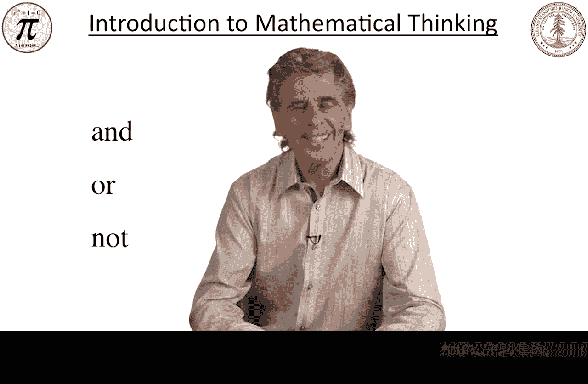
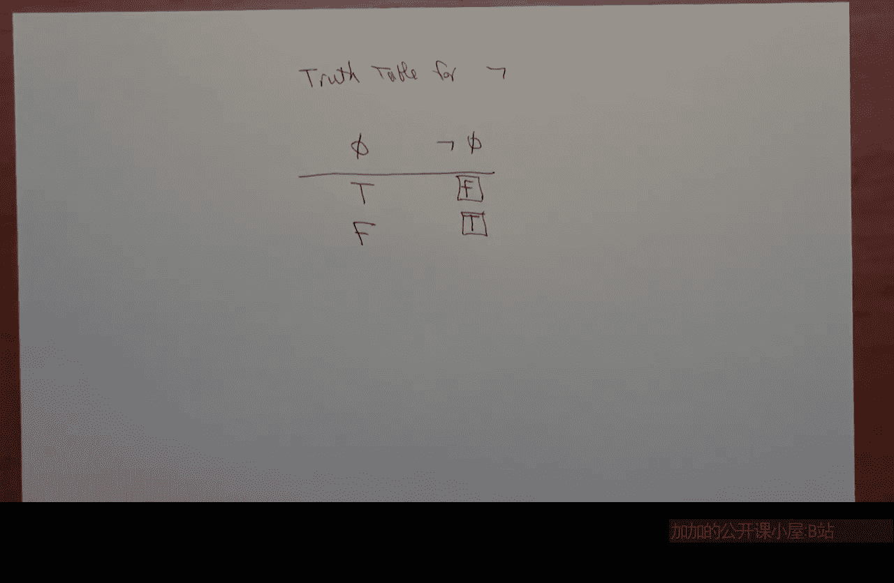
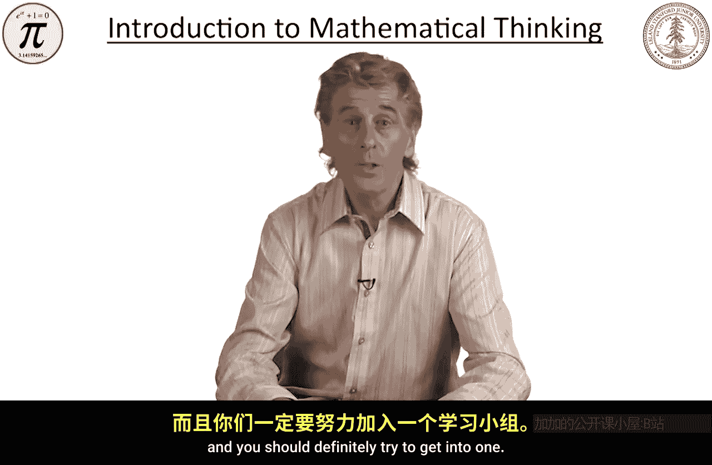

# 斯坦福大学【中英⚡数学思维导论｜Introduction to Mathematical Thinking】 p03 P3 03_讲座2-逻辑组合子 -BV1D44dzxEa7_p3-

Welcome to the second lecture。I hope you're making progress with the first assignment。

You should not expect to solve all the problems in an assignment in a single session。

 or even before the next lecture。What you should do before the next lecture is attempt each question。

That's what I mean when I sayComp the assignment。😡，Remember。

 the goal of this course is to acquire a certain way of thinking。

 not to solve problems by a given deadline。The only way to develop a new way of thinking。

Is to keep trying to think in different ways。Without guidance。

 that would be unlikely to get you anywhere， of course。

But the point of a course like this is to provide that guidance。😮。

And the assignments are designed to guide your thinking attempts in productive directions。Okay。

 let's proceed。😮，As a first step in becoming more precise about our use of language in mathematical contexts。

Will develop precise， unambiguous definitions of the key connecting words and or and not。

The other terms we need to make precise implies equivalentence for all， and there exist。

A more tricky and will handle them later。😊。

Let's start with And。We often want to combine two statements into a single statement using the word and。

So we need to analyze the way the word and works。The standard abbreviation of mathematician use for this is an inverted V known as the wedge。

Sometimes you'll see the old familiar ampersand used。

But I'm going to stick to the common mathematical practice of using the wedge。For example。

 we might want to say pi is bigger than 3 and less than 3。2。We could do this as followss。

 We could write pie is bigger than3。And。Pi is less than 3。2。In fact， for this example。

 where we're just talking about the position of numbers on the real line。

 there's an even simpler notation。 We would typically write 3， less than pi， less than 3。2。

But as an example illustrates in the use of the word and this one is fine。What does it mean， Well。

 if we have two stamens fire and sigh。Phi andsi means that they're both true。😮，The official term。

For an expression like this。Is its the conjunction of fi and say。Relative to the conjunction。

 the two constituents of P andci are called the conjuncts of P andcii。

What are the circumstances under which a conjunction phi in size2。Well。

 if I and S are individually true。Then the conjunction Phi and sigh will be true。

Under what circumstances will fire and so be false？Well， if either phi is false or psi is false。

 or they're both false。This might seem very self evident and trivial， but already， this definition。

AtLe to a rather surprising conclusion。And here it is。According to our definition。

 Phi and Pi means the same assi and Phi。 They both mean that Phi andsi are both true。

In mathematical pis。Conjunction is commutative。But that's not the case for the use of the word and in everyday English。

For example。John took the free kick， and the ball went into the net。

That doesn't mean the same as the sentence。 The ball went into the net， and John took the free kick。

They're both conjunctions。And the two conjuncs are the same。 One of them as John took the free kick。

 The other one is the ball went into the net。But anyone whos familiar with soccerer realizes that these two sentences have very different meanings。

The fact is， in everyday English。The word and。Is not commutative。Sometimes it is， but not always。😮。

Let's see what you make of this one。 Let A be the sentence。

 It rained on Saturday and let B be the sentence。 It sned on Saturday question。

Does the conjunction A And B accurately reflect the meaning of the sentence it rained and snowed on Saturday。

Well。😮，What do you think， Yes or no。Although I can think of situations in which the answer would be no。

 in general， I would be inclined to say the answer is yes。

A useful way to represent a definition like this is with a propositional truth table。 What we do。

Is we list the component statements in this case， will be P and p。

And they're going to go together to make the conjunction fire inside。

And now we're going to draw a table that lists all the possible truth， false combinations for phi，si。

And fire sigh。So let me see。 F could be true。And so could be true。Or phi could be true。

 and psi could be false。😔，Or phi could be false， and psi could be true。Or p could be false。

 andsi could be false。The next step。Is to list in the final column。T or F。

 according to our definition of what the conjunction means。

Why don't you see if you can fill in T or F in each of those four boxes。

To represent the definition of p and sigh that we've given。According to the definition。

Phi andsi is going to be true。Whenever fire is true and size is true。That's the first draw。

 so there's a T going to go here。But that's the only condition under which fire and size is true。

In all other circumstances， it's false。So the entries for these of all F。So in one simple table。

We' have captured the entire definition of P ands。This emphasizes the fact that the truth of a conjunction。

Depends only on the truth or falsity of the two conjuncts。

 The definition was entirely in terms of truth and falsity。What Phi andsi meant was irrelevant。

It was only about truth and falsity。That's going to be the case for all the definitions that we're going to give in order to make language precise。

They're going to depend upon truth or falsity， not upon meanings or logical connections。Now。

 let's look at the combbernet at all。We want to be able to assert that statement A is true。

 or statement B is true。For instance， we might want to say。A is greater than 0。

 or the equation x squared plus a equals 0 has a real root。Oh， maybe we want to say。A B equals 0。

 If a equals 0 or B equals 0。 Those are both statements that we get when we combine two substatements with the word or。

Both statementss are， in fact， true。But there's a difference between them。

 The meaning of awe is not the same in the first sentence as it is in the second sentence。

In the first sentence， there's no possibility of both parts。Being true at the same time。

Either it is going to be positive。Oh？This equation will have a royal route。They count both a cat。

If it is positive， then this equation does not actually have a rare route。

In the case of the second sentence。They could both occur together。To get A B equals 0。

It's enough if phase 0。It's enough if B is 0， oh， they can both be 0。 So these two are different。

In the first case。We have。An exclusive， or。In the second case， we have an inclusive o。Incidentally。

 it doesn't matter if you try to enforce the the exclusivity by putting an either in front of it。

 If you look at the way the word either operates， if you say either this or that。

 then what happens is that the either simply reinforces an exclusive or if one happens to be there。

In in the case of the second one， you could say A B equals 0， if either to a equals 0 or B equals 0。

And， in fact， that doesn't enforce the exclusivity at all。

 We just accept the fact that they could both be true。In other words。

 the word or in in everyday English is ambiguous， and we rely upon the context to disambiguate。

In mathematics， it's different。 We simply can't afford to have ambiguity floating around。

We have to make a choice between either the exclusive or。Or the inclusive or。And for various reasons。

 it tends out to be more convenient in mathematics。To adopt the inclusive use。

The mathematical symbol we use to denote the inclusive or。Is a V symbol。

It's known as the disjunctive symbol。So given two sentences， p and sigh。Phi vsi。Means phi。Oh， sigh。

Oh both。This sentence， P or ps。Is called a disjunction of fire and sigh。

And relative to the disjunction。The constituents fire and sigh。A call of disjuncs。Remember。Fhi orsi。

In mathematics。Means at least one of those two is true。They could both be true。For example。

 the following rather silly statement is true。3 is less than 5 or  one equals 0。

 I can't imagine a mathematician actually writing that down， except as an example， as I'm doing now。

Silly examples like this are actually quite useful in mathematics because they help us understand exactly what a definition means。

This thing is true。Even though one of the disjuncts is patently false。

So this emphasizes the fact that for a disjunction to be true。

 all you need to do is find one of the disjuncts， which is true。

 It doesn't matter if one or more of the other disjuncts is， is patently false。Okay。

 let's see how well we do understand that。Here's a quick quiz。Let air be the sentence。

 It will rain tomorrow。And let be with a sentence， it will be dry to Morrow。 Here's the question。

Does the disjunction A or B accurately reflect the meaning of the sentence。Toorrow， it will rain。

 or it will be dry all day， well。What do you think。The answer is clearly no。

If that comes as a surprise to you。You need to think about the definition of or a little bit longer and see what's going on here。

I'll leave you to that one。To wrap up this discussion of disjunction。

 let's see if we can complete the truth table for Phi or psi。Okay， if you got this one right。

 your truth table should look like this。True。😔，True。😔，Cu。😔，False。The disjunction is true。

If both are true。If one is true or if the other is true， the only time when a disjunction is false。

Is when both disjuncts are false。Okay， so now we've sorted out the meaning of the word awe。

The next word I want to look at is not。If Pi is a sentence。Then。We want to be able to say that。

 size is false。So givens， we want to create the sentence， notsi。

The standard abbreviation mathematicians use today is this symbol。

 which is like a negation symbol with a little vertical hook。Older textbooks will。

 you'll find with the， we'll use the tilder。 That's not the one I'm going to use。

 I'm going to stick with the modern notation， this sort of negative sound with the hook。

And we call this the negation ofsi。If size is true。Then， the negation of science is false。

And if psi is false， thelegation ofs is true。We often use special notations in particular circumstances。

 For example， we would typically write x not equal to y。Instead of not x equals y。

But you have to be a little bit careful。For example。I would write not the case， A less than X。

 less than or equal to B。You might be tempted to write。Something like。A， not less than X。

Not less than or equal to B。II would， I would advise against that。That one。Is better than this one。

This one is completely unambiguous。 It means that it's not the case that x is between A and B in that fashion。

 This one。 Well， it could mean， I mean， you could agree that it means that。

 but you it's really ambiguous as to exactly what's going on here。 So I would say。

 avoid things like that， use something like this。 we should always go for clarity in the case of mathematics。

 Remember， the whole point of this precision that we're trying to introduce is to avoid ambiguities to avoid confusions。

 because in more advanced situations， all we're going to have to rely upon is the language。And。

 and then we need to make sure that we're using language in a non ambguous and reliable way。

 Negation might seem pretty straightforward。 And in many ways， it is， but it's not trivial。

If we took something like not the case that pi is less than3。Then that's pretty straightforward。

 That means。Pi is greater than or equal to 3。Okay， that's easy。No problems there。

Let me give you one that's not quite so obvious。Look at this sentence。

 All foreign cars are badly made。What's the negation of this sentence。

Let me give you four possibilities。 Pos what or possibility A， all phone cars are well made。

Possibility B， all foreign cars are not badly made。Possibility to see。

 at least one foreign cow is well made。Possibility D。At least one phone car is not badly made。Well。

 I'm not giving you this as a quiz， but I would like you to think for a minute as to which one of these you think is the negation of that original sentence。

 or maybe you think it's something else。 Maybe you think it's something to do with domestic cars。

Domestic is， after all， the negation of phone。So what do you think it is？Well， let's look at them。

A is actually a very common one for beginners to pick。

 I've been teaching this material for many years now。 It's one of the examples I've always gave。

 It's in in the textbook I've written for this course and previous textbook I've written。

 And this one is a common answer I that I often get。

But if you think about the what the sentence really means， it's obviously not this one。

 This is not the negation。Why？Is the original sentence true， No， of course， it's not。

 There are many good carss that have fallen made。 Okay。

 so it's not the case that all fallen cows are badly made。 So this sentence。Is， in fact。

 a false sentence。We know that just by our knowledge of the world。 if that sentence is false。

 then its negation is going to be true。Well， this isn't true。😮，It's not the case at all。

 Foreign cars are well made。That's false。So that capt with neation。What about B？Same reasoning。

 That cant be ne negation。Because it's simply not the case。

That's all phone cars that all phone cars are not badly made。 Okay， those are false statements。

These are false， so they can with the negation of a false sentence。

 The negation of a false sentence is going to have to be true。

So whatever the negation of this original sentence is。

That negation will have to be something that's true。

And we know what's true and false in terms of cars being well made。Well， is this one true？Yeah。

 that's true。😮，Is this one true， Well these are both true？So， these are both possibilities。

For the negation of that。And this is still not a quiz。

 but I'm going leave you for a little while to think about this one。

Which one of these do you think actually is the the negation of this。 We'll come back to this。

 I'm going to introduce some， some formal notation from sort of algebraic notation。

 and eventually we'll be able to reason precisely to say which one of these two here or maybe a different thing。

Is the actual negation of this。But let me stress a point I made a minute ago and didn't write anything down。

Look at the following sentence。 All domestic cars are well made。

I've actually had students over the years who have thought that that was， in fact。

 the negation of this。I know why they're saying that because they're saying this says something about all foreign cars and this says something about all cars that are not foreign。

 So there is a sort of negation going on between these two。

 but it's not the negation of the original sentence。

How do I know it's not the negation of the original sentence， Because the original sentence is false。

 Therefore， whatever the negation is is going to have to be true。Well， this isn't true。😮。

This is also false。 And because this is false， it can't possibly been in neation of the original sentence。

And in fact， this one really falls a long way if I being the negation of that。

For the following reason。The original sentence is about foreign cars。That's what it's talking about。

 It has nothing to do with domestic cars。 It's purely talking about foreign cars。

So the negation can only possibly talk about foreign cars。

These were good candidates for the negation because they talked about foreign carss。

This one isn't even in the ball pack for an inigation。Because it's not talking about foreign cars。

 It's talking about domestic cars。Negigating a word in a sentence is not at all the same as negating the sentence。

So， this one。Is a really bad choice。Let me finish with a very simple quiz。

 Let me ask you to fill in the truth table for netgation。

This one's a much simpler table because there's only one statement involved phi。

 and then we're going to negate it。So。Very simple truth table。What do you think the values are。Yep。

 this one was an easy one。😊，If fire is true， the negation is false。 If fire is false。

 the negation is true。And with that， you should be in a position to complete assignment， too。

That last example about the negation of the sentence all foreign cars are badly made should， I think。

Iustrate why we're devoting time to making simple bits of language precise。

To figure out what the correct negation is。😮，We relied on our knowledge of the everyday world。

That's fine for statements about the everyday world we're familiar with。But in a lot of mathematics。

 we're dealing with an unfamiliar world， and we can't fall back on what we already know。

We have to rely purely on the language we use to describe that world。

When we've taken our study of language far enough。😊。

We'll be able to look at that foreign cow statement again and use rigorous mathematical reasoning to determine exactly what its negation is。

Well， that brings us to the end of the first week。How are you getting on？For most of you。

This will seem like a very strange course。And certainly won't look much like mathematics。

That's because you've only been exposed to school math。😊。

This course is about the transition to university level mathematics。Which in some ways。

 is very different。There isn't much material， and as a result， the lectures are short。😊。

I'm not providing you with new methods of procedures。

 I'm trying to help you learn to think a different way。Doing that is me up to you。 It has to be。

If you' at all like me and pretty well every other mathematician I know。

You're going to find it hard and frustrating。And it's going to take some time。

You definitely need to connect to other students and start working together。

If you're able to scan pages of work into PDF。Or risk use your smartphone to take good。

 clear photos of your work。I advise you to start showing your work to other students to get their feedback。

Send images as email attachments， put them on Google Docs。

 or upload them to whatever networking site you choose。

You should definitely attempt all the assignments that I give out after each lecture。

Doing those assignments， both on your own and in collaboration with others is really the heart of this course。

Yeah， sure， you can watch the lecture several times。😊，But you found that it almost never。

Tells you the answer。Or even how to get the answer。

In the way that you're familiar with from high school。It's like learning to ride a bike。

 Some one can ride up and down in front of you for hours， telling you how they do it。

But you won't learn to ride from watching them or having them explain it to you。

You have to keep trying it for yourself and failing。Until it eventually clicks。

This is a very different way of learning than you're used to， at least in mathematics。😊。

As well as the assignments， there's also a weekly problem set。

The problem sets comprise assignment questions that count directly towards your grade。

Because this course is designed for many thousands of students。

 it's impossible to look at everyone's work and provide feedback。

So we have to rely on automated grading。This means that the questions are posed in multiple choice format。

But these are not at all like the intellectual quizzes。

Those are supposed to be answerable on the spot。The problem set questions will require considerable time。

This is not ideal。For the material in this course， whether you get particular questions right or wrong is pretty insignificant。

😊，It's your thinking process that's important。But we can't check that automatically。

Asking you to answer multiple choice questions is like checking your health by taking your temperature。

It tells us something and can alert you and us that something is wrong。But it's pretty limited。Still。

 checking temperatures is better than nothing， and the same is true for the problem set grading。

What I'd like you to do is to try to grade your own work and that of others in whatever study group you form。

 and you should definitely try to get into one。

