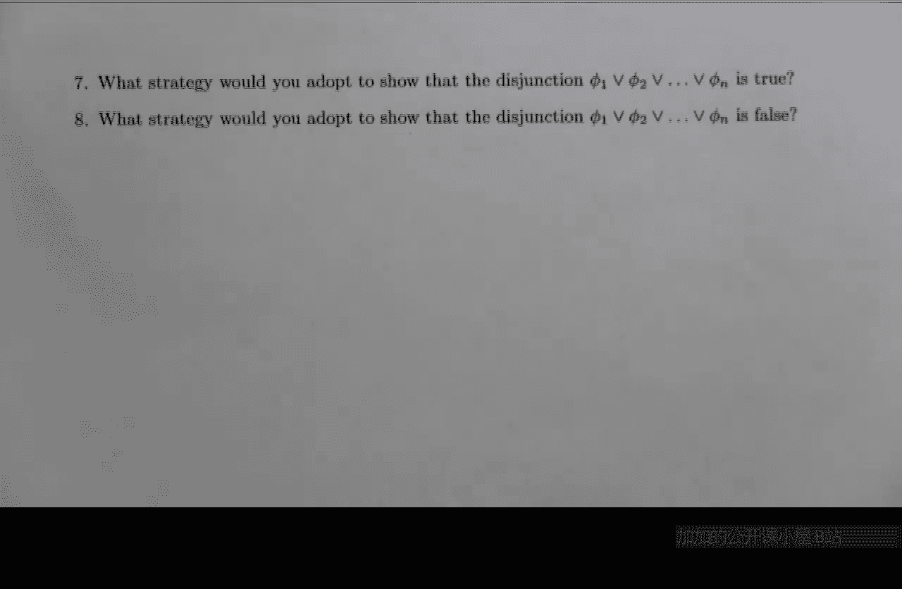

# 斯坦福大学【中英⚡数学思维导论｜Introduction to Mathematical Thinking】 p05 P5 02_作业2指导教程 -BV1D44dzxEa7_p5-

Okay， let's see what we've got。Number one has been done for you number two。

The simple word of like that is to say 7 less than or equal to P。Less than 12。The next one。

We would write us5， less than x。Less than 7。The next one， well。😮，If x is。

 let me say if x is less than 4。Then it's automatically less than 6。

So the second conjunct here is superfluous。 We could just write that as x less than 4。

What about the next one？Well， y squared less than 9 means， let me see， negative 3。Is less than why。

He's less than three。 That's what the the first。 That's what the second conjunct means。Okay。

But if why satisfies this condition？Then certainly why is less than full。

So the first conjunct is superfluous。And the only one that counts a second one。

So we could simplify that as wives square less than 9。Okay， that was just our thinking on the way。

What hold this one。 While x is greater than equal to 0， and it's less than equal to 0。

 there's only one possibility。And that' x equals 0。Well， for number three。

 in order to show that the conjunction is true。What you would do is show that all。A51。Phi 2。

 et cetera， up to phi n。That's true。And for number 4。To show that a conjunction is false。

As you show that。1 of 51。5，2。F n。Hiss false。So you have to find one of these， at least one of these。

 which is false。 And then it falls， as follows that the conjunct is false。Okay， well。

 that's that one。Okay， well， with part A， if part is bigger than 10。

Then it's automatically bigger than3。So in terms of the disjunct。Pi bigger than three dominates。

 that， that says more。 And if we draw a picture， we've got 0。 we've got 3。We've got 10。

And the first one says it。X is to the right of this point。

And the second disjunc is it X to the right of that point。

And the disjunction will be true if at least one of them is true。And at least one of them will two。

If we start at 3。First of all， only the first disjunct is correct。

 And then when we get beyond this point。Both these chunks are correct。

So it's the first one that works。This is that either x is less than 0。O x is greater than 0。

 So the simplest way to write that。It's just say that x is not equal to 0。

It's rather than less than 0， which's negative。Oh， it's bigger than 0， it's positive。

This is that x equals 0， or x is greater than 0。 The standard abbreviation for that is x greater than equal to 0。

And once you've got x equal to 0。That's going to dominate over the first disjunct in in terms of a disjunction。

 So you're going to have x greater than equal to 0。 That makes a more general claim of the two。

And for this one。Let me make a note that x squared greater than 9， this part。明字带的。X is greater than3。

O。X is less than negative 3。Well， one of these two justjuts is the one that's here。

So this one is superfluous。 So that's the one that counts。

 So x squared greater than 9 is the simple way of saying it。 And again。

 as I was as with the previous case， as with numbers 1 and 2。As I was going through them。

 I actually articulated what these things are。These were really just to sort of prompt you to thinking about how you would express them in English。

Okay， well， that's not one。

Well in number7。To show that a disjunction is true。You have to show that。One of them is true。

At least one of them。And for number 8。To show that。 it's false。You have to show that。All a far1， P 2。

 et cetera。To fire Anne。A false。Okay。Well， that's number seven and8 taken care of。

Turning to number 9 now to say that it's not the case that pi is greater than 3。2。Is to say that， Pi。

Hes less than equal to 3。2。When you ne a strict greater then， you get less than of equal2。

To say that it's not the case that x is negative。Is to say that x is greater and or equal to 0。

To say that it's not that， well， these， these are， these are real numbers from the context of。

 of the expression。 we can assume that these are talking about real numbers。And for a real number。

 every real number has a square。Which is strictly positive， with one exception。And that exception。

Is 0。 So the only real number for which it's not the case that x squared is strictly positive is x equals 0。

The standard abbreviation for not x equals 1 is x not equal to 1。And when you negate a negation。

 it takes you back to the original。Stment。And again， as I went through， though。

 I essentially answered number 10。Well， turning to question 11 now， here are the answers that I get。

Dollar and yen， both strong。Okay， Do are strong。And yeah strong。

I think that one's fairly straightforward。What about this one， Well， as these words， despite。And。

 but。By my mind， those are just nuanced forms of conjunction。 They both mean and， so。

We've got the Jann week。And。There's a trade agreement。And the dollar strong。

So the despite and the but they sort of get at the whether these things are contrary to our expectations or consistent with our expectations。

But they still say that all of these three things hold together。Okay， this 1， I think is。

 is fairly straightforward。 They can't both be strong at the same time。 So it's not the case。

That the do is strong。And the young strong。For part D。Well， if that doesn't prevent that。

 it means that happens。And both of those fail。So， the trade agreement signed。But the dollar falls。

Then the youngn falls。The trade agreement holding doesn't prevent。The fall in the dollar and the yan。

 That means the dollar and the yn do fall。Okay。And then for the last one。

 US China trade agreement fails。But both currencies remain strong。 Again， the butt， I think is is。

 is and its conjunction。 So we've got the trade agreement failing。The currencies both remain strong。

 the dollar strong and the y strong。Okay， those are my answers。

 I would hope you get the more or less the same。 you know。

 you might end up writing things slightly differently。

But even though we had to think a little bit about what these words mean to my mind。

There's no real dispute as to whether these are correct or not。Okay， well。

 how did you do on that one？