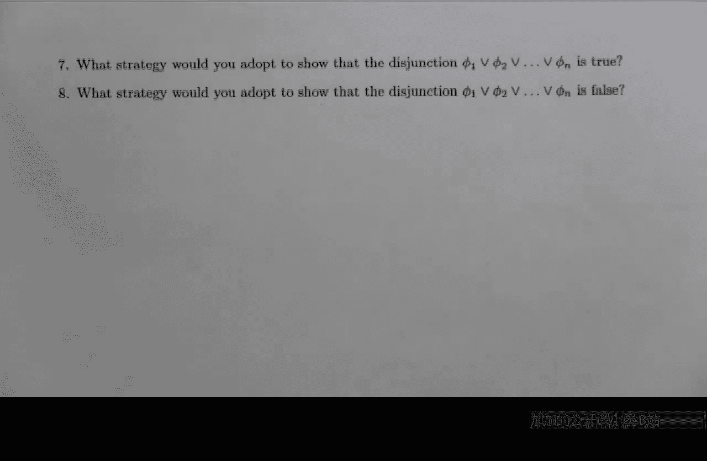

# 数学思维导论：第5章：作业2指导教程

在本节课中，我们将一起完成作业2的指导教程。我们将学习如何简化逻辑表达式、理解合取与析取的真值条件，并将自然语言陈述翻译为形式逻辑。课程内容将涵盖不等式、逻辑连接词（与、或、非）的应用，以及如何分析包含“尽管”、“但是”等词语的复杂语句。

## 简化不等式表达式

上一节我们介绍了作业的基本结构，本节中我们来看看如何简化一系列不等式表达式。以下是题目2的解答思路：

1.  **表达式：** `7 ≤ p < 12`。此表达式已是最简形式。
2.  **表达式：** `5 < x < 7`。此表达式已是最简形式。
3.  **表达式：** `x < 4 且 x < 6`。如果 `x < 4`，则它自动满足 `x < 6`。因此，第二个合取项是多余的。
    *   **简化结果：** `x < 4`
4.  **表达式：** `y < 4 且 y² < 9`。`y² < 9` 意味着 `-3 < y < 3`。任何满足此条件的 `y` 必然满足 `y < 4`。因此，第一个合取项是多余的。
    *   **简化结果：** `y² < 9`
5.  **表达式：** `x ≥ 0 且 x ≤ 0`。同时满足大于等于0和小于等于0的数只有一个。
    *   **简化结果：** `x = 0`

## 合取的真值条件

理解了如何简化表达式后，我们来看看如何判断一个合取命题的真假。以下是其判定规则：

*   **要使合取 `φ₁ ∧ φ₂ ∧ … ∧ φₙ` 为真**，必须证明每一个合取项 `φ₁, φ₂, …, φₙ` 都为真。
*   **要证明合取 `φ₁ ∧ φ₂ ∧ … ∧ φₙ` 为假**，只需证明其中至少一个合取项 `φ₁, φ₂, …, φₙ` 为假。

## 简化析取表达式

上一节我们讨论了合取，本节中我们来看看析取（“或”）表达式的简化。以下是题目6的解答思路：

1.  **表达式：** `x > 10 或 x > 3`。如果 `x > 10`，则它自动满足 `x > 3`。在析取中，只要有一个为真则整体为真。`x > 3` 这个条件覆盖了所有 `x > 10` 的情况，且范围更广。
    *   **简化结果：** `x > 3`
2.  **表达式：** `x < 0 或 x > 0`。这意味着 `x` 不是0。
    *   **简化结果：** `x ≠ 0`
3.  **表达式：** `x = 0 或 x > 0`。这表示 `x` 大于或等于0。
    *   **简化结果：** `x ≥ 0`
4.  **表达式：** `x² > 9 或 x > 3`。`x² > 9` 意味着 `x > 3 或 x < -3`。因此，`x > 3` 这个析取项已包含在 `x² > 9` 的含义中，是多余的。
    *   **简化结果：** `x² > 9`

## 析取的真值条件

与合取类似，判断析取命题的真假也有明确的规则：

*   **要使析取 `φ₁ ∨ φ₂ ∨ … ∨ φₙ` 为真**，只需证明其中至少一个析取项 `φ₁, φ₂, …, φₙ` 为真。
*   **要证明析取 `φ₁ ∨ φ₂ ∨ … ∨ φₙ` 为假**，必须证明每一个析取项 `φ₁, φ₂, …, φₙ` 都为假。

## 否定语句的转换

现在，我们学习如何对简单陈述进行否定。以下是题目10的转换示例：

1.  **否定 `π > 3.2`** 等价于陈述 `π ≤ 3.2`。
2.  **否定 `x 是负数`** 等价于陈述 `x ≥ 0`。
3.  **否定 `x² > 0`**：对于实数，任何实数的平方都大于0，除了0。因此，其否定是 `x = 0`。
4.  **否定 `x = 1`** 的标准缩写是 `x ≠ 1`。
5.  **否定一个否定**（例如，否定 `¬φ`）会回到原命题 `φ`。

## 自然语言的形式化

最后，我们将练习把包含经济术语的自然语言句子翻译成形式逻辑表达式。以下是题目11的答案：

1.  **陈述：** 美元和日元都很坚挺。
    *   **逻辑形式：** 美元坚挺 **∧** 日元坚挺
2.  **陈述：** 尽管日元疲软，但签署了贸易协定，且美元坚挺。
    *   **逻辑形式：** 日元疲软 **∧** 签署贸易协定 **∧** 美元坚挺 （“尽管”和“但是”表达转折，但逻辑核心是合取关系）。
3.  **陈述：** 美元和日元不会同时坚挺。
    *   **逻辑形式：** **¬**(美元坚挺 **∧** 日元坚挺)
4.  **陈述：** 签署贸易协定并不能防止美元和日元贬值。
    *   **逻辑形式：** 签署贸易协定 **∧** 美元贬值 **∧** 日元贬值 （“不能防止A和B发生”意味着A和B确实发生了）。
5.  **陈述：** 美中贸易协定失败，但两种货币仍保持坚挺。
    *   **逻辑形式：** **¬**签署贸易协定 **∧** 美元坚挺 **∧** 日元坚挺

## 总结

本节课中我们一起学习了作业2的核心内容。我们练习了简化不等式和逻辑表达式，掌握了判断合取与析取命题真假的规则，学会了如何对陈述进行否定，并成功将复杂的自然语言句子翻译成了精确的形式逻辑表达式。这些技能是数学思维中进行分析和推理的基础。