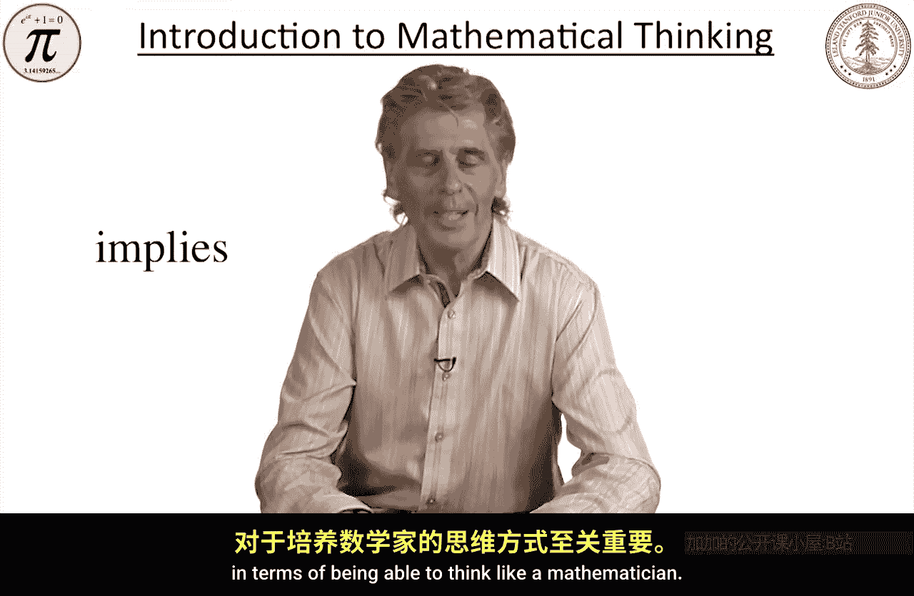
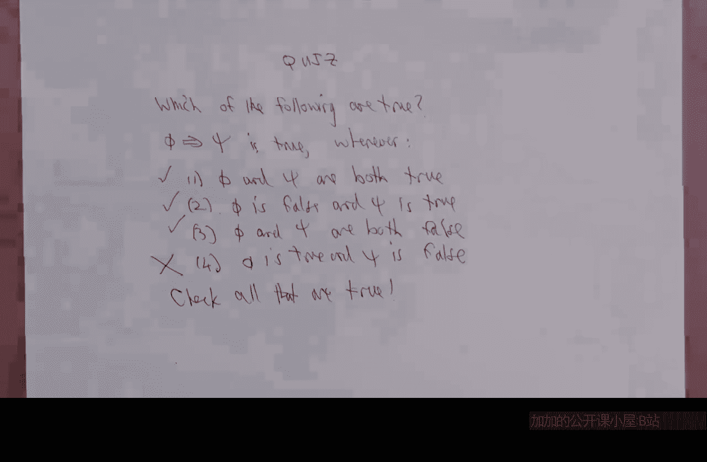
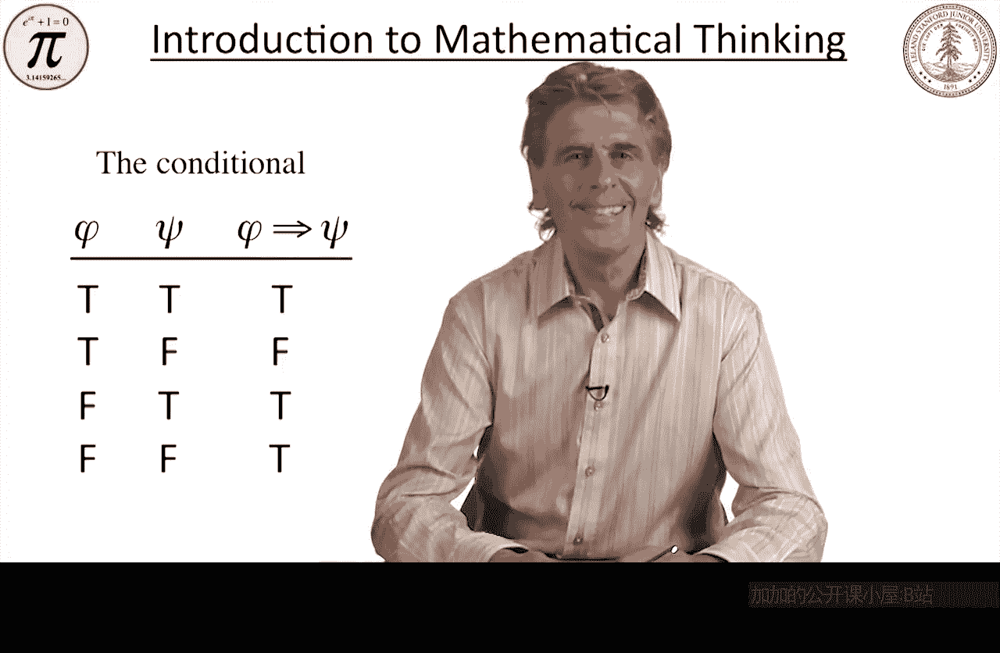

# 斯坦福大学【中英⚡数学思维导论｜Introduction to Mathematical Thinking】 p07 P7 01_讲座3-蕴涵 -BV1D44dzxEa7_p7-

Welcome to the third lecture。😊，I hope you made good progress with the assignment from the last session。

 Our next step in becoming more precise about our use of language for use in mathematics is to take a close look at the meaning of the word implies。

😊，This turns out to be pretty tricky。😊，Brace yourself for several days of confusion。

Until the ideas sort themselves out in your mind。Just like learning to ride a bike。

Where all the actual learning occurs before you finally get the hang of it。So too。

 most of the benefit from understanding the way language is used in mathematics comes from trying to figure it out。

😊，The benefit in this case。Is helping to develop your mathematical thinking ability。

And it's the process of trying to understand the issues that does that for you。Yeah， sure。

 Once you've sorted this language stuff out， you'll be able to use language more accurately。

But by that stage， you're just using it。The part that helps you learn how to think mathematically。😊。

He's largely over。We need other tasks to develop your mathematical thinking ability further。

So as you get into this。Bear in mind that the payoff for struggling with the issues is significant in terms of being able to think like a mathematician。

Here we go。In mathematics， we frequently encounter expressions of the form Phi implies plus psi。

Indeed， implication is the means by which we prove results in mathematics。

 starting with observations or axioms。So we'd better understand how the word implies behaves。

 in particular， how does the truth or falsity of a statement farhi implysi。

Depend upon the truth or falsity of thigh and of sigh。Well。

 the obvious answer is to say that Phi implies Psi。If the truth ofsi follows from the truth of Pi。

But it's that what we want？😮，Well， let me give you an example。That5 with a statement。

 route 2 is irrational。And let's side with the statement，0 is less than one。And let's ask ourselves。

Is the statements phi？Implies sigh。True。Well， P is true。😮，As I've mentioned once already。

We're going to prove that later in the course。And we all know that size true 0 is certainly less than one。

So we have the truth of this。 We have the truth of that。Does that mean that far implies say。

 obviously not。There's no relationship between P and S。 This takes some effort to prove。

 as you'll see。This， we all know this one。So yes， this is true and that's true。

But the truth of this doesn't follow for the truth of that。

And now we realize there's a complexity with implication that we didn't meet before when we were dealing with and with awe and with not。

And the complexity。Is that implication。Involves causality。

And causality is an issue of great complexity that philosophers have been discussing for generations。

Now we're facing a problem。It didn't arise before。Because when we were dealing with conjunctionction and disjunction。

 it didn't matter whether there was any kind of relationship between the two conjuncts or the two disjuncs。

For example， let's look at the sentence， Julius Caesar is dead。

And let's conjoin it with the sentence。1 plus one equals 3， the mathematical of sentence。

And let's do the same thing with this junction。Forming a conjunction and disjunction didn't require any kind of relationship between these two。

 And these were actually clearly they're independent ones a statement about a long dead individual。

 And the other one is a mathematical statement。Incidentally， while， we've got these in front of us。

 let me just give you a quick quiz。Is the first one true。Or is it false。Is the second one true？

Or is it false。What do you think。Well， remember what the definition was a conjunction is true。

 If both conjuncts are true。This one's true。But this one's false， so the conjunction's false。

This one's true。 This one's false。All you need for a disjunction to be true is at least one of the disjunct to be true。

 So that one's true。And the fact that there's no meaningful relationship between the two conjuncts in this case or the two disjuncs in that case。

Played no role in determining what the truth value was。 It was purely in terms of truth and falsity。

But that's not the same with implication， because implication。Involves causality。

So let we just express that explicitly。Implication has a truththpart。An a causation part。

What are we going to do？Is ignore that， Pat。 We're going to leave that to the philosophers。

 if you like。And we're just going to focus。On the truth part。😔，Now。

 that might sound to be a very rash thing to do。Throwing away causation， now。

 we're going to be left with anything useful。 It turns out we are。😊。

It might seem a dangerous thing to do to serve away this important constituents of implication。

But it turns out that when we focus on the truth part。

 we're left with enough to serve our needs in mathematics。

So much so that we're going to give this a name。We're going to call it the conditional。

Or sometimes the material conditional。That's the part we're going to focus on。

So we're going to split implication into two parts， the conditional and causation。The first part。

 the conditional we're going to define entirely in terms of truth values。And the second part。

 we're going to leave to the philosophers。The symbol that we use normally for conditional。

 or least a symbol I'm going to use is a double arrow。Lots of textbooks use a singlearrow。

 but that's got that has many uses in mathematics。 We're certainly going to use that for something else later on in the course。

 So to avoid confusion， I'm going to stick to this notation for the conditional。

So I'm going to write conditional expressions like this。That's the truth part of fi implies say。

When we have a conditional。We call Phi， the antecedent。And we call psi， the consequent。

And we're going to formally define the truth of Phi conditionalsi in terms of the truth of Phi and the truth of Psi。

Now， you might worry that by throwing away causation。

We're going to be left with a notion that's really of no use whatsoever。

 That actually is not the case。Even though we're throwing away something of great significance。

Hanging on to the truth part leaves us something very useful。And the reason is。

Whenever we have a genuine implication， which are actually the only circumstances in which we're ultimately going to be interested。

 whenever we have a genuine implication。The truth behaviour of the conditional。Is the correct one。

 It really does capture what happens with truth and falsity when we have a genuine implication。

That probably seems a bit mysterious at this stage。 But when we start to look at some examples。

 I think it should become clear what I mean。The advantage。Is that a conditional is always defined。

For real implication。You've got that issue of causation， the square root of two and the zero。

 less than one example。TheThe truth of falseity wasn't the issue。

 It was whether there was a relationship between those two statements。 was a complicated issue。

But because we're going to define the conditional。Purely in terms of the truth value。

Of the two constituents， the antecedent and the consequent。

It turns out that the conditional will always be defined。When we do have a genuine implication。

 the definition of the conditional will agree with the way implication behaves。

And when we don't have genuine implication， the conditional will still be defined。And so。

 we can proceed。Again， this probably seems very mysterious when I describe it in this way。

 but as we develop some examples， I hope you'll be able to understand what I'm trying to get at。Okay。

 I think we need to catch our breath。Let me do that by giving you a quiz。

The truth of the conditional from p tos， is defined in terms of。1。😮，The truth of P and sigh， or two。

Whether the p causes sigh。Oh， both。Which is it。It's number one。We define the truth of a conditional。

In terms of the truth and falsity of the antecedent and the consequence。

And because we define the truth of the conditional in terms of truth and falsity in that way。

It has a truth table。So let's see if we can figure out what it is。Well。

 I'm not giving you this is a quiz， by the way。 I'm going to work this， this one through。

 This is tricky。 we we're not out of the woods yet by any means。

 So I'm going to lead you through this one。This part we've already looked at。

We define the conditional as the truth part of implication。And implication has a property。

That a true implication。Leads to a true conclusion for the true assumption。

So because we take the conditional form real implication。

 we have to have truth all the way through the top level。Now， the fun begins。 We have to fill in。

These sea values。And when I say fun。I mean， fun。Let's look at that first row of the truthth table。

Suppose Phi is the statement。N is bigger than7。And suppose，si is a statement。

N squared is bigger than 40。If phi is true， in other words， if n is bigger than7。Then。

 n squared is certainly bigger than 40。In fact， it's bigger than 49。😊，So， certainly， in this case。

 Phi。Does imply sigh。So that thing is true。If n is bigger than 7。

 then n squared is certainly bigger than 40。So， that's true。We have two it everywhere。So。

So this is consistent with the truth table。Now， let's look at a different example。F with a statement。

 our old friend， Julius Caesar is dead。And next side with a statement， pi is bigger than three。

F is true？Srry is true。According to the truth table， it follows that f conditional size true。

In other words。Julius Caesar is dead。Conditional。P is bigger than three。😊，Now。

 if you read this as Julius Caesar is dead implies pi bigger than three。

 then you're in a nons situation， but remember this isn't implication。

This is just the truth part of implication。And in terms of the truth part， there's no problem。

That's true。That's true。The conditional is true。In the first example。

 there is a meaningful relationship between Phi and psi。When we know that Annie' is bigger than7。

Then we can conclude that n squared is certainly bigger than 40。There's a connection between the two。

And in that case。The behaviour of the conditional is certainly consistent with what's really going on。

In the second case， there's no connection between the two。The conditional is true。

 where it's got nothing to do with one thing following from the other。The value of doing this is。

 even though this。Has no meaning in terms of implication。Its truth value is defined。In both cases。

We have a well defined truth value。 In the first case， it's a meaningful truth value。

That does follow from that。In the second case， it's purely a defined truth value。

But that's not going to cause us any problems。Because we're never going to encounter this kind of thing in mathematics。

 We encounter this kind of thing all the time。But we're not going to encounter this kind of thing。

 So all we've done is we've extended a notion。To be defined under all circumstances。

And we've done it in a way that's consistent。With the behaviour we want。

 when something meaningful is going on。This is actually quite common in mathematics to extend the domain of definition of something so that it's always defined。

So long as it has the correct behavior， the correct definition。For the meaningful cases。

And palard we do the definition correctly。 It really doesn't cause any problems。 In fact。

 it solves a lot of problems and eliminates a lot of difficulties。

If we extend the definition so that it it covers all cases。

Is it just something we do in mathematics all the time。Mis seem strange when you first made it。

 but it is a part of modern advanced mathematics。Incidentally。

 if you think this is just playing games。Let me mention that the computer system that controls that aircraft that you'll be flying in next time。

Depends upon the fact that expressions like this are always well defined。

That software control system doesn't depend upon。Knowing whether Julius Caesar is dead or things like that。

 It doesn't depend on those kind of facts of the world。 Computer systems， by and large。

 don't depend upon understanding causation， which is just as well， because they don't。

What computer systems depend upon is that things are always accurately and precisely defined。

And this expression，5 conditionalsi occurs all over the place in software systems。

 So quite literally， your life depends upon the fact that this is always well defined。

 It doesn't depend upon the fact that the computer doesn't know whether Julius Caesar is dead or not。

Okay， time to look at the second row of the truth table。What goes in here？Tea。OF。Well。

We've only got two to choose from。 I guess we could just make a guess。

 but we're not going to do that。 We're going to figure it out and get the right answer。

But what would happen？😮，If we put a tea here， let me put it in very lightly because I'm not sure it's going to be a tea。

If this were true。And we think about it in terms of genuine implication。

 because we are trying to capture the truth behaviour of a genuine implication， remember。

So if it was the case that Phi really did imply Psi。If that statement was true。

 when we interpret it as real implication。Then the truth of Pi would follow from the truth of Phi。

 That's how we began， remember。That's what real implication means。

 Real implication means the truth of this would follow from the truth of that。

 So if that were a T and it was real implication。Then when we have a tea here。

We would have to have a tea there。But we don't。 We've got an F。 So we can't have a tea here。

 because if we put a tea here。The conditional is contrary， it contradicts real implication。

 and we're trying to extend implication to be defined in all cases when there's no causation。

So this has to be an F。😊，If we put a T there， we're in trouble。

 Our notion doesn't agree with real implication。In order that the conditional agrees with real implication。

That。Has to be an enough。If it's a。If it's a true， if it's a truth。

Then we would have two ancecedents。And a false consequence from a true implication。

So we've argued backwards to conclude that this has to be F。

Let me write that down just to make sure everyone's following what I'm trying to say。

If there were a genuine implication， Phi implies say。And if that implication were true。

Thens would have to be true if I were true。So we cannot have p true and s false。

If I impliess is true。That means。That in the case where far is true。And size faults。

We have to have a fault here。Let me write that down。Are you confused？This is tricky。

 There's no getting around the fact that sorting out implication and and extracting the conditional form implication。

Is tricky。You're probably going to have to replay the video several times and look at what's been written and think about it in order to sort this out。

I remember when I first met this， it took me quite a while to get on top of it。

 It really isn't an easy thing to do。So you certainly have my sympathy that you're going to have to struggle with this thing。

 it's probably one of the hardest things in the course to really come to terms with the way we define the meaning of the conditional。

Okay， final straight。 Let's see if we can fill in the last two inches in the truth table for the conditional。

 When we've done that， we'll all go off in search of some aspirin。Now， if you're like me。

 you have no intuitions as to what to put here。And the reason you have no intuition is that even though you are used to dealing with implication。

You've never dealt with an implication。Where the antecedent was false。

You were only ever interested in drawing conclusions。From true assumptions。

So you never dealt with a true one of these guys。When this guy was false。

You don't have any intuitions。You do， however， have intuitions about this guy。

And the reason that's going to help us out。Is that negation。Swas around F and T。

So corresponding to the F's here。When we look at this guy， we'll have truth。We'll have teas for this。

So you are used to having to deal with this。When this is true。

 and that will be equivalent to dealing with this。When that's false。

 because negation swaps too and falsity。Soaw the trick。

Or at least the idea by which we got to figure out what goes here。Is to stop looking at implication。

And look at not implication。A phi does not imply psi if。Even though fire is true。

Sigh is nevertheless false。Just think about that for a minute。Phi does not implysi， if。

Even though fire is true。Sigh is nevertheless false。That's how， you know。That this guy holds。

 You know that Phi doesn't implys， if you can check。That fire is true。But sigh is nevertheless。

 false。That's the only circumstance under which you can conclude this thing is true。

In all other circumstances。This guy will be false。 So let me write that down。Okay， this guy is true。

If you have phi true ands falses。In all other circumstances， this guy。Will be false。

You still with me？Because were only one line away from the conclusion now。Let me just。Rewrite that。

 as follows。Because negation swaps F and T。This guy will be false。When this guy is true。

So if we have T and F。Which we have here。Then， negation is faults。Which means this guy is true。

In all the circumstances。This guy is true。So， theres a truth。And we're done。Few， that was difficult。

 in fact， to my mind。😊，This is the most difficult part of the entire course。 This is not easy stuff。

 It's going to take you some time。Before you've sort it out in your mind。

 you're going to have to keep working at this。 look through the lectures several times and think about it。

 It will take effort， but it's its you'll get there。 We all get there in the end。

 but it's just not easy。In the meantime， you've got this far。

We should start thinking about opening a bottle of champagne。But before you crack open the bottle。

 let me leave you with one more little quiz。Which of the following are true。

Phi conditional psi is true。Whenever。1， fire and sire are both true。2。Fi is false， ands is true。3。

 f and sigh are both false。And4。Fhi is true。And size is false。

And I want you to check all that are true。Well。😮，Which of these for。Of case。

Which of these four conditions tell you when fire size is true。The answer is 1，2， and 3。

Fhy conditional sigh is true。Either when one is true or when2 is true or when3 is true。

The only time when fire conditional size falls。Is when four holdss。So the correct answer is 1。

2 and 3。And fire is not。Okay， now you can open that champagne。

Let me sum up what we've done。We've defined a notion。

 the conditional that captures only part of what implies means。To avoid difficulties。

 we base our definition solely on the notion of truth and falsity。

Our definition agrees with our intuition concerning implication in all meaningful cases。

 The definition for a true antecedent is based on an analysis of the truth values of genuine implication。

The definition for a false antecedent is based on a truth value analysis of the notion does not imply。

In defining the conditional of the way we do。😊，We do not end up with a notion that contradicts the notion of genuine implication。

Rather， we obtain a notion that extends genuine implication to cover those cases where a claim of implication is irrelevant。

Because the antecedent is false。Or meaningless。When there's no real connection between the antecedent and the consequence。

In the meaningful case where there is a relationship between Phi andsi。

 and in addition where Phi is true。Namely， the case is covered by the first two rows of the tooth table。

The truth value of the conditional will be the same as the truth value of the actual implication。

Remember， it's the fact that the conditional always has a well defined truth value that makes this notion important in mathematics。

😊，Since in mathematics， we can't afford to have statements with undefined truth values floating around。

Let's finish this lecture with a short quiz。When you've done that。You should complete assignment 3。

I've kept assignment three fairly short。😊，Since I expect you'll need most of your time。

 simply understanding our analysis of implication and the definition of the conditional。

Remember to discuss these assignments with other students。Don't struggle for too long on your own。

On this kind of material， it's much more effective to work with others。Here's the quiz。

Were the answer to the first one。Is that it's true？😔，The antecedent is true。

And the consequence is true。So the conditional is true。In fact。

 there's a deeper result going on here。Providing you take a positive number。Instead of pie。

 any positive number。Then if the square of that positive number is bigger than 2。That number。

Must be bigger than 1。2。Because the square root of 2 is 1。4， et cetera， et cetera， et cetera。

So for for positive numbers， it doesn't have to be pi。It can be anything。

Any positive number who square is bigger than2。It must be a bigger than 1。2。

And that would be a case of genuine causation， genuine implication。But in terms of the conditional。

 it's enough that the antecedent is true and the consequence is true。For this one。It's also true。Now。

 the consequence is false。P certainly does not equal 3。But the antecedent。Is false。

And if you have a false antecedents。A conditional is always true。

P squared is more certainly not less than 0。So you've got false， false。

That makes the conditional true。Number three。That one's false。The antecedent is true。

And the consequence is false。And you cannot obtain a false conclusion。For a true assumption。

What about the next one？Well I want to true。The antecedent is true。And the consequence is true。

What about this one。Do triangles have four sides， no。The squares have five sides， no。

But anything with a false antecedents。I's true。So， that's true。You've got false， conditional falses。

 and that's always true。What about this one。Well， we don't know when Euclius's birthday there was。

 At least I don't know when Euclius' birthday there was。 I suspect you don't either。

Vectangles certainly have four signs， however。Either this is true。Or its false。Either way。

Since the consequence is true。The thing is true。We've got an unknowndown。Yielding a true consequence。

So either we have true， true， in which case it's true。Oh， we have false truth。

 in which guess it's true。Okay， how did you get on with that？

