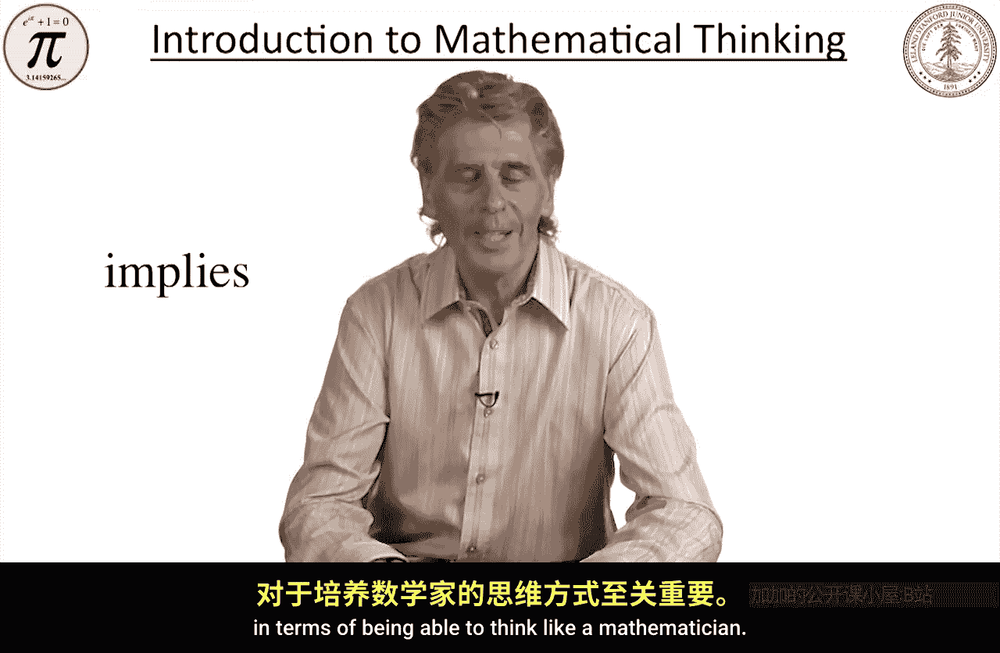
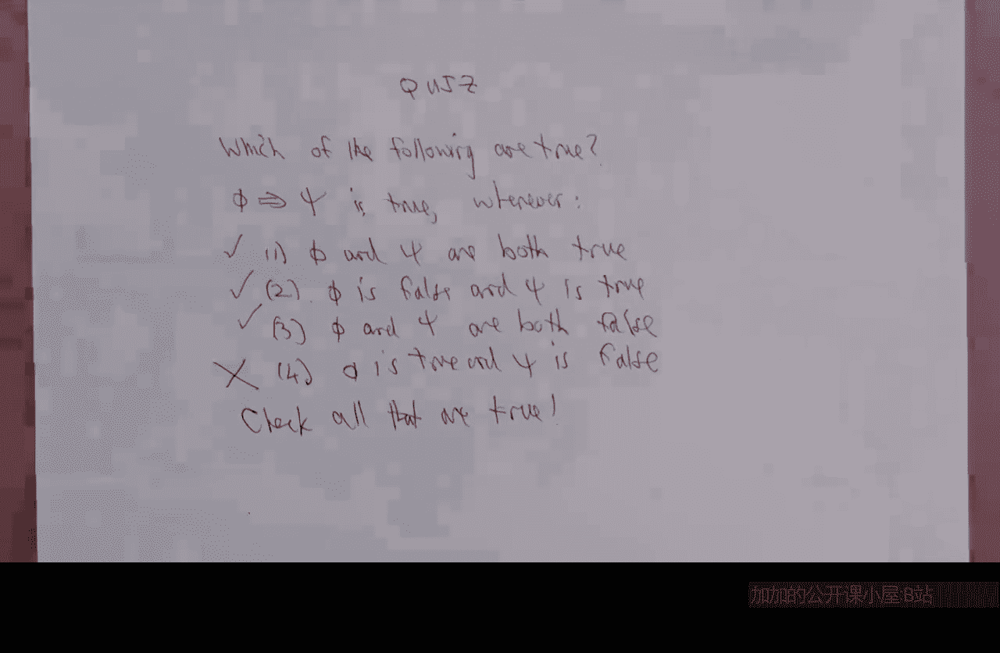
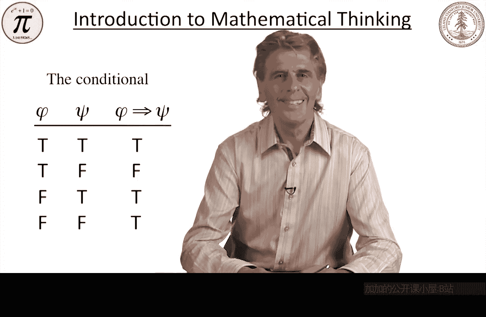

# 数学思维导论：3：蕴涵

在本节课中，我们将要学习数学语言中一个核心且微妙的概念——“蕴涵”。我们将剥离其复杂的因果部分，专注于其真值行为，从而定义出“条件句”这一在数学中至关重要的工具。

---

## 蕴涵的复杂性

上一节我们讨论了“与”、“或”、“非”等逻辑连接词，它们仅依赖于命题本身的真值。然而，“蕴涵”则更为复杂。

蕴涵涉及**因果关系**。例如，考虑命题 **P**：“√2 是无理数”和命题 **Q**：“0 < 1”。两者都为真，但 **P** 的真并不导致 **Q** 的真，它们之间没有因果关系。这表明，蕴涵不能像“与”或“或”那样，仅通过两个命题的真值来简单定义。

---

## 分离条件句

为了解决这个难题，我们将“蕴涵”拆分为两部分：
1.  **条件句**：仅关注真值关系的部分。
2.  **因果关系**：我们暂时搁置，留给哲学家讨论的部分。

在数学中，我们使用符号 **⇒** 来表示条件句。对于表达式 **Φ ⇒ Ψ**，我们称 **Φ** 为**前件**，**Ψ** 为**后件**。

通过专注于真值部分，我们得到了一个始终有明确定义的概念。虽然这看似丢弃了重要的“因果”内涵，但在所有具有真实蕴涵关系的情况下，条件句的真值行为与真实的蕴涵完全一致。而对于没有因果关系的情况，条件句依然有定义，这保证了数学陈述的严谨性。

> **核心概念**：条件句 **Φ ⇒ Ψ** 是一个仅由其前件 **Φ** 和后件 **Ψ** 的真值所定义的逻辑陈述。

---

## 条件句的真值表

现在，让我们来确定条件句 **Φ ⇒ Ψ** 的真值表。我们需要考虑 **Φ** 和 **Ψ** 所有可能的真值组合。

以下是推导过程：
*   **第一行（Φ 真，Ψ 真）**：如果存在真实的蕴涵关系，真前提必然导致真结论。因此，在此情况下，条件句应为 **真**。
*   **第二行（Φ 真，Ψ 假）**：一个真实的蕴涵绝不可能从真前提得出假结论。因此，在此情况下，条件句必须为 **假**。
*   **第三、四行（Φ 假）**：当前提为假时，我们日常的直觉很少涉及。我们可以通过分析“**Φ 不蕴涵 Ψ**”这一陈述来推导。**Φ 不蕴涵 Ψ** 仅在“Φ 真而 Ψ 假”这一种情况下成立（为真），在其他所有情况下都为假。因此，其否定“**Φ ⇒ Ψ**”就在其他所有情况下为真。这意味着当 Φ 为假时（无论 Ψ 为真或假），条件句 **Φ ⇒ Ψ** 都为 **真**。

综合以上分析，我们得到条件句的真值表：

| **Φ** | **Ψ** | **Φ ⇒ Ψ** |
| :--- | :--- | :--- |
| T | T | T |
| T | F | F |
| F | T | T |
| F | F | T |

> **核心公式**：条件句 **Φ ⇒ Ψ** 为假的唯一情况是 **Φ 为真且 Ψ 为假**。

---

## 理解与示例

这个定义可能起初显得反直觉，尤其是当前提为假时，条件句自动为真。关键在于区分“条件句”和日常语言中的“蕴涵”。在数学中，我们需要一个**普遍有定义**的工具。

考虑以下示例，判断条件句 **Φ ⇒ Ψ** 的真值：
1.  **Φ**: π² > 2， **Ψ**: π > 1.2
    *   **分析**：Φ 为真，Ψ 为真。根据真值表，**Φ ⇒ Ψ** 为 **真**。事实上，这里存在真实的数学蕴涵关系。
2.  **Φ**: π² < 0， **Ψ**: π = 3
    *   **分析**：Φ 为假，Ψ 为假。根据真值表（假，假 → 真），**Φ ⇒ Ψ** 为 **真**。
3.  **Φ**: 1 + 1 = 2， **Ψ**: 1 + 1 = 3
    *   **分析**：Φ 为真，Ψ 为假。根据真值表（真，假 → 假），**Φ ⇒ Ψ** 为 **假**。
4.  **Φ**: 三角形有四条边， **Ψ**: 正方形有五条边
    *   **分析**：Φ 为假，Ψ 为假。根据真值表（假，假 → 真），**Φ ⇒ Ψ** 为 **真**。
5.  **Φ**: 欧几里得生日是1月1日， **Ψ**: 矩形有四条边
    *   **分析**：Ψ 为真。无论 Φ 的真值如何（我们可能不知道），因为后件为真，根据真值表（？， 真 → 真），**Φ ⇒ Ψ** 恒为 **真**。

这些例子展示了条件句如何工作。在数学证明中，我们主要运用那些前件为真且存在真实蕴涵关系的条件句。而普遍的定义确保了逻辑系统的完备与一致。

---

## 总结

本节课中我们一起学习了：
1.  **蕴涵**与**条件句**的区别：我们将日常中带有因果关系的“蕴涵”，剥离出其真值核心，定义为普遍适用的“条件句”（**⇒**）。
2.  **条件句的真值表**：我们推导并理解了条件句 **Φ ⇒ Ψ** 的真值规则，其**仅在“Φ 真且 Ψ 假”时为假**，其余情况均为真。
3.  **定义的价值**：通过这种方式定义条件句，我们得到了一个在数学中始终有明确定义的逻辑工具。这不仅是理论需要，也是现代计算机科学和数学论证得以严密进行的基石。

理解条件句是数学思维的关键一步。它起初可能颇具挑战性，但通过反复思考和练习，你终将掌握这一强大工具的精髓。