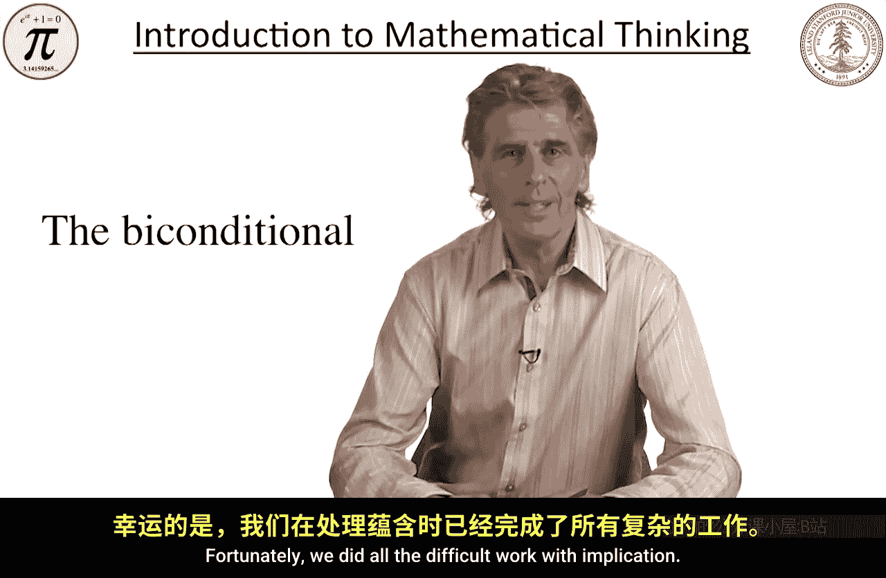
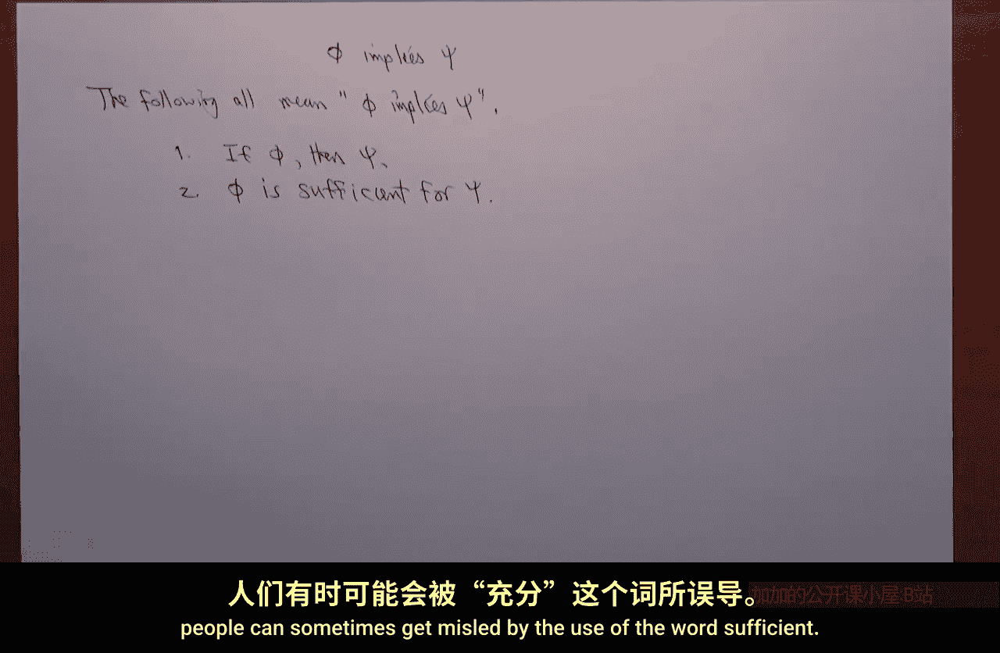
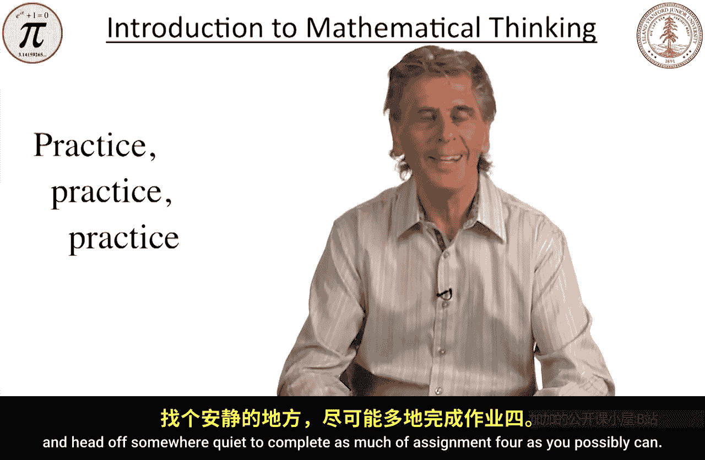

# 斯坦福大学【中英⚡数学思维导论｜Introduction to Mathematical Thinking】 p08 P8 02_讲座4-等价关系 -BV1D44dzxEa7_p8-

How did you get on with assignment 3。I kept it short since I wanted to give you a lot of time to come to terms with the tricky notion of implication。

This lecture is going to be fairly short as well。Though the assignment that goes with it will be the longest of the entire course。

I'm not expecting you to complete it all by the next lecture though。😡。

The next topic I want to look at is logical equivalence。😊。

Equivalence is closely related to implication。Two statements are said to be equivalent。

Or more fully logically equivalent， if each implies the other。

Equivalence is a central notion in mathematics。Many mathematical results are proofs that two statements are equivalent。

In fact， equivalence is to logic as equations are to arithmetic and algebra。😡。

And you already know that equations play a central role in mathematics。

Just as we had to introduce a formal version of implication that avoids the complex issue of causation。

Namly the conditional。We have to introduce an analogous version of equivalence。

It's called a bicondal。Fortunately， we did all the difficult work with implication。

Now we can reap the benefits of those efforts。2 statements。

 far and sigh are said to be logically equivalent or just equivalent， if each implies the other。

Since we have a formal version of implication， namely the conditional。

It follows that there's a formal version of equience。We call it the bicondal。

The bi conditiondal of fire and sigh is denotted by means of a double headed  hour like this。

And formally， the bi conditional is an abbreviation of Phi conditional psi and psi conditional phi。

Since the conditional is defined in terms of truth values。

It follows that the bi conditional is defined in terms of truth values。

If you work out the truth table for5 conditional sigh。And for side conditional Phi。

 And then you work out the conjunction， you'll get the truth table。For5hi by conditional sigh。

And if you do that， what you will find is that phi by conditional size is true。

If fire and I are both true or if they're both false。

One way to assure that two statements findci equivalent。Is to show they have the same truth tus。

Actually， to avoid confusion， let me change those to capital Phi and capital Psi。

Because I want to use the lowercase fineci for something else。

Because here's the example I'm going to look at。I want to show that Phi con joinedined withsi。Or。

 not p。Is equivalent。Tofi conditional sigh。So this is actually going to be。My capital Phi。

And this is going to be my capital say。If I was teaching this material at a high school level。

 I'd be very careful to choose different letters to denote everything。

 but we're looking at college university level mathematics now and university mathematicians。

 professional mathematicians frequently use open and lower case symbols in the same context and part of been able to master university level mathematics is actually getting used to disambiguate the notations。

😊，Okay， what we have to do is work out the truth table for this， the truth table for that。

 and show that they're the same。So we're going to have to start with Phi withsi。

 I'm going to need to work out Phi and psi。Would I need to work out not F。

Then I'm going to need to work out Phi and sigh， disjoined with not thighhi。

And then I'm going to have to compare that。With foul， conditional sigh。Okay， as usual。

 we start with the four combinations， T T。Tf。😔，FT。F， F。By the way。

 it doesn't matter which order you write these in as long as you get all four possible combinations。

 the way I've written it is the way that most mathematicians write it。Conjunction。

 conjunction is true。 If the two conjuncts are true。 T T gives T。Here there's an F。

 so you're going to get an F。Here there's an F。 So you're going to get an F。We have two F。

 so you're going to get an F。Nigation simply flips T and F。 So we have T， T， F， F becomes F， F， T， T。

Now， I'm going to disjoin this with that。And this junction picks out at least one tea。

Whether there's a T there， so I'm going to get a T here， there's no T， so I'm going to get an F。

There's a T there which gives me a T。And there's a T there， which gives me a T。I know。

The truth values for five conditional psi。There were T， F T， T。 If you look back at the earlier work。

 you'll see that that's what we worked at before。And now I just compare that column with that column。

TFTT is the same。 TFTT。Because these two columns are the same。I can conclude。

That that is equivalent to that。I should mention that proving equivalentence by means of truth tables is very unusual。

 It's only a very special case of equivalence。In general， proving equivalence is really quite hard。

 You have to look at what the two statements mean and develop a proof based on their meaning。

Equivalence itself is not too difficult an notion to deal with。

What is problematic is mastering the various nomenclatures that are associated with implication。

We start out with the notion。Fi。😔，Imply sigh。And I'm really going to be thinking of genuine implication here。

 but you can interpret everything I say in terms of the conditional。 And I we'll look at that。

 I'll talk about that a little bit later。If mathematicians always describe this situation in this way。

 then life would be very simple。But we don't。There were many different expressions we use to describe Phi implies psi。

Some of them are intuitively obvious and some of them are actually counterintuitive when you first meet them。

The following all mean， Phi impliess。1。If I， then sigh。Okay， that's very obvious。2。😔。

Phi is sufficient Versailles。In order to conclude that sigh。It suffices to no thigh。

WellOn the face of it， that's fairly straightforward。 but in complicated situations。

 people can sometimes get misled by the use of the word sufficient。

The use of the word sufficient。Is by no means the most problematic。

In the in the context of implication。This one causes people a lot of problems， at first。Fi。😔。

Only if sigh。😔，That's not the same。2是。If sigh， then p。The reason I'm emphasizing that is that the if。

Here。😔，Goes with the sigh。Just as it does here。Let's put quotes on that one。The if goes with thes。

 the if goes with the sigh。 But when it is expressed this way with an only if。

It flips round the order of the implication。For example。

 some of you may know that I'm a very keen cyclist。 On the other hand， Ive never qualified。

 nor have I ever ridden in the Tour of France。 However， I could， I could honestly say。

A person can ride in this a person con ride in the tour de France。Only if they have a bicycle。Well。

 that's true， because if you don't have a bicycle， you can't ride in the tour of France。

 So a person can ride in the tour of France。Only if they have a bicycle。Now， that's true for me。😮。

But it doesn't mean the same as。If you have a bicycle。Then you can ride in the tour de France。

I actually do have a bicycle。 I have several， but I can't ride in the Tour de France。

 So it's true to say Keith could ride in the tour de France only if you had a bicycle because that's true for everybody。

 You can only ride in the Tour of France if you have a bicycle。 otherwise， you can't ride in this。

But it's not the same。As saying it this way round that if you have a bicycle。

 then you can ride in the tour of France。So I've got to be a little bit careful。😊。

these are often confused， which is why I'm stressing the distinction。Okay。

Let's look at this one because this one that I'm going to write next is one that I've already really encountered in my discussions about the Tour of France。

Si ifphi。Notice that we've flipped the order now。Phi is the antecedent。Si is a consequence。

 Let me write those down， just to remind us， Pi。Is the antecedent。Andsi is a consequencesequent。

And those are the roles going to be played by fire and sigh in all of these。So phi is the antecedent。

 size a consequence。Ps the antecedent， size a consequence。Phi is the antecedent， P is a consequence。

They flipped。Far still untecedent。Si is still the consequence。 This still means that Phi implieslysi。

But， now。The consequ comes first。 The antecedent comes second。Si ifphi。If like me， you're a cyclist。

 you can think about that in terms of earning a bike and riding in the tour de France。

Or use your own favorite example。 Think of something that you do that requires something。

 that requires some equipment or some preparation or something。

And just interpret these things in terms of something that's meaningful in your life。

 and that should help you to sort these out。Okay， there's a couple more I want to talk about。Si。

Whenever P。Again， the order。Is flipped from the order in implication。That's still the consequence。

 That's the antecedents， but they've been written the opposite way around。 sigh whenever I。And。

 finally。Sai。😔，Is necessary for P。Again， the order is flipped round。 That's still the constient。

 that's still the antecedent size is necessary for P。In order to ride in the tour de France。

 it's necessary that you have a bicycle。It's not sufficient that you have a bicycle。😊。

To provide in the tour of France， it's necessary that you have a bicycle。

 but it's not sufficient that you have a bicycle。That's the example that I would use。

For all of these， but you can pick your own favourite example， too， to understand these things。

It's important to really master this terminology because it's used all the time。

 not just in mathematics， but in science and in analytic reasoning and thoughts in general。

 This is not just mathematical language， this is the language that people use in legal documents。

 in logical arguments， in analytic arguments and in discussions and so forth。

 So understanding language。As its used is is very important in many walks of life。

And having introduced terminology commonly associated with implication。

We have an associated terminology for equivalence。Fhi is equivalent to say。Is itself equivalent， to。

 by the way， this already shows how ubiquitous equience is。Because the obvious word to describe。This。

Let me put quotes around not just a disambiguate。The obvious way to describe that this is equivalent to something。

Is to use the word equivalentence as well。 I mean， equivalence is just a very basic concept in mathematics。

 So this。Sentence or this statement， this claim is itself equivalent， too。Well。😔。

Phi is necessary and sufficient for Psi。This combination necessary and sufficient。

 is very common in mathematics。And B。Fi。😔，If an only if sigh。That's also very common in mathematics。

 if we only。Notice that we're combining necessary and sufficient。With necessary。

 we have psi before Phi。With sufficientence， we have five beforesi。

And that gets as the implication in both directions。😊。

And equience means implication in both directions。 So the fact that it's in both directions is captured by the fact that here we have the psi before the phi and here we have the phi before the ps。

Similarly， with B， if and only if。Combines only if where phi comes before psi with if where psi comes before phi。

 So in both of these cases， we have an implication from phi tosi， from psi to phi。Final remark。

This expression。Is often abbreviated。IFF。I FF is a standard mathematician's abbreviation for if and only if。

So if and only if or if if。Means the two things are equivalent。Okay。

 once you've mastered this terminology， you should be able to read and make sense of pretty well any mathematics that you come across。

 That doesn't mean to say you understand the mathematics itself。

But at least you should be able to understand what it's talking about。

And that's the first step towards understanding the mathematics itself。

And that's all of is to say about this。 The rest is really up to you to spend some time mastering the concepts and the associated terminology。

Time for a quiz。This qui comes in four parts。So how did you do？Well。Let's see what's going on here。😰。

Which of the following conditions is necessary for the natural number N。To be a multiple of 10。

So the question we have to ask ourselves is。Does N。Being a multiple of 10。Imply。The statement。

To be necessary， N being a multiple of 10 has to imply the statement。Well， let's see。

Does N being a multiple of 10。Imply that it's a multiple of five。Yes， it does。

 so that one's necessary。Does N being a multiple of 10 imply that it's a multiple of 20， no。I mean。

10 is itself a multiple of 10。But 10 is certainly not a multiple of 20。Does N being a multiple of 10？

Imply that n is even。 and that it's a multiple of five， yes。

Does N being a multiple of 10 imply that it's a multiple of 100？No。

Those n being a multiple of 10 implied that n squared is a multiple of 100， yes。So。

 the three conditions。That are necessary for the number N to be a multiple of 10。Condition1。

Codition 3。Condition 5。Okay， let's move on to part two。Well， this time， we have to ask the question。

Does the statement imply N is a multiple of 10。Okay， well。

 does this statement imply that n is a multiple of 10？No， it doesn't。5 is itself a multiple of five。

But 5 is not a multiple of 10。Look at number two。Is it the case that if n is a multiple of 20。

Then it has to be a multiple of 10。 Does this imply that？ The answer is yes。

Does N being even and a multiple of  five imply that it's a multiple of 10。Yes。If any's 100。

Does that imply that it is a multiple of 10， yes。If n squared is a multiple of 100。

 does that imply it's a multiple of 10。Yes。So in this case，2，3，4， and 5。The the correct answers。

 they're all sufficient for N being a multiple of 10。Okay， let's move on to part 3。😊，For this one。

 we have to compare our answers for the two previous questions。The first question was necessity。

 and the second question was sufficiency。For necessity。We had one， we had three。😔，And we had five。

For sufficiency。We had 2，3，4， and 5。This asks for necessity and sufficiency。

There we've just got necessity， there we've just got sufficiency。There we have both of them。

There we just have sufficiency。There we have both of them。So the ones that are necessary and。

This one。And that one。Okay， let's move on to part 4。For this one。

 the question we have to ask ourselves is， what does the implying。 number one。This does he implying。

So， that's the antecedent。In question2。Of statement 2。Well。

 even though it's written the opposite way round， it's essentially the same statement。

It's the alarm ringing that does he implying。What about number 3。Keith cycles only if the sun shines。

What's doing the implying。Keepith cycling。 If youve see me cycling。

You can conclude that the sun's shining。Because I cycle only of the sunshs。Incidentally。

 I was brought up in England。 So that's not the case。 I'm quite happy to。

 and I'm not happy to ride to ride in the rain， but I do ride in the rain， but it's a good example。😊。

Number 4， what does he implying？ Well， Amy arrives does the implying。So far。

 I have distinguished between genuine implication and equivalence and their formal counterparts。

 the conditional and the bi conditional。In their daily work， however。

 mathematicians are really that particular。😊，For instance。

We often use the arrow symbol as an abbreviation for implies。And the double headed animalmo。

 as an abbreviation for， is equivalent to。although this is invariably confusing to beginners。

 it's simply the way mathematical practice has evolved and there's no getting around it。In fact。

 once you get used to the notions， it's not at all as confusing as it might seem at first。

And here's why。The conditional and bicondal only differ from implication and equivalence。

In situations that do not arise in the course of normal mathematical practice。

In any real mathematical context， the conditional effectively is implication。And the biconal。

 effectively， is equivalence。So having made note of where the formal notions differ from the everyday ones。

Mathematicians simply move on and turn their attention to other things。

The very act of formulating formal definitions creates an understanding of implication and equivalence。

That allows us to use the everyday notion safely。Of course。

 computer programmers and people who develop aircraft control systems don't have such freedom。

They have to make sure all the notions in their programs are defined and give answers in all circumstances。

Okay， that's the end of lecture4。😊，As I said at the start， it's been a fairly short lecture。

My reason for keeping the lecture short。😮，Is that the upcoming assignment is much longer than the others。

 It has to be。Implication and equivalence are at the heart of mathematics。

Mastery of those concepts and of the terminology associated with them。

Is fundamental to mathematical thinking。You simply have to master implication and equivalence before you can go much further。

And there's only one way to achieve mastery， right？😊。

Remember the story of the elderly lady who approached a New York City policeman and asked， officer。

 how do I get to Carnegie Hall。The officer smiled and said，La， there's only one way， practice。

 practice， practice。So。I suggest you carve out some time。

 grab some food and drink and head off somewhere quiet to complete as much of assignment for as you possibly can。

