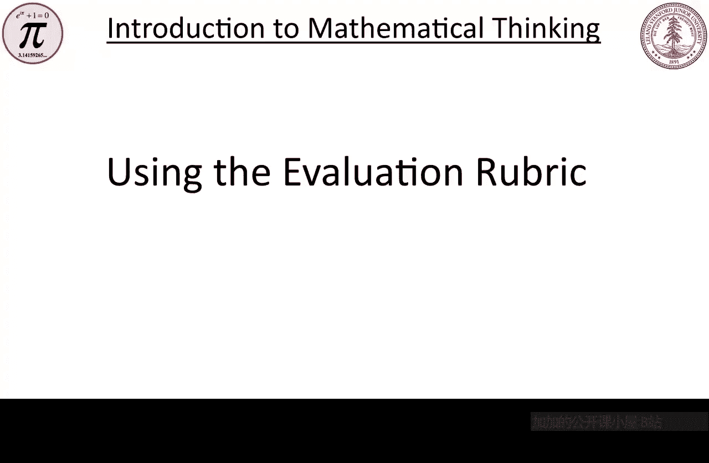
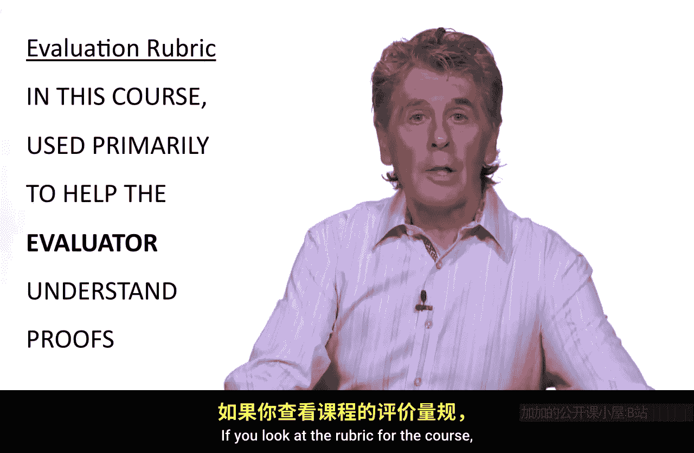
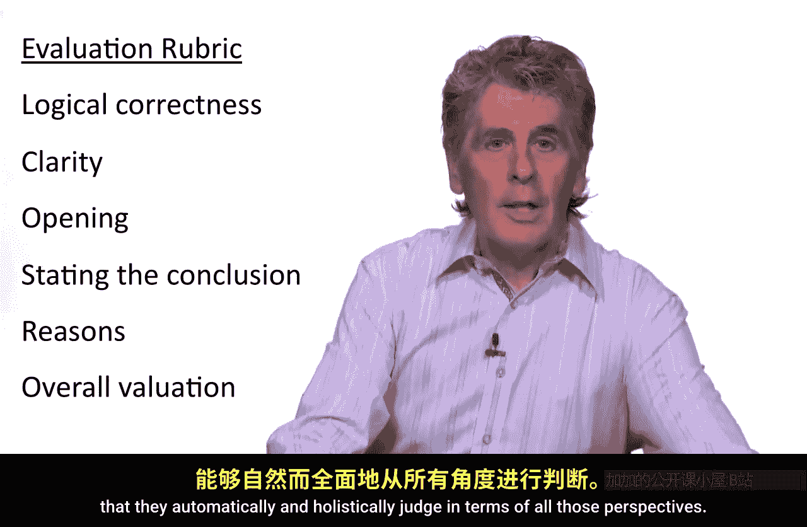
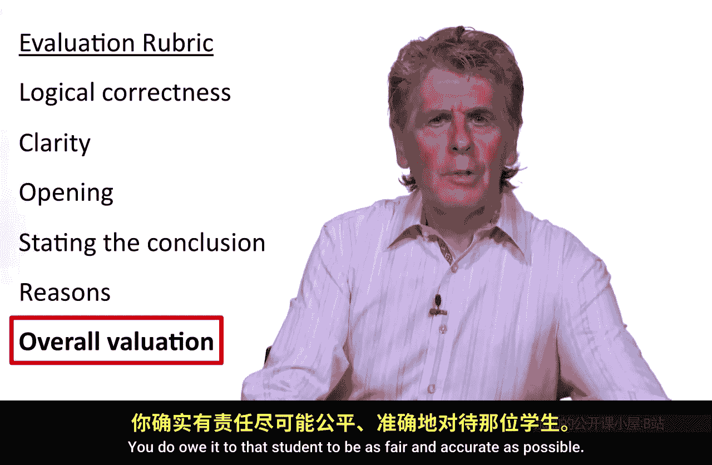
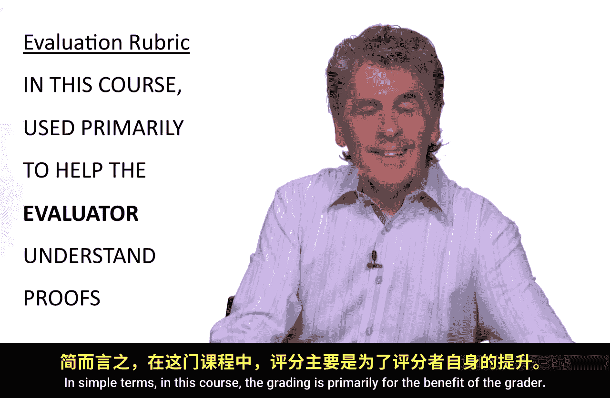

# 斯坦福大学【中英⚡数学思维导论｜Introduction to Mathematical Thinking】 p09 P9 03_补充材料-课程评估量规使用指南 -BV1D44dzxEa7_p9-

In this video， I'll say a little about using the course evaluation rubric。

The most common use of an evaluation rubric is to achieve uniformity in grades。

When a team of experts is creating a large collection of examinations。

The goal is to assign a reliable grid to each candidate's work。😊，In particular。

 it's assumed that the people doing the evaluation are experienced graders。😊，In this course。

 we're using a rubric in a very different way。Not to help experts produce a reliable grade of a piece of work。

But as a mechanism to help beginners learn about proofs。If you look at the rubric for the course。

You'll see that it asks you to consider five different features of proofs。Logical correctness。

Clarity。Opening， stating the conclusion。And reasons。I'll come to the sixth category later。

 by the way。These are all important features of proofs， and for pedagogic reasons。

 are given equal weight。Here's why。As I state repeatedly throughout the course。

 proofs do much more than simply establish that some statement is true。Actually， in practice。

 they don't really do that。 They simply provide evidence that convinces a reasonable person with sufficient background knowledge。

But let's leave that issue for now。If you look at the role played about Proofus in mathematics。

You discover that just as important as logical correctness。

Is the understandability of the proof by an intended reader。In fact， in practical terms。

 understandability is more important than logical correctness。😊。

There's probably no modern proof of more than a few pages that does not initially have a logical floor buried somewhere。

What makes proof useful is that others can not only detect errors。

 but also have enough information to try to correct them。

Proofs are as much about communication as establishing truth。

Because we have to use simple examples to develop proof evaluation skills。

In most of the examples you see， one or more of the rubric criteria will apply only in a simplistic way。

 if at all。😡，But in more complicated examples。There will all be important。

That's why the five criteria carry equal weight。When you evaluate arguments。

 you should view them in terms of each of the five rubric criteria in turn on an equal footing。True。

 experts rarely use rubrics。They' are so familiar with the proof concept that they automatically and holistically judge in terms of all those perspectives。

From a beginner， the rubric breaks up the task of juging the overall quality of a proof。

To judging those five aspects， in turn。这个。Each of those five is considerably simpler to do than the entire task。

😡，But you still find it difficult。After you have judged a proof in terms of the five proof characteristics。

 the rubric asks you to bring them all together to produce a single grade for the proof。

This is the number you would enter if your task were to assign a single numerical grid to someone's proof。

It corresponds to the number an expert working without a rubric would assign。

The rubric is designed to assist you as a beginner to arrive at that final grade。Incidentally。

 when you are evaluating the work of another student， as you will in test flight if you do it。

You do owe it to that student to be as fair and accurate as possible。

But no one expects accuracy from'm someone who's just beginning to learn about proofs。😡。

Because everyone's work is evaluated by three fellow students， all anonymously， by the way。😡。

With a reported grade computed from those three grades， plus the individual's own self grade。

It turns out that most of the time the final grids pretty good。Nevertheless。

 the real purpose of the test flight evaluation process。😊。

Is that it offers tremendous benefits to the evaluator in coming to a better appreciation of what makes a good proof。

In simple terms， in this course， the grading is primarily for the benefit of the grader。

