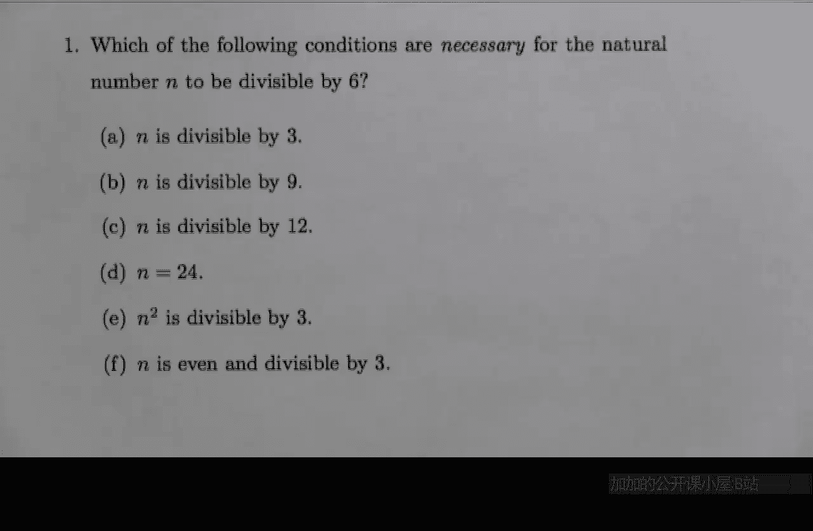
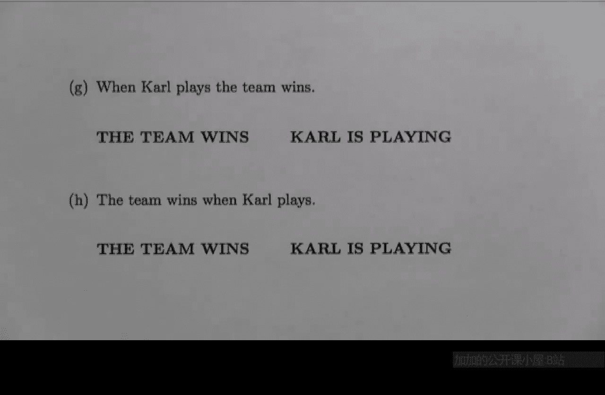
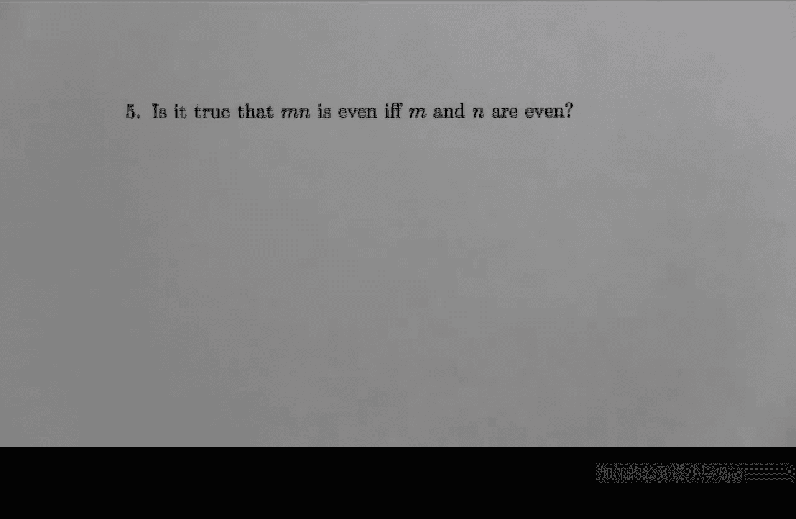

# 斯坦福大学【中英⚡数学思维导论｜Introduction to Mathematical Thinking】 p12 P12 03_习题集2指导教程 -BV1D44dzxEa7_p12-

Okay， let's see what we've got with the problem set2。By the way， this part of the course。

 we've been looking at ticking expressions in everyday language or problems that might arise on the real world in a certain sense and try to make them precise。

 and that of course means that for people whose language whose native language is not English。

 this is even more complicated because we have to deal with the complexities of the English language and try to eliminate the ambiguity from out and make things precise。

When it comes to these issues about necessary insufficiency。

 I actually don't think it makes a lot of difference if you if you're a native speaker in English。

 this is tricky when you first meet it。 and it it's easy to make a slip。

 So this is one of those occasions where I don't think there's an advantage to been a native English speaker we native English speakers found it difficult to。

Okay， in the case of necessity。😊，A condition is is necessary if it follows from from this。

 So what we're asking for is， is it the case。That if 6 divides n， then the condition X holds。

 That's what we're asking。 Does the condition X。Follow。From Hen been divisible by 6。Well， let's see。

 Is it the case， for example。That if6 divides in。Does it follow？3Drg。Well， the answer is yes。

 If 6 devs it， then three divs it， okay。So that one's necessary。What about this one。 Well。

 notice that。N equals 6 itself， satisfies this condition。Okay， if n equals 6。Then， then 65 end。

But is 60 visible by 9， Ns are no。Again， n equals 6 satisfies the condition of been divisible by 6。

But does it then follow that ends divisible by 12。 In other way， just 6 ifisible by 12。 No， it's not。

What about n equals 24。 Again， n equals 6。Gives us an example of a number that's divisible by 6。

But that number is not necessarily 24。Right。Because it's six。😊，So it's not that one。Okay。

N squared divisible by 6。N squared divisible by 3。 Well， let's just see，605 end， certainly。Imps 3 Di。

If 6 divs it， then3 diverges it。 and if 3 divs in。Then，3 degrees n squared。So that one's okay。Again。

 if 65 in。Then， of course， two sanards n because6 does。 and if 60ards n。Then，3 divrg in。

So two divides n and three divides n。 In other words， n is even and divisible by 3。 So it's that one。

 So we've got parts a。E and F。And this。Is the condition This is。

 this is the way it cashes out in terms of implication。

And in the case of the counter examples that we use to to prove some of these falses。

 the simplest counter example was n equals 6 itself。Okay， well， that takes care of number one。

 Let's move on to number 2。Well， in the case of sufficiency。

We have to look to see if the condition implies。That n is divisible by 6。Okay。

 sufficiency means implies n is divisible by 6。 So for each of these statements。

 we have to ask ourselves， does it imply。That n is divisible by 6。Well。If n is divisible by three。

In order to， if we， if we， if we think the answer is， it's not sufficient。

Then we have to find an example。 We have to find a counter example。Of a number that's divisible by 3。

 that's not divisible by 6。Well， while it would check n equals 3。3 is divisible by three。

But3 is not divisible by 6。 So that's a counter example。

So that one's not sufficient for beingdiisible by6。 that doesn't imply x is divisible by 6。

Because in particular， three is divisible by3， but not divisible by6。What about part B？

Let's take n equals 9。 That's a counter example。 n is divisible by 9， but n is not。

 but if we take n equals 9， then the n is divisible by 9。But9 is not divisible by 6。

 So that's a counter example。And is divisible by 12。 Is it the case。That if 12 divides into when。

Does it follow。That6 voting to win。But the answer is yes。So that one's okay。What about n equals 24。

Is it the case？That if n equals 24。Does it follow。That6， imagine。In other words， does six。They I 24。

Again， the answer is yes。So that one's true。N squared is defisible by 3。Does it automatically follow？

The don is differable by 6。 Well， while we take the same counter example we did in part A。

 let's take n equals 3。Then， certainly。Shui。😔，Divoutge n squared。Okay。But the 6ified and the 6ified3。

The answer is no，6。um。Does not divide in。So 3 divides n squared，6 does not divide n。

So it kept with that one。Finally， N is even indivisible by three。 I could write that。I saying。

 Annienie's even。Is to say that two divides in。And it's divisible by three。

 so I can just rewrite this statement to say that two divides n and3 divides n。

 but if two divides n and 3 divides n， then it's the case that6 divides n。Okay。So that one's true。

And when we come to question 3 in a minute， it's really going to be a matter of combining questions 1 on 2。

 So we've now got all the information we need to， to answer the next one。Well。

 question 3 ask us for necessary and sufficient。So let's just see what we did in in question  one。

 we dealt with necessity。 in in question2， we dealt with sufficiency。

 Let's remind ourselves what we had。 Let me see now。 we got necessity。 That was true in A wasn't it。

 It was true in。E， it was true in。F。I remember correctly。 Yeah， okay， actually， I'm not remembering。

 I'm working these out as I go through because I don't have do the one in front of me anymore。

 sufficiency。 Let's see that was C。It was D。And it was eh。😔，Okay， by the way。

 if I'm making this look fluent， it's because I've been doing this for many years。

 although you can still catch me out with a well with with a puzzling with a question it's described in a puzzling way。

 even the experts can be called out with this kind of thing。 Okay。

 so we just have to look for the ones which have an X in both rows in both columns And the only one that does is this one。

In all of the other ones， you've either got necessity or sufficiency or neither in the case of with part B。

 Okay， so you've got a one necessity。 you've got a neither。 you've got a sufficiency。

 you've got a sufficiency。 You've got a necessity。 The only one that's both is part F。

Thatt takes curve number 3。 Well， we're moving along rapidly。 now， let's go ahead。Well。

Qu 4 starts out simply enough because it's a very straightforward if then statement。

 And when you got an if then statement， identifying the antecedent。Is。

 he's pretty straightforward because it's the power that goes with the if， okay， so。It's this one。

If the apples are red， then they're ready to eat。Okay， so this was an easy start。

 But these things are going get a little bit more tricky as we move forward。

 Let's have a look at the part B。Okay， well， we're talking about sufficiency。And sufficiency。

Is the thing that does he imply。Okay。So what does he implying here？Well， they've been differentiable。

That's the one that does he implying。Because the differentiali ability of a function。Implies that。

 It's continuous。Okay。Sufficiency， does he imp。So sufficiency is the thing we're looking for。

So the antecedents is a sufficiency。Which is different duability。Well。

 I said these become a little bit tricky as soon as you get into them。

 even though in one sense this is straightforward， my experience is that many students。

 including myself， when I was a student under the Ksley today， if I don't really put my mind to it。

I have to think a little bit to to just flesh these out。 Are we ready。 Let's move on to part C。Okay。

 well remember we're still looking for the antecedent。

 the thing that does the does the implying this case， again。

 it's this one actually is fairly straightforward because it doesn't matter whether you put the if clause first or second。

 It's the thing that goes with the if。So long as it's an if or not an only if。

 the thing that just goes with with with a naked if is the thing that's the antecedent。

 So in this case， it's this guy。 it's if is' integral。 That's the thing that does the implying。

And we're never， actually。It's sort of the same as if it's another way of using way of saying if this。

 this tells us the condition under which something happens。

 this is bounded under the conditions of S is is convergent。

 whenever this is convergent or if S is convergent。 So it's that guy。 Okay。

 so it's this is the antecedent， This is the antecedent。Let's move on to Paddy。

When in the case of necessity。Necessity is the thing that follows。

So unnecessary condition is the thing that follows， okay？

So we have to ourselves ask and ask ourselves， what is it that's following in this case， okay。

And the answer is。This thing。Okay， so this is the antecedent。Because in being prime。Is necessary。

 So en being prime。Is the thing that's the consequence。Of。The antecedent。So， it's this。

That implies that。So this is the antecedent。Al ready。Let's move on to thef。

How did you do with that one。Well， this is where we start。

Combining wares like if and when with an only。😔，And because it says only when K is playing。This guy。

Is the consequence？The scene wins only when Carls playing。So if you know that the team wins。

You can conclude that K is playing because he only win when K is playing。

 So that's just another way of saying that K is playing is a consequencesequent of the team winning。

Okay。So this is the antecedent。And as I mentioned at the beginning of this discussion。

 even if you're a native English speaker， these typically cause people a lot of trouble。

It's just the where the human mind works。 It's not to do with the native language。

 It's to do with the way the mind works。

Well these two are a little bit more straightforward than the last one or two。

 because the the when is really almost the same as if that just tells you the condition on which something is。

 So the thing that just goes with a when without an only combined with it。Is is the antecedent。 Okay。

 so the antecedent in this case is that K is playing because it's when he's playing that the team wins。

 If you know that if you know that Carl is playing。

 then you can conclude that the team is going to win on the basis of this statement。

 So that's the antecedent there。 And it doesn't matter whether the the when clause comes first or second。

 as was the case with an ni clause， it can come first or it can come second。

 that's still the antecedent。Okay，Be the antecedent is not directly related to whether you're the first clause or the second clause in a sentence。

 it its to go with which word you're combined with if it's an if or if it's a when。

 then that combines with the antecedents， if it's an only if or an only when then that flips it round and then you're dealing with the consequence。

Okay， well， well，'s that's textka of those kind of examples。

 and the last two parts or the last three parts of this question were of this problem set were a little bit different。

Okay， well， in this case， it's certainly true。That if M and N are even。Then M， N is even。

 We know that。So， the question is。Is it the case。That if M N。Is even。Then M and N or even。

So that's what this boils down to。 this， this dis implication。 Okay。

 we know what there there are two implications here。 It's an if and only if。

 So that means the equivalentence。 It means the implication holes in both directions and one equivalent and one implication is certainly true。

 if M and N or even， then M N is even。And so it boils down to the question， if the product is even。

Then are the two numbers necessarily， even。 And once you've get it down to that stage。

 all you need to do is just just observe it's a counter。

 There are many counter examples we could take。A me equals 2。N equals 3。Then， M N equals 6。So。

 here we've got。A product that's even。But it's not the case that both numbers are even。

So this is a counter example。Soaw the answer to the question。Is no。

This is a statement about any pairs of integers。 And if we found one pair of integers that that makes it fail。

 then the whole statement fails。 So it's a counter examplele that we need to find。

 And we found one M equal plus 2。 n equals 3。 The product is even。

 but it is not the case that both numbers are even。Okay， now let's move on to number6。

So number 6 ask us， is it the case that Airmen is odd， if and only if E and N are odd， Well。

 I'm sure you all realise that the answer is yes。And you won't certainly realize the reason。

 You know the reason why Ba because there were two facts。 We know that odd。Time's odd。I'm better say。

 it is not equals。Is odd。And we know this even。😔，To's， anything any。Number or even。Is even。

So if you take two odd numbers and multiply them together， you get an odd number。

 If you take a number， a pair of numbers， Any one of which is even and multiply them together。

 you get even。 And when you combine those two。This falls out of it。And if you don't see that I'。

 I'm gonna leave it to you。 actually， if you want to sort of give a little bit more detail and express it as an implication in both directions。

 that's fine。 You could discuss this， and I'm sure you could discuss this endlessly on the forms。

 And that would be a good idea if you want to。 But I'm just gonna leave it with the observation that it's really。

 Just these two facts that give you this result。 Okay， this tells you how the parity。

 even a no works。And once you know that， you know that。 But you know， have fun with this one and。

 and， and discuss it amongst yourselves and settle to your own satisfaction。

 what constitutes a rigorous proof of this thing。 Remember the there's。

 there's actually no sort of gold standard of what is or is not a rigorous proof。

 It depends on the on the experience of of the audience。

 a proof in many ways involves audience design。 You've got to。

Cast that proof at the level of of detail and precision that matches the audience。 You know。

 typicallyyically， a mathematician， a professional mathematician would simply say。

And you see this actually in books and in in papers， a mathematician。Might very well say。

This is trivial。Okay， and and that would be the proof in in advance works on mathematics。

 you often see remarks like the proof is trivial。 It has to be said that a beginner might take several days to see why something's trivial。

 and when mathematicians use that kind of expression。

They're doing it with a particular audience in mind， namely other professional mathematicians。 So。

 you know， if you read that and it doesn't seem trivial to you。 doesn't mean you're stupid。

 It just means you haven't spent many years working as a professional mathematician。

 It's just the way we we， we classify things and proofs involve a lot of audience design when when you write and formulate proofs。

 okay。Where， one way to do all of these is by， by truth tables。And if you work out the truth tables。

 you find that A is true。 that B is true。 C is not true。 D is true。 E is true， and F is true。

 So simply by using truth tables。You could answer this。

 This one we've already seen in in in the lectures and discussions。

 we've we've sort of looked at these， this equivalentence。um。This one。And where is it that one。

 Those are examples of what's known as。The Morgan's laws。After a mathematician Augusta Tim Morgan。

That if you take negation。With a disjunction， you end up with a conjunction of the two negations。

And if you take an addition a negation of a conjunctionnction。

 you end up with the disjunction of the two negations。Okay。

So that was a basic fact about implication that that a conditional is true if either the antecedent is false or。

The consequence is true。 So that was the， that was the truth table that we worked out for for the conditional。

 those are de Morgan's laws。 that one's that， that one's not for。 that one's not the case anyway。

This one， you could probably reason this one out in terms of implication。

 Just think in terms of when implication。Under which circumstances？

Can you start with an assumption P？And de use two conclusions。And then see when that doesn't happen。

Okay。And you should end up with this， so it's possible to reason this one out。

Just in terms of implication。And the same is true for this one。You could reason it out。This 1。

 I think， is easier to reason out than that one because of fewer symbols to deal with。

 This says that。if you have an assumption。And then you have another assumption。

You can make a conclusion from it。Well， do you do it in two steps， Do you assume P。

 And then on the basis of that show that if Q is  true， then R is  true。

 or do you simply assume that both P and Q is true are true and de use R those two things would would be equivalent。

 You know， this is sort of doing it in two steps。 and this is combining the two assumptions。

They both really tell us that there are two assumptions。 There's one assumption。

 Then there's another assumption。 And in this case。

 we've explicitly said there were two assumptions and， and， and in both cases。

It's the hour that's following from them。Okay， so the question is。

 how and when do you get from P and Q to a conclusion。 So this you could reason it out。

 And if you feel uneasy about that， you could just work out the the truth table。Okay。

 but since we spent a lot of time on truth tables in the assignments。

 my recommendation would be that you would go through these and actually try to reason them out in terms of what they mean。

You know， tooth tables are good if you're a computer。But people are not computers。

 they're much more interesting creatures than that， and I think we have the power of reasoning。

 and so I would suggest you go through these and try to reason them out in terms of what these things mean because that after all is really what this entire cause is about。

In question 15， we make use of the course evaluation rubric。

 This is the first of many questions that youll you'll be asked to do。

 makingking use of this rubric in order to evaluate purported mathematical proofs。

Where is the first one？😮，The claim is that for any two propositions P and Q not P conjoined with not Q is equivalent to not P and Q。

 The argument is fairly short。 In fact， all of the ones I'm going to be using as examples are short。

 that's why they're good as examples in particular。

 I want to be able to give the solutions on a single slide as I'm going to do here。

 So in a way these are not typical In fact， if you do test flight at the end of the course you will almost certainly see proofs presented by other students which are much more complicated and much longer and perhaps have all sorts of mistakes in them。

 The arguments I'm giving you they all began as as arguments that were produced by students over the years when I've taught this material。

 but what I've done is I've picked particular aspects of proofs where students typically go wrong。

 And so the examples will have one or two common mistakes embedded in them。

 just so you get used to looking at proofs from the different perspectives as captured by the rubric and seeing how they work and don't。

As I mentioned in the description of the use of the rubric on the course website。

The way it will work is that because I'm using short examples in each particular example。

 some of these features won't really apply， in which case you have to sort of default and give four or zero depending on how the student handles it。

 typically you would end up giving full marks because it just doesn't really apply。Okay。

Well let's take a look at how this one was done and so I'll pretend that it was done by a single students。

 even though this is a composite of the kind of things that students have done over the years， okay？

Well， it's an equience。 So we have to prove it in two directions。

 We have to prove that this implies that， and that implies that。

 So there are two equivals to prove here。So， let's just。Check the left right implication。

So suppose that knock P and knockQ is true。😔，Then a conjunction is true。

If and only if the two conjuncts are true。 So if the conjuncctiont is true。

 then both not P and not Q are true。 Okay， that's correct。 That's what conjunction means。

If not P is true， that means P is false， that's what negation means。If not Q is true。

 that means Q is false。Saw the。Truth of these two negations means the falsity of P and Q。

But if P and Q were both false， then again， because of the way conjunction works， P and Q is false。

Hence， not P and Q is true again， because of the way neation works。 So that's absolutely okay。 Okay。

 left to right was proved。Great。What about right to left。Well， in this case。

 a student makes an attempt to be fairly sophisticated by saying the other argument that about the argument engineer the direction works the other way。

 If it does work the other way， it's absolutely okay to simply say that there's no requirement that you would have to repeat something that's obviously the case。

 but we'd better check that it is obviously the case because we're actually evaluating whether this is the case。

Okay， so let's。Let's spell out what this person didn't do。In other words。

 we'll try to do the same as here。Going to the direction。 So we're going to assume it's not the case。

The P and Q， okay。Let me just say， we'll assume that's true。 and that's sort of redundant。

 but I want to talk about truths and falsity。 So we'll assume that not P and Q is true。That means。

That P。And Q。😔，Is false because of the negation。 If the negation is true， it means a Pingki is false。

Well， what does that mean， that means。At least one。Of P and Q。😔，Is false。Okay。

Because you only need one of them false。To make the conjunction false。A， but。😮，The other one。

Whichever it is。Could be true。😮，It doesnn't have to be。😮。

But there's nothing to rule out the fact that you're the ones， too。Siwang。F p。And Q。Is true。

 That means one of not P and knock you。Could be。Fse。Okay。At least one of them is false。

So the other one could be true。😮，That means one of those could actually be false。

 One of these guys not beingQ could be false。That means if one of them could be false。

 it means not P。And knock you。😮，Could be false。That's not ruled out。😮，In other words。

 that implication。Does not work。😔，Just because not P and Q。😡，Is true。

 It does not necessarily follow that not pe and knock you。Is true， of course it could be false。

We're not saying it is。 We're saying it could be。 So there isn't an implication。

There is no implication from right to left。Because you could have that。Without having that。

That thing could， in fact， be false。In other words， the original claim。It's a false claim。

 it's simply not true。So this。😔，Statements。Though it was a it was a nice attempt。

To be somewhat sophisticated， it didn't work because， in fact。

The argument does not work the other way。I mean， it is essentially the same kind of argument。

 And if it had been correct， that would have been fine。 You wouldn't need to give this。

But it's not correct。 So now we're going to have to sort of put some numbers in here that capture what we've just said。

Okay？Well， what am I going to say？There are four marks available for logical correctness。

 The left to right part was absolutely correct。 this is logically correct。

 So I'm just going to give half marks for that。 I'm going to say two captures the fact that left to right was correct。

But remember， logical correctness is just one aspect of proof。There were other factors， too。

And that's what the rubric items are doing。So let's look at what we've got， clarity。😊。

This is absolutely clear。Even here， it was clear。 it was wrong， but it was clear。

 So in terms of clarity， this is very clear。 So Im to give full mark for clarity。

Is there an opening inofar as as there's any reason to give an opening here， Yes。

 it begins by stating。That we're going to go from left to right。

And so I'm going to give four for that。 now you could say。

Maybe the person should have begun by saying。To prove an equivalence。

 you have to prove implications from left to right and right to left。Well， you know。

 it's a judgment call。 I would say that for someone at this stage where they're producing arguments like this。

 And this is a nice argument。 This is perfectly correct。 For someone that's producing this。

 I think it's okay to say， yeah， it's obvious by the way they're doing it that they're doing that。

 you know， but。These， I remember even though the rubric does break a difficult task into smaller pieces。

 they're still not easy。 So these are going to be judgment calls。

 I would say that there's enough demonstration of knowing the person。

 knowing what he or she is doing。To just say， I'm not going to insist at this a。

Proving in equivalence is it， it is enough to prove left to right and right to left。

 I think it's clear。From the way they're doing it。 But they do start out by saying， assume one。

 improve the other one。Okay， what about state the conclusion。Absolutely， they were stated。

 we have implication in both directions up there where this just justifies what I've just said。

So the person has now said we have implication in both directions。

 so just emphasizing their father that he or she knew exactly what they were doing。

 remember also that we're really trying to do formative assessment rather than summative。

 The process is one of seeing what the person has done well and rewarding what they did well。

 It's not about trying to take marks off。 when we do this kind of thing we should always be looking for reasons to give marks to acknowledge what's been done correct and then to point out things to improve。

So we begin by adopting a positive giving max attitude。

 That's us the best way to do this kind of thing。 So I'm always going to be looking for reasons to give Max。

On the other hand， if there's you can't give marks if they're not justified。Okay， what about reasons？

😊，I mean， reasons were given。😮，But it was all， It was really the same as in the first case。

 the the reasons for the other part that should have been given weren because the person thought it was the same and it wasn't。

 So some of the reasons are here。 They were given as a person was going along。

So I'm going to have to give two for that one。Because。It was only half a proof。 I mean。

 the proof was listed。 The results false。 So this is absolutely false。So the most I can give here is。

 too， because even though reasons were given， that's not a reason。

 that would have been that would have actually been a reason if it was correct。

 if this kind of argument was correct， that would have been okay， but it's not。And then overall。

 again， I'm just going to have to give two because it's basically just half a result。Okay。

 that's really what it's coming down to。 The person has laid it out well。 So， so he。

 she is gonna get a lot of marks for laying it out correctly。

But they're going to be losing some max because they were only half of the thing。

 I'm just saying there's only half available， and so I'm giving half the max。

So the total is going to be 18。😊，Maybe a little bit generous， actually， After all。

 this thing is false。 In fact， if this was a mathematics course and I was sort of grading people for doing mathematics work。

 I think I'd have been much more harsh。 That'll probably come down at 10，12， maybe even less。

 But this is about much more than mathematics。 It's about mathematical thinking。

 It's about communication。 It's about understanding proofs。嗯。In reality。

 the mark I've given the person is too， While I've given them。2 out of the four。

 So I've essentially I've， I've said this is worth half marks in terms of the overall evaluation。

 because half the proof is。Okay， but because we are also rewarding or looking to reward。

Proof structure， communication， all of those other aspects of proofs， which are important。

 I'm going to give credit for the fact that a person has， has got the general idea， okay。

So we've got 18。As I see it， maybe we regard it as a little bit generous。

 I'm inclined to think it's a little bit generous myself。 On the other hand， this is a 75 per cent。

Okay。Which means 25%。Has been docked， if you like， or not given。嗯。And let's look at what happened。

 This was essentially just one mistake。 The person looked at it。And， and didn't look close enough。

 but it comes down to just one error。 It's one error and logic。

The person who could produce that argument。Almost certainly could produce the correct argument in either direction to show that it was false。

 So it really comes down to one slip。And frankly， it seems to me that if if you dock more than 25% or maybe 30% for just one error。

 then that's kind of harsh。 we are after all， trying to turn turn people into better better mathematicians to make them better mathematical thinkers。

So let's look at what they do right and then give due credit for that。

 and this person has done a lot of things right。 There was just one mistake and it was a mistake that almost certainly this person shouldn't have made。

 they had the ability not to make a mistake。But people do make mistakes sex。

 So we're not going to give Max wear for free， but having hesitated a little bit on the 18。

 I've actually now talked myself back into seeing 18 is actually a pretty good grade。 Am ready。 Well。

 that's the end of that problem set。😊。