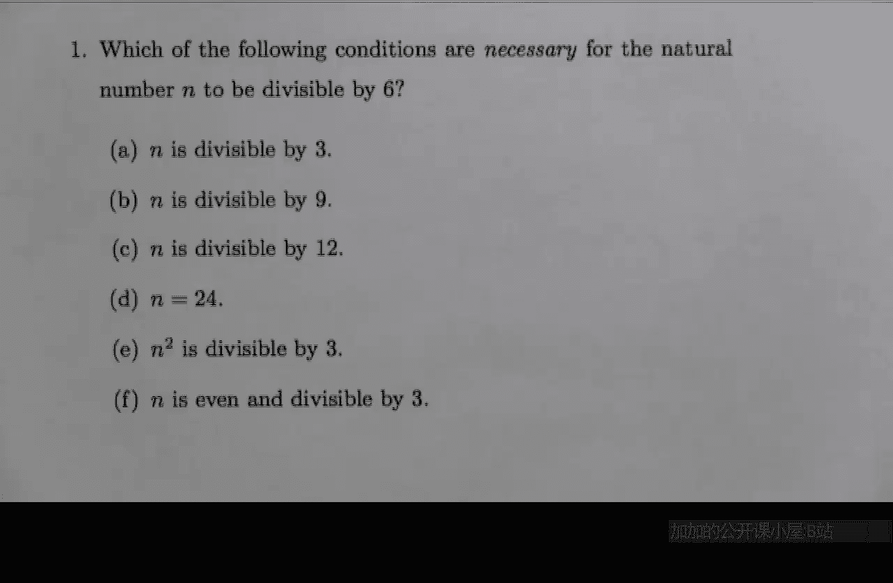
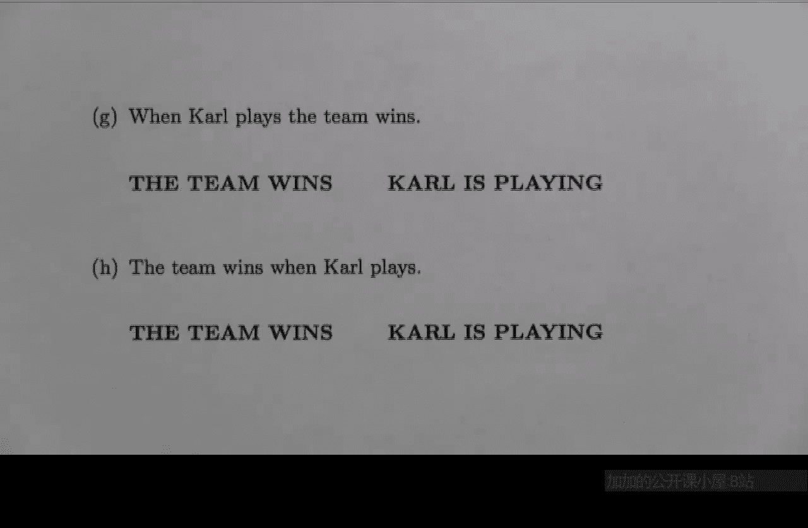
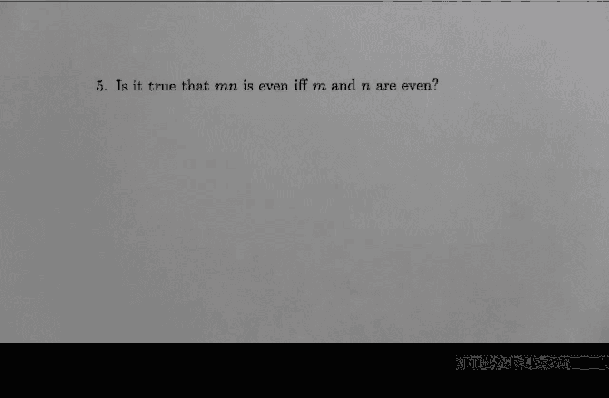

# 数学思维导论：习题集2指导教程

在本节课中，我们将一起学习如何分析习题集2中的问题，重点在于理解“必要条件”与“充分条件”的概念，并学习如何评估一个数学论证（证明）的质量。我们将通过具体的例子，一步步拆解逻辑关系，并使用课程提供的评估标准来分析一个证明示例。

## 习题集2：必要条件与充分条件分析

上一节我们介绍了逻辑推理的基本概念，本节中我们来看看如何将这些概念应用到具体的数学问题中，特别是关于“整除性”的条件分析。

### 问题1：关于“n能被6整除”的必要条件

我们需要判断，在以下各个条件中，哪些是“n能被6整除”的**必要条件**。一个条件是必要的，意味着如果“n能被6整除”成立，那么这个条件**必须**成立。用逻辑语言来说，就是“6整除n” **蕴含** 条件X。

以下是各个条件的分析：

*   **条件A：3整除n。** 如果6整除n，那么3一定整除n。因此，这是必要条件。
*   **条件B：9整除n。** 取n=6作为反例。6能被6整除，但6不能被9整除。因此，这不是必要条件。
*   **条件C：12整除n。** 取n=6作为反例。6能被6整除，但6不能被12整除。因此，这不是必要条件。
*   **条件D：n=24。** 取n=6作为反例。6能被6整除，但6不等于24。因此，这不是必要条件。
*   **条件E：n²能被3整除。** 如果6整除n，则3整除n。如果3整除n，则3整除n²。因此，这是必要条件。
*   **条件F：n是偶数且能被3整除。** 如果6整除n，则2整除n且3整除n。因此，这是必要条件。

**结论：** 条件A、E、F是“n能被6整除”的必要条件。在寻找反例时，最简单的反例常常是n=6本身。

### 问题2：关于“n能被6整除”的充分条件

现在，我们判断哪些条件是**充分条件**。一个条件是充分的，意味着如果这个条件成立，那么“n能被6整除”**一定**成立。即，条件X **蕴含** “6整除n”。

以下是各个条件的分析：

*   **条件A：3整除n。** 取n=3作为反例。3能被3整除，但3不能被6整除。因此，这不是充分条件。
*   **条件B：9整除n。** 取n=9作为反例。9能被9整除，但9不能被6整除。因此，这不是充分条件。
*   **条件C：12整除n。** 如果12整除n，那么6一定整除n。因此，这是充分条件。
*   **条件D：n=24。** 如果n=24，那么6整除24。因此，这是充分条件。
*   **条件E：n²能被3整除。** 取n=3作为反例。3²=9能被3整除，但3不能被6整除。因此，这不是充分条件。
*   **条件F：n是偶数且能被3整除。** 如果2整除n且3整除n，那么6整除n。因此，这是充分条件。

**结论：** 条件C、D、F是“n能被6整除”的充分条件。

### 问题3：关于“n能被6整除”的充要条件

充要条件意味着该条件既是必要的也是充分的。结合问题1和问题2的结果，我们只需找出在两个列表中均出现的条件。

**结论：** 只有条件F（n是偶数且能被3整除）同时出现在必要条件和充分条件列表中。因此，它是“n能被6整除”的充要条件。

---

## 习题集2：识别逻辑陈述中的前件（Antecedent）

在逻辑陈述“如果P，那么Q”中，P被称为前件（或条件），Q被称为后件（或结论）。识别前件是理解蕴含关系的关键。

以下是各个陈述的分析：

*   **陈述A：“如果苹果是红色的，那么它们就可以吃了。”**
    *   前件是“苹果是红色的”。
*   **陈述B：“一个函数可微，则它连续。”**
    *   这里讨论的是充分性。可微性**蕴含**连续性。因此，前件是“函数可微”。
*   **陈述C：“如果级数S收敛，则其部分和有界。”**
    *   “如果S收敛”指明了条件。因此，前件是“级数S收敛”。
*   **陈述D：“n是质数，仅当2^n - 1是质数。”**
    *   “仅当”引导的是**必要条件**。这里，“n是质数”是“2^n - 1是质数”的必要条件。因此，在逻辑上，“2^n - 1是质数” **蕴含** “n是质数”。所以，前件是“2^n - 1是质数”。
*   **陈述E：“球队获胜，仅当卡尔上场。”**
    *   “仅当”再次引导必要条件。球队获胜的必要条件是卡尔上场。因此，“球队获胜” **蕴含** “卡尔上场”。所以，前件是“球队获胜”。
*   **陈述F：“当卡尔上场时，球队获胜。”**
    *   “当...时”类似于“如果”。它指明了条件。因此，前件是“卡尔上场”。
*   **陈述G：“球队获胜，当卡尔上场时。”**
    *   这与陈述F本质相同，只是从句顺序调换。“当卡尔上场时”仍然是条件。因此，前件是“卡尔上场”。

**关键点：** “如果”(if)和“当”(when)通常引导前件；而“仅当”(only if)和“仅当...时”(only when)则引导后件，即它们指出的条件是结论成立所必需的。

---

## 习题集2：关于整数乘积奇偶性的真值判断

上一节我们处理了条件分析，本节我们来看两个关于整数乘积奇偶性的具体命题，并通过寻找反例或推理来判断其真假。

### 问题5：命题“mn是偶数，当且仅当m和n都是偶数”

这是一个“当且仅当”陈述，需要双向验证。
1.  **正向（充分性）：** 如果m和n都是偶数，那么mn显然是偶数。成立。
2.  **反向（必要性）：** 如果mn是偶数，是否m和n必须都是偶数？答案是否定的。例如，取m=2（偶数），n=3（奇数）。它们的乘积mn=6是偶数，但n不是偶数。这构成了一个反例。

**结论：** 该命题为**假**。因为反向不成立。

### 问题6：命题“mn是奇数，当且仅当m和n都是奇数”

同样需要双向验证。
1.  **正向：** 如果m和n都是奇数，那么mn是奇数。（奇数×奇数=奇数）
2.  **反向：** 如果mn是奇数，那么m和n都不能是偶数（因为偶数乘任何整数都是偶数），所以m和n必须都是奇数。

这个结论基于对奇偶性运算的基本理解。你可以通过讨论或真值表来严格证明。

**结论：** 该命题为**真**。

---

## 习题集2：使用评估标准分析一个证明

在本课程中，我们使用一个评估标准（Rubric）来系统地分析数学证明的质量。它关注逻辑正确性、清晰度、结构、陈述和推理等多个方面。

现在，我们来看一个学生对于命题“对于任意命题P和Q，¬P ∧ ¬Q 等价于 ¬(P ∧ Q)”的证明尝试。

**待评估的证明：**
> 假设 ¬P ∧ ¬Q 为真。
> 一个合取式为真，当且仅当它的两个合取支都为真。所以 ¬P 和 ¬Q 都为真。
> 如果 ¬P 为真，则 P 为假（否定的含义）。同理，如果 ¬Q 为真，则 Q 为假。
> 因此，P 和 Q 都为假。
> 如果 P 和 Q 都为假，那么合取式 P ∧ Q 为假。
> 因此，¬(P ∧ Q) 为真（否定的含义）。这就证明了从左到右的蕴含。
> 反之，另一个方向的论证同理可证。因此，我们得到了双向蕴含。

**逐步分析：**
1.  **逻辑正确性（4分）：** 证明试图建立双向等价。从左到右（¬P ∧ ¬Q ⇒ ¬(P ∧ Q)）的推理是**完全正确**的。然而，声称“另一个方向的论证同理可证”是**错误**的。实际上，¬(P ∧ Q) 为真只意味着 P 和 Q 至少有一个为假，并不能推出两者都为假（即 ¬P ∧ ¬Q 为真）。例如，P假Q真时，¬(P ∧ Q) 真，但 ¬P ∧ ¬Q 假。因此，原命题本身是假的。**评分：2分**（一半正确）。
2.  **清晰度（4分）：** 论证的表述条理清晰，易于跟随。**评分：4分**。
3.  **证明结构（4分）：** 证明明确分为两个方向进行，并说明了目标是证明等价性。开头和结论的陈述清晰。**评分：4分**。
4.  **陈述的明确性（4分）：** 证明清楚地陈述了假设和要推导的结论。**评分：4分**。
5.  **推理的合理性（4分）：** 在正确的部分（从左到右），每一步都给出了理由。在错误的部分，没有提供具体推理，只是错误地断言了对称性。**评分：2分**。
6.  **总体评价（4分）：** 证明展现了对证明结构的良好理解，但包含一个关键的逻辑错误，导致最终结论错误。**评分：2分**。

**总分：2 + 4 + 4 + 4 + 2 + 2 = 18分（满分24分）。**

**评估说明：** 这个评分可能略显宽松，因为它是一个错误的证明。但在“数学思维”的背景下，我们不仅评估最终答案，也重视沟通、结构和逻辑展示的过程。该证明在形式上有许多优点，主要错误在于未验证一个关键的逻辑步骤。75%的分数既认可了其优点，也反映了其重大缺陷。

---

## 本节课总结

本节课中我们一起学习了：
1.  **区分必要条件和充分条件**：通过“n能被6整除”的例子，我们练习了如何判断一个条件是必要的、充分的，还是充要的，并学习了如何使用反例。
2.  **识别逻辑陈述中的前件**：我们分析了多种日常语言表达的蕴含关系，学会了如何根据“如果”、“当”、“仅当”等关键词来确定逻辑条件。
3.  **判断数学命题的真假**：我们通过分析整数乘积的奇偶性命题，实践了通过构造反例来否定命题，以及通过基本数学事实来确认命题。
4.  **应用证明评估标准**：我们使用一个多维度的评估标准，对一个学生的证明尝试进行了全面分析，理解了如何从逻辑、清晰度、结构等多方面评价数学论证的质量。

这些练习旨在深化你对数学逻辑的理解，并培养严谨的数学思维习惯。