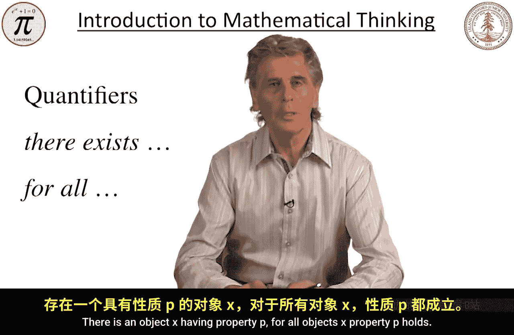
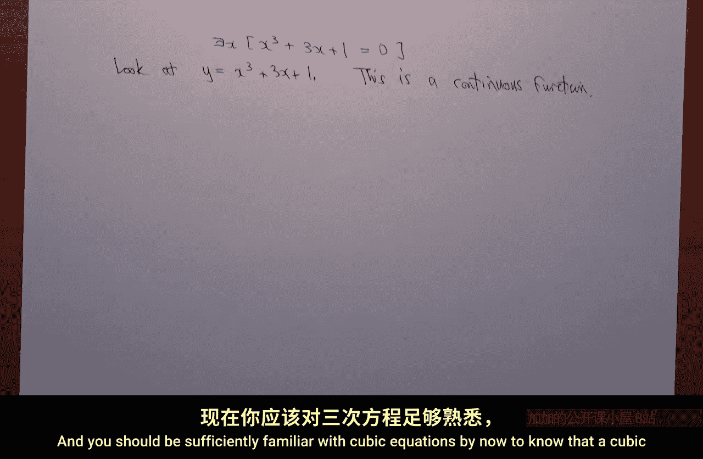
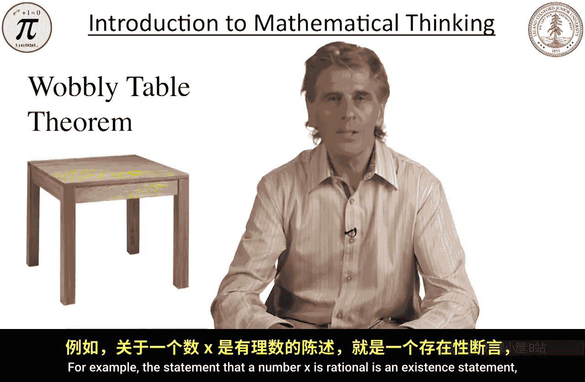
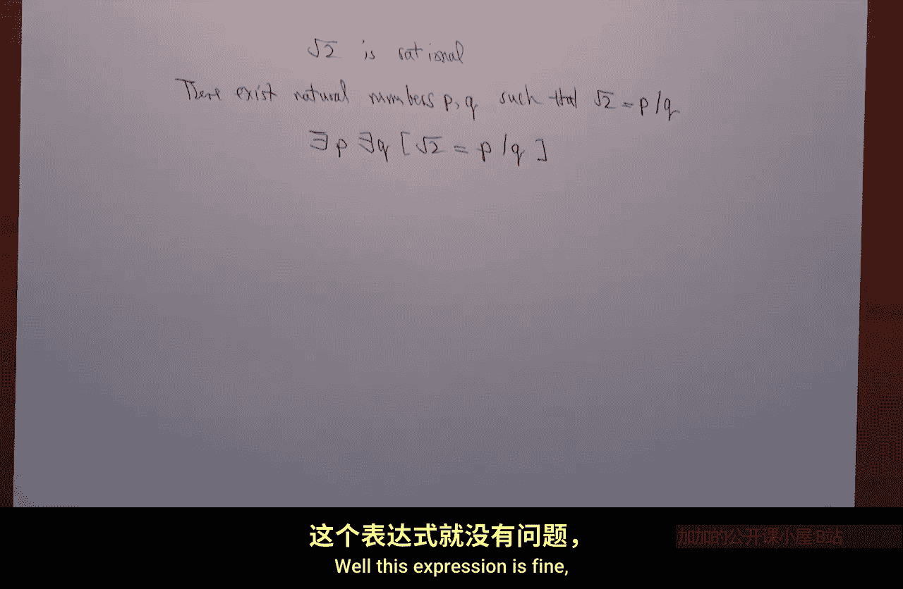
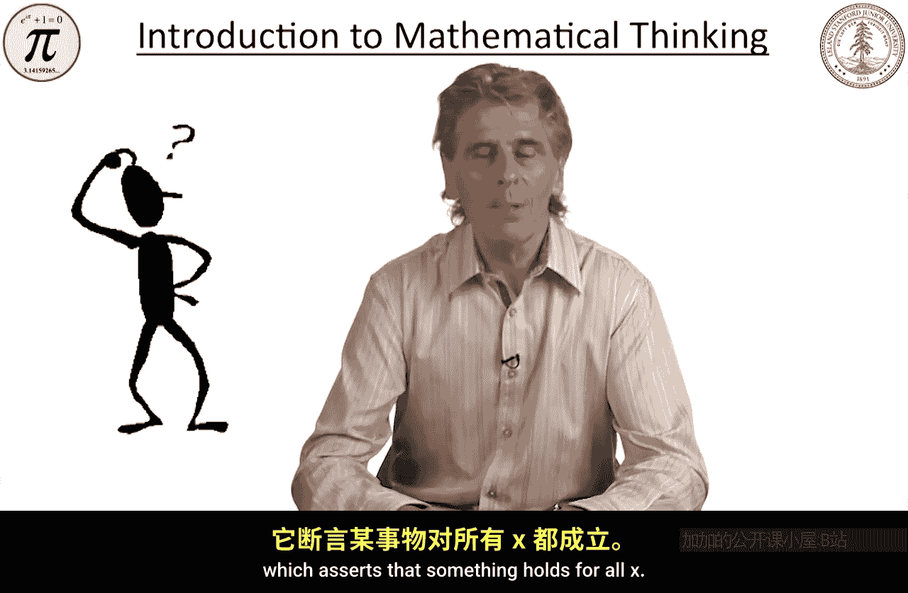
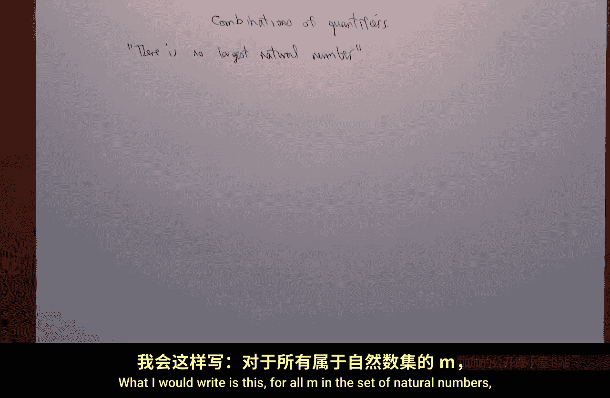
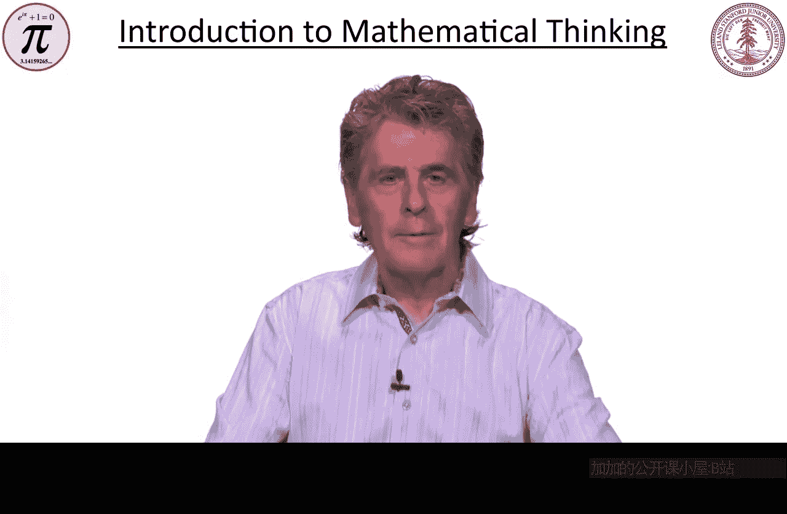

# 斯坦福大学【中英⚡数学思维导论｜Introduction to Mathematical Thinking】 p13 P13 01_讲座5-量词 -BV1D44dzxEa7_p13-

How did you get on with that massive assignment for？To give you a chance to complete it。

 this lecture is also fairly short。And this time， the assignment is down to a single page。

So keep working on that last assignmentment。It really is crucial to master those ideas and that terminology。

Knowing when and why one statement implies another。

And being able to distinguish between necessity and sufficiency are crucial abilities in today's world。

There are two more language constructions that are fundamental to expressing improving mathematical facts。

And which mathematicians therefore have to be precise about。The two quantifiers。There exists。

 and for all。When we've made these terms precise and are sure we know how to use them properly。

Our analysis of language will be over。The word quantifier is used in a very idiosyncratic fashion here。

In normal use， it means specifying the number or amount of something。In mathematics。

 it's used to refer to the two extremes。There is at least one。And for all。

These are all we need to look at because of the special nature of mathematical truths。

When mathematics is viewed as a subject in its own right。

As opposed to being a set of tools used in other disciplines and walks of life。

The core of the subject is the theorem。😮，And the majority of mathematical theorems have one of two forms。

There is an object X having property P。😮，For all objects X， property Pholes。

I'll take these one at a time。We're looking at statements of the form。There's an object X。

 having property P。For example。The equation x squared plus 2 x plus 1 equals 0 has a real root。

We could emphasize that this is an exist statement by writing it in the following form。

There is a real number x， such that x squared plus 2 x plus 1 equals 0。Or we could write it this way。

😊，There exists a real number x， switch to x squared plus 2 x plus 1 equals 0。

Doesn't matter whether we write it with an is or exists。It's an exist statement。

The symbolic abbreviation that mathematicians use for exists is a back to front E。E for exists。

 of course。So a mathematician would write this， as follows。There exists in x。

 such should x squared plus 2 x plus 1 equals 0。This symbol is called the existential quantifier。

The simplest way to prove an existential statement of this form is to find an actual X that satisfies the property。

And with this example， it's easy。T x equals negative1。The x squared plus 2 x plus 1。

Equals negative1 squared， which is1 plus two times negative 1， which is negative 2。

Then we've got the plus 1，1 minus2 plus 1 equals 0， which solves it。Well that was a simple example。

 sometimes we can prove an existential statement without finding an actual object that satisfies the property。

Let me give you an example of that。😊，I'm going to prove this statement。There exists in X。

So should x cubed plus 3 x plus 1 equals 0。I'm not gonna find an actual X that solves this cubic equation。

 but I am going to show that there is a solution。I'm going to start by looking at the function y equals x cube plus 3 x plus 1。

This is a continuous function。Continuity of functions is actually a fairly deep topic。

 we'll touch on it briefly at the end of the course。But for my present purpose。

 all I need to know is that a continuous function is one whose graph。

Is a smooth curve with no brakes and jumps。And you should be sufficiently familiar with cubic equations by now to know that a cubic equation has a nice。

 smooth curve that looks something like that in many cases。

Up and down， two calves。Okay， the point is it doesn't have any jumps。If x equals negative 1。

This curve。How's value。Or this function has a value。Negative one cubed。Which is negative one。

Plus three times negative1， which is negative 3 plus 1。Which is negative3。If x equals plus 1。

The curve or the function。Has value y equals1 plus 3 plus 1。Which equals5。So， the curve。

Lies below the X axis。For x equals negative 1。And above the X axis。For x equals plus one。

So it looks something like this。put the origin in here。 We're going to look at negative one。

 and we're going to look at plus one。 It's going to lie somewhere down here。 negative one。

 It's going to lie somewhere up here at plus one。And somewhere， it's going to cross the axis。 I mean。

 it looks like that， that Who knows。The point is it's going to have to cross the axis somewhere whether rather it to the left of the origin。

 not to the right of the origin。Doesn't matter where。

The important point is somewhere between negative one and plus  one， this curve crosses the axis。

And when it crosses the axis。😮，The y value was 0。So we haven't said which x solves the equation。

 We haven't even said whether the x is negative or positive。But we do know there is such an X。

 We've shown that the next exists that satisfies the equation。Without finding such an ex。

This is an example of an indirect proof。We haven't proved it directly by finding an X that solves the equation。

 We've simply shown that there is an X that solves the equation。A lot of mathematical proofs。

How of this nature， we show that there is a solution to some equation。

 or that there is an object that satisfies some property or other without finding such an object。

Pretty cool huh。Don't for a quiz。A simple modification of that last argument yield a most specific result。

 Which of the following is it。Is it one？There is an x less than 0 such as xq plus 3 x plus 1 equals 0。

Or is it2， There's an x greater than 0， such as x cubed plus 3 x plus 1 equals 0。Okay。

 which one do you think it is？Well， the answer is one。And here's how we can count that。

In the previous argument， I looked at the curve of x equals negative1 and x equals plus 1。

And I showed it looked something like this。At negative  one， the curve was below the X axis。

At plus one， the curve was above the X axis。And so it has to cross the X axis somewhere between negative one and plus 1。

But instead of going between negative 1 and plus one。

I could go between negative one and the origin itself。Well。Note that defect equals 0。

Then y equals x cube plus 3 x plus 1 is 1。So it's zero。It somewhere will。Which means it's negative。

Negative one。It's positive at 0， so it's somewhere between negative 1 and 0 that it crosses the axis。

Since the curve lies below the x axis at x equals negative1 and above the x axis at x equals 0。

 it must cross the x axis between negative 1 and 0。Or I could prove it a different way。

 I could simply observe that if x is greater than equal to 0。

 then x cube plus 3 x plus 1 is greater than 0。And in particular， is not equal to 0。 So2 is false。

 And that just leaves one。We know that one of these two has to be true as a result of the previous argument。

And so if we can eliminate it， too， as I've just done here。Then I can conclude one。 So either way。

 either by refining the previous arguments。Or by deducing it from the previous results by this observation。

I end up showing。That the equation has a root。Somewhere between negative 1 and 0。

 I still haven't found that route， but I have sure that there is a route。 It's an indirect proof。

Incidentally， in giving that last proof， I was careful to distinguish between the terms negative  one and minus1。

Chances are your middle or high school teacher made a big deal of that。

Like many professional mathematicians， maybe even most of us am generally far less careful。

I tend to use negative and minus interchangeably。It's not that we don't know the distinction。

 It's just that at at university level， we focus on other issues。

And since this is a university course， I'll assume you can use your knowledge of arithmetic to determine the intended meaning。

 just as we do with everyday language。In this course。

 a similar issue arises with implication and the conditional。😊。

And since that distinction is likely new to you。I'm going to try to always use the correct term。😡。

But when I'm talking with my professional colleagues。

We just talk about implication to cover both cases。

And rely on our shared knowledge of the concepts to disambiguate。In both cases。

 the distinctions are important， which is why we emphasizee them in our teaching。😡。

But once we're sure everyone has fully grasped the issues。We adopt a more relaxed attitude。

 confident that our understanding will keep us out of trouble。

The same kind of argument I just used to show that a certain cubic equation has a real root。

Can be used to prove the wobbly table theorem。Suppose you are sitting in a restaurant at a perfectly square table with four identical legs。

 one at each corner。Because the floor isn'teven， the ti were wobbles。😡。

One solution is to fold a small piece of paper and insert it under one leg until the table is stable。

But there's another solution。Simply by rotating the table。

 you'll be able to position it so that it doesn't wobble。😡，You might enjoy trying to prove this。

The solutions simple。But it can take a lot of effort before you find it。

It's very much a thinking outside the box question。It would be an unfair question on a timed exam。

And I'm not giving it as a course assignment。😊，But it's a great puzzle to keep thinking about。😊。

Until you hit upon the right idea。I'll leave you with it。

Even if you can't think of a mathematical solution。😊。

You could go off in search of a square wobbly table。And confirm the theorm experimentally。Meanwhile。

 let's get back to our main theme。😡，Sometimes it's not immediately obvious that a statement is an existence assertion。

In fact。Many mathematical statements that do not look like an existing statement on the surface。

Turn out to be precisely that when you work out what they mean。For example。

A statement that a number x is rational is an existence statement。

And here's why。Let's take the specific statement。 square root of2 is rational。As it happens。

 it is a false statement。But we're just using it as an example of a statement。 So on the face of it。

 this doesn't look。Like an existence statement。But it actually is because we can write it as there exist natural numbers P and Q。

 such that square root of2 equals P divided by Q。Or using our symbolic abbreviation。Exist， P。Exist。

 you。Such its growth or two。Is P over Q。Incidentally。

 when we do come to prove that the square root of2 is not rational。

 we'll do it by ass that there are no values of P And Q that satisfy this equation。

 So we'll prove a non existent statement。Well， this expression is fine。

 So long as we know in advance that P And Q。

Dote natural numbers。 I mean， here， I said it explicitly。Here I didn't。

So how do you know that P&Q denote natural numbers， I mean。

 maybe they should denote real numbers or complex numbers？The answer is。You make it more specific。

And you do that by writing it in the following way。There exists a P in n。And there exists a Q in n。

Such that route to。Es P over a cube。Where end inote a set of natural numbers。Incidentally。

 another font that's often used to denote the set of natural numbers。Is something like this。An end。

With a double line for the diagonal。In this course I'm assuming that you're familiar with set there with basic set theoryin and you know what the membership symbol means。

 if you're not， then there is a course supplement and I'm just going to leave it to you to read that supplement and of course is a course textbook if you acquire the textbook。

That's my own book， Introuction to Maal thinking。In any case。

 I'm going to assume that you are familiar with set theory and I'm not going to talk about it in the course itself。

You sometimes see mathematicians write it in an even more abbreviated fashion。

 There exists a peakique U in earn。Ss that square root of2 is P over a Q。That's fine。

 If you're confident about the material and you're familiar with the notations。

But we're going to be looking at examples where there were many different types of quantifiers coming in together。

And then if you start。Putting them together in this fashion。

 There's a possibility of getting confused and going off course。 So I would say at the early stages。

Keep things distinct， as they are here。And try to avoid that。fin out。As I said。

 professional mathematicians write this kind of thing all the time。

But just as when we're beginning to learn mathematics。

 it's important that we distinguish things like negative and minus。

 and then when we master them we tend to forget the distinctions and we don't forget them。

 but we don't make them explicit。 So here when we're beginning to look at quantifiers。

 I think it's important to be very explicit。 And then once once you really understand it。

 then you can do what we do in the business we just write things in in the simplest fashion。

 confident that we know what's going on and that the way we write it won' misleads。Incidentally。

See if you can prove that the square of the2 is not rational。We'll do that in class later。

 but see if you can do it now。What that amounts to is proving that there do not exist P and Q in the natural numbers。

Sucharch that the square root of 2 equals p over Q or that 2 equals p squared over Q squared。

This is the statement you actually approve。In order to show that the square root of 2 is irrational。

 it's not a difficult argument。But it's rather clever and ingenious。 It's fairly short。

And the chances are that you're not going to come up with it， but it's worth giving it a shot。

 You don spend a half an hour an hour or so thinking about it。To see if you can。

 if you can prove that statement， good luck on that one， but we will come back to that in class。

How are you doing。Do try to assure that the square root of2 is irrational。

Not so much to find the poof。But to get used to what it's like to do university level mathematics。

One feature you need to get used to in master in College mathematics or more generally what I'm calling mathematical thinking。

Is the length of time you may need to spend puzzling about a problem or even one particular detail？

For the most part， without seeming to be making progress。High school mathematics courses。😊。

Particularly in the US。I generally put together so that most problems can be done in a few minutes。

With the goal of covering an extensive curriculum。At college。There's far less material to cover。

But the aim is to cover it in more depth。That means you have to adjust to the slower pace with a lot more thinking。

And less doing。At first， this comes hard， since thinking without seeming to be making progress is initially frustrating。

But it's much like learning to ride a bike。😮，For a long time。

 you keep falling or relying on training wheels， and it seems you'll never get it。

Then suddenly one day， you find you can do it。😊，And you can't understand why it took so long to get there。

But that long period of repeated falling was essential to your body learning how to do it。

Training your mind to think mathematically about various kinds of problems is very much like that。

Okay， sermon over。The one remaining piece of language you need to examine and make sure we fully comprehend is the universal quantifier。

Which assert that something holds for all X。

This notation means for all X， it's the case that something of other。

The symbol here is an upside down letter A。Which means for all， for example。

 if I wanted to say the square of any real number is greater than or equal to 0。

I could write it like this。4 x。X squared greater than equal to 0。

So the short way of actually saying that is for all x， x squared greater than equal to 0。

Just as we would write things like that exists in X。Such should x squared equals 0。

Notice that I didn't use the word at all in this sentence。I use the word any。

 the same thing happened with exist。 There are different words we can use。

To express an existence assertion。 And there are different words we can use to express a for all assertion。

This。Is the universal quantifier。How do I know what the X means， Well。

 I have to specify what it means。 If I want to be explicit。

 I would have to write something like for all X in the set of real numbers。

X squared greater than equal to 0。Okay， let's take a look at combinations of quantifiers。

Most statements in mathematics involve two or more quantifiers combined。 For example。

 if I want to say there's no largest natural number。What I would write is this。

For all M in a set of natural numbers。There is an n in a set of natural numbers。

 such that n is bigger than N。For all natural numbers M。There is a natural number N。

 such as N is bigger than M。That clearly says， there's no larger's natural number。

Note that the order of the quantifiers is important。If I swap those quantifiers round。

 andrite exists in N in N， such that for all M。In end。N is bigger than M。The result says。

 there is a natural number N。Which has the property that， for all natural numbers M。

N is bigger than M。 In other words， this says。There is a natural number bigger than all natural numbers。

Which is false。All I've done is swap the quantifiers round。But in so doing。

 I've turned a true sentence。Into a false sentence。

Remember that example from the American melanoma Foundation？In their fact sheet， they wrote。

 one American dies of melanoma almost every hour。Using our quantifiers。

 we could write that like this。They exist in American。Such that for every hour。Hey， die。In our age。

There is an American。Such that every hour， A dies in our age。Poor guy。Quite amazing。

What the writer obviously meant。Was the following。For every hour。

There is an American such that A dies in our age。It will be different Americans for different hours。

Now， as I mentioned earlier， in the case of everyday English， these are almost never a problem。

 Everyone understands the context。 We know what's meant。 We know that this one。

Is not meant because this this is clearly wrong。 We know that that one's the one that's meant。

And with a simple mathematical example like this one。

 arguably it's not important either because everybody knows what's meant。 We know that there is。

 there is no largest natural number。 We know it must be this one and not this one。

 So in these examples， there's probably no problem。

But we want to use mathematical notation in complicated situations and to talk about things we don't yet understand。

That means we can't disambiguate。It's really important that we say things in the right order。Okay。

 I think it's time for a quiz。So how did you get on？We the literal meaning of this statement。

Is captured by number one。That's the literal meaning。 It says， there is a  license。

For which there are two distinct states。That that license comes from。So this is the literal meaning。

But it's false。Licenses are issued by states。 You can't get a  license that's issued by two separate states。

So the correct answer to the question is number one。

But it's not what the person who wrote that sentence in the in the form。

 in the driver's license application meant to say。Let's look at number two。That says。

There were two different licenses。 They're different。 There were two licenses。

Which are issued by one state。Well， I guess it's possible that you could own two  licenseences that are both issued by the same state if you had two identities or something like that。

嗯。So this is a possibly true statement。But it's not what the sentence means。Let's look number3。

 That says there are two licenses。And two states。Different states， different licenses。

 there are two  licenses and two states， one license comes from one state。

 the other license comes from the other state。This is the sentence。

That the driver's license application meant to say。So the literal meaning is number one。

Which is false。Number2 may be true， but it's it's not what the what the sentence is about。

Number 3 is， is clear of the intended meaning。 And is's a meaning that we would all understand from this because we know about licenses and about states and so forth。

 So this is， is this is the one we understand。But it's not the literal meaning。

Doesn't matter when you're applying for a driver's  license unless I guess if you get into trouble。

 you get your lawyer， you might try to get you off by arguing on the basis of the mathematical meaning。

 good luck if you want to try that。 but in mathematics， we can't allow this kind of thing to happen。

 we get into all sorts of problems and in mathematics。

 we can't hire a lawyer to get it out of difficulty。Okay。

 let's look at the next question in this quiz。😊，Well， the correct answer is number 3。Let's see why。

What does the first one say， It says there is a  licenseence。And there were two different states。

Such that that license is valid in one state and valid in the other state。

So it says there's a  license that's found in two steps。 Well， okay。It's true because in America。

 when you have a licence valid in one state， it's valid in any state， you can use it anywhere。

So it doesn't say anything particularly interesting。What about number two。

That says for every license and for every pair of states， which could even be the same state。

The license is valid in one state， or which valid in another state。Well， this is actually false。

As a statement。Because there can be invalid licenses。Okay， if you've got an invalid licence。

 that means the whole thing is wrong。This one is the one that captures that， that sentence。

 Let's just read it。 It says for every  licenseence， any license。

If there is a state in which that license is valid。Then that license is valid in all states。

So3 is the one that captures this sentence。One is actually a true statement。

 but of very little relevance。And two is actually a false statement。It's false， remember， because。

You can have invalid licenses。So it's not the case。That for all licenses and for all states。

 the license is valid in one state or another state。Okay， how did you do on that？😊。

You might have had difficulty reading the formulas in that last quiz。If so。

 check out the supplementary video tutorial called How to Read Mathematical formulas。😊。

You'll find it in the same place。 you access all the regular tutorial videos。

