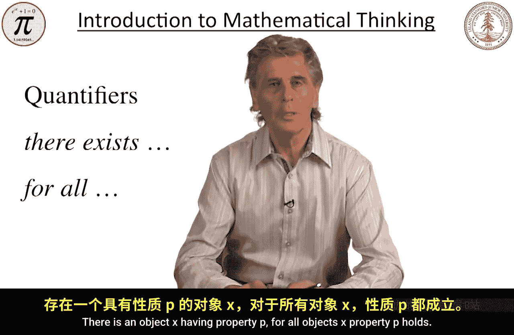
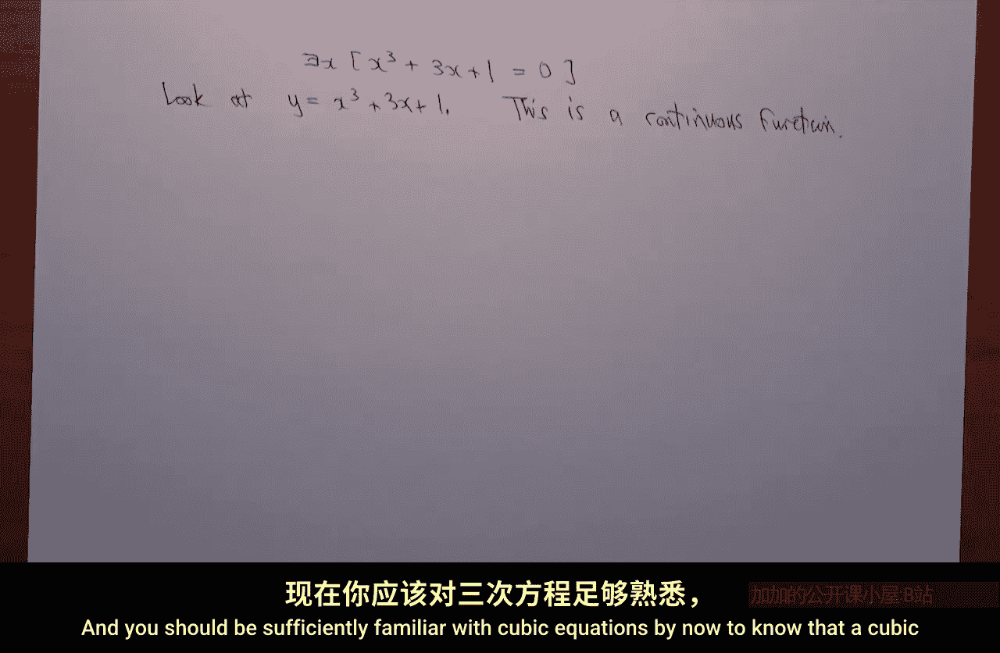
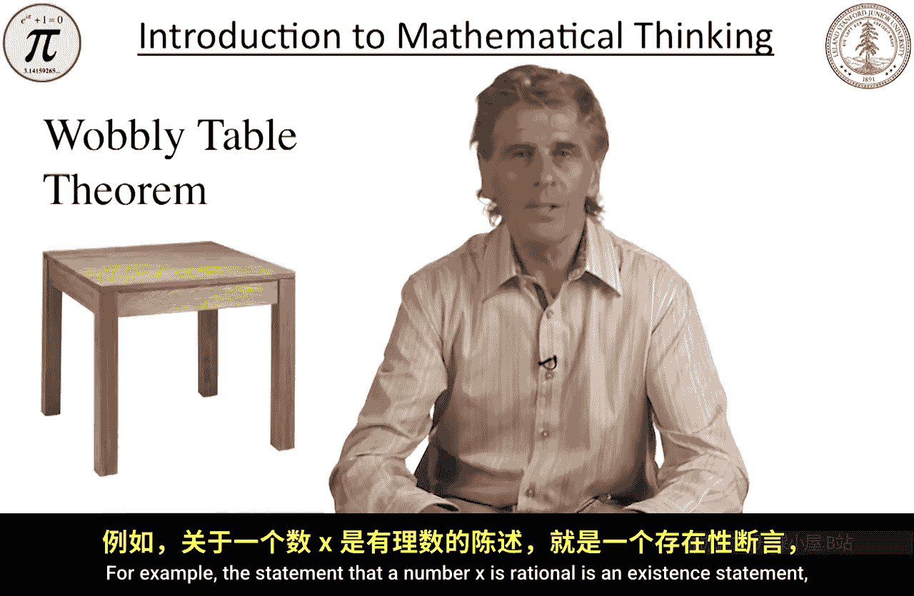
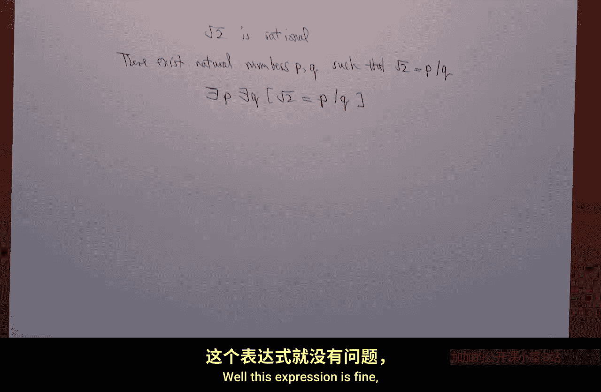
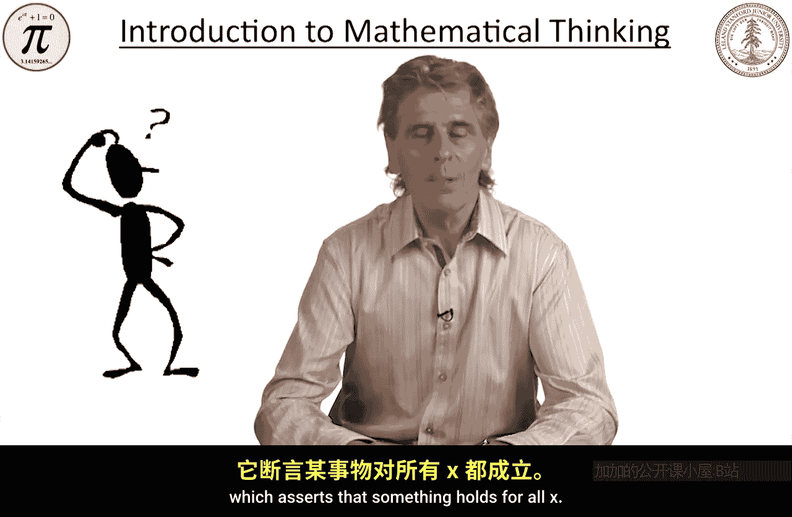
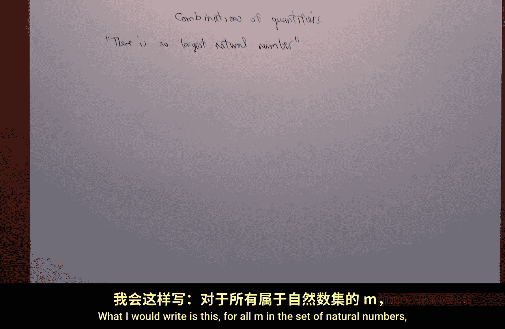
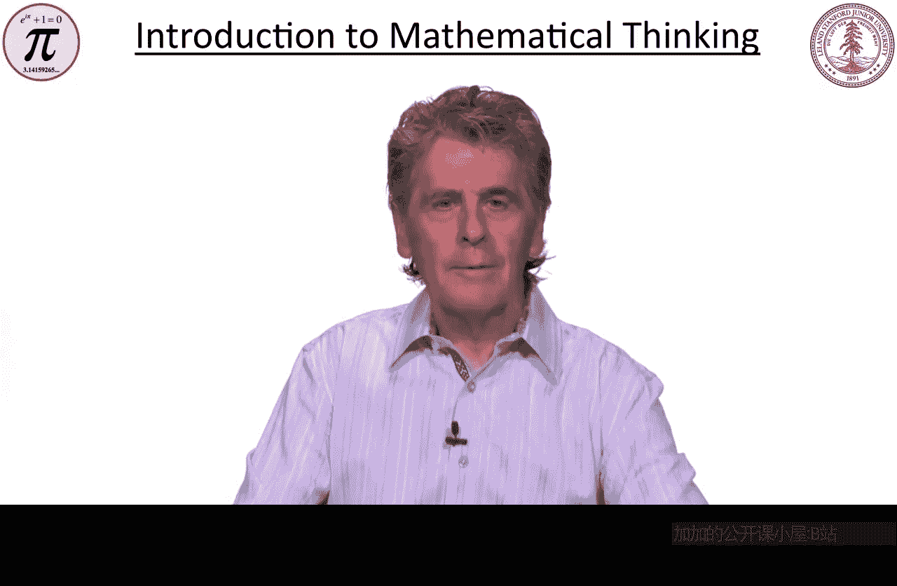

# 数学思维导论：5：量词

在本节课中，我们将要学习数学语言中两个至关重要的构造：量词。量词是“存在”和“对所有”的精确表达，它们是陈述数学事实的基础。我们将学习如何识别、书写和理解包含量词的语句，并了解它们在证明中的运用。

上一节我们介绍了逻辑蕴含与条件句，本节中我们来看看如何精确地表达“存在”和“所有”的概念。

## 存在量词 (∃)

存在量词用于断言至少存在一个对象满足某种属性。其符号是一个倒写的字母 E：∃。

例如，陈述“方程 x² + 2x + 1 = 0 有一个实数根”是一个存在性陈述。我们可以用以下方式强调这一点：
*   存在一个实数 x，使得 x² + 2x + 1 = 0。
*   符号表示为：∃x ∈ ℝ, x² + 2x + 1 = 0。

证明此类存在性陈述最直接的方法是找到一个满足属性的具体对象。对于上述例子，取 x = -1 即可证明。

然而，有时我们可以在不具体找出对象的情况下证明存在性。考虑以下陈述：
∃x ∈ ℝ, x³ + 3x + 1 = 0。

我们可以通过分析函数 f(x) = x³ + 3x + 1 来证明。这是一个连续函数，其图像是一条没有间断的平滑曲线。计算可得 f(-1) = -3 < 0，而 f(0) = 1 > 0。由于函数值在 x = -1 时为负，在 x = 0 时为正，根据连续函数的中间值定理，在 -1 和 0 之间必然存在某个 x 使得 f(x) = 0。这样，我们虽然没有明确解出 x 的值，但已经证明了这样的 x 存在。这是一种间接证明。

以下是关于存在性陈述的一些要点：
*   有些陈述表面上看不像存在性陈述，但实际上是。例如，“√2 是有理数”等价于“存在自然数 p 和 q，使得 √2 = p/q”，即 ∃p ∈ ℕ, ∃q ∈ ℕ, √2 = p/q。
*   在书写时，明确指定对象所属的集合（如 x ∈ ℝ）非常重要，这能避免歧义。
*   证明某个对象“不存在”（如证明 √2 不是有理数）本质上就是证明一个否定的存在性陈述。

## 全称量词 (∀)

全称量词用于断言某个属性对某一集合中的所有对象都成立。其符号是一个倒写的字母 A：∀。

例如，陈述“任何实数的平方都大于或等于零”是一个全称陈述。我们可以写成：
*   对所有实数 x，x² ≥ 0。
*   符号表示为：∀x ∈ ℝ, x² ≥ 0。

与存在量词一样，在自然语言中我们可以用“任何”、“每一个”、“所有”等词来表达全称含义。

## 量词的组合与顺序

大多数数学陈述会组合使用多个量词。此时，量词的顺序至关重要，改变顺序可能会完全改变陈述的含义。

例如，陈述“没有最大的自然数”可以符号化为：
∀m ∈ ℕ, ∃n ∈ ℕ, n > m。
（对于任意自然数 m，总存在一个自然数 n 比 m 大。）

如果我们交换量词的顺序，得到：
∃n ∈ ℕ, ∀m ∈ ℕ, n > m。
（存在一个自然数 n，它比所有自然数 m 都大。）

第一个陈述是真命题，而第二个则是假命题。这说明在复杂的表达中，必须严格按照逻辑意图来排列量词顺序。

自然语言中常因量词顺序模糊而产生歧义，但在数学中，我们必须保持精确以避免错误。

本节课中我们一起学习了数学中两个核心量词：存在量词 (∃) 和全称量词 (∀)。我们了解了它们的符号表示、如何用它们来构造陈述，以及证明存在性陈述的两种方法（直接构造和间接证明）。最重要的是，我们认识到在组合使用量词时，顺序决定了含义，这是进行精确数学推理的关键。掌握这些概念，是理解和构建更复杂数学论证的基础。