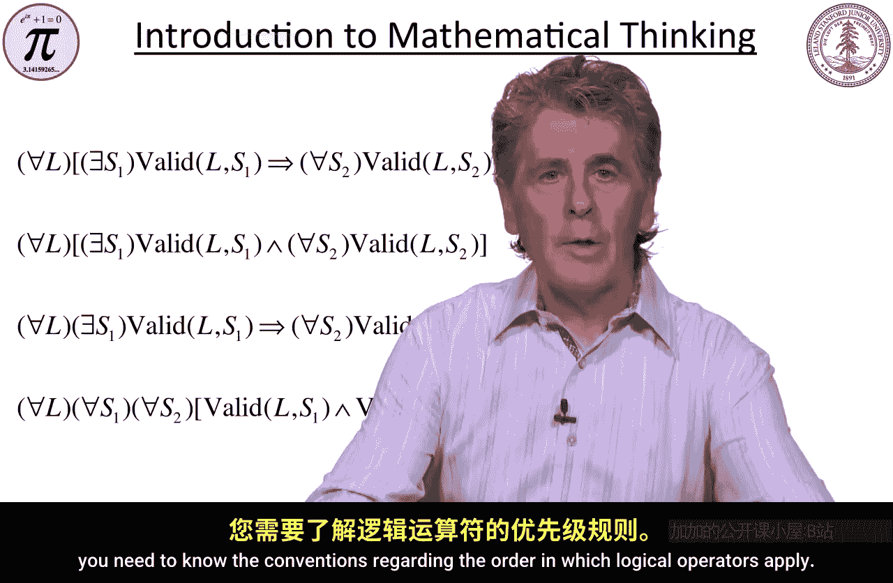
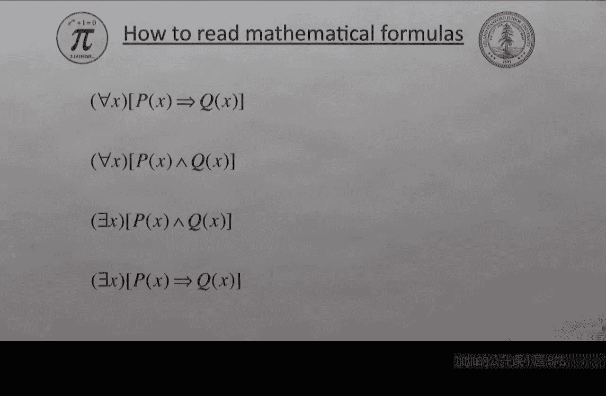

# 斯坦福大学【中英⚡数学思维导论｜Introduction to Mathematical Thinking】 p14 P14 01_补充材料：如何阅读数学公式 -BV1D44dzxEa7_p14-

In this video， I'll explain how you read mathematical formulas。😊。

Just as you're probably familiar with in arithmetic and algebra。

 you need to know the conventions regarding the order in which logical operators apply。

Well， let me begin by just quickly summarising the precedent's order for applying the logical connectives。

The ones that bind the most tightly， the ones that are sort of the strongest， if you want。

 that are holds something close together are the quantifiers for all and exist。

And a quantifier applies to whatever comes adjacent to it。Okay。Now， typically。

 what comes adjacent to it involves various other things like handss and nos and knots。

 So you would put them in in parentheses or brackets， square brackets or whatever。 So very often。

 in fact， I almost always make a habit of putting whatever I want next to it。In parentheses。

 because so for all then applies to everything that comes there。 Okay。

 it binds tightly to this applies to everything the same with existing here。Now。

 if there's only something very simple coming next， for example。

 supposing I wanted to say all the balls are red。I could say， for all balls。😔，Red B。

 if red is a predicate that applies to balls。 So I could say for all B， red B。

And that would apply to the red balls。 And if there was something else here。You know。

 if there was an da， da da， then the fool would not apply to that if I wanted the for all to apply to that。

 I'd have to put parentheses around there。I didn't put parentheses here。 I could do。Again。

 especially when I'm giving introductory level courses， I usually put parentheses around quantifiers。

 but if you look at some of my research work and advanced courses。

 you'll find I often don't do that that fairly consistent among instructors you know the golden rule is if there's any doubt whatsoever and if you're beginning on this material there certainly will be doubts if there's any doubts put parentheses in。

You know， you can't have too many Well， that's not quite true。 if you have too many parentheses。

 it gets hard to read it。 So you have to strike a balance。

 but always if there's going to be any ambiguity， put the parentheses in and mix parentheses a long square brackets or even spaces。

 I'll try to remember to give an example in a minute with a space。

 because you can sometimes use spaces to disambigut。

 But the golden rule must be you want to avoid someone being left unclear as to what the meaning is。

Okay， negation is about the same strength as well is the same strength as as the quantifiers。

 So the negation applies to whatever is immediately next to it。

 and since we usually want a whole bunch of things to be negated。

 then the negation is followed by parentheses and then it applies to everything between there。

 let me give you the following example， suppose we wanted to say not the case that three is greater than zero。

And 3 is less than 0。Okay。Well， is 3 bigger than 0， Yes， is 3 less than 0。 No。

 So here I've got a conjunction of something that's true and something that's false。

 So this conjunction is false， So its neation is true。 So this guy is true。

 But supposing I want it this way。 Not the case。3， greater than0。And。😔，3 less than 0。

Supposing the parentheses didn't include both of those。 They just included one of them。In that case。

 what have I got this guy。Is false。This guy。So here greater than0 is true。So that guy's false。

 So here I've got a conjunction of false things。 So I've got something that's false。

So these clearly aren't the same because this one's true and that one's false。

Here the negation applies to everything in between。Which makes it true here。

 the negation only applies to the thing next to it。No。I could have gone back here。

And put parentheses here， and I'll mention that in a moment actually comes up in the next priority。

That wouldn't have changed things。That wouldn't have changed things。

Because the negation would apply to what was in the next parenthesis。

 Nagation applies to whatever comes next。 And what comes next is the whole thing。

Because the parentheses includes the whole thing。 So simply putting parentheses inside doesn't change anything。

 It makes it maybe a little bit clearer。Although， this is one of those cases where adding parentheses arguably mixing is a little bit less clear。

But in terms of the logic， the issue between these two wasn't whether there were parentheses round the three。

Greater than our lessons0。 the issue was whether the parenthes governed everything that was next or just the wanting that was next。

 Okay， so these are not the same。The next one is conjunction。

 Let me know just pick up that thing I mentioned before。 When I did that the first time。

 I wrote this， I said3 is bigger than 0 and 3 is less than 0。 Now， I， in fact， left a space。

 If you watch what I did， I left a space。And I realized at the time I was doing it that that's what I was doing。

 which is why I decided to pick it up now。 So this says that three is bigger than zero and three is less than  zero。

You actually don't strictly speaking， need parentheses around here。

 because this is an atomic formula， as we sometimes call it。

 This is a basic building block out of which we're building more complex formulas。

 This simply states a fact，3 greater than 0， an atomic fact， a single fact。

 This states another atomic fact，3 less than 0。 So when you have basic facts about arithmetic or whatever。

 there are， they stand on their own。 The conjunctions and the kind of quantifiers are what combine these basic facts。

So you strictly speaking， don't need。To put parentheses around these。

 this is a case where I typically would just leave a bit of extra space in here to sort of make it clear that this is a unit。

 and that's a unit。On the other hand， if you want to be safe and it's always wise to be safe if you at all unsure sure。

You could put those things in。Okay， and I did this here。 I went back and put them in。

Just to make it clear。Okay。😊，Then， well， some mathematicians will say that conjunction disjunction are more or less the same or conjunction disjunction implication。

 We're， we're getting down to a sort of a journal grouping now where everything is roughly the same strength。

 There are actually some arguments that say that conjunction should be tighter than disjunction。

 but it's's， it's not particularly strong。In any case。

 I think in this this is a case where one should always use parentheses to disambiguate。

The point is that the conjunction applies to whatevers to the left of it and whatever is to the right of it。

 And if you want it to apply to a whole bunch of things， you put them inside parentheses。Likewise。

 here。You would have a whole bunch of things。 And the same is true for disjunction implications。

 So regardless of whether you think that's stronger than those。

 the issue should never really arise because you should always put things in parentheses to just say it's this guy or this guy。

 And in here， there could be a whole bunch of things。

And that whole bunch of things will be disjoined with this。And likewise， here。

 if you have an implication of a conditional， this whole thing would be the antecedents。

 and this would be the consequence。 Now， in here， there may be all sorts of conjunctions and disjunctions and stuff。

 There may be quants in here。 There may be quantifiers in here。

 There could be all sorts of stuff in here。Nigation signs inside。

This whole thing would imply that whole thing。So whenever you you looking at the， I mean。

 the sort of， the basic thing with all of these is when you've got a。

Whether a quantifier or a negation symbol or a conjunction or a disjunction or an implication or equivalentence。

 actually， I didn't。Talk about equivalence， But equivalence is just a conjunction of two implications。

 the biconditional。So， we could put that one in here as well。Strictly speaking。

 if you did assume that that had more。Tight binding on this。 You could write something like this。

 You could write A and B。Or C And D。And if you put space in there， that， I would think is fairly。

Veryair clear that it meant to be this or that。So this is， I would say。

 at least the way I was brought up。 let's put it that way。 As a mathematician。

 I was brought up to us to say that that actually is， is okay。

 and it's definitely it's not ambiguous。But I would almost certainly now。

 I think I've cured myself of that childhood sin。 I would always put in parentheses and say it's A And B or C And D。

 I mean， you just have to be very careful about not making sure that things are nicely not ambiguous。

 okay。So， golden rule。But parenthes in。And then everything applies to whatever comes between the next parentheses。

 It's kind of optional as to whether you have parentheses rather the quantifiers。

But the parentheses that follow providing， you always do it， there shouldn't be any problem， okay。

Now， let me illustrate those points with examples that have all related to that quiz at the end of lecture 5。

Okay， so let's let's take these one at a time。 This was actually from that particular quiz。

Well a fool all and for all applies to everything that's adjacent to it。 Now， that parenth is there。

Teams up with that parenthesesis there。 and I've actually written them not as parentheses。

 but of square brackets to make it absolutely clear。That is the thing。But the fall applies to。Okay。

 for all applies to all of this。In particular， what it's going to say is that。Pick any license。

And then it's going to say something about the licenses。 Now。

 the license L is going to appear on both sides of this conditional。

 and it will be the same L because the L is been picked here。 And once you've picked the L。

It'll apply to everything here。 So that L。Is bound by that quantifier。 Okay， so I would say L。

Is bound。😔，By the quantifier for all L。Okay。Quantify a binding。Okay。

 so let's read it now in in English， it says。For any。License L。

If there is a state in which Earl is valid， if ill。Is valid。In some state。At least one state。Then， L。

Is valid。In every state。Okay。For any  licensee， if early is valid in some state。

The exists here simply applies to this。The exist binds what's next to it。

 or the exist simply binds this thing。 Likewise， the for all binds what's next to it。

 which is this thing。So what this says is for every license。

 for any license or for every license cell。Something happens。

What happens if that license early is valid in some state， then that license。

 that same license is valid in every state。So this is the one that actually says a licence that's valid in one state is valid in every state。

 which is true in the United States， by the way。嗯。Okay， that's the first one。

 let's look at the second one。What's the difference。

 Let's see what we've got for all applies to something in the middle。

 So for all applies to everything here because I've got the parentheses。

The only difference is that instead of having a conditional or an implication。I've got a conjunction。

So let's see what that how we would read that。 Okay， mean the binding is the same。

 The for all applies to everything here。 This exists applies to this thing。

This fool applies to this thing。And the L is the same L here as here。

 Because once you have said the for all L within this expression here， the ear is determined by that。

 The ear is still bound。 So as， as was the case there。The L inside here is bound。Okay。

 but what is it， How would， How would we read it， We'd say for every license Earl。

There is a state in which the license is valid。And。The license is valid in all states。

 so let me just write that down。For any。License L。There is a state。😔，In which L。He's valid。And。L。😔。

He's valid。In every state。It doesn't mean the same as the previous one。

Just think about this for any license sale， for any license。

 there is a state in which that license is valid。And。Elies， in fact， valid in every state。

But this is actually false。😮，This precludes the fact that there are invalid  licenses。For example。

 if you go to California and you drive with too much alcohol in your bloodstream。

 you will find yourself with an invalid licence。Not every license is valid。😊。

So this is actually a false Ste， and the one above was true。 This is true in the United States。

 This is false。 This means something different。Okay， in fact， really it， it's the。

It's the first thing that was the problem。For every license， there is a state in which it's valid。

Well， that's simply not the case。 alreadyread the first conjunct。Makes it invalid。

 didn't arise in the first one， because in the first one。

The part that said it's valid in a state was the antecedent。

 if it's valid in a state then it's valid in all states。 So that said for every  licenseence。

 if it's valid in a state， this says for every  licenseence， it is valid in a state。 Well。

 that's not the case。 Not all lics are valid。Okay， so there is a distinction between these two。

 and in fact， the distinction is a meaningful one in terms of validity of  licenses and so forth。

Let's look at this one。 Well， here， we don't have these brackets。 So let's see what's going on。

 This means for all L， for every license， there is a state。That the license is valid in that state。

Well。Is that true， is it true if remember this is？😮。

This is a unit that for all in the exist apply to whatever is next。 So there's a line here。

The for in the exist don't apply to that。 They apply to what's next。 And there was no bracket。

 So we doesn't get included here。 So what this actually says is that for every  license。

 there is a state in which that  license is valid。So what this really says is that。All licenses。

Are valid somewhere。Well， okay， that's not true。And the statement is， if that's the case。

 then for all this two， that would say L。Well， ha ha， this would say that L。😊，Is valid。In all states。

Well now we've got all sorts of things gone wrong as a conditional。

 this guy would look on the face of it as if it was going to be true because the antecedent is false。

 It's not the case that all licenses are valid somewhere that can be invalid  licenses。

So this is a false antecedent。 Now， you might be tempted to say， since it's a false antecedent。

The conditional is true。But not quite because this guy isn't even defined。This is undefined。

 This is meaningless。What's hell？😮，What is that L？It's not governed by that quantifier。

 This is just an orphan。It's just sitting there。 We don't know where it comes from。

 We don't know what it means。 It's just a letter。That has no internal meaning to this formula。

So it's not the case that this is a valid conditional。 It's actually undefined。

 This is meaningless unless you know what L is。 If you know what L is， you can assign meaning。

And once you know what L is， then， you know， if L replied to my license。

 if that L there was my license， then we would have a meaningful and in fact， a true conditional。

But as it stands， you've just got a completely an unbound variable。

 So the L there is what we might sometimes call just an unbound。Or free variable。Unbound variable。

 free variable。 Okay， and until you assign a value to it， it doesn't have any real meaning。

And then let's finally look at this one for all L1 for all this， and what's the difference here？

Somewhat similar to the one of here， but not quite。Okay， let's just read it through。

 it says for every license and for all pairs of states。

The license is valid in one state and the license is valid in two states。

 with that really just means。All licenses。A valid。In all states。Again。

 this is not the case in the United States because you can have invalid licenses。

So we've got something that's actually false。And it's over， I mean， there's redundancy here。

Because the second S adds nothing new， it simply says for all licenses and for all states。

 the license is valid in that state and it's valid in the other state。

So we could just scrap that and scrap that， and we'd have the meaning。Without any of that stuff。

So there's nothing actually wrong with this， it's just， I mean， it's a false statement。But it's it。

 it's got redundant clauses。 The second clause says adds nothing that the first one didn't already state。

Okay。

Finally， let me just try to distinguish between four cases that beginners typically get find to be very confusing。

 They're actually really very distinct。 And if you find the， this confusion between these for。

 that's a sure sign that you haven't yet mastered the， the notations and the and what they mean。

 Okay， let me just write down a transcription of what it means。 And then let's just ask ourselves。

 exactly what that signifies。 So in English， that would say。For every x。If P of X。Then Q of x。Okay。

 for every x， if P of x， then Q of x， this is very common。 Okay， for every。For every number。

 for every real number， if that number is non non negative， then it has a square root。 cetera。

 cetera， et cetera。 So this occurs a lot in mathematics， this kind of statement， for every x。

 if P of x， then  Q of x。Okay。Very meaningful。 And it's the same X here。

 notice once you've got that for all， the X here is the X here。

 So whatever x providing the x satisfies P， then it satisfies Q。

 So this establishes a relationship between P and Q， because if you've got an X that satisfies P。

 then that x will definitely satis Q。 So this is a very strong and very common statement to make。

This is also pretty common。 This says。For every x。P of x。And Q ofx。

It says that every X satisfies P And Q。It's kind of strong， I mean， it doesn't occur。

Tribly frequently。Because that's weird the same。 mean， I mean， you could equally。

 you could just as equally say。For all X P of x。And。😔，For all x Q of x。

Because you're basically saying everything satisfies P and Q。

 and that's equivalent to everything satisfies P and everything satisfies Q Not by the way that this is non abiguuous。

Because of the binding， the for all binds what's next to it。 So the for all can only bind that。

 The for all binds what's next to it。 And so I don't need the parentheses here， because in this case。

 the for all absolutely can't be confused with that。

 So here's a case where you don't need extra parentheses。 I didn't even write the parentheses here。

 You don't need them。 This is totally clear in this case。 Okay， and its equivalent to that。

So you don't see this very often because it really is just saying everything satisfies P and everything satisfies Q。

 But it's okay。 if that arises， don't worry about it。 it might in in a context。

 it might be sensible to write that down。But it doesn't have the same sort of logical force that this does。

 This has real logical force。 It establishes that there's a relationship between P's and Q's。Okay。

 what about this one， this says。There is an X。For which。P of x。And Qx。Oh， this is， again。

 pretty common in mathematics。 This is quite a strong statement。 It says you can find a single X。

 which satisfies P and satisfies Q。Okay， so you can find an X which has the property P and which has the property Q。

 So this is a strong statement。 That one was strong。That one's strong。I mean， this one's strong。

 but it's only strong because each part is strong。 So the， there's a V。

 there's almost a redundancy in the way it's written。 So this is maybe Id would put strong in。

Quotation Max to sort of say， well， yes， it is strong。

 but it's not strong because of the logical structure， it's strong。

 simply because it's making a statement about P and Q both been satisfied by all X's。Okay。

 what about this last guy？😊，This is one that people often write down and this really means nothing in any real sense。

It says what。There is an X。Such that。If P of x。Then， Q of x。😔，Okay。

 there is an x such that if p of x。Then Q of x。嗯。It's pretty rare to ever， to ever need to say that。

 actually。This really doesn't arise particularly frequently that you would need to say something like this。

 if you see yourself writing and exist。With an implication。

 the chances are very high that you've sort of got confused。 this， this is it's really。

 let me just put it Let me just say that this is weak。Okay。

 it's not on the same strength as these guys。Because this says for every x， if it satisfies P。

 then it satisfies Q。 that's making a strong statement。 for every X， there's an implication。

This simply says there's1 x。For which there's an implication。 Well， like in， in a sense， the。

 the implication is almost vacuum then。 I mean， one thing to say， for example， is that。

If you can find。An X。That does not satisfy P。In a words you can find an x for which P of x is false。

 If you can find an x anywhere for which p of x is false， then you'll have a conditional。

That's necessarily true。So this can be made true。By finding an X that doesn't satisfy P。

Okay that's all it would take to make this thing true。

So if you're trying to make a stronger statement， if you're trying to make an existing statement。

 if you're using this to say there is an X with a certain property。

 then you could make this guy true simply by finding an X does not satisfy P。

Because if you can make that part false， the conditional becomes true。

 So that's one of the reasons really why this is weak。 it's。

 I'm sure there will be circumstances where this is this， this could have some significance。

 but basically。My message for you， would we forget that one。

 It's just if you see yourself fighting and exist。With an implication after it。

 the chances are very high that you've got confused。Always be prepared to override what I say。

 you know， all sorts of circumstances can arise。 but in general， these guys。

Are all quite significant。That's particularly significant。 That one's very significant。

 This one is sort of less so because it really just reduces to the two separate things。

 and this one is really pretty weak。 So it exists combined with implications。 If you see that。

 flag it and said， do I really mean what I'm writing that。Okay。

 well I hope that's helped clear up some of the basic issues about reading formulas。

But like many things at this stage， really the only way to get rid of any confusions is to just do a whole bunch of examples for yourself。

Okay， good luck on sorting these things out as you work through the rest of the course。

