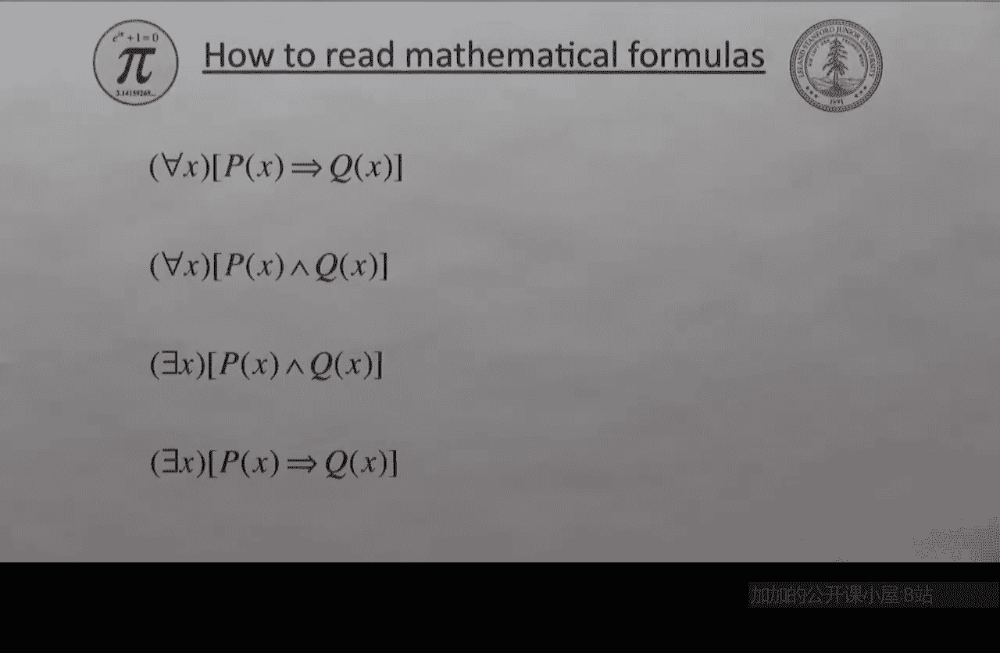

# 数学思维导论：P14：如何阅读数学公式 📖

在本节课中，我们将学习如何正确阅读和理解数学公式。数学公式有其特定的语法和优先级规则，就像编程语言一样。掌握这些规则是避免误解和进行严谨数学推理的基础。

## 逻辑连接符的优先级顺序 🔢

上一节我们介绍了数学公式的基本概念，本节中我们来看看构成复杂公式的核心——逻辑连接符的优先级顺序。理解优先级是正确解读公式含义的第一步。

以下是逻辑连接符从高到低的优先级顺序：

1.  **量词**：`∀`（对所有）和 `∃`（存在）。它们与紧随其后的内容绑定得最紧密。
2.  **否定**：`¬`（非）。它与紧随其后的内容绑定。
3.  **合取与析取**：`∧`（且）和 `∨`（或）。它们通常具有相似的优先级。
4.  **条件与双条件**：`→`（如果…那么…）和 `↔`（当且仅当）。它们通常绑定最弱。

**核心规则**：当一个连接符（如量词或否定）需要应用于多个部分时，必须使用括号 `()` 或方括号 `[]` 将这些部分括起来。

## 优先级规则详解与示例 📝

了解了基本顺序后，让我们通过具体例子来深入理解这些规则是如何运作的。

### 量词与括号的作用

量词 `∀x` 或 `∃x` 只作用于紧邻它的表达式。为了明确其作用范围，我们经常使用括号。

*   **示例**：`∀x (P(x) → Q(x))`
    *   这里，`∀x` 作用于整个括号内的内容 `(P(x) → Q(x))`。意思是“对于所有x，如果P(x)成立，那么Q(x)成立”。
*   **对比**：`∀x P(x) → Q(x)`
    *   这里，`∀x` 只作用于 `P(x)`，而不作用于 `Q(x)`。公式含义变为“如果所有x都满足P(x)，那么Q(x)成立”，并且 `Q(x)` 中的 `x` 是一个未绑定的自由变量，含义不明确。

**黄金法则**：当存在任何歧义的可能时，就使用括号。对于初学者，在处理量词时始终使用括号是一个好习惯。

### 否定符号的范围

否定符号 `¬` 同样只否定紧邻它的内容。

*   **示例**：`¬(3 > 0 ∧ 3 < 0)`
    *   否定符号作用于整个合取式 `(3 > 0 ∧ 3 < 0)`。由于 `3 > 0` 为真，`3 < 0` 为假，合取为假，所以整个公式为真。
*   **对比**：`¬(3 > 0) ∧ 3 < 0`
    *   否定符号只作用于 `(3 > 0)`，得到假。再与 `3 < 0`（假）进行合取，结果为假。
*   **原子公式**：像 `3 > 0` 这样的基本事实称为“原子公式”，它们本身是完整的，通常不需要额外括号。为了清晰，可以用空格分隔，如 `3 > 0 ∧ 3 < 0`。

### 合取、析取与条件

对于 `∧`, `∨`, `→` 等连接符，最佳实践是**始终使用括号来明确结合顺序**，尽管有些约定认为 `∧` 比 `∨` 绑定更紧。

*   **清晰的做法**：`(A ∧ B) ∨ (C ∧ D)`。明确表示是“（A且B）或（C且D）”。
*   **可能混淆的做法**：`A ∧ B ∨ C ∧ D`。如果没有约定，其含义是模糊的。

**核心原则**：对于任何连接符，如果你想让它连接多个部分，就用括号把这些部分括起来。括号内的内容可以非常复杂，包含其他量词、连接符等。

## 实例分析：驾照逻辑测验 🚗

现在，让我们运用刚学的规则来分析一组具体的逻辑公式，它们来自课程中的一个小测验。假设我们讨论“驾照(L)在州(S)是否有效(Valid)”。

以下是四个公式及其分析：

1.  **`∀L [ ∃S Valid(L, S) → ∀S Valid(L, S) ]`**
    *   **分析**：`∀L` 作用于整个方括号内的内容。意思是：“对于任何驾照L，**如果**存在某个州S使得L有效，**那么**L在所有州S都有效。” 这在美国是真实的（一州有效，全国有效）。

2.  **`∀L [ ∃S Valid(L, S) ∧ ∀S Valid(L, S) ]`**
    *   **分析**：`∀L` 同样作用于整个方括号。意思是：“对于任何驾照L，存在某个州S使得L有效，**并且**L在所有州都有效。” 这声称所有驾照都是有效的，这显然是假的（例如，被吊销的驾照无效）。

3.  **`∀L ∃S Valid(L, S) → ∀S Valid(L, S)`**
    *   **分析**：这里没有外层的方括号/括号。`∀L` 只作用于 `∃S Valid(L, S)`，`∃S` 也只作用于 `Valid(L, S)`。所以前半部分是“所有驾照都在某个州有效”（假）。后半部分 `∀S Valid(L, S)` 中的 `L` 是一个**自由变量**，未被任何量词绑定，因此整个公式意义不明确。

4.  **`∀L ∀S1 ∀S2 [ Valid(L, S1) ∧ Valid(L, S2) ]`**
    *   **分析**：`∀L`, `∀S1`, `∀S2` 作用于合取式。意思是：“对于任何驾照L和任何两个州S1、S2，L在S1有效且在S2有效。” 这等价于“所有驾照在所有州都有效”，同样是假的。其中 `S2` 是冗余的。

通过对比，我们可以看到括号如何根本性地改变了一个公式的含义。

## 四种常见模式的辨析 ⚖️

最后，我们辨析初学者容易混淆的四种重要逻辑模式。理解它们的区别是掌握数学陈述的关键。

以下是四种结构的含义：

1.  **`∀x (P(x) → Q(x))`**
    *   **含义**：“对所有x，如果P(x)成立，则Q(x)成立。” 这在数学中极为常见，它建立了性质P和Q之间的**强关联**。

2.  **`∀x (P(x) ∧ Q(x))`**
    *   **含义**：“对所有x，P(x)和Q(x)都成立。” 这等价于 `(∀x P(x)) ∧ (∀x Q(x))`。它是一个强陈述，但逻辑上可分解为两个独立的全称陈述。

3.  **`∃x (P(x) ∧ Q(x))`**
    *   **含义**：“存在一个x，使得P(x)和Q(x)同时成立。” 这也是一个常见且有力的存在性声明。

4.  **`∃x (P(x) → Q(x))`**
    *   **含义**：“存在一个x，使得如果P(x)成立，那么Q(x)成立。” 这是一个**非常弱**的陈述。因为只要找到一个不满足P(x)的x，这个条件语句就自动为真。在数学中，很少需要单独做这样的陈述。**如果你写下了存在量词后紧跟一个条件语句，很可能你需要重新审视你的逻辑。**

## 总结 🎯

本节课中我们一起学习了阅读数学公式的核心规则：
*   逻辑连接符有明确的优先级：**量词和否定最高**，其次是合取、析取，最后是条件和双条件。
*   **使用括号**是消除歧义、明确作用范围的黄金法则。
*   量词会**绑定**变量，未被绑定的变量是**自由变量**，会使公式含义不明确。
*   我们通过驾照例子分析了括号如何改变公式真值，并辨析了 `∀x (P→Q)`、`∀x (P∧Q)`、`∃x (P∧Q)` 和 `∃x (P→Q)` 这四种模式的根本区别。

要熟练掌握这些，关键是通过大量练习来培养直觉。希望本教程能帮助你更清晰、更自信地解读数学语言。