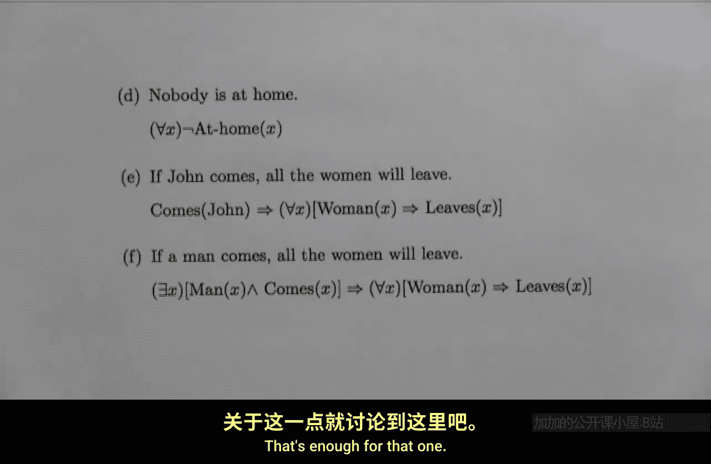
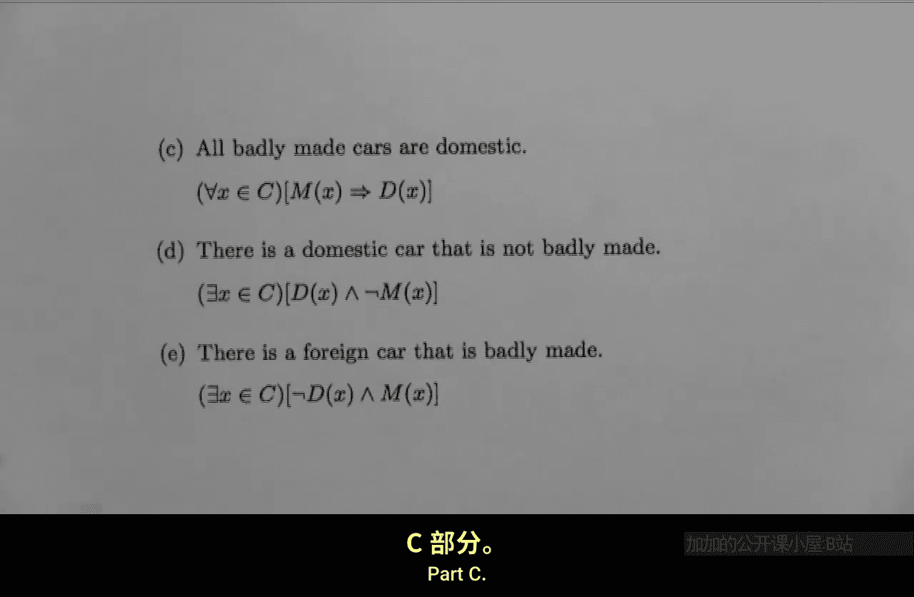

# 斯坦福大学【中英⚡数学思维导论｜Introduction to Mathematical Thinking】 p15 P15 02_作业5指导教程 -BV1D44dzxEa7_p15-

Him are my answers to As 5， starting with question 1。

The equation x cubed equals 27 has a natural number solution。

I got there is an x in the natural numbers， such that x cubed equals 27。For part B。

 a million is not the largest natural number。What I said was there is an X in N。

 There is a natural number X， which is bigger。Then a millionion。Part C。

 the natural number N is not prime。There is a natural number P。And there's a natural number Q。

Such that p is bigger than 1 and Q is bigger than 1， and n equals p Q。

So the our natural numbers peak U， both of them bigger than one， such at n。Is the product of P And Q。

 Not that。Conjuction。Split things in this way。There's a natural order of precedence for the various relationships。

 first of all。A relationship like equals greater than less than comes in。

 Then you conjoin things and disjoin them and do various other things。

 And then next in line of precedence is actually conditional and bi conditional。

And you read these formulas left to right。 There's a P in Q。 There's a Q。 There's a P in N。

 There's a Q in N such that P bigger than1 and Q bigger than1。 And n equals P Q。

 So you read it left right。 This is why we made a big deal about that the American melanoma Foundation。

Because in mathematics， you really have to read things left to right。

 and the left to right ordering dictates the logic。Okay， well， let's go on to question 2 now。

Express the following us for all assertions using symbols and words， okay。

So the equation x cubed equals 28 does not have a natural number solution。Well。

 the most obvious way of expressing it using quantifiers in a symbolic formulaic way is to say it is not the case that there is a natural number X。

 which satisfies the equation。were asked to give it in terms of for all assertions。

So this basically means putting this in in in a sort of canonical form or a positive form。

And to say it's not the case that exists in x and n is to say for all x。In end。

It's not the case that X cubed equals 28， which I'll write in the familiar fashion， X cubed。

Is not equal to。28。Okay。I mean， I could have written it。

 I could have written the last part as being not the case。That x cubed equals 28。 Okay。

 I could have done it that way。They're both fine。Okay。

So now we've expressed the fact that there's no natural number solution。

 another way of saying it is every natural number fails to be a solution。Okay， number B。

0 is less than every natural number。 Let me just stress that the natural numbers。Do not include 0。

 They begin 1，2，3， etc cetera。I mean， historically0 was an unnatural number。 In fact。

 originally0 wasn't a number。 It was just a the zero symbol was a circle which dennoted that there was nothing there and you needed to denote that there was nothing there when you had place value arithmetic so。

This came much later， Brahma Gta in India， 600 and something current error was the one that sort of came up with that。

Okay， well he was the one that wrote about it and it's this today credited we've been the one that really sort of nailed it。

Okay， so0 is less than every natural number。 So this is actually true。 This is a true statement。

 and here's a way to capture it for all natural numbers， X。Zero is less than x。

I could have writtened as x greater than zero， I I mean， in whichever way I like it doesn't matter。

But I've written it since it's expressed in terms of less than。

I've I've used a formula for less than。 but I mean， that' says the same thing。

I guess I don't think there's really anything else to say about that。The natural number n is prime。

 Well， this is actually the negation of of the previous one of part C of question1。

 where we looked at the formula， which captures the natural number N is not prime。

And so we were essentially going to negate that。 You could go back to the previous one and put a negation sign in the front and then let let the negation ripple through as you sort of work your inwards towards a positive statement。

 But let's just sort of jump straight in and and say it directly。

To say the natural number N is a prime in terms of universal quantifiers。

What you're going to say is that for all possible numbers that would divide into it。They account't。

 unless they're equal to one of the number itself。 Okay， so here's a way of saying it。

 whenever you try to factor it。 So for all possible factors into2。If you have a factor。

 if you have a factorization。Then one of the numbers is one。And the other one is N。

So for all possible ways of factoring the number N。Necessarily， one of the factors。Is equal to one。

For all。Possible factors。One of them has to be equal to one。Okay。That's it。😮。

So those are the three answers that I got。For number2。Question 3。Everybody loves somebody。😮。

Here's how I interpreted that。For all people， X。Of all persons X。There is a person， why。

Such should X loves y。For every person。There is a person they love。

The person they love will depend on the person you start with。The y will be different。

 perhaps from one x to the next x。 Give me an x。I'll find a Y。 Give me a person X。

 I can find a person Y， such that X loves Y。Different people， again。

 that American Melanoma Foundation example， which， of course is not a problem in real life because everybody interprets the right way。

 In fact， some of the people on the forum them in the forum discussions。 was that quite a few people。

Who said they couldn't see the problem with the literal statements。Okay。

 this is why we're making a big deal of this because to get to the point where you can understand how the ordering of quant can be important。

 you really have to be able to see what was going on with that kind of example。Okay。

 let's move on to part B。Everyone is tall or short。 What that says is for every person X。

Either X is tall or X is short。Everybody is one or the other。Actually the way this works。

 this is the inclusive or， but of course the properties themselves will make this ajoint disjoint one。

 you won't have someone who's both tall and short， although in real life tall and short will have an overlap。

 you know there comes a point where is someone tall or is someone short so。

Interpreting these is really a matter of interpretation。 I mean。

 I think this is a fairly clear answer。But when you try to map。The ambiguous。

 fuzzy real world into the precision of mathematics。That there's。

 there's something do with some trade offs。 That's the whole point。 The point is， things like this。

very ambiguous。When does tall turn into short。By writing something like this。

 we've turned we've taken something that's ambiguous and fuzzy， and we've forced it。To be precise。

 And that's the whole point of what we're trying to do to get precision。

To get rid of the ambiguity and the fuzziness。Doesn't mean to say that's gone from the real world。

 but it's gone from our interpretation of the real world。

 So this is an interpretation within mathematics， if you like。

With its precision of something in the real world， which is not precise。Okay， part C。

 everyone is tall or everyone is short。😊，That actually comes out a different way。

That says every person's next is tall， that's one part。😔，In the second art。Everybody X is short。

And here we've got another of these precedents rules for logic in the universal and quantifiers or the same is true for existential quantifiers。

 as we'll see。There's a very tight they they're bind whatever comes in the comes next。 I mean。

 so which means we have to use parentheses if we want to use a quantifier that binds everything like we did here。

So to make this bind these two， by the way， I'm talking about things like for all X。Bines。😔。

The thing that comes next， the thing that in the parentheses。We use the word binds for quantifies。

 I mean it governs that。s， it restricts the x's in there。

 And the formal terminology for that is binds。And so in the binding rules quantifies。

 bind everything that comes next to them。 And if you want them to bind a disjunction。

 you have to put them in parentheses。 So that has to become a unit to be bound by for all。

 same would be true for exists in this case， you don't need the parentheses。

 because all you've got is one preddiity here， tall X。 So you've got for all X， tall X， or for all x。

 short X。You might ask yourselves， do you need？These parentheses here。 And the answer is no。

 I've put them in to be clear。Generally the rule for parentheses is you put parentheses in when you need them to disambiguate。

 but because this is the first time we're running through these and I'm being explicit with parentheses the goal in all cases is avoid ambiguity and if you haven't got something ambiguous。

 you don't need the parentheses。Alright， so'll notice that these are different though。

 This is talking about either everybody is tall or everybody is short。

This is highly unlikely to be to be true， except in a very strange sort of society。

 This one is certainly true if we're prepared to say whether whether tall and short changes at sort of I don't know。

 five feet or whatever you want to do okay。Okay， let's move on。 That's enough for that one。

Well， for nobody at home， I took it as a sort of a universal quantification， if you like。 I took。

 I read this as for every person， X， X is not at home。 You might have gone a different way。

 You might have said it's not the case that there is an X。Just at home， X。Okay。That would be fine。

 You might think that you might think that this is actually a closer rendering of this one。

 It depends whether you regard that as some kind of a universal quantifier or not。 You know。

 So I'm I'm interpreting that as saying something about。

A sort of a negative universal quantiifier all I'm saying it's this fex。

 It's not the case of ex term， but you could equally well argue， I think。

 to say that that the most natural one is to say there is no person who's at home。Okay， you know。

 in natural language， is that a sort of a universal quantification or is it an existent sort of a negation of an existential quantification depends how you interpret it。

 but both of them are correct。 These are equivalent。As we've seen， these are equivalent asserts。

It's just a matter of choices to which we think more accurately reflects the nuances of English language。

 part E。If John comes， all the women will leave。If John comes then， so this is， I think。

 very clearly an if。Statements， and then there's a conclusion。 So this is the antecedents。

And then we got a consequence。So John comes。 Then it's the case that all the women will leave。

For any x and our variable x ranges over people。 So we have to say， for every x。Effect is a woman。

 then next leaves。 So that's all way of saying。All women leave。For all X effects is。

 and I've put brackets here。Because I want to make sure that the universal quantifier。

Applies to this。It's the same X that if X is a woman， then X leaves。Already， number F Part F。

 if a man comes all woman， all the women will leave。 In this case， it's not a single person。 John。

 It's any old man。 So well have to say if there is an X。 So here's the if part。If there is an X。

Who is a man。And who comes。Then。We've got the consequence。That every woman leaves。

This is the same as the previous thing。 So this still says every woman leaves。

 But instead of saying John comes， I'm saying there is an ex who is a man and who comes。

Well notice that number four isn't about whether these things are true or false。

 It's simply about expressing them in a formal fashion in this case。

 using the quantifiers at range over the set of rails and the natural numbers。

 this actually is a very common situation when you're looking at real analysis。

 the theory behind the calculus， you have quantifiers at range over the real numbers and either the natural numbers or the integers the positive and negative numbers。

 the whole numbers but it's very common to have this kind of scenario。Okay。

The equation x squared plus equals 0 has a real root for any number A， for any real number A。

 So here's how I， how I wrote it for all real numbers a。There's a real number X。

 which satisfies the equation。Notice that here， the quantifier over a comes first here。

It came at the end of the sentence。Now， this is because this is a very natural way of writing it in English。

we certainly have to be careful， we don't make that melanoroma foundation mistake of getting quantifies in the wrong order。

In English， it's fine because we， we know how to read these things in mathematics， it's crucial。

 Ably crucial that the first thing that comes here is that the for， if this guy comes first。

 it's going to be wrong， It's not going to capture it。So when we take a sentence in English。

 even whether if the quantifier comes at the end and hear the quantifier for any real number A。

 this is a universal quantifier， even though that comes at the end of the sentence。

 which is fine in English。Wasn't fine for the American melanoroma film。

 actually it was because everyone reads that melanoma example correctly。

 but it causes mathematicians some amusement every time。But in this case。

 the order is absolutely crucial。And here's why because。😊，The X。That we get。Depends。On the A。Okay。

In fact， for some As， you're not going to get an X as we know。 I mean。

 this is only true if it is negative。 and we'll look at our case in a minute。

 So this isn't even true for all A。But even if you take the negative as。

 the X that solves it depends on the a。So you have to have an A before you can find the X。

 One way of reading this is to say， if you give me any a。I will find an X that solves the equation。

 you give me an A， I'll find an X depending on the a that solves the equation。Already？

Quantifier order is crucial in this kind of expression。Part B actually brings into the previous one。

 but except we're really talking about for any negative real number。

 and this is actually going to be true。😊，So there's a quantifier for any real。왜 any negative number？

And we're got to capture that as follows。 We're going to say。

 because we don't have the set of negative real numbers。 We've got the set of real numbers。

 So we have to say， for all real numbers a。Okay， if it's the case that is negative。

 then so there's an if there。 And here's a then。Then it follows that there is an X that satisfies the equation。

So let me read that once more one more time for any real number a。If it happens， it is negative。

Then there is an x which solves the equation。Or in terms of you giving me a number and me finding an answer。

 if you give me an A。Then providing the air that you give me is negative。I can find an X。

That satisfies the equation。 But again， notice。As was here。The X depends on the A。

Youll give me a different ear。 A few minutes later。

 I can still find an X providing the a is negative， but it'll be a different X。

This is why the order is important。 The a has to come first because the x depends on the a。Now。

 that's actually true here as well。 But English allows you to see them in the opposite order and still mean the same thing。

 because English is a rich natural language。Mathematics is got this a precise formal language。

 at least this kind of kind of formulaic mathematics。 This is very precise and formal。

 and it has to be for doing particular things in mathematics。 I mean。

 most mathematicians most of the time don't write things formally this way。 They use English。

 They write things like this。This kind of expression is importance in certain crucial stages of mathematics。

It's not that mathematicians argue using precise language all the time， they don't。

 they argue using everyday language。But when it counts。

They pull this kind of a thing out because it's crucial。And in fact。

 the very last week of the lectures in week 8 when we look at the last topics。

 we're going to make some very， some historically and actually contemporary important examine we're going to look at something very crucial to modern mathematics that were developed in the late 19th to early 20th century。

 many late 19th century， where it was actually crucial in order to advance in mathematics to make one or two key definitions with this kind of precision。

Okay， that's issues of convergence of sequences and continuity of functions。Okay， part C。

 every real number is rational。So， if we real number x。What are we trying to say。

 we're trying to say for， this is of course is false， right， that's again， as as in other examples。

 we've been looking at， this isn't about whether things are true or false。 I mean。

 this one was false。 This one not actually true。 This one is false。

 And let me just mention these things。 That one's false。 This one's true。 This one's false。 I't。

 this isn't what we're asked to do。 We're just we're just looking at expressing things。

 The point is you can express things in mathematics precisely。 whether they're true or false。

And sometimes you have to express them formally in order to determine whether they're true or false。

 But it's a separate issue。 Tru or falsealsity。 Tru or falseals is a separate issue from whether you can express it formally。

Okay， everyone number is rational。That really says that you look at any real number X。

 So this is the every real number part。What you want to say is the real number x can be expressed as a quat of two inchestegers。

 So you would probably say M over N。Equals x or well。These are positive numbers。

The X could be negative， so we've got to allow for the fact。Minus M over n equals x。

So that's to say m over n equals x or minus m over n equals x， or the x could even be be0。Okay。

So you could have zero equals x if we're putting the x is second， so three possibilities。

It's equal to the ratio of two natural numbers or minus the ratio of two natural numbers。

 or it's equal to 0。Okay。Oh， incidentally， I wrote it this way just because it's sort of neater。

 I mean， my the aesthetic， you know， I've been in mathematics a long time。

 and you develop an aesthetic sense。And the sense I developed was that it's cleaner to just write it this way。

 in part because when we're talking about natural numbers in the natural numbers。

 you have two operations， essentially you've got plus and you've got times。

You don't have negation and you not always。 I mean， you can sometimes subtract。

 but one number has to be bigger than the other。 and you don't always have division。

 You have a property of divisibility， but you don't have division。

 So when you're dealing with just natural numbers， all you can do is add them or multiply them。 Now。

 here， we've got real numbers flow thrown in as well。

 So there's nothing wrong with writing it this way。

But because M and N typically when they're on their own， don't involve division。

 I just thought it was sort of nice and elegant to avoid writing M over N。

 because this actually ticks you out of the integers out of the natural numbers。U。But I mean。

 this that's this， this is just aesthetics。 It's not a question of right or wrong。

 It's just a matter of aesthetics。 If you'd do read it this way， that's absolutely fine， okay。

we've captured it。 notice that the M and the N that exist depend on the X。You give me an X。

I will find an M and an N， which satisfy that。At at least I would if that happened to be true。

 it's not， so I can't always find them。But the order of the quantifiers is crucial here as well。

 If you get the orders， I mean， the M and the end， it doesn't matter with those two。

 This is symmetrical。 But if that guy comes in here somewhere。Then it's not going to capture it。Okay。

Well， part D is just sort of like a negation of part C if you like， okay， and here's how I wrote it。

There is an irrational number， so there is a number。With the following。propertyperty。That for all。

 pairs of natural numbers， M and then。M divided by n is not equal to x。And negative M divides in。

Is not equal to x。Okay， as before。I have to look at both possibilities。To allow for negative numbers。

 previously， we had a disjunction here because we were talking about the positive thing。

 and I've really just negated what what came before。

Notice that I'm not pulling brackets around this whole thing because I don't need them。

 because when you read left to right。There's only one way to read this because of of the parentheses I've got in。

There is an X now。This is going to be the irrational number we're asserting to exist。

With the property。But for all A men and for all any men。Now， I've got brackets in because this part。

Has to be brought together。M is not equal to Nx， nor is M equal to negative Nx。

M divided by n is not equal to x， nor is。Minus m divided by N。Equal to x。Okay。

So I suggest you compare this one with part C that we just did to see how I've just taken my answer to part C。

 and taken the negation and made this an existence statement。Party。

 well I mentioned in when I formulated the question that this one looked quite complicated， it does。

Unless you could do， you do what I did。 I there are two ways。 Ive I， I answered this two ways。1。

 I said， well。What I could say is that。For all world numbers are。For， for all real numbers， why。

There's a real number in that's bigger than why。Which is not rational。So given a real number。

 I can find a bigger real number。Given a real number。You can find a bigger real number。

Which is not equal to。The quos of two intes M and N noticed that I didn't bother with the negative part here。

Because I'm going bigger and bigger。And if you're trying to say it as's no largest ir rational number。

 you're really going， you're in the positive range。 you're going up into the positive range。

 So what happens in the to the left of0 on the on the real line is irrelevant。

So I don't need the negative part because I'm talking about there been the largest one。

But I am saying that for given， given any real number。There's a number bigger than that。

Which is not the quatient of two integers。 And again。

 because I'm now restricting myself to natural numbers， I think it's cleaner to write it in this way。

 But you don't have to because we are globally。 We're talking about real numbers。

And which means that we could， in fact， here just right M over then。Not equal to X。

 And that would be fine。 It was equal was fine before。

 I'm just trying to draw the draw attention to the point that the natural numbers themselves。

Only have additional multiplication。But we are， after all talking about real numbers so there's no problem writing it this way。

 wasn't a problem The previous questions either。Okay， you could， however。

 say that this is really a statement about。Just the irrational numbers， given any irrational number。

 there's an even bigger irrational number。 Then it gets extremely complicated because you have to say。

Given any real number R。😔，If that number？😔，Is irrational？Then。There's an even bigger number。

 That's irrational。So the differences in this one， are simply said， given any real number。

 there's a bigger number。 that's irrational。And in the second1， I' have said。

 given any irrational number。There's a bigger number。 That's irrational。Now， arguably。

 the second one is a much closer interpretation of what this means。

 because you could say what this is really saying is it's making a statement about irrationals。

 So you're really only going to mention irrationals。And that's the second version。

 Given any irrational， there's a big irrational。So this is a closer。That's a closer answer。

The first one is equivalent to it。Because the irrations and the irrationals make up the rails。

 they're sort of interspersed。And if you can find an irrational bigger than any real number。

Then you can find any irrational。Bigger than any irrational number。But。know either are correct。

 It's just a matter of how youre interpreting them and exactly how much of this statement。

You are capturing in the formalism。Once you've got something formal， it's。

 it's it's not ambiguous as long as you express it correctly with the parentheses and so forth。

 It's not ambiguous。 It's absolutely precise。 This thing has exactly one interpretation。

This thing has exactly one interpretation。 That's the whole point。 This has several interpretations。

 I mean， here are two different ones。 They're equivalent。 They're obviously equivalent。

 for very obvious reasons。But we've cashed them out in different ways。Well。

 question 5 is our old friend about domestic cars and foreign cars。So C is a set of all cars。

 Dx means x is domestic。 Mx means X is badly made。All domestic cars are badly made。For all cars。

If that car is domestic。Then it's badly made。For all cars。If the car is domestic。

 then it's badly made。I think that's a fairly straightforward 1。 I。

 I wouldn't expect you to come up with anything significantly different from that。

 In fact I wouldn't expect you to come up with anything different from that at all。

 But you might have done， okay。All foreign cows are badly made。

 where we don't have a pendicate for phones。 So we have to take foreign as meaning not domestic。

 in which case we take the previous one， and we just replace the D X by negative D X。

And so by not dx， so for all x in C。Effex is not domestic， then it's badly made。

And here I'm making use of the fact。That negation is is a very tight binding as a very tight binding。

 negation， like quantifies applies to whatever comes next。

 So if you want to negate a whole bunch of things。You have to sort of join them together。

And put parenthesis around in order to make sure that the negation applies to to the whole thing。

 So negation applies to whatever comes next。And so if you wanted to apply to a bunch of things。

 you have to put them in parentheses。 So just as with arithmetic and in algebra。

 you have to use parentheses to disambiguate。And the rules actually follow pretty closely to the rules in in arithmetic and algebra。

 And so once you realise how negation， conjunction， disjunction conditional， bi conditional。

 once you realise how they correspond to to formulas in。

 the symbols of mathematics to the symbols of algebra and arithmetic， then you。 you'll be。

 it should be able to follow the the these kinds of formulations。 Okay。

 it just takes a little bit of getting to use to just as it does it in arithmetic and algebra。Part C。

All badly made cows are domestic。For all cars。If the car is badly made。Then it's domestic。Again。

 I think that one's straightforward。There is a domestic car that's not badly made。There is an X。

 which is a car， which is domestic。And it's not badly made。Notice， by the way。

 that when we're capturing universal quantifiers with statements that involve on if， then。

 then we have。A conditional an implication for all X。If it's forex of in the cars for all cars。

 if the car is badly made， then it's domestic in the case of an existential quantifier。

 if there is a car。We're seeing there isor car， which is domestic。And not badly made， so。

When we have universal quantifier， we typically will pair it with a， with a conditional。

 with an implication。 when we have an existential quantifier。

 we would typically compare combine it with a with it with a conjunction。 Okay。

 so for all goes with the implication exists goes with conjunction， at least in these kinds of cases。

 the trick or it's not a trick。 The rule or the thing we have to remember is to try and understand what these things say。

 so it's never a good idea to look for symbolic rules。

 that can lead you astray if if the formulation is a little bit different。

There is a foreign cow that's badlyly made。There is an X in the set of cars。Which is foreign。

 namely non domestic。And it's badly made。 And because negation binds tightly。

I didn't bother putting parenthsesis around this。If I wanted to say not Dx and M of X。

 I would put pros on there， but the negation just binds what comes next to it and what comes next to it is that it's not domestic。

Okay。It's fallen。Already， well that takes care the of the foreign cars。 Let's move on to question 6。

😊，Qu6 is about the same kind of things we've already been looking at in some of the earlier ones and name whether things are rationals and whether they've ordered in a certain way。

 whether they're biggest rationals or whatever， but we've got a different set of restrictions here with asked to simply use quantifies for real numbers。

Loical connective， the order relation。 But we do have a symbol Q of x， meaning x is rational。

 So we're going to get a different expression。 So the focus in what we trying to make precise has been。

 has been put elsewhere。Okay， we， we're allowed to assume what it is to be rational。

 That's not part of what we're trying to explicate。So in this case。

 we don't have to talk about things within the reals or not whatever， because that's all we've got。

 So I don't have to say for all X in R for all Y in R。 can you say for all X and for all Y。And I've。

 I've left off parentheses because there's no ambiguity。 that just means for all X， for all binds。

 whatever comes next to it。 So for all X and for all y。 Now。

 I do have brackets because there's a bunch of things going to come next that depend on the for all X and for all Y。

 So for all X and y。If x is less than y， then。There's a Z。Which is rational and lies between X and y。

So reading left or right for all pairs of real numbers， X and y。With x less than y。There's Z。

Which is rational， and lies between them。Now， I didn't write exist Z。In queue。

I didn't write that because the queue isn't a set。In this case。

 we've got a predicate meaning that x is rational。Okay， so I I'm distinguishing。 I mean。

 what I'm doing with a lot of these examples actually is distinguishing between the various formalisms we have for expressing things within mathematics。

 and sometimes we use sets， sometimes we use predicates， sometimes we use quantify restrictions。

 Sometimes we use predicate restrictions。 They're all different ways of getting getting formality and precision into statements。

 and in mathematics， we we pick the one that's that's most relevant。 In fact， in most mathematics。

 we never use these formalisms in this detail。 this is much more akin to to things we have to write down in computer science。

 but we're actually trying to。Unravel or to learn how to unravel the formal structure beneath the statements we make。

Okay？Well， that was number six， let's press on to number7。Okay。

 and number 7 is this famous quotation， which is allegedly made by Abraham Lincoln。 Actually。

 there's there's there's some some dispute on on websites as to who was supposed to have said this。

 but it's it's commonly and popularly ascribed to Abraham Lincoln from our for our purposes。

 it doesn't really matter who said it。 the issue is can we can we。

Make it precise within within mathematical language。 You will fool all the people some of the time。

 You can even fool some of the people all of the time。

 but you cannot fool all of the people all of the time。

 The reason I like this example is that the quantifiers in English are used in the way we use quantifiers in English。

The quantifiers come at the end。Of of the clauses。 But in mathematics。

 we read strictly left to right。 and so the quantifiers have to come first。

So let's let FX T mean you can fool person whoops， P。 that should have been a preachach shouldn't。

 So let me just change that now。Okay， that F P T meaning you can fool person P at time T。

Then let's take these one by one。 You may fool all the people some of the time。

That means there are some。When you can fool all of the people。There are sometimes when you can。

 the point is。Take in this clause。The people。Depend on the time。 There are some。

When you can fool all of the people。There are some times when you can fool all of the people。

 So we have to say there are some times when you can fool all of the people。

Then there's a second clause。 And this is going to be a conjunction， because these are。

Different things we're saying。So there's an andt， if you like， there's a。

 there's an unstated ante here。 you may fool all of the people some of the time， and。

You can fool some of the people all of the time。That's the second part。 So， and。

There are some people。 And because quantifiers are these extremeal cases， we only have there exists。

 and for all， at least those the common ones。And so some in in， in the case， when we was quant， some。

Is captured simply by there is at least one。And strictly speaking。

 that's really the logical heart of some。 If we say something。Then strictly speaking。

 we're saying there's at least one。 Now， arguably， you could say in English。

 when you use the word sum， there's an implication that there's more than one。Okay， well， you， you。

 you could， you could follow that。 But in in， it turns out that in mathematics， it's really more。

 more。Lets you say more efficient。To just focus down on one。 So there's a。

 there's a specialization occurs in mathematics that when we say some things。

We usually mean there's at least one and we can capture that by the quantifier exists。

You can fool some of the people all of the time。That means there are some people。

 There's at least one person。Who can be fooled all of the time。And in this gloss。

 what's been captured， that's important。 I mean， you can argue about you know。

 whether whether sum is really well captured by exists。 but。

 but really what's going on here is that the。People that are fooled。

Can change from one time to another。Okay。No， I said the wrong way around， didn't they。

 what's really going on here？😊，Is that all of the time。You'll be able to for any time。

You can find some people。 Oh is that what I'm saying。 Let me think about this for a minute。

So the people all of the time。Yep， I think that's correct， okay？😊。

You can fool some of the people all of the time。 so you can find some people who can be fooled all of the time。

You can find some people。Who can be fooled all of the time。Okay。

 I saw for a moment that when I worked this out a little while ago， I got it wrong， but no。

 I think that's exactly what it means。There are some people。Who can be fooled for all of the time。

Okay， so I'm happy with that one， I'm happy with that one。 let's look at the last one。

 but the but that's just another conjunction really。😊。

You cannot fool all of the people all of the time。 I think this one's the one that's easiest because there's just two oils。

 It's not the case。That you can fool all people all time。And for this one。

 you could swap those round。 You could have for all T and for all P。You've got。

 when you've got two universal quantifiers or two existential quantifiers。

 it really doesn't matter which order you put them in。But when you have， for all and exists。

 it really does matter which way you， you write them down。So let's just recap， this says。

There there are times。When you can fool。All of the people。

There are times when you can fool all of the people。

 This The first clause is about fooling old people。

 and it says that there are times when you can do that。The second clause。Is different。

 It says there are people that you can fool all of the time。It said there was some people。

Who could always be fooled。You can fool all people some of the time。

So there were some when you can fool all people。And you can fool some people all of the time。

There were some people who can be fooled all of the time。

But you cannot pull fool all the people all of the time。Okay， well， I stumbled a bit here。

 at least I had second thoughts for a moment， but on reflection。

 I decided that I got it right the first time。 and and I'm happy with those three。

 So let's well I hope you managed to get something similar to that。 I think this is tricky。

 This is tricky。 no doubt about it。😊，That suck why。 It's a good exercise。

 It's a really good exercise in understanding how mathematical formalisms capture the kind of things we will we actually do see in the real world。

 And this is a real world statement， one with some cultural significance。😊，Okay。

 let's move on to number eight。😊，Okay， well， listen to that number 8 is is really very similar to the American melanoma Foundation example。

 Okay， a driver is involved in an accident。Every six seconds。Okay。

 so we've got x as a variable to note a driver T a variable for six second interval。

 A X T means that x is in an accident during interval t。The headline is written。

If we simply take a literal translation from this into the formalisms of this， this。

ThisThis language we got here， we would say。There is a driver。Such that for all times tea。

A is involved in an accident at times T in that six second interval。 Okay， so that's a literal。

Interpretation。Then we're going to rewrite it so that the English expression really captures it in a literal way。

And then we would say every six seconds a driver is involved in an accident。And in that case。

 we're saying。For every six second interval， there is a driver。Involved in an accident。

 noticeice here that the driver。Can change。From one interval。去问到的。

The driver can change from one into another。For all T， there is an X， A X T。These are different。

 These are very， very different。And this makes a huge difference in mathematics。嗯。know。

As I mentioned， a lot of you had trouble really seeing that there was any problem with the American Melanoma Foundation example。

 and of course， in everyday language， there isn't a problem because we use our understanding of the real world in order to disambiguate。

But when you start to make those things precise for doing mathematics。

In order to develop a language and a formalism， a way of saying things that's totally precise and reliable。

 then the order in which you say things makes a big， big difference。

 And that was the whole point of that exercise on these other ones is to make sure that the left right ordering。

Of the various formulas。Cappttures the logical flow。And there's a logic to this。This one says。

There is a driver who was in an accident。Every six seconds。Which is nonsensical。

 this one says for every six seconds there's a driver in accident。

And when we took the formal language。Then the distinction is， is really， really significant。Okay。

 okay。 well I。I guess we've finished we finished assignment 5。 Okay。

 quite a of quite a lot of questions in there。 This is not easy to master。

 but once you've mastered it， boy， you can， you can。

 you can tear through mathematical arguments at a much greater rate。

A lot of the difficulties people have following mathematics is they try to bring to mathematics the sort of the inherent sloppiness and ambiguity and vagueness of everyday language。

 And when you do that， you just run into trouble。The whole point about dis formalalism is it eliminates all the ambiguity because in mathematics。

 we very often don't have knowledge of the everyday world to help ourselves out。

 as we do when we use language in the everyday world。Okay， how did you guys do in in assignment 5？

wasnn't easy， was it？😡。