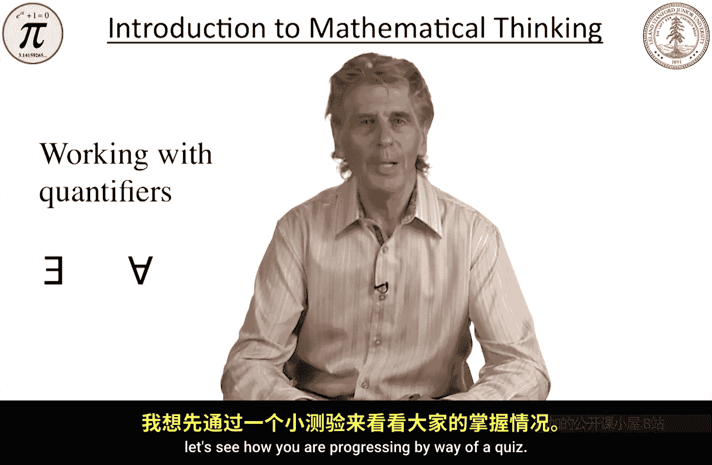
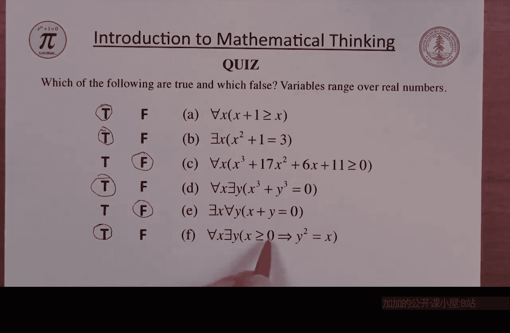
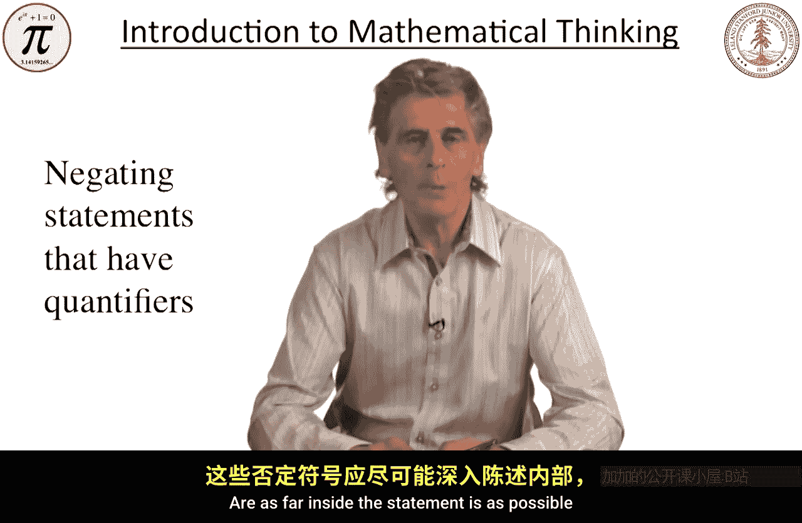
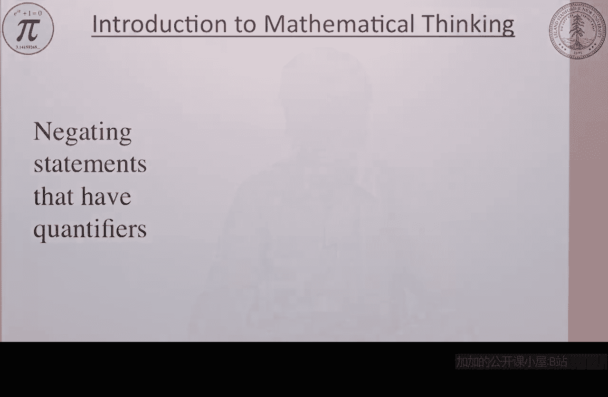
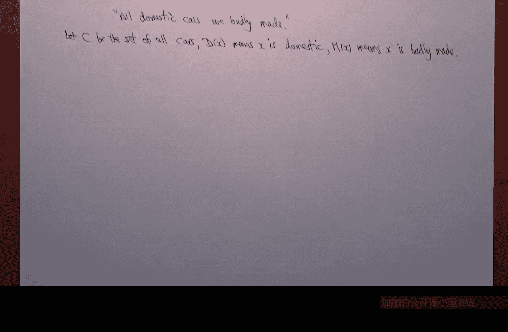
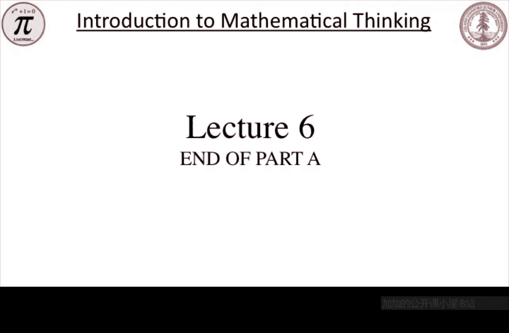

# 斯坦福大学【中英⚡数学思维导论｜Introduction to Mathematical Thinking】 p17 P17 01_讲座6a：量词运用1 -BV1D44dzxEa7_p17-

How did you get on with assignment 5？Mastery of quantifiers is the one last stability you need to be able to cope with definitions of mathematical concepts and with mathematical reasoning。

I'm going to begin by looking at the way negation affects quantifiers。But before I start。

Let's see how you're progressing by way of a quiz。

Okay， let's see what we have。Is it the case that for every real number of x。

 x plus 1 is greater than equal to x。 Yes， it is。Is it true。 There is a real number of x。

 So it said x squared plus 1 equals 3。 Well， that would' mean x squared equals 2。

So we're really saying， is it true that there exists in number x。Whose square is two？Well。

 if we were talking about the rational numbers， the answer would be no because the square root of two is irrational。

 But for the real numbers， it's true。What about this one？Well， for very large negative x。

X cubed is an extremely large， negative number， which will dominate all of these numbers。

So for large negative x， this expression， this cubic expression is negative。

 So it's not the case that it's always positive。 So that one's false。What about this one。

Is it true that for all x of is a Y x cubed plus y cubed equals 0。

 That would mean y cubed is equal to minus x cubed。The answer is， yes。Give any X。

Just let Y be negative X。When you Cuba a number。You cube a positive number。 It's positive。

 You cube a negative number。 It's negative。So by taking y equals negative x in all cases。

 you'll get zero。 So this one's true。What about this one。Is there an X？

Such that whatever why you add to it you get 0， the answer is no。

If the quantifies were the other way round。The answer would be yes。For every Y， there is an X。

Such that x plus y equals 0。 namely， you'll let x be negative y。

But it's not the case of his one x that works for all way。 So that one's false。What about this one？

Well， is it the case that for all X， there is a Y。Such that if x is non negative。

 then y squared equals x。 Well， let's look。Supposing we took an X。If X was negative， then。Game over。

 because this conditional would be true。 It would have a false antecedent。If that Xs。

Was non negative。Then there is a y whose square is x， name the square root of x。

So whatever x we take。There's always going to be a why that satisfies this。It's true。

You might have to think about this one a little bit。Because there were two cases involved。Given an X。

 you can find a Y。That makes this thing true。If the X you're given is negative。

Any way will make that true。Because if the x is negative， the antecedent is false。

But if the ex you're given。Satisfies this condition。 If the extra given is non negative。

Then the y U pick is a square root of x。You see what's going on？If you're given a negative X。

There is no y that satisfies y squared equals negative x， not in the real numbers。

But that eliminates that case。So this one's quite subtle。I suggest you think about this one。

It's the kind of thing that you encounter quite a lot in mathematics。Okay， well， how did you do？Okay。

 let's move on。In mathematics and in everyday life。

 you often find yourself having to negate a statement involving quantifiers。Yeah， of course。

 you can do it simply by putting a negation symbol in front。😊，But that's not enough。

 at least often it's not enough。 You need to produce a positive assertion， not a negative one。

The examples I'll give should make it clear what I mean by positive here。 But roughly speaking。

 a positive statement is one that says what is rather than what is not。In practice。😊。

A positive statement is one that contains no negation symbol or else one in which any negation symbols are as far inside the statement as is possible。

Without the resulting expression being unduly cumbersome。

Let's look at our first example of negating a quantified statement。

Let E of x be some property of x。For example。X is a real root of the equation x squared plus 2 x plus 1 equals 0。

And I'll sure that not for all X here of x。Is equivalent to do exist X， such that not e of x。

For example。It's not the case that all motorists run red lights。Is equivalent to。

There is a motorist who does not run red lights。Well， in this case。

 it's pretty obvious that these two are equivalent。

The proof that I'm going to give in the general case。

Is actually the same reasoning you automatically do when you look at this specific case。

If it seems hard to follow， the issue is purely one of the abstraction。Improving an equivalence。😮。

So I'm going to prove an implication from left to right。And then， from right to left。

So we begin with the left to right kiss。I'm going to assume。Not。For all X。A x。Well。

If it's not the case that for all X。A of x。Then at least onex must fail to satisfy Ivx。So。

 for at least one x。Not if X is true。😮，In symbols。There exists in X。Such that not ir is true。Well。

 that's the left to right implication， I assumed。Not for all X of x。And I concluded， do existx。

 not Ivx。Now， we want to do the other implication。So assume exists sex， not air of X。Well。

 in this case， there's an x for which a of x is false。

That's just expressing this in everyday English。Well。If there's an x for which E of x is false。

Then airvix cannot be true for Orlix。In other words。For all， X A of x must be false。

Expressing that in symbols。It's not the case that， for As。Hevos。

And now have proved the second implication from exist X not a of x to not for all X a of x。

Assume exist X not A of X conclude not for allx， A of X。If you found this reasoning hard to follow。

It's purelyer because of the abstraction。The logic is exactly the same as in the example。

Almost certainly， you had no difficulty with this example。

 And that's because you are familiar with this situation。

The human brain is very good at doing logical reasoning about familiar situations。

 When we turn those situations into abstract versions， the brain finds it difficult。

 at least at first。 And， in fact， one of the things about becoming a mathematician is learning to take familiar everyday reasoning that we don't even think about。

 when you do it automatically。And reproduce it in an abstract situation。

And it's the abstraction that's causing you difficulty。You can follow the logic。

But you find it difficult to follow it in an abstract situation。

 And that's just because of the way the human brain works。Okay， why don't you try this one？

Show that not there exists an Xa of x。Is equivalent to for all x， not of X。And before you start。

 you might want to look at an everyday example。This is coming up as an example in the assignment for this lecture。

But you might want to try it now。While this example is fresh in your mind。Okay。

 good luck on that one。With that one under our belts。

 now we can go back and look at that earlier example of the negation of all domestic cars are badly made。

Let see with a set of all cars。D of x means that x is domestic and M of x means that X is badly made。

With this notation， the sentence becomes。4 all x in C。D X。Implies Mx。For all cars。

If the car is domestic。Then， it's badly made。Well we've already seen what happens when you negate a universal quantifier。

The negation becomes。There exists an X in C。Such that。Dx。Does not imply。N of x。And here。

 I've actually abbreviated。The following。Not the case。The X。impliesmplies M of x。

Where it's not much of an abbreviation， but instead of writing not D， X implies M of X。

 I views this simpler notation， D X does not imply M of X。Okay。But in any case。

 looking at our previous example， the one that I illustrated with the motorist。

When you tick forvolex， something and you negate it。

 you get the exist sex with the negation of the thing inside。

 Just compare what's going on here with the previous example。One comment， why am I not saying？Exists。

Not in sea。Beginner students often do this kind of thing。

And the reason they do it is they are trying to go through a formula symbolically。And negate things。

And that's not the way to go about these things。 You've got to think about what the symbols mean。

 In this case， it's talking about X's， which are in C。

The only xs we're interested in are xs which are in C。 In other words。

 the only object we're interested in are cars。But if the only objects were interested in are cars。

The negation will only be talking about cars。So the in sea part simply tells us which kinds of objects we're dealing with。

 And we don't negate that。Okay， now let's look at this part。We know。Dx。Does not imply。M of x。

Is equivalent， too。D of X and not M of X。In fact， this was the key part of our reasoning to figure out the truth table for the conditional。

D of X does not imply。M of x。If D of X can hold， and nevertheless， M of X can fail。

So we looked at this when we did truth tables。So the negation of the original sentence。Which is this。

Is equivalent， too。There exists sex in C。This part。Is the same as this part。Dear Vex。And not。M of X。

Well， what does this mean in everyday language， it means。There is a car。Which is domestic。And。

Is not badly made。And that's it。😮，So if you found it difficult to figure out the negation of this sentence when we first looked at this example。

Now， because we've got this notation and this little method for dealing with these negations。

You should be able to follow it through fairly straightforwardly。Moreover。

The previous time when we looked at this， even if you got the answer。

 you might not have been totally confident that you got the answer right。

This kind of reasoning makes it clear that this is the right answer。

And that's the whole point of introducing this formal of notation and this logically precise reasoning。

We're no longer left。 Not certain if we've got the exact best， correct， logically correct negation。

The mathematics leaders。这个样子。And that is the correct answer。O。

