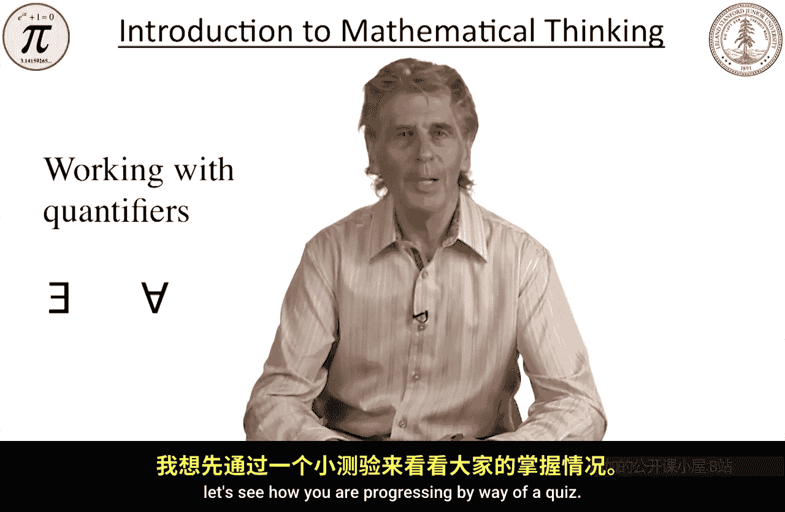
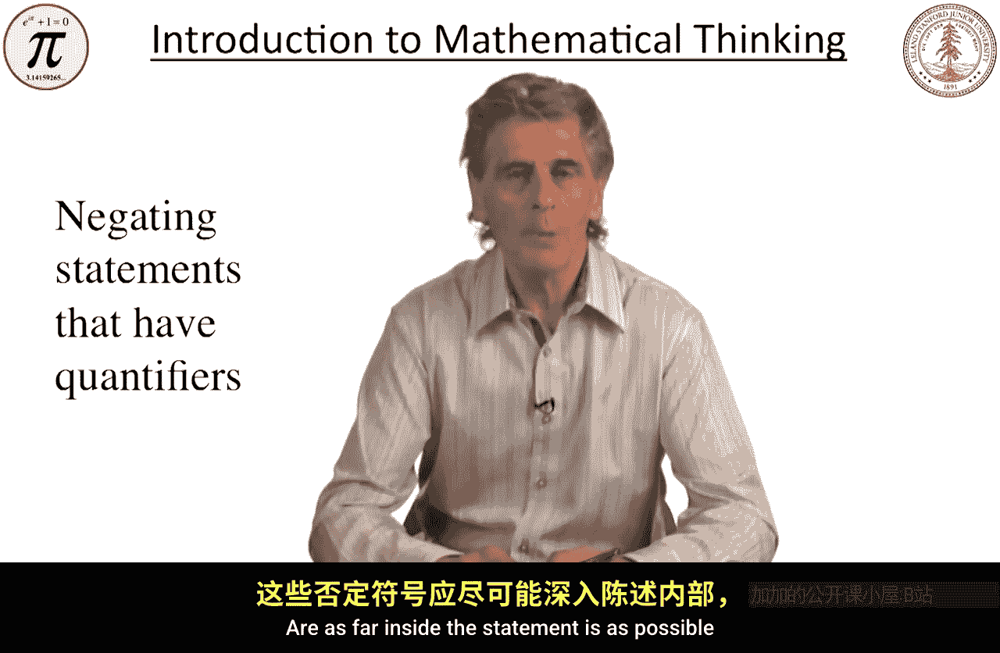
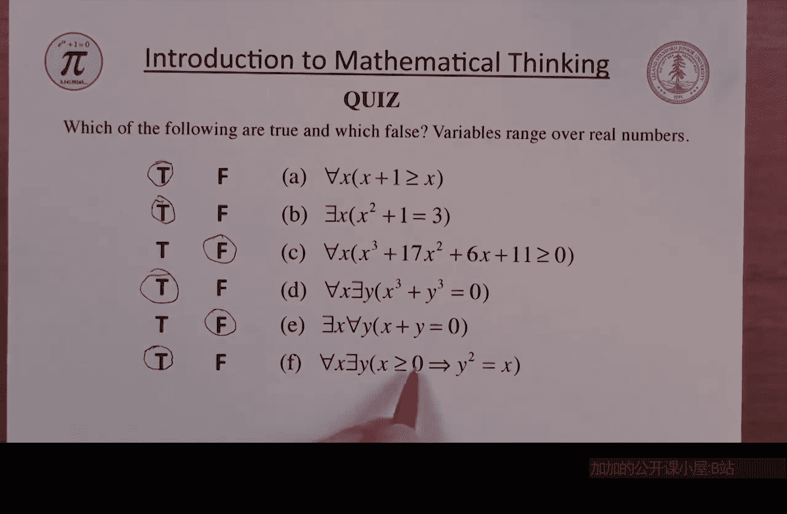
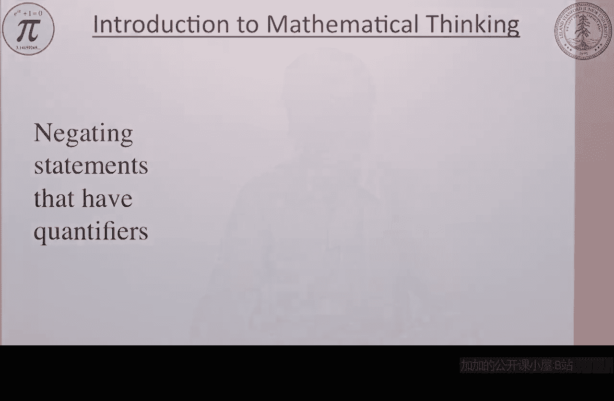
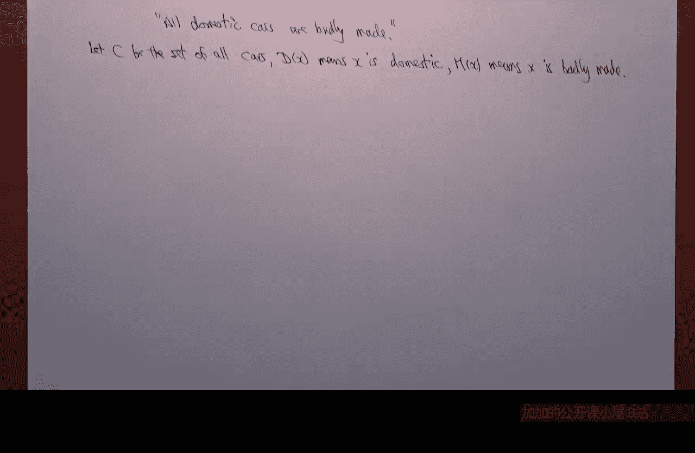
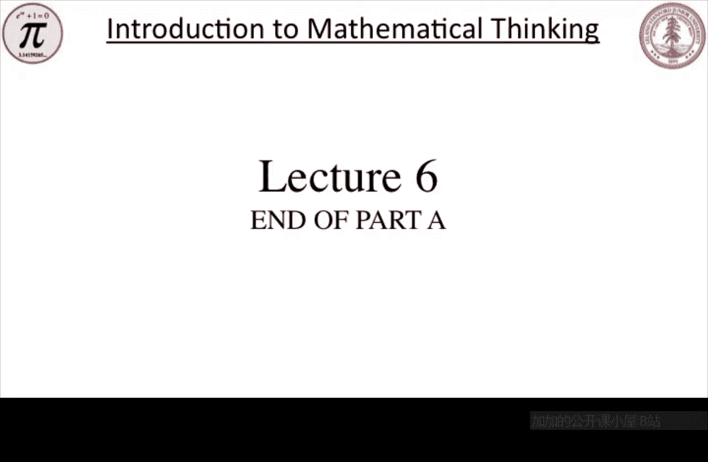

# 数学思维导论：6a：量词运用1 🧮

在本节课中，我们将学习如何运用量词，特别是如何对包含量词的陈述进行否定。掌握量词是理解数学概念定义和进行数学推理的关键基础。

## 课程概述

上一节我们介绍了量词的基本概念，本节中我们来看看如何对包含量词的陈述进行逻辑否定。我们首先通过一个小测验来检验当前的理解程度。

以下是测验题目的解析：

1.  **对于所有实数x，x+1 ≥ x**：正确。对于任何实数，加1后结果不小于原数。
2.  **存在实数x，使得x² + 1 = 3**：正确。这等价于x² = 2，实数范围内存在解（√2 和 -√2）。
3.  **对于所有实数x，x³ + 3x² + 3x + 1 > 0**：错误。当x为很大的负数时，x³主导表达式，结果为负。
4.  **对于所有x，存在y，使得x³ + y³ = 0**：正确。对于任意x，取y = -x即可满足。
5.  **存在x，使得对于所有y，x + y = 0**：错误。不存在一个固定的x能与所有y相加都得0。若量词顺序相反（对于所有y，存在x...），则成立。
6.  **对于所有x，存在y，使得如果x ≥ 0，则y² = x**：正确。若x为负，条件语句前提为假，整个语句为真；若x非负，取y为x的平方根即可。

最后一个例子较为微妙，涉及条件语句的逻辑，在数学中很常见。

## 陈述的否定

在数学和日常生活中，我们经常需要对包含量词的陈述进行否定。虽然可以直接在陈述前加否定符号（¬），但这通常不够。我们需要得到一个“肯定式”的陈述。

所谓“肯定式”陈述，是指陈述事物“是什么”，而非“不是什么”。在实践中，它指不包含否定符号，或者否定符号尽可能内嵌而不使表达式过于繁琐的陈述。

## 否定全称量词

让我们看第一个否定量化陈述的例子。

设E(x)是x的某个性质。例如，x是方程x² + 2x + 1 = 0的实根。

**¬(∀x E(x))** 等价于 **∃x ¬E(x)**。

例如：
*   “并非所有司机都闯红灯” 等价于 “存在不闯红灯的司机”。

在这个具体例子中，等价性非常明显。一般情况的证明，其逻辑推理与你在具体案例中自动进行的推理完全相同。如果抽象证明难以理解，困难纯粹来自于抽象性本身。

以下是等价性的证明：

1.  **从左到右（¬∀x E(x) ⇒ ∃x ¬E(x)）**：
    *   假设 ¬∀x E(x) 成立。
    *   如果不是所有x都满足E(x)，那么至少有一个x不满足E(x)。
    *   因此，∃x ¬E(x) 成立。

2.  **从右到左（∃x ¬E(x) ⇒ ¬∀x E(x)）**：
    *   假设 ∃x ¬E(x) 成立。
    *   那么存在一个x使得E(x)为假。
    *   因此，E(x)不可能对所有x都为真。
    *   所以，¬∀x E(x) 成立。

如果你觉得这个推理难以跟上，纯粹是因为抽象性。人类大脑擅长对熟悉情境进行逻辑推理，但当我们将这些情境抽象化后，大脑起初会感到困难。学习数学的一部分，就是学会将这种自动进行的、熟悉的日常推理，复现到抽象情境中。

## 否定存在量词

现在，请你尝试证明另一个等价关系：

**¬(∃x E(x))** 等价于 **∀x ¬E(x)**。

在开始之前，你可以先思考一个日常例子（例如，“不存在会飞的猪”等价于“所有的猪都不会飞”）。这将是本节课作业中的一个例子。

## 应用实例：否定复杂陈述

掌握了上述规则后，我们可以回头分析之前那个“所有国产车质量都很差”的否定例子。

设C是所有汽车的集合。D(x)表示“x是国产的”，M(x)表示“x质量很差”。

用符号表示，原句为：**∀x ∈ C ( D(x) ⇒ M(x) )**。

根据否定全称量词的规则，其否定为：**∃x ∈ C ¬( D(x) ⇒ M(x) )**。

这里 ¬( D(x) ⇒ M(x) ) 可以简写为 D(x) ⇏ M(x)。但更重要的是，根据我们之前学习条件语句真值表时的推理：
**D(x) ⇏ M(x)** 等价于 **D(x) ∧ ¬M(x)**。

因此，原句的否定等价于：**∃x ∈ C ( D(x) ∧ ¬M(x) )**。

用日常语言解释就是：**存在一辆汽车，它是国产的，并且质量不差**。

之前如果觉得直接得出这个否定句有困难，现在通过符号表示和逻辑推理，过程就清晰明了了。这种形式化的记号和逻辑严密的推理，能让我们确信得到的否定是绝对正确、逻辑无误的。数学就是这样进行的。

## 本节总结

本节课中我们一起学习了：
1.  如何解析涉及量词的复杂陈述的真假。
2.  对量化陈述进行否定的核心原则：否定全称量词得到存在量词，反之亦然（¬∀ ⇔ ∃¬；¬∃ ⇔ ∀¬）。
3.  如何将否定规则应用于包含条件语句的复杂陈述，并通过逻辑等价变换得到简洁明确的“肯定式”否定句。

掌握这些技巧，是进行严谨数学定义和推理的基石。