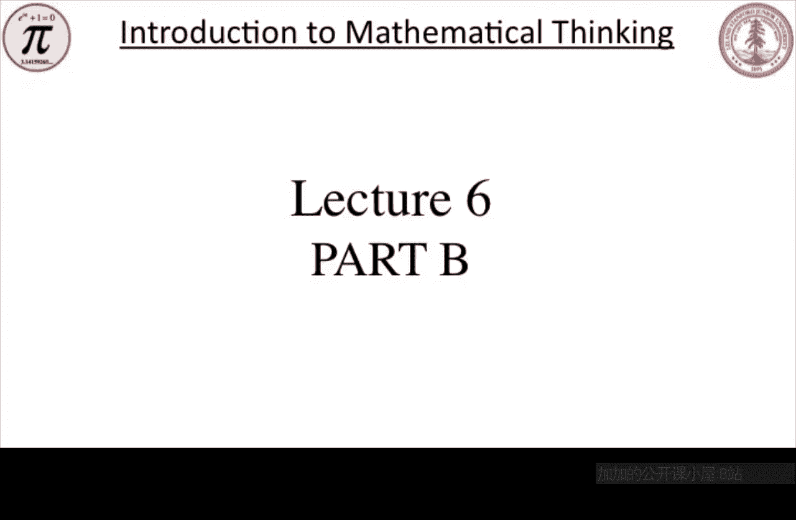
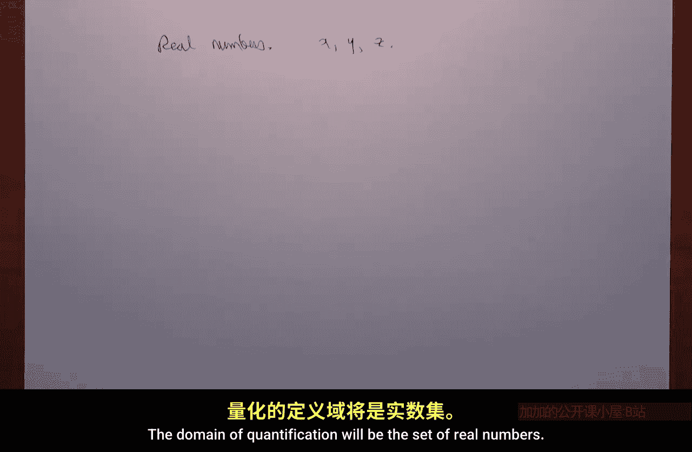

# 斯坦福大学【中英⚡数学思维导论｜Introduction to Mathematical Thinking】 p18 P18 02_讲座6b：量词运用2 -BV1D44dzxEa7_p18-

Let's do another example。嗯。Let's look at the claim all prime numbers are odd。No。

 we all know that this is false。And we know it's false because we know that 2 is a prime number。

Which is not odd。But let me tease apart the logic that underlies that conclusion。

Because in more complicated situations where we're not familiar with the with the domain or with the result。

All we'll have to use is the logic itself。So I want to make heavy weather of this。

In order to understand the kind of reasoning that we' use in situations where we don't know the answer。

Okay。So， I'm going to let P。Of x mean。X is prime。 And I'm going to let。O X。Mean this X is on。

So the sentence can be written symbolically。As for allx。If X is a prime。Then， X is odd。

When I get this。I get。Exist sex。Not Px。Here's Ox。Or another way of writing it。There is an X。

Search the p X。A not o of X。The negation of not for all x P of x implies O of x。

Is there exists in x should the P of x and not of x in words， Ie。There is a prime。That is not odd。

So in order to prove that this is false。Which is the same as proving that the negation is true。

The logic says。Find a prime。 That is not odd。And we can， too， is a problem that's not odd。

So if I want to prove conclusively that this statement is false。

Which is the same as proving that its negation is true。

What I need to do is demonstrate that there is a prime that's not odd。And in this case。

 that's immediate。We just pulled two out of the hat。Observe that two is prime， and it's not odd。

Therefore， the negation is true。 The original statement is false。Well， in that simple example。

 that was making what you do about nothing。But in more complicated situations。

 going through the underlying logic。Is often the only way forward。By now。

 you should have noticed the pattern of behaviour that's happening with these these symbolic negations。

When we negate， a for all becomes exists， and the for all sort of jumps inside。

 And when it jumps inside， we can manipulate it and get the result into a positive form where the negation is at the most innermost point。

You can actually turn these into formal symbol manipulation rules。

And which means you can implement them on computer systems。

 And there are computer systems that do this kind of reasoning for you。

 I'm recommending very strongly that you don't do that。

Because what we're trying to get at is mathematical reasoning and moving symbols around doing symbolic manipulation is not mathematical reasoning。

 It's connected with mathematical reasoning。 It supports mathematical reasoning。

 We can use it in mathematical reasoning， But the real essence of what we're trying to do。

 is to understand what the statements mean， understand what the symbols represent and reason with the concepts Its reasoning with concepts that mathematical thinking is all about。

 not symbolic manipulation。Okay。We showed that。 This was false。By finding a counter example。

 in this case， the counter example was 2， supposing I modify it。As follows。

All prime numbers bigger than 2 a odd。In symbols。For all X bigger than2。If x is a prime。

The next is odd。Okay。Now， I'm going to give you a quiz。What is the negation of this statement。

Is it one。There exists in x less than or equal to2， such that P of x and not O of x。Or is it too？😮。

There exists in x greater than2， such the P of x and not O of x。Okay。

 which one of those two do you think it is？Where the correct answer is2。

It says there exists a number bigger than two， which is prime。 It is not odd。

That's the negation of that statement。 Why isn't it number one， Well。

 Because the original statement is about numbers bigger than2。

 So the negation must be about numbers bigger than 2。

 We don't simply negate every symbol in sight and say， well。

 in terms of the ordering on the real line。 if we negate something being bigger than2。

 then it means it's less than or equal to 2。That's a symbolic negation。

 That's a sort of a detailed localized negation about the ordering on the real line。

But the sentences a whole means。Something about all numbers， bigger than2。

So its negation means something about all numbers bigger than two。Okay。WellLet's move on。😊。

That ex not a person。Let P of X mean x players for sports team T。And that H of x mean x is healthy。

And let me look at the statements。There is an x such that P of x and not H of x。

What does that mean in everyday English？There is noneheal player on team T。Now， let me negate that。

I'm going to find the negation by symbolic manipulation。 Now， this， remember。

 is the method that I'm suggesting that we don't use。

 I'm doing it that way in order to illustrate the mathematics and the underlying logic。

If we negate this， we know that when we negate and exists， it turns into a forall。And then。

 the negation。Moves inside， if you like。And then when we move that negation inside。

 we get not P of x or H of x。So， the negation moves inside。We get P of x becomes not P of x。

 When we ne a conjunction， we get a disjunction， and when we double ne something。

 we get the original thing back。Remember， this is not the way I'm recommending you do it。

I'm doing this as an illustration of the underlying logic。Well， this thing looks familiar。

Remember when we looked at the conditional。P conditional Q means the same as not P or Q。

 They have the same truth table。So this guy。Can be rewritten。Its P of x。Here's h of x。In English。

All players on team T are healthy。Well。Is that。The neation of that。

There is an unhealthy player on team T。Well， if it's not the case that there's an unhealthy player on team T。

Then all the players on team team must be healthy。Which is definitely the case。😊。

That is definitely the negation of that。And again， let me stress。

 this is not the way you should do this kind of thing。 I'm using this to illustrate。

How negation behaves with quantification。Next point。Suppose I write down a sentence。

 like the following。4 x。The x is greater than 0。Then， there is a why。So should x y equals1。

Is that true or is it false。When is no way of knowing。 It depends what the ex notes。

If Xote's a motorist or an automobile or a healthy team player。It's completely nonsensical。

If X denotes a natural number， it makes sense， but it's false。If X denotes a rational number。

 it makes sense。 And it's true。But the point I want to make is that the quantifier only tells you something if you know what the variable dennootes。

Associated with any quantifier。We have what's called a demand of quantification。Which tells us。

 what does the x out。If the domain of quantification is obvious。

 if we've set it in advance or the context makes it clear what it is。

Then we can use statements like that。If there's any danger of misunderstanding。

 if there's any potential ambiguity。We can make the quantifier more explicit。

By stating the domain of quantification。To make this more explicit， I could write it as。For all X。

In the set of rational numbers。Effect is positive。Then there is a why。Should said x y equals1。

And now I've got a true statement。That's unambiguous。 It tells us that for every positive rational。

Well， wait a minute。 Wait a minute。 I haven't actually been explicit as to what the why is have I。

Now， arguably。Having made it clear that the ex notess are rational。

It's reasonable to assume that the wide are rational。But if I want to。

 I could be even more explicit than save for Ax in Q。If x is greater than0。😔。

Then there is a y in queue。So that x， Y equals 1。I think most mathematics would agree that if you are explicit about the quantifier at the beginning of a statement。

 then absentaneial indication to the contrary， the other quantifiers doote the same thing。

 But if there's any possibility of misunderstanding or if there's any potential ambiguity。

 it's better to be explicit everywhere as to what the quants denote。

Something else you need to be aware of with regards to quantification is that mathematicians sometimes emit the quantifier。

We write things like。If x is greater than equal to 0。

Then square root of x is greater than equal to 0。If you see an expression like this。

What that means is the following。For all x。Perhaps in our or perhaps in something else。

 for Als in our。X squared than equal to 0。Ily square root of x greater than equal to 0。

Or something like that。Depending on what the X denotes， I've assumed from the context。

 and this is a reasonable assumption。 I've assumed that the the variable is meant to range over the real numbers。

Even though there's no explicit quantifier here。This would be read as meaning， something like that。

This is what's known as implicit quantification。The mathematician is simply leaving out of the formal expression。

Any explicit mention of the quantifier， It's left implicit in the way this is rid。 Now。

 this is a fairly advanced point。I'm certainly not recommending you do this。

But the professionals do this all the time。 So you need to be aware of it in case you come across it in something that you read。

But。Please。Avoid doing this。I realize by seeing this。That I'm saying， do， as I say， not as I do。

 because like all professional mathematicians。I do write things this way， all the time。

But while you're still learning about these ideas， it's best to avoid doing it because if you don't use this in the right kind of context。

 all kind of difficulties can arise。And having given you one caution， let me give you another one。

This is about combining quantifiers with conjunction and disjunction。

Let me just do this by way of an example。Let N， the set of natural numbers。

 be the domain of quantification。That E of x mean x is even， and that O of x mean x is odd。

Look at the formulas for all x， E of x or O of x。And for all X， E of X。Of Walx， Ovex。

I guess I don't need that last bracket， right。Okay， for all x， E of x or O of x。

 and for all x E of x or for all x O of x， notice that the first one。Is true。It says。

For every natural number。It's either even or it's odd。What does the second one say， it says。

Every natural number is even。Or every natural number is odd。 Well， that's false。

Well the point I'm trying to make here is you can't just take a forall and take it inside a bracketed expression。

If you do that， you'll likely it to end up turning a true statement into a false statement or vice versa。

Similarly。If I take there exists sex。E of x and or of x。We'll do it with an arm this time。

And I'll take exist in X E of x。And exists in X。Oex。Again， I've put that extra bucket in there。

 Can't stop myself doing that。What have I got。This says there is an X。Which is both even and odd。

Which is false。What does this one say， There is an excer even。And there Vi an X。 That's odd。

That's true。So the same thing happens with exists and conjunction。

 say you can take an existence statements like this。And in this case， it's false。

But if you paired them up in this way， it's true。In other words。

 be very careful when your reasoning with quantifiers， conjunctionjuctions and disjunctions。

You can't simply take things inside the way you sometimes do in arithmetic。

If you think about what these things mean， you're not likely to run into that difficulty。

 But if you start treatinging these as symbolic expressions to manipulate。

 then things could go badly wrong。Don't requiz。Okay， well， we've just seen that this expression。

 something like foror X， A X or B， X， is not equivalent to4 X， A X or4 X， B， X。

 The example we looked at was whether numbers are even or odd。

 And it was the case that for all natural numbers。The number is either even a odd。

 but it's not the same as saying that。All natural numbers are even。 or all natural numbers are odd。

In the case of even a odd for natural numbers， this is true。But both of these disjuncts are false。

 or the disjuncction is false。Okay？What about this？Instead of having this junction。

We've got conjunction。Are these equivalent？Or not。What do you think？Well， the answer is。Yes。

They are equivalent。Now， you could argue this in in an abstract form。

 but let's just look at an example that's that's pretty illlustrative。 Let's take something like。

All athletes。How big and strong。Okay， so X didote athletes A means big， B means strong。

 so that says all athletes are big and strong。 this would say。All athletes are big。And then。

 we'd have。All athletes are strong。And it's pretty clear that in the case of the example。

 that is equivalent to the conjunctionjuction of those two。If all athletes are both big and strong。

 then in particular， they're all big and they're all strong。 And conversely。

 if they're all big and they're all strong， then they're all big and strong。In other words。

When you've got universal to quantification， if it's combined with a conjunction。

Then you get the equivalentvalence of these two forms。

But if universal quantification is combined with a disjunction。They're not necessarily equivalent。

 I mean， this this isn't a proof。 This is just an example。 But if you take that example。

 you should be able to come up with a simple little logical argument。

 showing that that implies that and conversely， that implies that。So the answer is yes， in this case。

Let's look at another variant。Well， again， in this case。When we had even an odd numbers。

That showed that these are not necessarily equivalents。But what about this。

 where we have an existential quantifier combined， not。With the conjunction。But with a disjunction。

Do we have equis in this case。What do you think？Again， the answer is yes。These are， in fact。

 equivalent。What would be a good example。 Oh， let's take something like。And。There is a player。😔。

Let's let's keep with with athletic examples。 there are a player who， well， let's say。Who honour。

 Who is。A good attacker。Oh。A good defender。Okay， so there was a player who was a good attacker or a good defender。

Is that the same as saying？Let's just simplified it a little bit， there was a good attacker。O。😔。

There is。😔，The good defender。Okay。And we're going to disjo those。

 So if there was a player who was a good attacker or a good defender one or the other。

Then whichever one it is。We'll be here if the player who is referred to here。

Hes going to either be a good attacker or a good defender。 So one of those two is going to be true。

 which means that the disjunction is true。 So if this is true， then that's true and conversely。

If there's a player who is a good attacker， then that player is a good attacker or a good defender。

 In fact， a good attacker。Oh， if it's this one， then that's true。😊。

So we have an implication that way with a disjunction。

And we have an implication that way with the disction。There equivalentent。 Again， this isn't a proof。

 This is just an example to， to illustrate the fact。

But you shouldn't have any difficulty taking that example and turning that into a simple little argument。

 at least I hope you won't have any difficulty doing with now。

 turning that into a simple argument to show that that implies that and that implies that。

So in the case of existential quantification。If we have it with a conjunction。

Then we don't get equivalence。But if we have it with a disjunction。Then we do have equivalentence。

And if you think about what's going on here， the fact is that， for all。He's like。

 and let me put quotes on here because this is a sort of specialized use for all he's like conjunction。

And exists。Is like disjunction。Because， for all。Says something's true for all。

 and conjunction means that all of the conjuncts have to be true。This synthesis is at least one。

And this serve it at least one。So that's all about all things。And that's about。At least one。

So we get good behaviour of whether you call this good or not， you get this nice behaviour。

 If we have exists with disjunction because exists is essentially a disjunction sort of thing。

And for all。that was on the previous side for all， he's really a conjuncction sort of thing。

And it's when they're mixed up when you get。The disjunctive thing here and the conjunctive thing here。

That things fall apart。Okay。Well， there you go， How did you get on with those two parts of the quiz？

And this is the last point I want to make about quantifiers。Suppose we're having a discussion about。

 oh， let's say the real numbers。So if we have variables， X， Y， and Z， theyre sh in reveal numbers。

The demand of quantification will be a set of real numbers。

And in the course of the discussion about the real numbers。

 we want to talk about rational numbers or particular rational numbers。You。

 we might want to mention that there's a rational number X。Well。

 there's one way we can do that we can talk about。The rational number in this context。

 we consider the Vin x in Q。Or we can say， for all y in Q。

Or if I want them to talk about a natural number， I can say。For all N in the set of natural numbers。

So by introducing explicit demands of quantification in this way。

In the course of discussing real numbers。That can restrict attention to particular rationales or natural numbers。

 or whatever。And so in the course of an argument， I can actually use multiple。

Demains of quantification。Well， in examples like this。

 where we're talking about different sets of numbers。This is fine。But in other situations。

 it really doesn't make sense to introduce multiple domains of quantification， for example。

Suppose I'm going to be talking about， oh， let's say animals。

 So I'll suppose the domain of conrification is the set of animals。

And then I might want to say something like。Every leopard has spots。Well， how would to do that？Well。

 suppose I could say。For all X in the set of leopards。X has spots。But in the next sentence。

 I might want to talk about tigers and then giraffes。 And then who knows what。And very soon。

 I could have a whole range of different domains of quantification floating around。

And that's not very clean。 It's not very nice， and it's certainly not very sensible。

Because the discussion。Isn't really about leopards。Or tigers or giraffes or whatever。

It's about animals。And if the discussions about animals。

 then the set of animals shall be the domain of quantification。

 So instead of writing something like that， what I should write is for all animals。

If that animal is a leopard。Then is' has spots。That allows me to say something like。

There is an animal。Which is a horse。😡，And has spots。There's a spotted horse。Or I could say。4 x。

If X is a tiger。And X doesn't have spots。The point is that I'm talking about animals。

Then when I refer to specific animals。I'm not changing the domain of quantification。

 I'm still talking about animals。 I'm just describing properties of particular kinds of animals。

 The discussion is still about animals。 So the domain of quantification should be animals。

It's different here。Because the domain of quantification， arguably。

 is the set of real numbers or the set of all numbers。

And then because we have these standard subsets。It's okay。To introduce things like this。

 you don't have to。 You could actually use something analogous to this。But in this kind of situation。

Yes， if you are talking just about real numbers， then you really don't want to be introduced in particular subdage。

 You should use the analog of these kinds of expressions and talk about if it's irration in this。

 if it's a natural number than this。But if this is really a discussion about all numbers。

 not just the real numbers。Then these are just particular categories of real numbers and natural numbers and so forth。

 And you can have sub domains。 You can have different domains of quantification。

This isn't an issue of right or wrong。 It's an issue of whether it's sensible and helpful to work in a certain way。

And using separate sub domains of quantification is fine if there are natural domains and it makes sense to talk about it that way。

 But the idea of a domain of quantification。Is that that tells us what it is we're talking about。

If we're talking about animals， then don't introduce different demands of quantification that are not animals。

Even if their subdiic gets complicated。Okay， that's enough about quantifiers for now。

I suggest you go in and see how you get on with assignment number 6。

