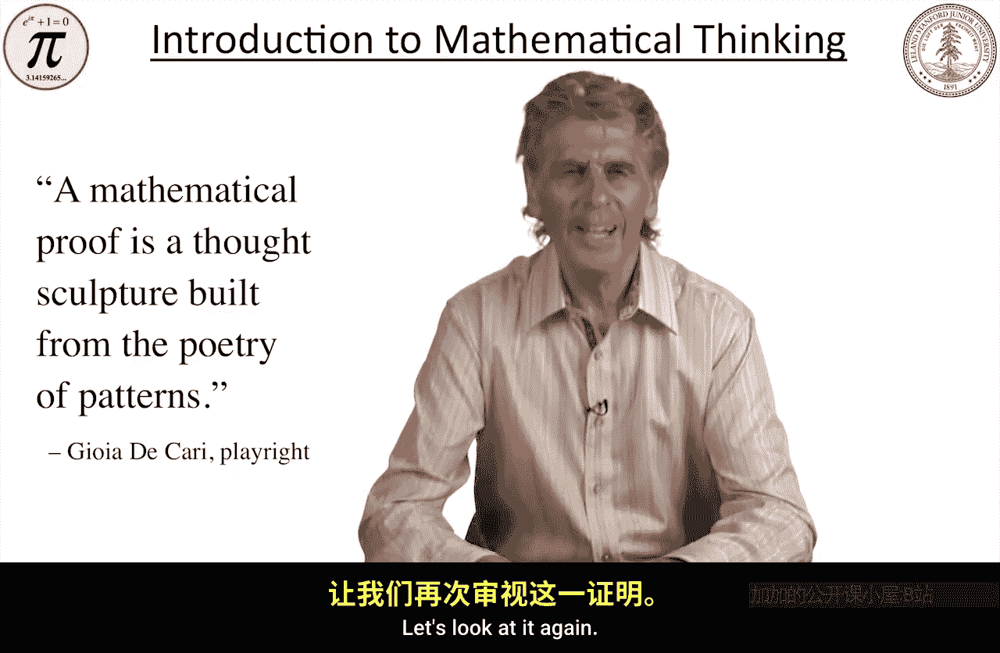
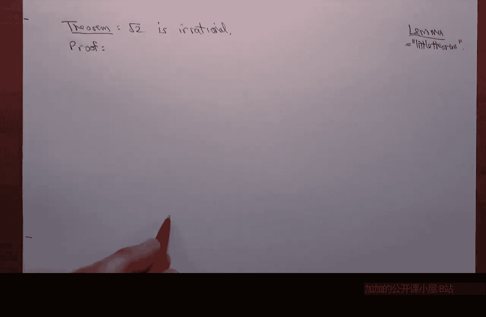

# 斯坦福大学【中英⚡数学思维导论｜Introduction to Mathematical Thinking】 p21 P21 01_讲座7a：证明方法1 -BV1D44dzxEa7_p21-

How did you get on with assignment 6？If you've followed everything so far and managed to do fairly well on all six assignments。

You should have a good idea of the kind of linguistic precision required in mathematics。😊。

Now we can start to put that precision to use， improving mathematical statements。

In the natural sciences， truth is established by empirical means。😊，Involving observation。

 measurements and the gold standard experiment。In mathematics。😊。

Truth is determined by constructing a proof。A logically sound argument that establishes the truth of the statement。

The use of the word argument here is， of course， not the more common everyday use。

To mean a disagreement between two people。But there is a connection in that a good proof will preemptively counter explicitly or implicitly all the objections。

 the counter arguments that a reader might put forward。When professional mathematicians read a proof。

They generally do so in a manner reminiscence of a lawyer cross examining a witness。

Constantly perbing and looking for floors。Learning how to prove things forms a major part of college mathematics。

It's not something that can be mastered in a few weeks。It takes years。

What can be achieved in a short period？And what I'm going to try to help you do here。

Is gain some understanding of what it means to prove a mathematical statement？😡。

And why mathematicians make such a big deal about proofs？😊，First。

 what is a proof and why do we use them？😮，I'll answer the second question first。

 since their purpose dictates what they are。Proofs are constructed for two main purposes。

To establish truth and to communicate to others。Constructing or reading a proof is how we convince ourselves that some statement is true。

I might have an intuition that some mathematical statement is true。But until I've proved it。

 I read a proof that convinces me， I can't be sure。But I may also have to convince someone else。

And that's the second purpose of a proof。For both purposes。

 a proof of a statement must explain why that statement is true。In the first case， convincing myself。

It's generally enough that my argument is logically sound， and I can follow it later。

In the second case， where I have to convince someone else， more is acquired。

The proof must also provide that explanation in a manner the recipient can understand。

Troths written to convince others have to succeed communicatively。

 as well as biological logically sound。There's actually not as much of a distinction here as my words might imply。

😊，For complicated proofs， the requirement that a mathematician can follow his or her own proof a few days。

 weeks， months or even years later can also be significant。

So even poofs written purely for personal use。😊，Need to succeed communicatively。

The requirement that proofs must communicate explanations to intended readers。It can set a high bar。

Some proofs are so deep and complex that only a few experts in the field can understand them。

For example。For many centuries， most mathematicians believed or at least held a strong suspicion。

That for exponents n greater than or equal to 3。The equation x to the n plus y to the n equals z to the n。

Has no positive whole number solutions for X， Y， and Z。

That was conjectured by the French mathematician Pierre de Ferma in the 17th century。

But it wasn't finally proved until 1994， when the British mathematician Andrew Wies constructed a long and extremely deep proof。

Over the centuries， it became popularly known as Fairmatt last Theorem。

Since it was the last of several mathematical statements。

 Fairmat announced that remained to be proved。 Most mathematicians， myself included。

Lack the detailed domain main knowledge to follow whilst proof ourselves。

But it did convince the experts in the field。 The field， by the way， is analytic number theory。

And as a result， Fairmatt's ancient conjecture is now regarded as a theem。

Fairmat's Lasthereorem is an unusual example， however。

 most proofs in mathematics can be read and understood by all professional mathematicians。😊。

Though it can take days， weeks or even months to understand some proof sufficiently to be convinced by them。

I've chosen the examples in this course to be understood by a typical student in a few minutes。

 or possibly an hour or so。😊，Examples given to College of mathematics majors can usually be understood with most a few hours effort。

Proving a mathematical statement is much more than gathering evidence in its favour。

To give one famous example in the mid 18th century。The great Swiss mathematician。

 Leonard Euler said he believed that every number beyond 2 can be expressed as a sum of two primes。

This property of even numbers had been suggested to him by Christian Goldback。

And became known as the Goldback Conjecture。It's possible to run computer programs to check the statement for many specific even numbers。

And to date， 2012。It's been verified for all numbers up to and beyond 1。6 quintillion。

Most mathematicians believe it to be true。😊，But it's not yet been proved。

All it would take to disprove the conjecture。😮，Would be to find a single， even number N。

For which it could be shown that no two primes sum to end。Incidentally。

 mathematicians don't regard the goldbacker conjecture as important。😊。

It has no known applications or even any significant consequences within mathematics。

It's become famous solely because it's easy to understand。😊，Was endorsed by Euler。

And has resisted all attempts at solution for over 250 years。

Whatever you may have been told at school， there's no particular format that an argument has to have in order to count as a proof。

The one absolute requirement。Is that it is a logically sound piece of reasoning。

That establishes the truth of some statement。An important secondary requirement。😊。

Is that it's expressed sufficiently well that an intended reader can， perhaps with some effort。

 follow the reasoning。In the case of professional mathematicians。

The intended reader is usually another professional with expertise in the same area of mathematics。

Proofs written for students or layperss generally have to supply more explanations。

This means that in order to construct a proof。😊，You have to be able to determine what constitutes a logically sound argument that convinces not just yourself。

But also an intended reader。Doing that not something you can reduce to a list of rules。

Constructing mathematical proofs。Is one of the most creative acts of the human mind。

And relatively few are capable of true original proofs。😊，But with some effort。😮。

Any reasonably intelligent person can master the basics。And that's my goal here。

Euclids proof that there are infinitely many primes， which I gave in the first lecture。

Is a good example of a proof that requires an unusual insight。Let's look at it again。

Here's what we did。The idea is to show that if we list the primes in increasing order。

Then the list can be continued forever。So we imagine we've listed the primes。P1 is 2。 P2 is 3。

 P3 is 5， et cetera。All the it with some stage PMN。

And we sure that we can always add another prime to the list。And to do that。We look at this number N。

Which we obtained by multiplying together all the primes in the list so far。And then， adding one。Now。

 this number N consists of the product of all those numbers， P12 PN plus1。

 So it's certainly bigger than all of those numbers。So it's bigger。

 so n is bigger than all the problems in the list。Well， if any is prime。

Then we know that there's a prime bigger than P。Namely N。In which case， we can continue the list。

Probably not by adding in itself。In。Because it's the product of all these plus one is going to be a lot bigger than PM。

 So N's almost certainly not the next prime。But that doesn't matter。If N is prime。

 it shows of is a prime bigger than the one at the end of the list。

 And that means we can continue the list。The alternative is that any is not crime。In which case。

 there's a prime Q less than N that divides it。But none of the primes in the list can divide in。

Since if you divide end by any of those primes， you left with that remainder one。

If you try to divide P1 or P2 or any of these primes into this number N。It gets swallowed up。

By this part。 And then there's a remainder of one。Okay。So Q has to be bigger than P N。

 Those are the first n primes。 So if Q is not equal to one of those。It must be later on in the list。

In which case， we've shown again that is a poem bigger than P。And the list can be continued。Again。

 this particular cu that divides N。Is not necessarily the next prime。But as before。

 that doesn't matter， showing that the reason of the prime is all you need to do。

 because then you can take the next prime， whatever it is and add it to the list。Either way， either。

 if any is prime。Or if n is not prime。Either way， there's another prime to add the list。

It follows that there are infinitely many primes。And the theores proved。

There were two creative ideas in this proof。 The first one。Is here。

To show that if we list the prime in increasing orders of P1 P2， et cetera。

 then the list can be continued forever。So the first creative idea is to think about listing the primes and showing that the list can always be continued。

The second creative idea。Was this one。Dfining this number N in such a way。

Did it guarantees that we can always find another prime。

I would say that this idea is one that most mathematicians would come up with sooner or later。

It's a fairly obvious one。This one is genius。Okay， this is true genius。

Let me give you another example。And this time， Im going to prove that result I promised earlier that the square root of 2 is irrational。

And I'm going to write it the way mathematicians typically do when they write up results for publication in professional journals or in books。

 namely we call it out by calling it a theorem。So in mathematics。

 a result that's sufficiently significant or important that it's worth mentioning as such is called a theorem。

In this context， let me mention there's another word we often use called lemma。

And alemma is a result which is worth calling out for some reason。

 but doesn't quite merit the status of being called a theorem。it's actually feel like a little there。

Okay， the next thing a mathematician typically does is indicate that we're begin to。

 going to begin the proof， okay。So this is just part of the way mathematicians lay things out。

 we specify the theorem。And then we say we're going to give the proof。

 You don't have to do it this way。 It's just a convention。

 The essence of being a proof is what comes next。

Proofs are about their logical structure， not the way we write them down。

I'm going to begin by assuming on the contrary that the square root of two were rational。Now。

 if you've never seen the proof that the square root of two is irrational before。

This first step is going to seem pretty mysterious。

Why do I begin by assuming the opposite of what I'm trying to prove？Well。

 by the time I get down here。Youll see why。The reason this is a great example。

Is in about six or seven lines。I can make it clear why I'm doing something right in the first step。

Well in that case， if square root of two were rational。

Then there are natural numbers P Q with no common factors。

 such that the square root of 2 is P over Q。Remember a rational number。

Is one that can be expressed as the quotient of two integers in the case of a positive number。

 it will be two natural numbers。And we can always pick those natural numbers or those integers to have no common factors。

 In other words， when we write a rational number as a quotient， we can always cancel out。

Any common factors and express it as a quotient where the two numbers themselves have no common factors。

Again， it might seem a little bit mysterious why I'm being particular about cancelling out common factors。

 but as as with the the first step by the time I get down here， it'll be clear why I'm doing this。

Well squaring that equation gives me 2 equals p squared over Q squared。Rerr。

 I get2 Q squared equals p squared。I multiply both sides by Q squared。

 that gives me a two Q squared on the left。 And then when I multiply the right by Q squared。

 it cancels that Q squared， and I'm left with a P squared。So P squared is even。

It's equal to twice something。Hence。Peaing。Why？😮，Because the square of an even number is an even number。

 the square of an odd number is an odd number。So the only way I could get the square of a number P to be even。

Is if the number P itself is even。Even squared is even。 odd squared is odd。So P is2 R for some R。

I'm now going to take this equation P equals 2 R and use it。To substitute back in this equation。

So I take this equation， I've got two Q squared。Equs p squared。And P equals 2 R。

So I've got2 Q squared equals 2 R all squared， which is 4 r squared。Well。

ll forget the middle term now。I've got2 Q squared equals 4 R squared。 I can cancel the two。

What if  Q squared is 2 r squared？Then Q squared is even。

But exactly has happened before with P squared。 If Q squared is even， then Q is even。Aha。

See what's happened。Ive deduced here that P is even。I've deduced here。The queue is even。

So P and Q were both even。But they can't be。Because we assume P&Q had no common factors。

If they're both even。Then they have two as a common factor。But this is impossible。

 since P And Q have no common factors。Well， the logical reasoning here。The algebra， the arithmetic。

Is all sound。absolutely， everything's perfectly sound。

 How come we have arrived at an impossible conclusion。By a piece of sound reasoning。Well。

 the only thing that can possibly have gone wrong is we began by making a false assumption。Remember。

 we began with an assumption。The only way we can have reached a false conclusion by a valid argument。

 And this is valid。If you don't believe me gone， check it is for yourself。 There's not many steps。

 See if there's anything wrong in any of these steps， there isn't。If we reach a false conclusion。

Biological argument。Then we must have started with a false assumption。Hence。

 the original assumption that the square of the two were rational must be false。Hence， square to 2。

Weust be irrational。And when I was at school， teachers used to insist that we write Q E D at the end of a proof。

 Quaurra Demonstrandum， which is Latin。It is actually not a bad idea to indicate when a proof ends。

And mathematicians have different， different ways of doing it。

 Sometimes they write a little box at the end。How you express it， I mean， how。

 how you lay it out on the page is not that critical。

I mean the idea is to is to lay it out in a way that can be followed what makes a proof of proof isn't the fact that you call it a proof。

 it isn't the fact that you end in a QED， It's the logical flow of the steps。

 It has to be logically precise and you have to be able to follow it。Well， there's the proof。

The reason this is a good example to give。Is it short。

 it's concise and all of the steps are simple arithmetical steps。It's very easy to follow every step。

And yet， when you followed this small number of simple steps。You've proved a significant result。

 In fact， this result， when it was first discovered by one of the Pythagoreans in ancient Greece。

 was dramatic。 It changed the course of Greek mathematics， because until then。

 they felt that quots of integers。Were sufficient to measure any length。But square root of 2。

Is the length of the diagonal。Of a right angle triangle。Whose sides。Measure 1。

And when this result was proved by one of the Pythagorean mathematicians。It showed that。

Quots of integers were not sufficient。To measure all lengths in， in， in geometric figures。

 And that changed the course of Greek mathematics， and subsequently， the rest of mathematics。

 it was extremely dramatic。Incidentally， there's a story you'll read about in books and on websites that say that the this was discovered by a young mathematician and that the Greek mathematicians。

 the Pythagoreians were so annoyed and so scared that this would kill their career and their profession that they。

 they threw him overboard。 There's absolutely no evidence whatsoever that that was the case。

 It's a great story， but。Like many stories， it's probably not true。Okay， but in any case。

 we've now shown that the square root of two is irrational and。😊，There we go。 I mean。

 this is really a remarkable result， very short， very elegance。 Incidentally。

 when mathematicians talk about aesthetics， when they talk about an elegant proof or a beautiful proof。

 this is the kind of thing they have in mind。😊，Not that it looks beautiful the way it's written out。

 In fact， I've just worked through it， and it doesn't look particularly beautiful to look at。

 but the logical structure is beautiful。 Every step counts。The result is established。

And every step can be understood fairly straightforwardly。The complex is。

 it doesn't come because there a deep results involve deep， deep facts， deep concepts。

The proof works。Because of the structure， the logical structure。Okay。

 so now you know why vote two is irrational。