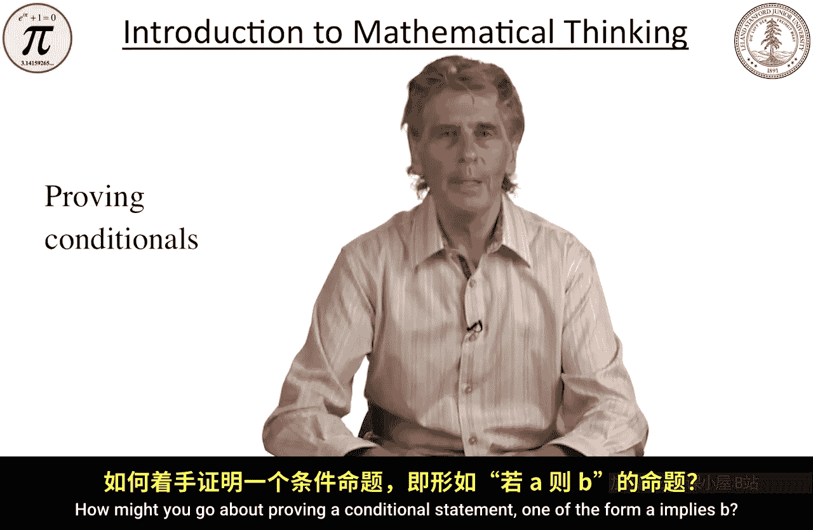

# 斯坦福大学【中英⚡数学思维导论｜Introduction to Mathematical Thinking】 p22 P22 02_讲座7b：证明方法2 -BV1D44dzxEa7_p22-

Let me say a little more about that proof。 It's an example of what mathematicians call proof by contradiction。

And proof by contradiction is a general method that works as follows。

You want to prove some statement phi。You start by assuming not fair。

You reason until you reach a conclusion。 That's false。Often by reducingucing bothsi and notsi。

 for some statement， sighi。For example， in the proof that the square root of two was irrational。

We prove that P and Q have no common factors。And yet， we knew that P and Q were both even。

So we have a statement and it's negation。 not strictly speaking。 It's negation。

 but but close enough for these purposes， This is not an exact rendering ofs and notsi。

 But the point is， we've deduced two contradictory things。

 It cannot be the case that they have no common factors and that they're both even。

But a true assumption cannot lead to a false conclusion。Hence， the assumption not fine must be false。

Remember， we began by assuming not thigh。We reach a false conclusion。A contradiction。

A true assumption can lead to a false conclusion。 So the assumption must be false。In other words。

 fine must be true。If not fire is false。And fire is true。

Will we begin by wanting to prove some statement phi。And we're going to end up with Phi。

And in the middle。We reason by assuming the contrary。

So here's the contradiction proof going on in here。That's fine。Theres Phi in here。

 we're reasoning with not Phi。We start by assuming not far。And we reach a conclusion。

 a false conclusion。And conclude that。 That's false。Let me say a little bit more about this。

We can look at proof by contradiction in terms of truth tables。

What could we conclude from a proof of theatre yield sigh， where sigh is false。

In the case of the proof of routetu being irrational。The theatre was the statement。

 square root of two is rational。And the sigh was the false statement。

That we never actually brought out in full that P And Q are both even。And have no common factors。

 which is false because there's no such there are no pairs of interview which are both even and have no common factors。

So in terms of the of proofof by contradiction， the the is the assumption you make at the start of the proof。

And the psi is the false conclusion you reach at the end。So I'm going to use truth tables。

To understand how it is that starting with an assumption。And reaching a false conclusion leads。

To concluding that the the assumption was false。And since the assumption was counter or contrary to the thing we were trying to prove。

 that would amount to proving the theorem， okay。So I'm going to write down the truth table。

For theta yields psi or theta conditionalsi。Right， the truth values down in T。Qi。C F。F。Qi。F。F。

And we know what the table looks like here。 it's T。F。😔，Qi。😔，2。Well， if we've carried out a proof。

Of this。That means this thing is true。So we can forget that line。

We're only interested in what happens when this thing is true。

 So we've carried out a proof that this implication is conditional is true。

 So it's one of these three。In this case， however。The sigh。Is false。Where's the sign false。

 was his size true？His size is true， His size is false。So， this。Is the only line in the truth table。

Which fits this。We have this being true。Which means it's one of these three。

 And we have psi being false。That's the only possibility。In other words。See that is false。

So when in a proof by contradiction， you make an assumption。A counter assumption。 an assumption。

Counter to what you're trying to prove。And you carry up some reasoning to deduce a false conclusion。

 a contradictory conclusion， or a contradiction。So you've established in your argument。

That this thing is true。This says that the argument is valid。Then the conclusion。

From having reached a false。Conclusion。The big conclusion， the global conclusion。

Is that your original assumption is false。Okay， it's a little difficult to explain this in words because we have to keep talking about truth and falsity and assumptions and conclusions and the assumptions and sub assumptions and so forth。

But if you go through the original proof that square root of two is irrational once more and then think about it in terms of what I just said a moment ago about proof by contradiction in general。

And then think about it in terms of this truth table analysis。

And hopefully you shouldll be able to understand why， why push back contradiction work。

 it's a very clever idea。 and they used a lot in mathematics。

 And I've just noticed I've misspellt truth table。 So let me put the L in there， okay。There we go。

That was a fairly lengthy discussion of such a short argument。

But I know from many years of experience， the beginners find the route too proof hard to really understand。

You may think you understand it。But do you really。Let's see if you can produce a similar one。

Try to prove that the square root of 3 is irrational。You should definitely try to do this exercise。

But be prepared to spend some time at it。Go on。 Give it a try。I'll say it again。

 this course is about the process of thinking， not about getting results。

You can use the thinking abilities you develop in a course like this to get results in other courses and in other situations in your life。

It doesn't matter if you don't get the route 3 proof。 you'll have benefited from trying。

Truofs by contradiction， which we use in the Voot2th theorem of a common approach because they have a clear starting point。

To obtain a direct proof of some statement phi。You have to generate an argument that culminates in Phi。

But where do you start？The only way to proceed is to try to argue successively backwards to see what chain of steps ends with Phi。

There are many possible starting points。But just one goal。And you have to end up at that goal。

can be difficult。But with proof by contradiction。There is a clear starting point。

And the proof is complete once you have deduced a contradiction， any contradiction。

With such a wide target area， that's often a much easier task。

The proof by contradiction approach is particularly suited。😊。

To establishing that a certain object doesn't exist。For example。

 that a particular kind of equation does not have a solution。

You begin by assuming that such an object does exist。And then you use that assumed object。

To deduce a false consequence or a pair of contradictory statements。

The irrationality of the square root of  two is a good example。😊。

Since that states the non existenceistence of two numbers P and Q， whose ratio is equal to root 2。

Even though there is no cookie cutter template approach to constructing proofs。

There are some guidelines。We just met too。Proof by contradiction is often a good approach when there's no obvious place to start。

And proof by contradiction is a useful method to prove nonexistent statements。Of course。

 you still have to construct a proof。😡，You've simply replaced a narrow goalpost with an unclear starting point。

Byu a much wider one with a known starting point。But like Robert Rus's fork in the trail。

That choice can make all the difference。There were a number of other guidelines。I'll tell you some。

But do bear in mind that these are not templates。As long as you continue to look for templates to construct proofs。

 you're going to encounter significant difficulties。

You have to start each new problem by analyzing the statement that you want to prove。

What exactly does it say， What kind of argument might establish that claim。

Let's look at another guideline。How might you go about proving a conditional statement。

 One of the form A implies B。

We want to prove a conditional，5 yield si。Well， we know this is true if phi is false。

 so we can assume phi is true。Why do we know2， if I is false。Well。

 that was part of the definition of the conditional that we developed using truth tables。So。

 to prove it。We assume Phi。And did you say。This， of course。

 confirms the point I made earlier that despite its strange definition。

 its counterintuitive definition， perhaps the conditional really does capture genuine implication。

 because in all actual practical examples。 and you try to establish a conditional。

 What you do is you assume Phi。 and you did uses。 And this is genuine implication。

 This says thatsi is following from Phi。For example， that X and Y be variables for real numbers。

And prove the following。If x and y are rational， then x plus y is rational。Okay。

 this is not a surprising result。 This is nothing deep。 I'm focusing not on the results。

 but on the method I use to prove it。 And so I've deliberately chosen an example that's extremely simple so that we can look at the process of reasoning that's involved improving a conditional。

So step one。The sh， X and Y。Arational。In that case， there are integers P， Q。

 N and M such that x is p divided by M， and y is Q divided by n。Where in that case。

 x plus y is P divided by M plus Q divided by n。Which equals P N plus QM divided by M N。

Insex persuade is rational。Okay， as I mentioned a moment ago， there's nothing surprising here。

 It's almost not a proof at all。 It's just really adding two things together。

But it actually needs a proof because it has the right structure of a proof。 Here's what we did。

 We began by assuming。Bex and Y arerational。We concluded。That the sum is rational。And in the middle。

There was an argument to demonstrate that fact。The argument was actually fairly typical in what we first did was take the assumption。

And then unpack the assumption in terms of some useful information。And once we've done that。

We reasoned with that information。To get a conclusion。That， in fact， was。

The thing we were aiming for。So we write down the assumption。We carry out some reasoning。

 and we've reached the conclusion。All three steps are important。Declare the assumption。

Carry out the reasoning in a clear， understandable fashion。

And then stay at the conclusion when you've reached it。Remember that proofofs have two purposes。

 One is to convince yourself。And two is to convince other people。

And you may know what you're doing if you don't mention what your assumption is。

Or what your conclusion is。 although I'll guarantee from experience that a week from now。

 you'll forget exactly what you were doing。 So it really is good even for your own purposes to write down what your assumptions are。

 but certainly from a communicative angle， it's important to begin by stating the assumption。

 then to lay out the reasoning in a simple， understandable fashion。

And then to state at the conclusion that you've reached。Okay， well， that's。

 that's the most basic method of proving a conditional。Let me give you a quiz。

Letft arm and S be irrational numbers。See which of the following are necessarily irrational。

And let me stress that word。Necessarily。Number one。Ha plus 3。😔，Number two。Five times hour。Number 3。

A process。Number 4。Times S。And number five， square root of our。No， this is a quiz format。Well。

 I'm just asking you to select the ones that you think are necessarily irrational。

 But unlike most of the quizzes。Well， I expect you should be able to answer very quickly。

I'd like you to think a little bit before you answer each of these。

 because the focus isn't really on getting the answer right。 I mean。

 I'll be say I want you to get the answer right。 I'm sure you do too。 but that's not the focus。

 The focus is on the reasoning that you need to carry out in order to get those answers。

 In each case， you're probably going to have to carry out one or two lines of simple reasoning in order to answer the question。

That's the focus of this particular quiz。 In fact， in the assignment that's coming up in assignment 7。

 I'm going to ask you to write out proofs。Of each of the five answers。So。

 let me stress that the focus。Is on the logical reasoning。Okay， see how you do。Well。

 the ones that are necessarily irrational。Wang。2。😔，And 5。In each case。

 you use the fact that a rational number is one that can be expressed as a quotient of two integers。

 and an irrational number is one that cannot be so expressed。

And then you carry out a couple of lines of reasoning。To show that I。R plus 3 has to be irrational。

 If r plus 3 was rational， then R would be rational。 Likewise。

 you would carry out a couple of lines of reasoning to show that if5 R was rational and could be expressed as a quot of two integers。

 then so could R， and similarly， youd carry out a similar argument for the square root of R。

The two that are not necessarily irrational， the three。And 4。😔，In order to show that R plus S。

Is not necessarily irrational。 What you would need to do to find examples of irrationals， R and S。

For which the sum is rational。Well， how about taking our is a square root of two。And S。Equal2。

Let's see say 10。😔，Minus the square root of 2。plus S。Is equal to 10。Which， of course， is rational。

 It's an integer。😊，We know that the square root of 2 is irrational。

And a very simple argument shows that 10 minus the square root of 2 must be irrational。 In fact。

 the argument you use to show that this number is irrational is a combination of the two arguments you used in parts 1 and 2。

Okay， so our and are irration， but their some isration。In the case of this guy。

We could take r equal square root of2。😔，And S equals square root of 2。

Our and this are both irrational。And yet， our times S is 2， which is rational。Okay， how did you do？

Remember， then in assignment 7， I'm going to ask you to give proofs of each of the five answers。

While conditionals involving quantifiers are sometimes best handled by proving the contra positiveitive。

What's the contra positive？😮，Well， we met that in assignment 4。So， to prove。And a conditional。

Phi Yoaii。What you can do is prove。Not sigh。Uses。😔，Not5。That's the contrapoitive of failure。

 you'll say。You reverse the fire thes， and you put nes in front of them。And in assignment 4。

 if you look back。We proved that those two are equivalent。 We proved that using in truth tables。

So let's look at an example of how this might work。And the example I'll take is this one。

I want to prove。As if the sign of an angleng theta。Is not equal to0。😔，Then。

For all N in the natural numbers。Theater。Is not equal to n pi。Okay， there's a conditional。

 And I'm in the middle of some argument will imagine。

 And I want to prove that if the s of theta is not0， then theta is not a whole number。

 multiple of pi。Were the statements equivalent to not the case that for all any N。

Teas are not equal to Npi。Implies not that sound The is not 0。Where there's lots of knots in here。

 So let's clear them all out and put this into a positive form。So in positive form， this is。

Not for all N in N， we're going to get the exists N。In n。And the knot is going to move inside。

And it's going to negate this knot。 It's going to wipe that one out。

 And then I'm going to have theta。Equals n pi。Yields。Not。That sign theater is not  zero。

Means that sign The is error。So， this。Is the contra positiveitive of this。

And that's the thing we're trying to prove。Well， we know this。

 we know that whenever you've got a whole number multiple of pi， its signine is 0。

So this proves the desired result。Obviously， this is a highly contrived， manufactured example。 Again。

 the focus is not what I'm actually proving。 It's the method I'm proving。

 I I'm picking simple examples so that we don't have to worry about the mathematical content。

 We can just look at the logical reasoning。 And in this case， we start out。

 We want to prove something。We replace it by the counter positiveitive。

And then we prove the contra positiveitive。 In this case， the proof of the contra positivesitive。

 we just pull on well known knowledge about the sine function that the sine crosses the X axis whenever you were a whole multiple of pi。

Okay， let me tell you about one more thing involving proofs of conditionals。

To prove a by conditional phi equivalent to psi， we generally construct two proofs。

 one of phi yield psi， the other of psi yields phi。

And since the by conditional is just a conjunction of the two conditionals that clearly amounts to approve of the by conditional。

Occasionally， it's easier to prove the two conditionals far yields。And not far yield not say。

And I'm going to leave you to find out why this is enough。Why does this work？

If you look back at the assignments， you should find a clue as to why it's enough to prove these two in order to prove the biconditional。

Okay， now I'd like it to complete assignment 7， as usual。

 completing an assignment means at least you should attempt all of the questions。

 you may not be able to get them all out at least not at first。

But remember the benefit from working on the assignments in this course is actually trying them。

 whether you get them out or not is not that important。

 Remember my favorite example of learning to ride a bike The fact that you don't succeed in riding a bike for many days or weeks when you're learning doesn't mean you're not making progress。

 The same with learning to swim。 You actually get the benefit during the process when you're trying and failing。

 and then suddenly you find you can either ride the bike or you can swim and it's the same with this kind of material in this course。

 Okay， good look on assignment7。