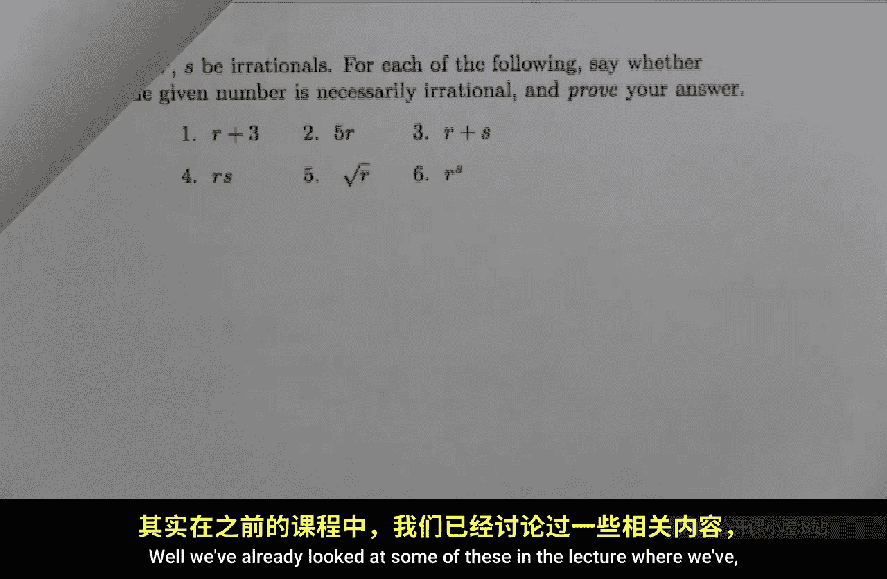

# 斯坦福大学【中英⚡数学思维导论｜Introduction to Mathematical Thinking】 p23 P23 01_作业7指导教程 -BV1D44dzxEa7_p23-

Well， I won to all of the examples in assignment 7， but there's still a few of them。

 starting with number one， Pova disproved the statements all bears can fly。Well。

 we'll find a counter example。 I mean， that's false。And to show it's false。

What I need to do is to find a counter example。And an obvious one is the ostrich。

That's a bird that can't fly， so we'll a counter example。😊，Okay。Well now let's look at number two。

 prove or disprove the claim for x in forvol x and y in R x minus y squared is greater than 0。

 that's also false。And again， to prove for something that's a universal quantifier。

 just like the one above it， it's a universal quantifier， or in this case， two universal quantifiers。

And to prove that a universally quant statement is false。

 what you need to do is find a counter example。Well， that's one way of doing it at least。😊。

The most obvious one here will anything that takes x and y equal that will do it。

 So let's give a specific counter example。 Let's take x equals y equals 1。And in that case。

 x minus y squared equals 0 and0 is not strictly greaterd than 0。 Okay came close， right。

 if you if we'd excluded x and y being 0， then then we' then we'd have a positive result。

 but it says it's true of all x， Y and R and a single counter example is all it takes。

 and in this case， any pair of equal numbers gives us the gives us a counter example， Okay， number3。

 prove that between any two in equal rationals， there's a third rational。

 So let's let x and y be rationals。X less than y。Okay。Then because they rationals x is P over Q。

 we can write y is r over s。Where P， Q， R and S are integers。

And we have to show there's a number between， what I obviously think is to take the the mean。

Let's just take X y over2。And if that's rational。😊，Then then we'll approve the results。 Well。

 here's the proof that it's rational。 X plus y over 2 is equal to P over a Q。Plus， our overs。

Over two？😮，Okay？Which is P。S。Plus Q o。😔，Over QS。Alllold over to。Which is。Pierce。Plus Q。Over two。

 what was a QS？😮，Can't see underneath my hand here。Which is rational。

Because it's a quotient of two integers。But of course， X is less an x y over2。Is lesson y。

And we're done。Okay， that's one， two， and three knocked off very， very， very quickly。😊。

Let's go on to do I number seven， the one about square root of three。Well。

 just as we did with a square root of two， we're going to prove it by contradiction。

So I'm going to assume。Square root of three。We're rational。Okay。Then I could write3。

 root 3 is P over a Q。Where P and Q are natural numbers。

And I can always assume that they have no common factors。Okay， because if you pick a pair of intes。

 pair of natural numbers that do have a common factor。

 you can cancel it out so you can always express a rational number in that form。

Then if we square that， I get three。Is p squared over Q squared？

So I can multiply across by the Q squared and get 3 Q squared。Equs p squared。So，3。Dou P squared。

But three is prime。And if a applying divides p squared。That means3。If Is P。

If prime divides a pair of numbers， multiplied together。 It divides one of the numbers。

 So3 divides P。So that means p is of the form3， let's call it 3 R okay？So that means p squared。

Equals 9 r squared。So I can take p squared and substituting it back in here。To get。3 Q squared。

Equals p squared。Equs 9 r squared。So if I'll forget the middle term now。

3 Q squared equals9 r squared。 Let me factor the three out。 I've got Q squared。Equals3 r squared。

So that means three。Dividedes Q squared。But if 3 divides  Q squared then just as before with P。

 that means that 3 divides  Q。And now we've got a contradiction。Since P and P。Have no common factors。

And yet， we've just shown that three is a common factor。

 So there's a contradiction almost exactly the same as the one for square root of 2。

So if we compare the two， see。The proof。For square root of two。In the case of the square root of two。

 we talked about numbers being even。But if we talk about something like。P been even。

That's just another way of saying。Two divides p。So really。

 all I've done here is I've taken the fever proof。 the one for route to。

And instead of talking about it in terms of even or not。

 I could recast it in terms of whether it's divisible by two or not。 And then the facts。

 the fact about two that we use there， we said if2 divides p squared， then it divides p。

 it used the fact that two was prime。So I might just as well use 3。

 So it's exactly the same proof as before， except instead of talking about divisible by 2。

 I'm talking about beingdiisible by3。I didn't express it that way before I talked in terms of even an odd。

 but even just means it's a multiple of two。Okay， well， we've， we've moved on。

 Let me decide which one to do next。 I think I'll do number 8。 that shouldn't take too long。

 so we'll do number 8 next。Okay， so the converse of of an of an implication of a conditional is the implication in the in the opposite direction where you swap around the antecedent and the con。

 but everything remains more otherwise unchanged' change。 So the the converse of this is。

If the yn rises。The dollar falls。We just shot them around。Sameme here。

If negative y less than negative x。Then X is less than y。And in the case of C。You have two triangles。

Have the same area。Then they are congruent。Now， in terms of what we do and this is。

 this is totally trivial。 This is just swapping things around without doing anything。

 What I'm really trying to get at with this this exercise is is in part to sort of contrast it with the with the contra positiveitive and also to to observe that。

Truth and falsity can change。 In this case， we start out with something that's true。

This is a truth to implication。That's a true implication， too。

 So sometimes the converse of a true implication is a true implication。Let's look at this one。

 If two triangles are congent， they have the same area。 that's true。But this one。

 if two triangles have the same area， they're congruent， that one's false。

So sometimes the converse of a true statement is true。

 and sometimes the converse of a true statement is false。Now。

 that's a different situation from what we find with the con positive。

But when you swap down the order， you can sometimes get truth， go into false。

 and you can sometimes preserve truth。Okay， well， that's really all it is to that。

 It was just to sort of given give an opportunity to to reflect on these things and to recognize that truth and falsity plays its own game when you're dealing with converses。

Okay， let's scor do number 11， Okay that was that one about the irrational numbers。

Well， we've already looked at some of these in the lecture where we've we've observed that some of them are rational。

 Let me see。 we observe that。This one can be rational。We observe that this one can be rational。And。

There's an issue about this one being rational。 these were easy。 We did those in the lecture。

 was that was a later issue。Not these one，2 and 5。 they're the ones where where they're irrational。

 And so we have to prove them this time。 Okay， and so let's starting with number one say。

What we're trying to show is that it is irrational， so yes， it's irrational。Okay。And that。Let's see。

 suppose that plus3。Re rationalal。Okay。That's a plus sign there。😔。

Then r plus 3 would be of the form P over Q。Where P and Q。vintageンジュー。We then。

R would equal P over  Q minus3。😔，Which is P minus3 Q over Q。Which is rational。

And that's a contradiction。Because I was assumed to be。えまし not。

And we've shown that if apple of3 were rational， then I would have to be rational。

And the others are similar。You simply assume the contrary， you express it in terms of P over Q。

 and then you do a tiny little amount of manipulation and you end up showing that the number R is rational here and that square root of R and that R is rational in the square root example。

Okay， very straightforward。Nothing reallyモャば this one。Okay。

 the only one left now to do on on assignment 7 is question 12。

 so let me just quickly go through to question 12。Well。

 the key facts that you use in in dealing with all of these are that。If N is even。

Then an actually shouldn if and only if， then N。Is 2 k。For some care， some inter care。Okay。

 and that n is odd。If and and if N， equals 2 k plus 1。For some care。Okay。

 the even numbers are the ones that are multiples of two and the odd ones are the ones that are one more than a multiple of two。

 Okay， in between the multiples of two。 So， for example， if we do part a。If m and N are even。

 then we would have M equals 2 k， for example， we'd have n equals 2 L。

 so m plus n would equal 2 k plus 2 L， which is 2 into k plus L。Which means it's even。

 it's two times something else。um。Do I need to do one more， Well， let me just do one more anyway。

 just just because I've， I mean， I'm un now， let me do a number D， part D， if one of them is even。

It's 2 k， and the other one's odd。 It's 2 L plus 1。Then。M plus N， equals 2 k。Plus 2 L plus 1。

We equals 2 into K plus L plus 1。Okay。So it's twice something plus one。E ceter for all the others。

 okay。Nothing terribly deep about。About these things。 But in terms of writing out a proof。

 it's basically a case of just ca straws and evens and odds in this way and doing a tiny amount of algebra。

 Okay， that was a very easy assignment。 I think it was meant to be an easy assignment。

 It's easy for me to say that right， I've been doing this for years if you haven't met this kind of thing before。

 then it probably isn't an easy assignment。 I fell into the trap of mathematicians of seeing something easy in the same way we talk about trivial。

 that's a sort of a term of art that we use in the game。

 So everything's easy when you know how to do it right， Okay。

 but I was looking ahead to assignment 8， which was decidedly difficult for me and for you guys。

 Okay assignment 8 coming next is difficult。