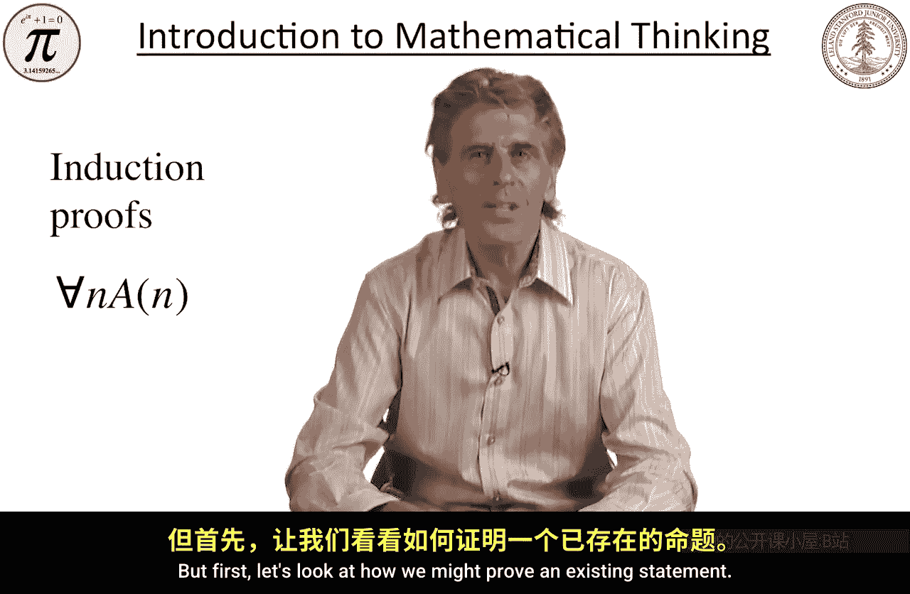
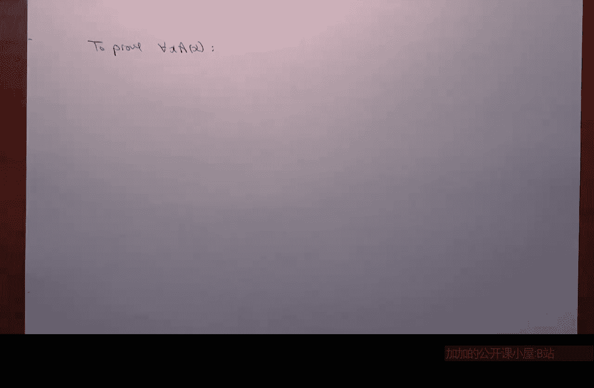

# 斯坦福大学【中英⚡数学思维导论｜Introduction to Mathematical Thinking】 p25 P25 01_讲座8a：带量词的证明方法1 -BV1D44dzxEa7_p25-

How did you get on with assignment 7？In this lecture。

 I'll say something about how to prove statements that involve quantifier。

Which is true for almost all mathematical theorems。

Universally quantified statements of the form for all natural numbers N， some property A N holds。

Where the quantification is over all natural numbers。😊。

Are often proved by a method known as induction。I'll explain the method of induction with some examples from number theory。

Number theory is one of the most important branches of mathematics。

It studies the properties of the natural numbers，1，2，3， etc cea。

We look at some elementary parts of the subject， in later lectures。But for now。

 it provides good examples of induction proofs。But first。

 let's look at how we might prove an existence statement。

We want to prove the exist text， such as airx。The obvious way is to find an object A for which A of A。

For example， to show that there' is an irrational number。

 just prove that square root of two is irrational。Which we did。😮，Unfortunately。

 this doesn't always work。Sometimes， we use indirect proofs。For example。

 I worked through that problem about the cubic equation。

 where we assured that there was a point on the X axis where the curve crossed it。

 and hence that the cubic had had a solution。 We never found the solution。

 which assured that one existed。Let me give you a really fascinating example of an indirectic proof。

I'm going to prove that the irrationals are and S， such that are to the poweres is rational。

That actually came up in assignment 7， if you remember。

 And I promised then that I would look at this later。 Well， now is that later。

The proof involves considering two cases。Case1。If the square root of two raiseds to the power square root of two happens to be rational。

We can take R and S both equal to square root of 2。

Then by the assumption that square root of2 to the square root of2 is rational。

 we've shown that the v numbers R and S， which are irrational。With art to the Pos， rational。Well。

 if case one isn't the case。Then we must be in case two。

Which is where route 2 to the route2 is irrational。In which case。

 take R equals square root of 2 to the square root of 2 and S equals square root of 2。

And if we do that， then our of the powers is root 2 to the root 2， all to the root 2。Which。

 by the way， that exponents work is route 2 to the power route 2 termss root 2。

Which is root 2 squared， which is2。Until he's rational， so again。

 we've proved that there are irrationals。😊，Our and S such stood out of the powers， is rational。

Takeickn together， case 1 and case 2， prove the theorem。I really like this example。

 it's not just clever， but it's cute and it's cute because of the way it works。😊。

We really don't know whether this number route 2 to the route 2 is rational or irrational。

 It's probably irrational， actually， But the point is we don't need to answer that question。

 We just look at the two alternatives。If it does happen to be rational。Seems weird。

 but if it does happen to be rational。Then we can find irrationals。

Oh and as with to the S rational this way。On the other hand， if route2 to the route2 is irrational。

 which probably is the case， but again we don't need to know that。Then we take r to be this number。

 S to be that number， and then R to the S is2， which is rational。

 So we don't know officially which one of these is the case。

 and more to the point we don't need to prove which one of these is the case。

 We simply look at the two alternatives。And depending on which alternative we're in。

 we take different rationals。 we take different irrationals R and S。With our to the S being rational。

So the choices of our andS are different in the two cases。

But because these two cases exhaust all possibilities。This number is， after all。

 either rational or irrational。Then， this proves a result。By the way， this is known as。The method。

Of proof by cases。And it's a method that she used a lot in， in in advanced mathematics。Pretty neat？😮。

Well now， let's take a look at how we might prove a statement involving a universal quantifier。

Suppose we wanted to prove a statement for all X， A of x。

One way is to take an arbitrary X and that it satisfies Ux。For example。To prove that for all n。

 there is an M M bigger than n squared。Where the variables M and N range over the natural numbers。

Well， this is a pretty trivial example。But I want to focus on the method that you would use。

To handle the two quantifiers in a statement like this， where in particular。

 the first quantifier is a universal quantifier。That N B an arbitrary natural number。

Set M equal to n squared plus1。Then enemy is bigger than N squared。

And this proves the statement there is an M M bigger than n squared。

And it follows that the statement for all N of is an M M bigger than n squared is true。Okay， well。

 as I said， this is pretty trivial。 Let's just see what's going on in terms of the logical reasoning。

You want to prove a statementment involving two quantifierifies of the form for all N rise M and bigger than n squared。

What we're going to do is eliminate one quantifier by replacing it by an arbitraryary natural number。

Now， by a， I mean， we make no assumptions at all other than the fact that it is a natural number。

The argument will have to hold for any natural number， whatsoever。

Because we're trying to show that this is true for all in。So we pick an a but you one。

Then we carry out some reasoning。To verify the rest of the formula。Okay。

 when we eliminate that for all N， we're trying to prove that there is an M M bigger than n squared。

 which is this statement。Now， in this case， it's a trivial argument。 We just square n。

 add  one and let M be that number。 So we explicitly find an M that satisfies this， this property。

In practice， you're probably going to have do a lot of work here with a more significant example。

 there could be several lines or even pages of arguments involved at this stage。But the point is。

 you eliminate the first quantifierer by picking an arbitrary in。

 Then you carry out some reasoning to prove the rest of the formula。Which is this thing here。

And when you've done that， because the argument works for an arbitrary natural number。

It follows that。 You've proved it。In this form。The for all end has been handled by reasoning。

With an hour between natural number。So we've taken away one of the quantifiers。

Carried out some reasoning。And prove the result。But let me stress that this works because the end that we pick is arbitrary。

 another approach would be to use method of contradiction。To prove for all X of X。Assume not for Xx。

This is equivalent to exist X， not ear of X。Well， let C be an object such that not A of C。

Notice that this isn't an arbitrary object。It's a specific object。

 Adittedly an object who was identity we we may not know。That is guaranteed to exist by this。

The point is to， to prove this universal statement。 we began by assuming its negation。

 its negation gives us an existential statement。And that tells us that there will be some object。

 a specific object。For which not ear of sea。Now， we've got a starting point to carry out a proof to derive a contradiction。

No reason with C， together with the fact that not A of C。To have a contradiction。Now。

 the exact reasoning you use will depend upon what the statement A says。

But the general pattern is this。You want to proof for all X A of x。

 and you're going to use contradiction。 So you assume not for all X A of x。

That's equivalent to exist x not air of x。And that tells you you can find an object。

Or at least you know that an object exists for which not A of C。And then if you can。

 your reason with that object using the fact that not A F C， did you have a contradiction。Okay。

 again， we'll see examples of this later on。 I'm just giving you the general overview of the。

 of the way these arguments work。So as in the previous case， if this looks a little bit mysterious。

 it， it'll become clearer， I hope， when we look at some specific examples later。In fact。

 at this stage， you might want to look back at assignment 7。

And see what was going on there in the light of， of what I've just said here。And before I let you go。

 let me give you a little quiz。Well， the correct answer。Is no。This is not a valid proof。The point is。

Picking a positive rational P arbitrarily。Is not the same。As letting P be arbitrary。

The choice of P man need be arbitrary， but once you've made it， you've got a specific P。

And we've even said what it is。That's actually different from saying let PB arbitrary。

An arbitraryr choice of P leads to a specific P， which you may have chosen arbitrarily。

 but you might have been unfortunate in your choice。

 You might have chosen a P that just happens to make something happen with。

 without there been any specific reason。It's a subtle point， I know， but it's an important point。

 So you really need to sort this one out。Letting P be arbitrary is not the same。

As picking in an arbitrary fashion， a specific P， the point is that P。Is specific。

Its choice may have been arbitrary。But once you've made it， it's specific。In contrast。

 when you argue with an arbitrary P。You don't know anything about the P。

 You certainly wouldn't know that it was equal to 0。001， or whatever。

You may need to think about that one a little bit longer or talk it over with some of your colleagues。

Now， let's look at proof by induction。This is the special case where we're proving the universal quantified statements where the quantifier ranges over the natural numbers。

For example。Suppose I want to prove that1 plus 2 plus， et cetera， et cetera， et cetera， plus n。

Its a half n N plus one。So the sum of the first n natural numbers is a half times n times n plus1。

Well， if you're meeting this problem for the first time。

 a smart thing to do is to begin by checking the first few cases， just to see first of all。

 to see if it's true for the first few cases and to try and get a sense of what's going on。So。

If n equals one。What do we get， Well， then we've just got one here。

And putting n equals one into the formula。 We have a half。Times 1。Ts one plus one。Which is a half。

Times 1。Times 2， which is1。And indeed， one equals one。 So it's true。In the first case。

In the second case， n equals 2。What do we have， We have one plus 2。Is the left on side。Equals。

 put n equals 2 here。 We get a half。Times 2。😔，Times 2 plus1。Which is a half。Times 2， times 3。

AHalf two old， we've got three。😔，And1 was 2 does  equal 3。 So the formula is correct for n equals 2。

We might want to try n equals 3。Whatever we get then， we get1 plus 2 plus3。Equals。Aha。3。😔，3 plus one。

W is the half。3。four。Which is 6。Which is correct。So the formula checks out for the first three cases and you know we might want to do a couple more cases。

But at least that gives us some sense of what's going on。 by doing this。

 we understand what the fall I we understand what the equation is saying。so far， this isn't a proof。

 This is just checking the first three cases。In fact。

 you've got to be very careful about jumping to conclusions based on the first three or four cases。

 So let me just stress that。This is not a proof。Okay， let me stress it again。Beware。😔。

Of jumping to conclusions。And to drive this point home。

 let me give you an example where if you jump to conclusions， you'll come to the wrong conclusion。

Consider the formula P N equals n squared plus n plus 41。If you start working out。

Values for this formula。You found something rather interesting。

You find that all values of P N for n equals 1，2，3， et cetera， are prime numbers。Well， not quite。

That's true。Until you reach。And he was 41。And when you get to 41。You found at P of 41。Works out at 1。

6，8，1。Which is 41 squared。So the first series of values for n equals 1，2，3， et cetera。

 all the way up to 41， which is is well beyond in the number of cases most people would try out by hand。

You find you've got a prime number。 But if that leads you to believe that this formula generates primes for every end。

 then you're going to be wrong。Because when you get to n equals 41， it's no longer prime。

This example， by the way， is due to the the famous Swiss mathematician Leonard Eler。In 1772。

And it's a cautionary tale。Telling us not to jump to conclusions based on， on nu evidence。

Nevertheless， it's always a good idea。 It's often a good idea to begin looking at a problem by working out a few cases。

 Not only do you get an understanding of what the formula is about。

But you can sometimes when you work out a few cases， you can find a pattern。In this case。

 there actually isn't much of a pattern to find。 You。

 you work out the values and you just get get numbers。

 And it turns out that the first 40 of them are primes。But in this case。

 if you look at what's going on。After even if you we， you did maybe a couple more n equals 4。

 n equals 5， you'd begin to see a pattern of what's going on。

 How the two parts of the formula are combining， what's happening to the half。

 The half is dividing into the second one here， the first one here， the second one there。

And after you've done a few cases， you can often。Find a way of capitalizing on the pattern that's there。

In order to produce the proof that I'll that I'll show in a minute。

 So induction proofs can be can often be derived by looking at the first few cases。

 seeing what the pattern is when you start plugging the numbers in。

And then actually building a correct， rigorous proof。 Okay， so the next step now is to。

 to begin with this numerical evidence and our understanding of how the formula works in order to come up with a rigorous proof of the fact that this formula holds for every end。

The method of induction depends on a principle known as a principle of mathematical induction。Okay。

 and here's what it says。😊，Suppose you want to prove a statement。F then。Even文。

Establish the following two statements。Wan。A of Wang。That's known as the initial case。

 or the initial step。2。Prove the following statement。For all N， for all natural numbers N。

If A of n is true。Then a of n plus1 is true。That's known as the induction step。Now， intuitively。

 this gives a statement for all N A of N as follows。By the initial step。Step 1。A one。

If we now apply the induction step。In the special case where n equals 1。

We have a of1 by the initial step。And that yields if n plus 1， which is a of 2。So， bye。2。

 or by step 2。Eve 2， E 1。Yields if too。Soir from Air 1。We can conclude。If two。Okay。

 we begin by approv the initial step。 So if we've proved a of 1。Then we know that one's true。

 We can now apply the induction step in this special case， where n equals 1。And having proved this。

If we have a of 1， we can conclude a of 2。Then we can do the same thing again。 Once we've got a of2。

We can put the two in here， and conclude E of 3。So by F2。And the induction step。We can conclude。F3。

B cetera， all the way through the natural numbers。So it's a little bit like taking a row of dominoes。

 And you knock the first one down。And providing the dominoes are close enough so that when one gets knocked down。

 the next one gets knocked down。Then once you start to topple the of dominoes。

 the first one not goes down。 Then the first one knocks down the second one。

The second one knocks down the third one。 The third one knocks down the fourth one。

 The fourth one knocks down the fifth one and so on and so on and so on。

 all through the natural numbers。 So you get a ver of dominoes falling down。So this basically says。

 knock the first domino down。And put the domino's closelo enough together so that when one falls。

 the next one falls。Okay， that intuitive explanation is fine as far as it goes。

 but that's certainly not a rigorous demonstration of this method。

The the fact that's proving these two。Together does yield。That universal stin。

 that universally quantified statement。 that's actually quite a， quite a deep result of of。

 of mathematics。And， and let me just stress that。You need an axiom or a principle to make this work。

Called the principle of math induction。The principle of mathematical induction is what tells you that one and2 above steps 1 and2 above yield for all N e of N。

Okay， now we have the the method of induction laid out before us。

 I'll apply it in order to prove that identity that we looked at a moment ago about the sum of the first n natural numbers。

So I'm going to prove a theorem now。for any natural number in。One plus2 plus 3 plus yada， yada。

 yada plus n。Is a half。And。😔，N plus1。I'm calling it a theorem because I'm going to give a rigorous proof。

I'm going to use a method。Of mathematical induction。And since one of the purposes of a proof。

Is to explain why something is true。It's usually good form to indicate to the reader the method you're going to use。

 It orients the reader to what's going to come next。And I'm using a standard method here。

 namely mathematical induction。 So it's good form to indicate that that's the method I'm going to use。

Well， I have to do two things。I have to show that this is true， when n equals one。

And then I have to show that if it's true at N， it follows at N plus one。

So the first step is to say that for n equals  one。The identity。Weuces to。Well。

 n equals one on the left hand side。 I've just call one。Put n equals one on the right hand side。

 I've got a half times 1 times 1 plus1。Which is a half times 1。😔，Times 2。And indeed。

 the left hand side does equal the white hand side。So， that's true。Since both sides。Equal  one。

So we've proved the first step。Incidentally， you may have noticed that I referred to this not as an equation。

But as an identity。And the reason is this's an equation is something that you solve to find the value of a variable。

 either x in the case of a real number equation or n in the case of a natural number equation。

 But this isn't an equation that you solve for N。This is an identity。 It's something。

 It tells you that the two sides are always equal。And we use a word identity to refer to an expression like this。

That claims are that states that two things are equal for all， for all values of n。

So these two sides are identically equal。So the correct terms are an identity for something like this。

 an equation for something that you solve， Having said that。

 like many mathematicians in practice I'm sometimes not particular in the words I use。

 if you caught me talking to my colleagues you might find me using the word equation where I mean identity。

 possibly even using the word identity where I mean equation， all all that one's less likely。

But strictly speaking， an equation is something you solve。

 and identity is something that states that two things are always equal。Okay， let's move ahead。

We've proved that the result is true， at n equals 1。The next step is the induction step。So。

 I'm going to assume。The identity holds。For n。I。e。 I'm going to assume one plus 2。Plus n。

Es a half n n plus1。😔，And let me note now， and I'll put this in brackets。😔，I want deuseuce。😔。

1 plus 2， plus du， da。Plus， n plus 1。E equal是 half。N plus1。And was one。Plus one。Okay。

 that's just a note for myself。To indicate the target I'm aiming for。

And the challenge now is to start with what I know。And did use where I want to get。Well。

 how can I get this from this？Well one way would be to add N plus one to both sides of that identity。

Which means that I'd get the left hand side here。And then hope that when I work out。The right hand。

Having added N plus1， I end up with this expression。Okay， so let's add。Endless one。

It's both sides of， let me call it。S。😔，So star is the identity I'm a human。

Let me add endless one to both sides of that。That gives me one plus two plus。😔，Plus， n。Plus n plus1。

Is a half。N， n was1。Plus n plus1。So I've not what the left hand side。Of what I want to prove。

I need to show that the right hand side。Is the right hand side of the thing I want to prove。

 So I need to show that that is the same as that。Well， let's just see what happens。

I can take the half out as a common factor。 So I've got a half。Into N。😔，N plus1。

Plus2 into n plus one。😔，And that equals。Aha。N squared。😔，Plus， n plus2 n。Plus 2。Which is a half。

N squared。Plus 3 n。Plus 2。And this factors。This is a half。Enless one。N plus 2。

But that's the same as that。I can write it explicitly， if you like， as a half。N plus1。

N plus one plus one。Which is the identity。With n plus 1。In place a men。Hence。

By the principle of mathematical induction。The identity holds。Folhen。😔，And we're done。

 We've proved the initial step。A simple matter of observation。And we've proved the induction step。

By a fairly simple algebraic argument。And that's it。That's mathematical induction in practice。

Where this screen came up about a quarter of an hour into the lecture。

Did you spot anything wrong with it at the time。Can you see anything wrong with it now。We。

 the problems in here。This isn't the polynomial。I meant to write down。

What I meant to write down here。Was the polynomial P of N。Equals n squared minus n。Was 41。

I've got the same wrong。And for this， it is the case that for all values of the polynomial for n equals one all the way up。

Through n equals 40。It's prime。Okay all the way up。And then， P of 41。If you put that in。

 it's 41 squared-41 plus 41。Which is 41 squared。Which is this number here。1681。

Let me call that piece of minus to indicate that there's a man I sign here。

Because the polynomial I wrote down， I'll call P plus of N。Was this one。Plus N。Plus 41。That one。

Hes actually prime for n equals1。Through 39。You never put 40 in there。😔。

Let's put the minus in there to distinguish it。If I put 40 in there。I get what。 I get 40。

N squared plus n is n times n plus 1。 So it's 40 times 40 plus1。Plus 41。Which is 40 times 41。

Pluss 41。 So I've got 40 times 41， and then another 41。That means I've got 41， lots of 41。

Which again。Is 41 squared。Equs 1681。These are sort of the same polynomy When you look at it in terms of the behaviour here。

 if you just see what's going on。 They were both actually due to it。 Well， actually what。

 I'm not sure historically， whether oil have brought them both down， But clearly。

 once this had been discovered， you're just manipulating them。And what I did when I。

 when I was giving the lecture。 this is spontaneous。 by the way， almost all of these lectures。

 spontaneous， they're not meant to be polished lectures。 I mean， I'm familiar with the material。

 So it sometimes looks as though I'm just sort of reading it from a book。

 But if I am reading it from a book。 It's a book in my head from having taught it for many years。

 basically what I'm recording is spontaneous。 And this just， I just pulled this off from my memory。

 And I confuse two things。 I knew that it didn't really matter what the sign was。

But it does make a difference as to where it stopped being prime。 If you'd pick the negative sign。

Its prime all the way up to up to 40。If you pick the positive sign。

 it's prime all the way up through 0 to 39。 So it was a technical error， but in principle。

 it was correct。 And it's certainly whichever one you pick。

Gives a wonderful example of the fact that just because you have a repeating pattern。

 it doesn't mean to say something's true for all then。

 And remember that I introduce this as an illustration of caution when I was talking about induction proofs。

Okay， well， what happened was the first time I gave this course。

Many students found the mistake and I thought it was good to leave it in the second time I gave the course so that students would have a further chance of finding the mistake themselves。

 It's always fun to find mistakes this time I decided to leave it in but put in a quiz at the end just to prompt to anyone that hadn't noticed a mistake that there was actually a mistake。

 Okay， so now you know what's going on here。 and you've seen me make a wonderful mistake in public。

Which is something that all good mathematicians should do。 Okay， Well， that brings us to the end of。

8。 a lecture 8。 a。 Let's move on to lecture 8。 B now。

