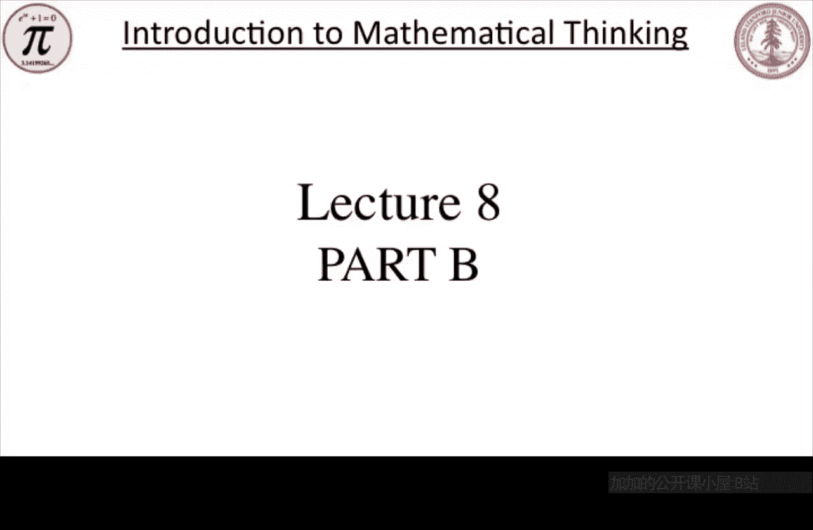
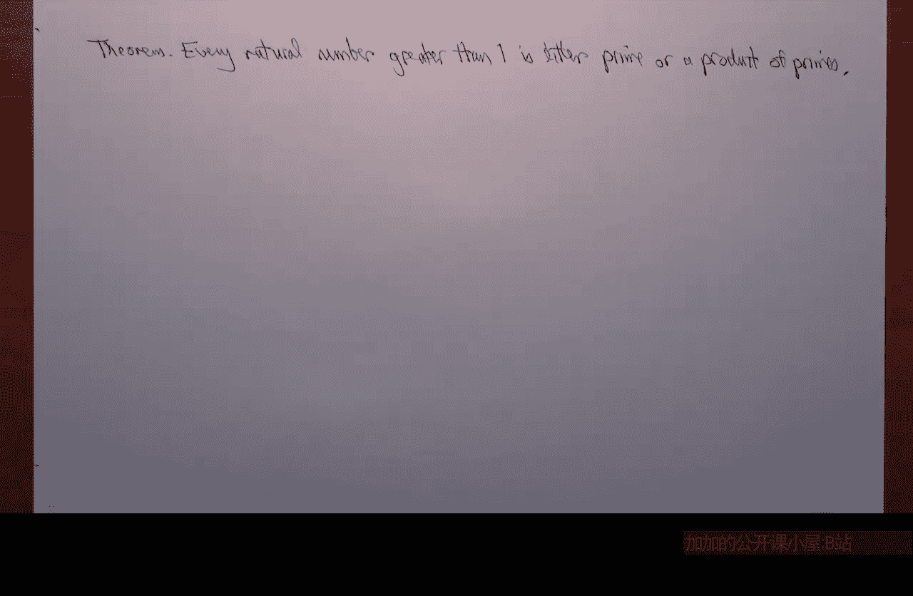
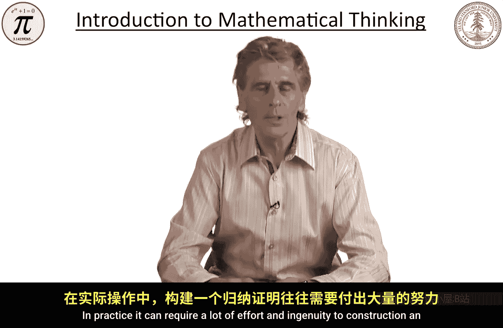
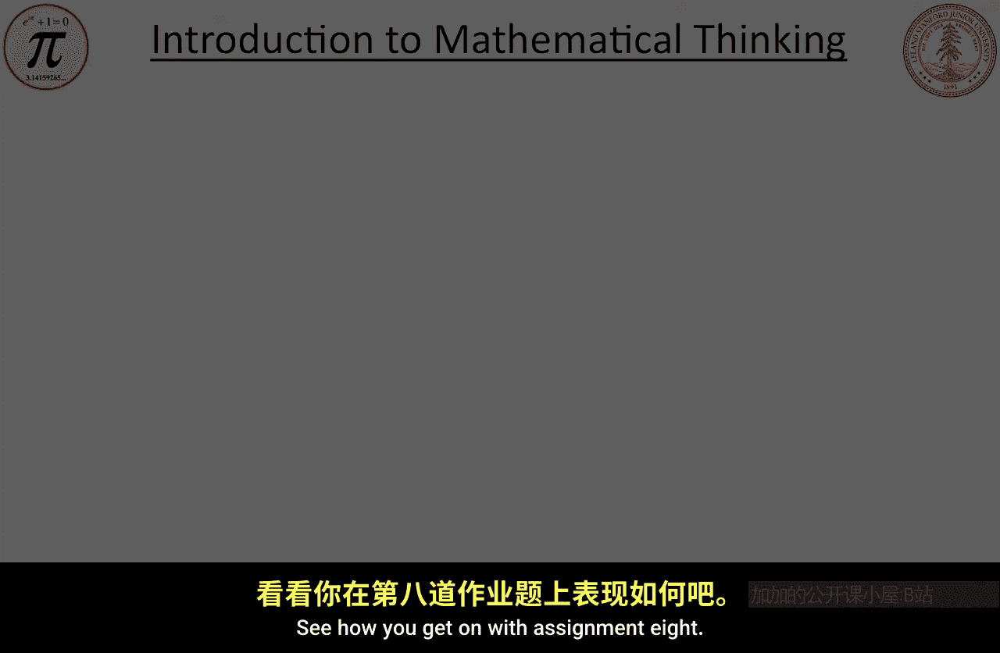

# 斯坦福大学【中英⚡数学思维导论｜Introduction to Mathematical Thinking】 p26 P26 02_讲座8b：带量词的证明方法2 -BV1D44dzxEa7_p26-

Where the correct answers are。This one。This one。And this one。

If you checked back at the description I gave of the method of induction。

 you shouldn't have any difficulty。Realizing why this is the correct answer。

 why this is the correct answer。And this is the correct answer。So if you got any of these wrong。

 you definitely need to go back and look at the lecture again。

And make sure you really understand induction。 It's a very important technique in mathematics。Well。

 let me give you another example of an induction proof now。 And this time。

 I'll lay out the proof in a way that makes explicit the connection between the argument I give and the description of induction I gave a moment ago。

And the example I want to give is the following theorem。

 well calling it a theorem is actually a bit of a stretch。

Here's what I'm going to show that effects is a positive real number。Then for any natural number N。

1 plus x to the n plus 1 is bigger than1。Plus n plus 1 x。Okay。

 this result is not going to set the mathematical world on fire。

 but it is a good example to illustrate the way mathematical induction works and in particular to connect the arguments that I'm going to use to the early description I give for mathematical induction。

So here's the proof。Well， I'm going to begin by stating the method I'm going to use mathematical induction。

Since one of the purposes of proofs is to。Explain why something is true。

 It's always a good idea to begin by stating the method you use that orientates a reader。

To the argument that's about to come。And to connect it to the description I gave of induction before。

I'm going to let N。 let A of N be the statement。1 plus 6。To the end， plus Wang。Bigger than one。

Plus N plus 1 x。So by induction， I'm going to prove。For then， here then。Well。

 the first step is to prove a of 1。An he of one。Is the statement。1 plus x squared。😔。

Is bigger than one plus 2 of x plus 2 x。 We put n equals one here。

 We'll get one plus x squared greater than one plus 2 x。Is this true， Well the answer is yes。

 It's true by the Baromial theorem。Which tells us。That one plus x squared。😔，Is equal to 1 plus 2 x。

Plus x squared。Which is bigger than one plus 2 x。Because x squared is strictly positive。

Notice that x is positive， so in particular， x is non0。 Hence x squared is strictly positive。 Hence。

 we have a strictly positive term here。Hence， that expression is strictly bigger than oneamp per2 x。

So a1 is true。The induction step。involves proving。Fulin。😔，A。😔，Implies a n plus 1。

Or how do we typically prove a statement like this。We pick an arbitrary， in。

And prove N implies N plus one。And how do we prove an implication like this。

 We assume the antecedent and deduce a consequenceequ。Well， A N。

Is the statement1 plus x to the n plus1。Greater than one。Plus n plus 1 x。

And n plus one is the statement1 plus x to the n plus 2。I greater than one。Plus n plus 2 x。

So the induction step boils down to assuming this。And deucing that from it。

So I'm going to focus on this now。And I'm going to begin by looking at the first expression。1 plus x。

To the n plus 2， in order to use the induction hypothesis。I'm going to pull out one of these terms。

And write that as one plus x。Times。1 plus 6。To the endless one。And by the induction hypothesis。

1 plus6 to the m plus one。Is bigger than one。Plus。And plus 1x。And that equals one。Plusscent plus1 x。

Plus， X。Plus N plus 1 x squared。Which equals1 plus I've got m plus 1 x and another x。 So altogether。

 I've got m plus 2 x。Plus n plus1 x squared。😔，And this。Is positive。

So that expression is strictly bigger than one。Plus N plus 2 x。And that。Part of it。

the part here connected with this is this。In other words， this。This proves。And plus one。

And the theorem follows by induction。Okay， I've laid this out in gory detail here。

But my purpose was to connect the kind of argument that you give when you do an induction proof。

With the description of induction that I gave a moment ago in terms of predates。

Okay so this is so what I've been doing here is really emphasizing how my earlier description of induction connects to an actual proof。

 if you take out all of the pedagogic stuff that I've put in here。

 you've really got a two or three line argument。I mean， he really boils down to that step。

And then this step here， those are the two key steps of the year。Of the induction proof。Okay。

 well there we are。Let me summarize how induction works。

You want to prove that some statement in is valid for all natural numbers N。You first prove a1。

That's usually a matter of simple observation。The next step is give an algebraic argument to establish the conditional air of N yields air n plus1。

Usually， you assume E Van。And then you deduce even plus one from it。And typically， you do that。

By looking at the form of A N plus one， manipulating it into such a form that you can apply air of N in order to carry out an argument。

In other words， reduce air vent plus one to a form where you can use air vent。Conclusion。

By the principle of mathematical induction。This proveds for all end， here then。Occasionally。

 you might have to work pretty hard to to establish the first case。Generally， this step is easy。

And this one is where you have to put in the effort。But neither of these two steps on their own。

Constitutes an induction proof。It's the whole package that constitutes induction。

My illustration of induction as， as knocking over a row of dominoes， while it's intuitively helpful。

Obscues the fact。That this principle of mathematical induction。

Is actually a pretty deep principle of mathematics。The reason it's deep， by the way。

Is because this is talking about an infinite collection。

Its talking about all of the natural numbers and no infinitely many of them。

And the moment you start talking about infinity in mathematics。

 there were subtleties and complexities lurking on the wings。Incidentally。

 that's why we usually complete a proof。By writing a sentence， something like。

By the principle of mathematical induction， the result follows。Because this is heavyweight。

And it's usually good practice。And a shrewd move to mention a heavy weight。

 If there's a heavy weight in the room。Okay， well， that's induction。

I'd better tell you about a fairly common variant of induction。

We sometimes need to prove a statement of the form for all n greater than or equal to n 0 E， then。

Where n 0 is some fixed number 5 or 10 or 20 or a million or something。In this case。

 the first step is to verify a n 0。Here of one may not be true。In fact。

 it's usually the case that when we are trying to prove something of this form。

The reason we have an N 0 as the starting point is precisely because。

The result doesn't hold at the beginning。 We have to go out somewhere through the natural numbers until the result starts to hold。

General induction starts at one。This variant starts at some point， beyond one。But other than that。

 the argument is essentially the same。In particular。

The induction step is to prove for all n greater than equal to n 0。A of n implies A of n plus1。

In fact， the example of induction I want to give you next uses this variance of induction。

And that example is part of a famous result of mathematics。

Called the fundamental theorem of arithmetic。Before I do， let me give you a quiz。

Is one a prime number。Okay， I know this isn't the focus of the course。

But there's a lot of confusion about this。 And if we don't clear it out of the way now。

 it's going to keep haunting us as we go through the material that's coming up。No， you know， I I。

 I could， of course， simply give you the answer。 And in previous times when I've given this kind of course。

 both in a MOOC and elsewhere， I've given students the answer。

But it's one of these things that that people just don't sort of really pay attention to。

 And then it comes up again when， when there are homework exercises and discussions。

 So what I'm going to do is give you this as a quiz。

 So I want you to answer whether this is a prime number or not， whether one is a prime number or not。

 okay。Well， the answer is， one is not a prime number。And the reason is。The definition。

Here's the official definition of a prime number。 It's a positive integer， N。

Greater than one who was only exactrs for one and dead。That's all of is to it。 It's a definition。

So from now on， please be be very careful that you， you really know the definition of a。

 of a prime number。 One is not a prime number。 incidentdentally， whilst on the topic of。

 of getting definitions cleared out， let me make another。Remark，0。😔，He's not。A natural number。Again。

 this is by definition。Zero is an integer。But it's not a natural number。 His。

 the natural numbers are the count numbers， and people historically started counting at 1，2，3。

 et cetera。0 was very much a Johnny come lately。Okay， so these these， these come around all the time。

 They cause confusion。 It's it's some or unnecessary confusion。

 So I thought I would get it out of the way now， and I would draw your attention to this definition by putting it in as a quiz。

Okay， now let's go on to to what I was applying to do。

Here's the part of the fundamental theorem of arithmetic that I want to prove。

And it's the following theorem。Every natural number greater than one is either prime or a product of primes。

Now， we have to use that variant of induction for this one。Because it's not2 at n equals 1。

 The theorem only holds for n equal to 2 or more。In fact。

 one is the only number for which it doesn't hold。So we're only just in the variance。

 weve just missed one point。But we have to start at n equals 2。In other words。

 the that the first step of the induction。Is going to involve looking at n equals 2， not n equals1。

But with that one change， it's going to be an induction proof。

So， proof。Will be by induction？Well， the induction statement at in is。What， you might think。

It's going to be。😰，N is either prime or a products of primes。Okay。

 based on the examples we've seen so far。You might imagine that's A of N， the induction statements。

Is this。N is either prime or a product or primes。 Well， that turns out not to be the case。

 that just doesn't work。We have to pick something else， and this is what we pick。For them。

If2 is less or equal to M。Is less than or equal to n。Then， M。Is either a prime。

Or a product of crimes。So the induction statement， A of N。Talks about。

All the numbers between 2 and 1。Being prime or products of primes。

So it's a sort of cumulative statement， if you like， as we go up through the natural numbers。

We iterate on the cumulative fact。Of things being primes or product primes。

And the induction proof establishes that A and is true for all N， bigger than one。

So we have to start with the first step。Namely n equals2。Have two。Says what。But if n equals 2。

The only is1 m between2 and1。So the universal quantifier here is is essentially e vacuous。 I mean。

 it's just a special case。 It's a degenerate case。 There is just n equals 2。So this statement。😔。

When n equals 2， simply says。2。😔，Is either prime。Our product of primes。Which is true。Two is a prime。

Now， we're going to。S n。In deuce。then plus one。Well。

 a of N plus1 is going to talk about all numbers M between 2 and N plus1。

So let's look at one of those Ms。Let M be a actual number2 less than or equal to M。

 less than or equal to n plus1。Well， if M is less than or equal to n plus1。

 M is either less than or equal to n。Or m is equal to n plus1。If M is less than or equal to n。

 then by a of N， M is either a prime or a poly of primes。

The only other possibility is that M equals n plus1。Well。If n plus 1 is prime。Their name is Brian。

So what happens if M equals n plus1？And N plus one is not prime。Then a natural number is P Q。

 such that 1 less than P Q， less than n plus1。And n plus one equals P Q。If N plus one is not prime。

Then it can be obtained as a product of two smaller numbers。

Not being prime means you can find two smaller numbers whose product。Eals the number。

Two smaller numbers other than one。 that is。So this is just a definition of not being prime。Well。

 since 2， less than or equal to P and Q， less than equal to N。By in。

P and Q are either primes or products of primes。These two numbers P And Q were less than n plus one。

 So they're less than or equal to when。That means these numbers。

Are M's that fit into the induction hypothesis。 They're less than or equal to n。 So by a of N。

Each of these。Is either a prime or a product of primes。But endless wand is a product of them。

So N plus1 is a product of two numbers， each of which is either a prime or a product of primes。

Hence1 plus1 is a product of primes。The theem follows by induction。

If you look back through this proof， now。You see why we。

Took our induction statement to be this somewhat more complicated looking statement。

We wanted the in statement to talk about all the numbers up to an including end being either prime or products of primes。

So that when we went through the proof and we came down to a pair of numbers like this。

We could immediately apply the induction hypothesis。诶 event。

In order to conclude that each of those two were either prime or products of primes。And therefore。

 that the end was won。Was either a prime or a products of primes。

Incidentally formulating induction statements that are cumulative in this fashion。It's quite common。

It's often the case that in induction proofs， you end up dropping down to some number or some pair or group of numbers smaller than the one you've got。

And needing to apply the induction hypothesis to those smaller numbers， as we did here with P And Q。

Okay， how did you like that one？Okay， so now you know about induction。And with induction。

 we're starting to get into some serious university level mathematics。😊。

Though the general idea is simple enough。If you can always go one more step。

 then you will eventually reach every natural number。😊，In practice。

 it can require a lot of effort and ingenuity to construct an induction proof。

See how you get on with assignment8。

