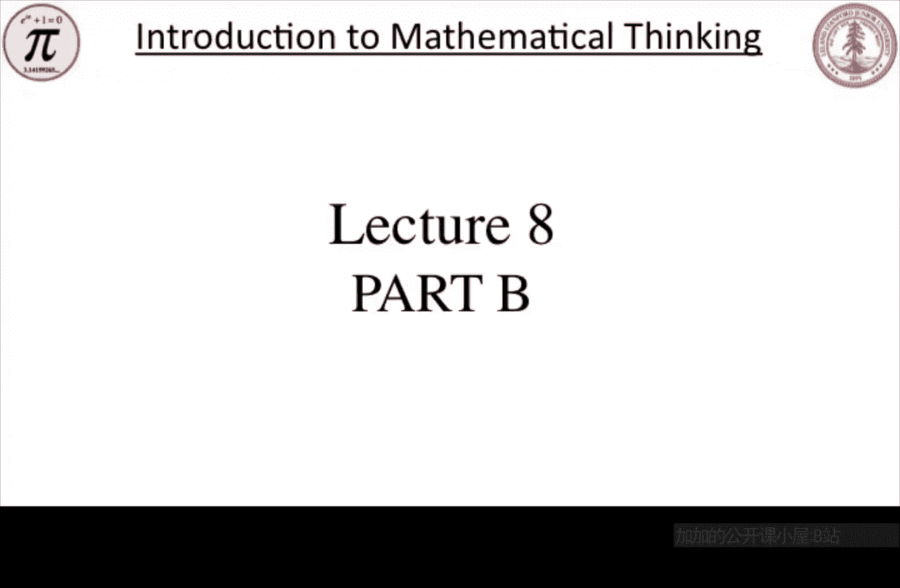
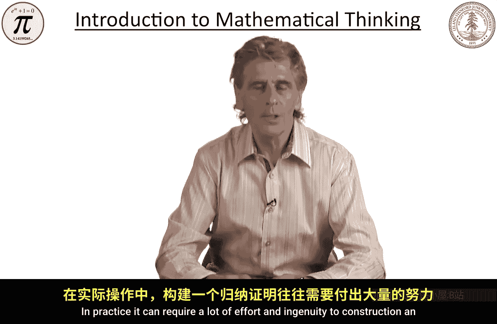
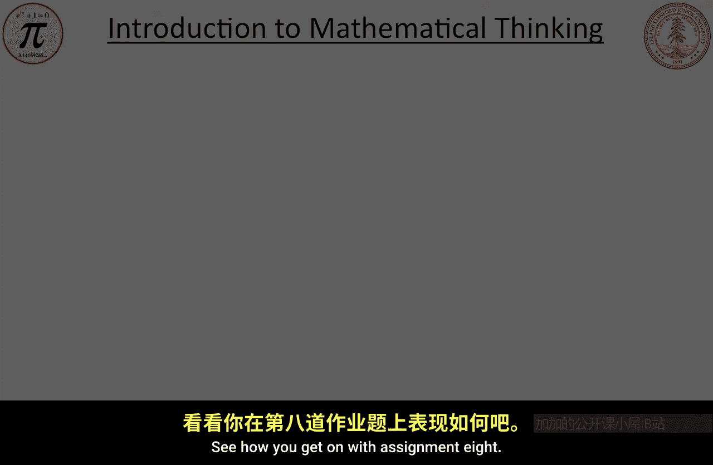

# 数学思维导论：8b：带量词的证明方法2

在本节课中，我们将深入学习数学归纳法，这是一种用于证明关于自然数的命题的强大工具。我们将通过具体的例子，详细拆解归纳法的证明步骤，并介绍其一种常见变体。

## 概述

上一节我们介绍了数学归纳法的基本思想。本节中，我们将通过一个代数不等式的证明，来具体展示归纳法的应用流程，并揭示其背后的逻辑结构。随后，我们将探讨归纳法的一种变体，并利用它来证明算术基本定理的一部分。

## 数学归纳法示例：一个不等式证明

为了清晰地展示归纳法证明的结构，我们来看一个具体的定理。设 `x` 是一个正实数，我们将证明对于任意自然数 `n`，以下不等式成立：
**`(1 + x)^(n+1) > 1 + (n+1)x`**

以下是详细的证明过程。

**证明**：我们使用数学归纳法进行证明。
首先，我们定义归纳命题 `A(n)` 为：
**`(1 + x)^(n+1) > 1 + (n+1)x`**
我们的目标是证明对于所有自然数 `n`，`A(n)` 为真。

**步骤一：验证基础情形 `A(1)`**
当 `n = 1` 时，`A(1)` 的表述为：
**`(1 + x)^2 > 1 + 2x`**
根据二项式定理，我们知道：
**`(1 + x)^2 = 1 + 2x + x^2`**
由于 `x > 0`，所以 `x^2 > 0`。因此，`1 + 2x + x^2 > 1 + 2x`。
所以，`A(1)` 为真。

**步骤二：进行归纳递推**
现在，我们需要证明对于任意 `n`，如果 `A(n)` 成立，那么 `A(n+1)` 也成立。
即，假设 `A(n)` 为真：
**`(1 + x)^(n+1) > 1 + (n+1)x`**
我们需要推导出 `A(n+1)` 为真：
**`(1 + x)^(n+2) > 1 + (n+2)x`**

我们从 `A(n+1)` 的左边开始：
**`(1 + x)^(n+2) = (1 + x) * (1 + x)^(n+1)`**
根据归纳假设 `A(n)`，`(1 + x)^(n+1) > 1 + (n+1)x`。由于 `(1 + x) > 0`，不等式方向保持不变，因此：
**`(1 + x)^(n+2) > (1 + x) * [1 + (n+1)x]`**
展开右边：
**`(1 + x) * [1 + (n+1)x] = 1 + (n+1)x + x + (n+1)x^2 = 1 + (n+2)x + (n+1)x^2`**
因为 `(n+1)x^2 > 0`，所以：
**`1 + (n+2)x + (n+1)x^2 > 1 + (n+2)x`**
综合以上步骤，我们得到：
**`(1 + x)^(n+2) > 1 + (n+2)x`**
这正是 `A(n+1)`。因此，归纳递推步骤完成。

**结论**：根据数学归纳法原理，命题 `A(n)` 对所有自然数 `n` 成立。

这个证明清晰地展示了归纳法的两个核心步骤：验证起点和建立从 `n` 到 `n+1` 的递推关系。

## 归纳法原理总结与变体

现在，让我们总结一下数学归纳法的工作原理。

以下是使用归纳法证明“对所有自然数 `n`，命题 `P(n)` 成立”的标准流程：
1.  **基础步骤**：证明 `P(1)` 为真。这通常通过直接观察或简单计算完成。
2.  **归纳步骤**：证明条件语句“若 `P(n)` 为真，则 `P(n+1)` 也为真”对所有 `n` 成立。通常的做法是：假设 `P(n)` 成立（归纳假设），然后通过代数或逻辑推导，证明 `P(n+1)` 必然成立。
3.  **得出结论**：结合以上两步，根据数学归纳法原理，可断定 `P(n)` 对所有自然数 `n` 成立。

值得注意的是，归纳法原理涉及“所有自然数”这一无限集合，因此它是一个深刻的数学原理。在证明结尾，我们通常会明确写上“由数学归纳法原理，结论得证”这样的句子。

有时，我们需要证明的命题并非从 `n=1` 开始成立，而是从某个更大的数 `n0` 开始。这就引出了归纳法的一种常见变体。

以下是这种变体归纳法的步骤：
1.  **基础步骤**：证明 `P(n0)` 为真。
2.  **归纳步骤**：证明对于所有 `n ≥ n0`，若 `P(n)` 为真，则 `P(n+1)` 为真。
3.  **得出结论**：则 `P(n)` 对所有 `n ≥ n0` 成立。

除了起始点不同，其逻辑结构与标准归纳法完全一致。

## 应用示例：算术基本定理的一部分

接下来，我们将使用上述变体归纳法来证明一个著名定理——算术基本定理——的关键部分。

**定理**：每一个大于1的自然数，要么本身是质数，要么可以写为一系列质数的乘积。

注意，这个定理只对 `n ≥ 2` 成立，因此我们使用起始点为 `n0 = 2` 的归纳法。

**证明**：
我们定义归纳命题 `A(n)` 如下：
“对于所有满足 `2 ≤ m ≤ n` 的自然数 `m`，`m` 要么是质数，要么是质数的乘积。”
我们的目标是证明对所有 `n ≥ 2`，`A(n)` 成立。

*   **基础步骤**：证明 `A(2)`。
    当 `n=2` 时，`A(2)` 断言：所有满足 `2 ≤ m ≤ 2` 的数 `m`（即只有 `m=2`）是质数或质数乘积。因为2是质数，所以 `A(2)` 为真。

*   **归纳步骤**：假设 `A(n)` 成立（归纳假设），需证明 `A(n+1)` 成立。
    考虑任意满足 `2 ≤ m ≤ n+1` 的自然数 `m`。有两种情况：
    1.  如果 `m ≤ n`，那么根据归纳假设 `A(n)`，`m` 已经是质数或质数乘积。
    2.  如果 `m = n+1`，我们需考察 `n+1` 本身：
        *   若 `n+1` 是质数，则结论成立。
        *   若 `n+1` 不是质数，则根据定义，存在两个自然数 `p, q`，满足 `1 < p, q < n+1` 且 `n+1 = p * q`。
            由于 `p` 和 `q` 都满足 `2 ≤ p, q ≤ n`，根据归纳假设 `A(n)`，`p` 和 `q` 各自都是质数或质数乘积。
            因此，`n+1 = p * q` 就是质数的乘积。
    综合以上，在 `A(n)` 成立的假设下，我们证明了 `A(n+1)` 也成立。

**结论**：由数学归纳法（起始点为2），`A(n)` 对所有 `n ≥ 2` 成立。这意味着每个大于1的自然数都是质数或质数乘积。

在这个证明中，我们选择了累积性的命题 `A(n)` 作为归纳假设，这使我们能在证明 `n+1` 不是质数的情况时，顺利地对更小的因子 `p` 和 `q` 应用归纳假设。这种技巧在归纳证明中很常见。

## 两个重要的定义澄清

在继续之前，有必要澄清两个初学者常混淆的定义：

*   **1是质数吗？**
    **答案：不是。**
    质数的正式定义是：一个大于1的自然数，如果除了1和它自身外不再有其他因数，则称为质数。因此，1不符合“大于1”的条件，不是质数。

*   **0是自然数吗？**
    **答案：通常不是。**
    在本课程及多数数学语境中，自然数指正整数 `{1, 2, 3, ...}`。0是整数，但不是自然数。自然数从计数开始，历史习惯始于1。

明确这些定义有助于避免后续学习中的混淆。

## 总结

本节课中我们一起学习了：
1.  **数学归纳法的完整应用**：通过一个代数不等式证明，我们详细演练了从定义命题、验证基础情形到完成归纳递推的每一步。
2.  **归纳法原理的总结**：我们明确了归纳法证明的标准结构及其背后的逻辑力量。
3.  **归纳法的变体**：我们介绍了当命题从某个大于1的数 `n0` 开始成立时，如何调整归纳法的起始点。
4.  **变体归纳法的应用**：我们使用起始点为2的归纳法，证明了“每个大于1的自然数可分解为质数或质数乘积”这一算术基本定理的关键引理，并学习了如何构造累积性的归纳命题。
5.  **关键概念澄清**：我们明确了1不是质数，0通常不属于自然数集。

归纳法是处理与自然数相关命题的基石性方法。虽然其思想直观（如同推倒多米诺骨牌），但构建一个严谨的归纳证明常常需要洞察力和技巧。请通过习题来巩固你对这一重要方法的理解。