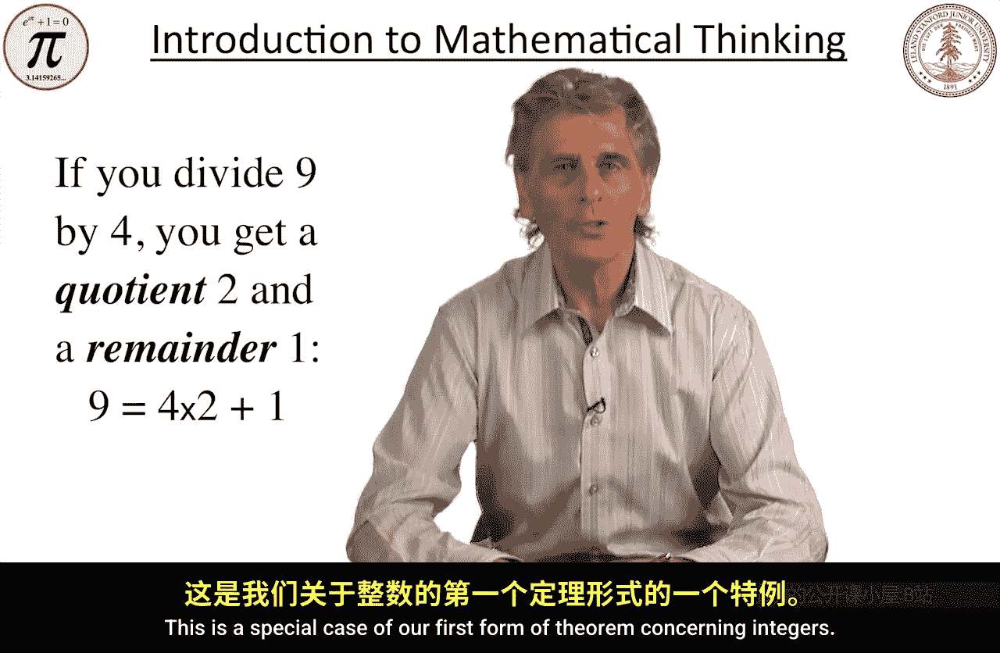
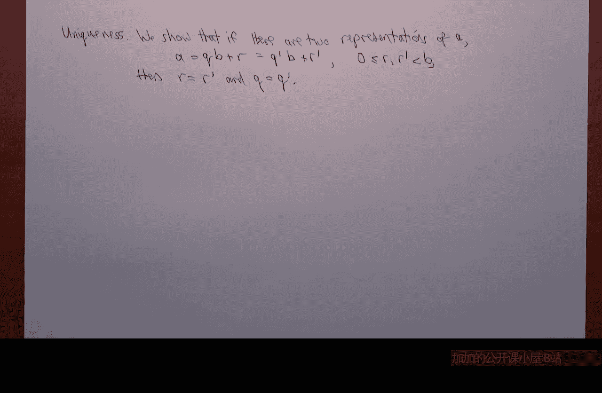
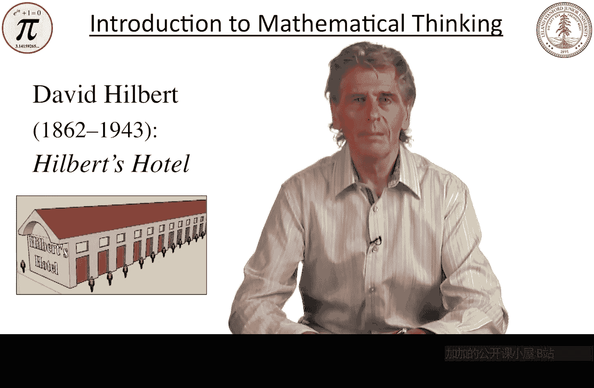
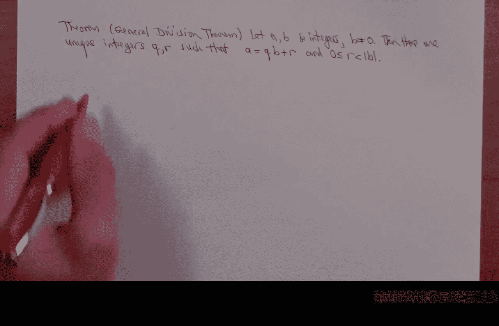
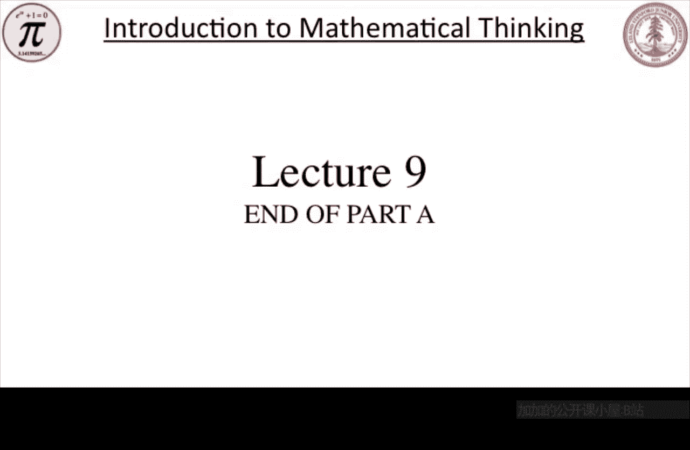

# 斯坦福大学【中英⚡数学思维导论｜Introduction to Mathematical Thinking】 p29 P29 01_讲座9a：数论基础1 -BV1D44dzxEa7_p29-

How did you get on with a silent date？Though the focus of this course is a particular kind of thinking rather than any specific mathematics。

😊，The integers in the real numbers provide convenient mathematical domains to illustrate mathematical proofs。

Those domains are number theory and elementary real analysis。

The principal advantage is example domains。😊，Is that everyone has some familiarity with both systems。

Yet very likely you want have been exposed to their mathematical theories。😊，I'll take the ins first。

Most people's experience with the whole numbers is by way of elementary arithmetic。

Yet the mathematical study of the integers。😊，Looking beyond mere calculation to the abstract properties those numbers exhibit。

Goes back to the very beginnings of recognizable modern mathematics around 700 BCE。

That study has grown into one of the most important branches of pure mathematics。😊，Number 3。

Most college mathematics majors find that number3 is one of the most fascinating courses they take。😊。

Not only is a subject full of tantalising problems that are easy to state but require great ingenuity to solve if indeed they have been solved and many haven't。

But some of the results turn out to have applications crucial to modern life。😊。

Internet security being arguably one of the most important。Unfortunately。

 we'll barely scratch the surface of number30 in this course。

But if anything you see in this lecture arouses your curiosity。

 I would recommend that you look further。You're unlikely to be disappointed。

The mathematical interest in the integers lies not in their use in counting。😊。

But in thea medical system。Given any two integers， you can add them， subtract one from the other。

 or multiply them together。And the result will always be another integer。

Division is not so straightforward。And that's where things get particularly interesting。

For some pairs of integers， say 5 and 15。Division is possible。

15 dividevalueged by 5 to give the integer result 3。For other pairs， say 7 and 15。

Division is not possible unless you're prepared to allow fractional results。

 which takes you outside the integers。If you restrict arithmetic to the integers。

Division actually leads to two numbers， a quotient and a remainder。For example， if you divide 9 by4。

 you get a quotient of two and a remainder of one。9 equals 4 times 2 plus1。

This is a special case of our first formal theorem concerning integers。

The division there。The division theorem says the following。Let A B be integers with B greater than 0。

Then there are unique in Q and R。😮，Such that a equals QB plus R and 0 less than equal to R。

 less than B。Well there were two parts to this theorem。There's an existence pass。

 there are integers with this property。And there's a uniqueness part。

Those integers are unique with this property。In proving the theorm。

 we're going to take those one at a time。I'll first prove existence。And then I'll improve uniqueness。

So， approve。As always， it's a good idea to begin a proof by stating the method you're going to adopt。

In this case， what I'll say。Is I'm going to prove。Existence， first。Then uniqueness。

I'm not using any standard methods， so I'm not able to state that I'm using something like induction or whatever。

But it will orientate the reader to say that the first part of the proof will deal with existence。

And the second part will deal with uniqueness。Okay， so we're going to handle existence。Well。😮。

Look at all non negative intes of the form A minus K B， where K is an integer。

Ensure that one of them is less than B。What the theorem says。Is that among the integers E minus QB。

 namely the integers R。There is one with R between 0 and B。

So I'm going to look at all possible candidates for a minus Kb or a minus QB， if you like。

And I'm going to show that， among those candidates。One of them satisfies that condition。

And the key for which it satisfies that condition。Will be the cu that I'll take with a theorem。Well。

 first of all。I need to show that there are such changes。For example， tick K equals negative。

 absolute value of a。Then since B is greater than equal to 1。

A minus K B equals a plus absolute value of a times B。

Which is greater than or equal to a plus absolute value of a。

 which in turn is greater than equal to 0。Well。Having shown that there assets integers by producing a K。

That gives me such an in。I can choose the smallest one。Let are be the smallest such integer。

And let Q with the value of K for which it occurs。Ie。We'll have R equals a。inus QB。

So with our and cube defined in this way。I will indeed have。A。Equals QB plus R。

If I can show that R lies between 0 and B。In this fashion。Then I'll approved the existence。

So to complete the proof， we sure that hour is less than be。

Or suppose on the contrary that I is greater than equal to be。In other words。

 I am now going to use proof by contradiction。To show that I is less than B。Well。

If I is greater than equal to be。Then。A minus Cuppus1t B。Eals a minus QB minus B。

Which equals I minus b。Which is greater than equal to 0。By virtue of this assumption。Thus。

 a minus is Cupus 1 B。Is a non negative integer of the form A minus K B。But a， is the smallest such？

😮，And yet， a minus Q plus 1 B is less than a minus Q B， which is R。And that's a contradiction。

If our is the small as such。We can't find a smaller one。There's a contradiction。

And sorry is less than B。Because we obtain that contradiction on the assumption that I is greater and or equal to be。

And that proves existence。If you haven't seen a proof like this before。

It almost certainly looks very complicated。It's actually not complicated or deep。

 It's just intricate in its structure。The idea is to look at at all of the possible candidates to make this true。

Well， first of all， we have to show there is a possible candidate。

 and we actually do that by exhibiting one。And then to get a candidate which satisfies this additional requirement。

We pick the one where the R is is the smallest。 It's it's the minimal value of R that gives us one of these things。

And then we use the fact that it's minimal in order to show that it has。

 thats to satisfy this requirement。Each individual step is just elementary algebra。

 It's just somewhat intricate to push the argument through。

There's a lot of arguments in mathematics like this。 There was no deep mathematics involved。

 There's nothing more than elementaryrithmetic and a little bit of algebra。

But there's a bit of intricate structure to make the proof work。

 So if you haven't seen this kind of argument before， it'll probably take you several reads through。

 you need to look at it several times before it begins to make sense。Okay， well。

 that proveds existence。😮，Then we need to turn to uniqueness。To prove uniqueness。

We show that if there were two representations of a。

 a equals Q B plus r and a equals Q prime B plus r prime。

With zero less than equal to higher and our prime， less B。

Then r equals r prime and  Q equals Q prime。So the first part of the division theory。

 the existence part that we've already proved shows that there are representations of this form。

What we're now doing is showing that if there were two such representations。Then， in fact。

 theyre identical。The R is the same and the Q is the same。Incidentally， you probably realise by now。

That the， the letter Q is going to denote quotient and letter R is going to denote remainder。

We haven't officially defined quotient and remainder yet。

 so I haven't written anything like that down。But I'm using the， the familiar notation。

Because what we're doing is we're giving the mathematical underpinnings。

Of the familiar knowledge that you probably have about about arithmetic。Dividing one into by another。

Okay， so we have an equation here。QB plus r equals Q prime b plus r prime， let's rearrange it。

Reranging。I get r prime minus r equals B into Q minus Q prime。

And' label that equation 1 for later reference。Now I'm going to take absolute values in this equation。

And when I do that。I get absolute value r prime minus r equals B times absolute value of  Q minus Q prime。

Which are labeled equation too。B as positive， remember。So when you check absolute values。

 B remains the same。But negative B is less than negative R， which is less than equal to 0。

And 0 is less than or equal to R prime， which is less than B。

So a negative B is less than i prime minus r is less than B。Well。

 if Rp prime minus a is between negative B and plus B。That means。To the absolute value of r5 minus5。

Is less than B。So by2， B times absolute value of Q minus Q prime is less than B。

I can divide by Bno to give me。Absolute body of Q minus Q prime。Its lesss than one。

But everything here is an integer。And the only way you can have a pair of integers。

The absolute value of the difference between them being less than one。Is if that absolute value is0。

Which means Q。That's to equal Q prime。And then， by equation 1。Hows to we lotifying。

And that proves uniqueness。And with it， we've proved the de， so。Again。

If you haven't seen arguments like this before， it's going to seem pretty daunting。

 But when you go through it step by step， this is really just very basic arithmetic arguments with inequalities。

Take it step by step， and you should be able to follow the arguments so write it until the end。Okay。

 good luck with that。If this is the first full blown。

 rigorous proof of a theorem like this that you've encountered。

You'll probably need to spend some time going over it。The result itself isn't deep。

It's something we're all familiar with。Our focus here is on the method we use to prove conclusively。

That the division property is true for all pairs of integers。

Time spent now making sure you understand how this proof works， why every step was critical。😮。

Will peer dividends later on when you encounter more difficult proofs。

By gaining experience with mathematical proofs of simpler results like this one。😊，Which is obvious。

Mathematicians become confident in the method of proof and can accept results that are not at all obvious。

For an example of a result that's not obvious。😊，In the late 19th century。

 the famous German mathematician David Hilbert。😊，Described a hypothetical hotel that has a strange property。

Hilbert's Hotel， as it's become known。😊，Is the ultimate hotel。In that it has infinitely many rooms。

As in most hotels， the rooms are numbered using the natural numbers，1，2，3， etcter。One night。

 all rooms are occupied。When an additional guest turns up。I'm sorry， says the desk clerk。

 all our rooms are occupied， you have to go somewhere else。😮，The guest， a mathematician。

 thinks for a while before saying。😊，There is a way you can give me a room without having to eject any of your existing guests。

Before I proceed with this story。You might like to stop the video for a moment and see if you can see the solution the mathematician guest has seen。

The clerkeric is sical， but he asks the mathematician to explain how he can free up a room without ejecting anybody already in the hotel。

It's simple the mathematician begins。😊，You move everybody into the next room。

So the occupant of room one moves into room2。😮，The occupant of room two moves into room three and so on throughout the hotel。

In general， the occupant of room N moves into room n plus 1。😊，When you have done that。

 room one is empty， you put me in that room。😮，The clerk thinks about it for a moment and then has to agree that the method will work。

😊，It is indeed possible to accommodate an additional guest in a completely full hotel。

Without having to eject anyone。The mathematician's reasoning is totally sound。😊。

And so the mathematician gets to room for the night。The key to the Hilbert or argument。

Is that the hotel has infinitely many rooms。Indeed。

 Hilbert formulated the story to illustrate one of the several surprising properties of infinity。

You should think about the above argument for a while。

 You won't learn anything new about real world hotels。

 but you will come to understand infinity a bit better。

And the significance of understanding infinity。😊，Visit it's the key to calculus。

 the bedrock of modern science and engineering。And when you're satisfied。

 you understand the Hilbert's solution。Try the following variance。First variance。

The Hilbert Hotel scenario is as before， but this time， two guests arrive at the Aly Full hotel。😊。

How can there be accommodated in separate rooms I should add？Without anyone having to be ejected。

Second variant， this time， the desk clerk faces an even worse headache。The hotel is full。

 but an infinite tour group arrives。Each group member wearing a badge that says。😮，Hello， I'm N。

For each of the natural numbers， n equals 1，2，3， et cetera。

Can the clerk find a way to give all the new guests a room to themselves without having to eject any of the existing guests？

And if so， how。Examples like the Hilbert Hotel demonstrate the importance of rigorous proofs in mathematics。

When used to verify obvious results like the division theorem。They may seem frivolous。

But when the same method is applied to issues we are not familiar with。

Such as questions that involve infinity。😊，Riggorous proofs are the only thing we can rely on。

Now back to the division server。Well， the way I've stated the division theorem。

It only applies to division by a positive interview B。

 There's a more general version that I'll give you now。So， theorem。General division theorem。

Let A B be integers with being on 0。Then there are unique in Q and R such that a equals Q times B plus R。

And 0， less than or equal to R， less than absolute value of B。So， the general division theorem。

Is almost exactly the same as the previous division theorem we proved。

 except that instead of demanding that B is strictly positive， we're saying that B is non0。

And then here， we have the absolute body of B。And the proof。

Follows fairly straightforwardly from the previous result。

Then since the absolute value of B is greater than 0。

 The previous theorem tells us though our unique introduced Q prime and R prime。

Such that a equals  Q prime times the absolute value of a B plus R prime。And 0。

 less than or equal to R prime， less than absolute value of B。Well， now we simply let Q。

Equal negative Q prime。And I equal。Then。Since absolute value of B， in this case， with B negative。

Is negative B。We get A is QB。不是。0， less than equal to R， less than absolute value of B。

And that's this the。So we simply threw it back to the previous result。

And with the general division theorem now established。

 we could formally give names to the two numbers， Q and R。

and officially we say the number Q is called the quotient of a by B。And I is called the remainder。

And so we've now cycled right back to something that you'll learn in elementary school about dividing numbers and that there were sometimes remainders。

 There were quots and remainders。Okay， and in that， we've done it with some sophistication。

And we've shown that everything is well defined。How about that？😮。

