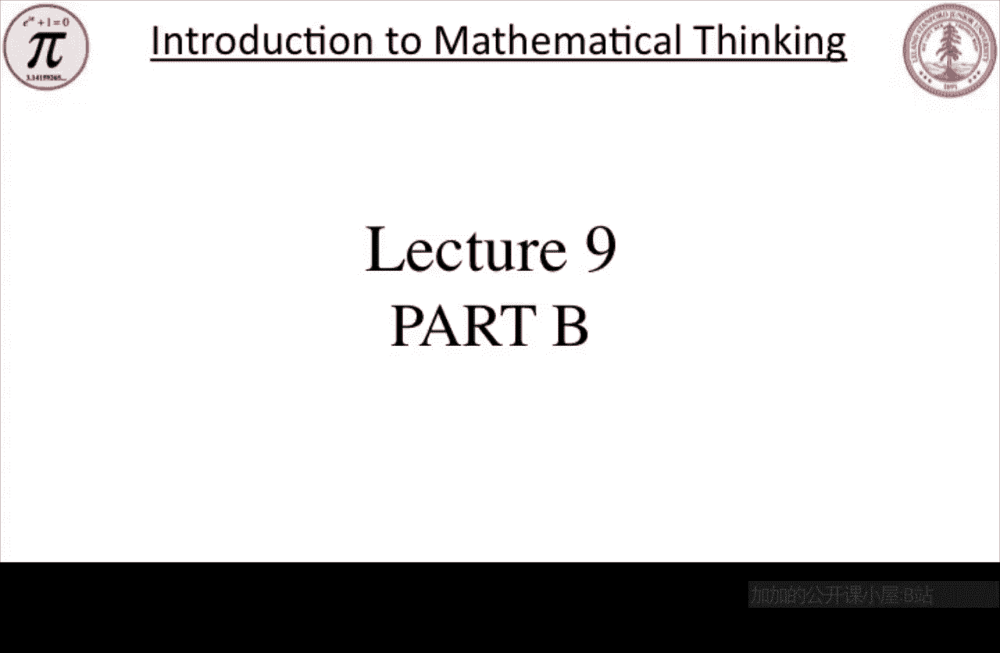
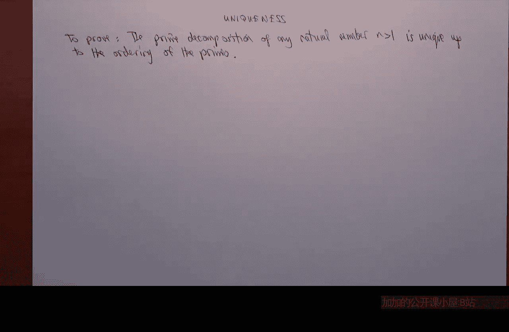
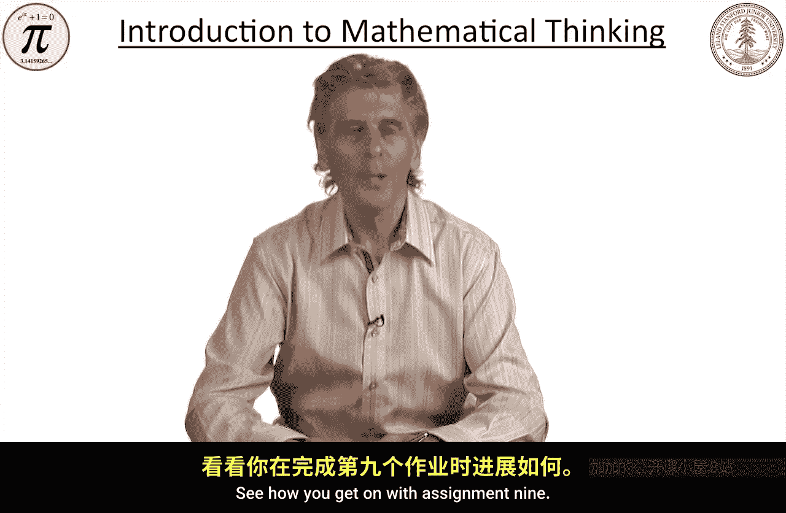

# 斯坦福大学【中英⚡数学思维导论｜Introduction to Mathematical Thinking】 p30 P30 02_讲座9b：数论进阶2 -BV1D44dzxEa7_p30-

Well， now that we have the division theorem available。

 we can look at the important mathematical property of divisibility。

If division of a by B produces a remainder to R equal to 0， we say a is divisible by B。Hence。

 A is divisible by B。 If for only if there's an integer Q，6 that a equals to B Q。For example。

45 is divisible by 9， but 44 is not divisible by 9。The notation that we use for divisibility。

Is this B vertical  line a。Dnot is divis by B。And let me give you a warning at this point。B。

Divge into a or a if visible by B。Is not the same as B。Divided by a。With a slanted line。This guy。

Is a relationship。Between a。And bei。It's true or false。This guy。D not's a rational number。

The result of dividing B by a in the rational numbers。So we have a property， a relationship。

 which is either true or false。And we have a notation for a rational number。Now。

 these are quite distinct concepts。 This is something to do with two integers。

 It tells you whether two integers are in a certain relationship。

This is a notation for a specific number。The reason I'm issuing this is a warning。

Is that beginners in particular often confuse these two things。They both， after all。

 do have to do with division。But， in this case。It's a property。Has nothing to do with with fractions。

 with rational numbers。This， it's a specific number。

It's a specific rational number that we're referring to。Now， there wouldn't be as much of a problem。

If the notation wasn't very similar。And it gets worse when people with sloppy handwriting。

 And you've probably noticed that I'm one of them。Often。

 don't distinguish clearly between a vertical line。And a slanted line。 In fact。

 this one is already almost vertical。 Maybe it would have been better if I'd written it like that。

Okay， that's better。But because the notation is similar。

It's often very easy to get confused between these two things。 The context does disambiguate。

 If you understand what what's been discussed， you shouldn't have any problems。But bear in mind。

 especially when you are meeting this material for the first time。

 that there is an important distinction here。 And in fact， I've got a quiz coming up in a moment。

 which I hope is going to help cement your understanding of this notion so that you'll be able to distinguish it from this one。

Okay， and once we've got divisibility lined up， we can define the all important notion of a prime number。

A prime number is an integer P， greater than one。That is divisible only by one and P。

Notice that we explicitly exclude one from the prime numbers。So the first prime is 2。

 The next one is 3， then 5， then 7 and 11 and so forth。Now for that quiz about divisibility。Okay。

 how did you do？Well， remember the。Condition we have to check is this one B D divided I A。

 if and only if there is a Q， such that A equals B， Q。Well， let's see what we have。 The correct ones。

B。De。F。Jun。NH。😔，Why don't to have a will remember the whole definition of divisibility。

Was under the assumption。That be is nonze。We can't consider div visibility by a zero number。

So that one doesn't work。And likewise， that one doesn't work。And， of course。

 the reason this one doesn't work is because 7 simply doesn't divide into 44。Okay。

Do be careful about this， though。 Division by 0 is problematic under any circumstances。 And so we。

 we ruled it out。 And in this case， it was ruled out in the very statement of the divisibility theorem。

Okay， how about this one。Well， again， the condition we have to check。Is it beat， if I say。

If and only if。Heres a queue。So should a equals B Q。And again， this is under the assumption。

Been on  zero， everything is is an integer here。With the correct ones。That。That。嗯 that。

So why the others false？Well， this one is false because that simply doesn't divide that。 However。

 if you sort of got out a calculator and actually tried to divide it， then you were missing。

The obvious point。This is an even number。 and that's an odd number。And we cannot have。An even number。

Dividing an odd number。So if you had to do any arithmetic with this。

 then you were making the mistake that I've been warning you against of acting as if you were in high school。

 This is a course about mathematical thinking。 And what I hoped you would have done is to think about this mathematically and realize that you can't have an even number divided into an odd number。

 So this is a cautionary reminder that this is not about jumping into calculations and applying procedures。

 This is all about thinking about a problem。Okay， so。That's false。

But I would hope that you would recognise its false。Without doing any work whatsoever。

Was it a little bit of thinking。Okay。I occasionally like to slip things like that into into quizzes just to keep people on their toes。

Well， at least it is false， of course， because that'ss simply not the case that to when divide in squared。

 The reason the others are false。Well， this is false for various reasons。 I mean， it's the same。

 I mean，2 n simply doesn't divide n squared for various reasons。

The reason this is false is because if N can vary over Z。Then that would include n equals 0。And so。

 we can't have this。Because we can get a zero coming in。That includes any equals error。Likewise。

 for this one。Okay， same thing。So， this one fails。Because 0 was included。 If I excluded 0。

 it would be fine。I mean， the only difference between these two is that this is the positive integers。

1，2， and 3， and and so forth。This one， because it's all of the integers。Include 0。Okay， well。

 let's move on though。I want to prove a the oforem， now。

It gives the basic properties of divisibility。是。😔，7。Let A， B， C And D be integers with a non 0。Then。

 the following all hold。Wan。It divides 0。And a divides a。2。He divides1。If and only if。

A equals plus or minus-1。3。If a divides B。And C D H D。Then AC divides BD。

This is under the assumption C is non zero。Because we can't have divisibility by 0。

 the division theorem itself excludes the case of division by 0。4。If8 it B。And B divide C。

Then A divides C。And this is under the assumption being on 0。 Again。

 we have to exclude the possibility of division by 0。5。E images B。And B D I J。Those two hold。

If and only if a equals plus and minus B。six。If a divide B。And if b' is non zero。

Then absolute value of a less than or equal to absolute value of B。

You can only divide smaller numbers into bigger numbers。

Or at least numbers that are no bigger than You can't divide a number B by something that's bigger than it in absolute value。

One more？7。If a divides B and A divides C， then A divides B X plus C， Y for any integers X， Y。Okay。

 you prove all of these。By going back to the definition of divisibility。what。

 what I'm gonna do is just， I'll give you， I'll prove two of them as examples。

Let me just pick number 4。Let's prove forward。 That's this one here。

All the proofs were essentially the same idea。If a divides B and B divides C。

 then that means there are integers， D and E。Such that B。Equals D。And C equals E B。

 That's the definition of divisibility。In which case， C。Equals D times E times a。Which， again。

 by the definition of divisibility， means air divide C。Let me do one more。 Let me do6。Okay。

So A0 bys B。 So that means。Sitive odds B。It no means there is a D。So that B equals D。In which case。

 taking absolute values， absolute value B equals absolute value D terms absolute value A。

And since p is non zero。😔，We know that the absolute value。Of D。

Will have to be greater than equal to one。So the absolute value of a is national equal to the absolute value of B。

Okay。See， p is non zero。So， D。Can't be 0。 So its absolute value is greater than equal to 1。

 And if the absolute value of D is greater than equal to 1， then a has to be less than equal to B。

The other statements in the theorem。Approved similarly。

 you just take it back to the definition of divisibility。And when you， you know， that's。

 remember the definition is。B Dij。😔，If and only if there is a Q。Such today。Equals Bq。

Only in all cases， you go back to the definition。And then the thing drops out in a couple of lines。

Okay， well， that's the that lists all of the basic properties of divisibility。Okay。

 it's time to prove the fundamental theorem of arithmetic。Theem。

Every natural number greater than one is either prime or can be expressed as a product of primes in a way that's unique。

 except the order in which they are written。For example。4 is two times 2 or two squared。

6 is two times 3。8 is too cubed。9 is 3 squared。10 is two times 5。

12 is two squared times 3 and so on and so on。3366 equals 2 times 3 squared times 11 times 17 and so forth。

I worked that one out in advance， by the way。Okay， so2 is self is prime。3 is prime。

4 is a product of primes。5 is prime。6 is a product of primes，7 is prime。8 is a product of primes。

9 is a product of primes，10 is a product of primes，11 is a prime。

12 of is a product of primes and so on and so on and so forth。

The expression of a number of a poet of primes is called its prime decomposition。

And when you know the prime decomposition of a number。

 you know an awful lot of information about that number and how it behaves with with relation to other numbers。

What we proved part of this a little while ago， proved the existence part。

 And I'm going to give you another proof of existence in a moment。

 But the new part is to prove uniqueness。The uniqueness proof will require Euclid's dilemma。

That says if a prime Pe divides a product， A B。Then P adds at least one of it B。

The proof of Eucli'slemma is not particularly difficult。

 but it would take me outside the scope of this course。

 Remember the the focus of this course isn't isn't to teach you number theory and number theoretic techniques iss to develop mathematical thinking。

 and it would be too much of a detour from that goal in order to prove Elid'slemma。

But if you just Google Euclius lemma， you should be able to find some references that would lead you to a proof。

Let me give you the existence proof。More precisely， let me give you a new proof of existence。

Remember， this is the statement of the theorem。Any natural number greater than one is either prime or can be expressed as a product of primes in a way that's unique except for their order。

And we going to prove existence？The previous proof of existence that I gave you used the method of mathematical induction。

 and I gave it as an illustration of the method of induction。But I'll give you a different proof。

 now。I'll prove it by contradiction。Suppose they were have a composite number。 That's a non prime。

That could not be written as a product of crimes。Then there must be a smallest such number。

Call it in。Since N is not prime， there are numbers A， B。Strictly between1 and n。

 such as n equals A B。If A and B are primes， then n equals Air B is a prime decomposition of N。

 and we have a contradiction。Because N was chosen。So as not to have。The prime decomposition。

It was actually the smallest number that didn't have a primary de compositionposition。Well。

 if it's not the case at end， via primes。Then at least one of them must be composite。

But if either of A B is composite， then because it's less than n。It must be a product of crimes。

So by replacing one or both of A B by its primary decomposition in n equals A B。

We get a pro decomposition of N。 And again， we have a contradiction。That proves existence。

That's the first part of the proof of the fundamental theorem of arithmetic。Now。

 let me prove you uniqueness。So what I have to prove。

Is that the prime decomposition of any natural number N greater than one is unique up to the ordering of the primes。

And I'll prove it by contradiction。So assume there is a number N greater than one that has two or more。

 in fact， different prime decompositions。Let end with the smallest such number。

That n equal P1 times P2 times da， da， da times P R。Equals Q1 times Q2 times da da da Q S。

Be two different。 Pri decompositions of。So we have N as a product of our primes。

And we also have N as a product of S primes。 some of the primes being different。Well。P1。

Is a prime factor of n， So P1 divides n。So， P1。Dide this product。

Since P1 divides Q1 times Q2 through Q S。And let me stop at this moment。And see what I've done。

I've said P1 demands N， So P1。Dividedes this。 And I'll split that into two that way。

 and notice that P1 divides Q1 times that。And I've done that in order to apply Uage lemma。

So now let me continue that sentence。By Euchar lemma， either P1 divides Q1。

Or P1 divides the product Q2 through QS。Rememberber Euclid's Lemma。

Says that if I have a prime number P。And if P divides a product， A times B。

Then P demands at least one of A B。So eucal dilemma was that if P divides a product here B。

 it divides at least one of those two numbers。So from here， P1 divides this product。

Ive now written that as a product of two numbers。And I can now apply Euclid's lemour and say that if P1 divides that times that number。

 it must divide at least one of them。 Either P1 divides Q1， where it divides either parts。

 or maybe both of them。Okay。Hence， either P1 equals Q1。

Or else P1 equals Q I for some I between 2 and S。Okay， if P1 divides Q1， then they're both primes。

 So the only possibility is that P1 equals Q1。Or else P1 divides this product of crimes。

Which means that P1 actually is one of those primes。So first case。I know that P1 equals Q1。

Second case， another that P1 equals Q I。For one of the eyes between2 and S。

But then we can delete P1 and Q I from the two decompositions in S。

Which gives us a number smaller than N。 That is two different prime decompositions。

Contrary to the choice of N is the smallest such。Okay， having established that P1。

Is equal to one of these cus。 We don't know which one， but it's going to be one of them。

I can delete the P1 from here。 I can delete the appropriate Q from there。

And when I delete P1 from there and sum Q from there。I still have equality。

I still have a prime decomposition of a number。 but having deleted that common prime。

The number that I get is smaller than N。 So I get a number smaller than N that has two different parameter decompositions。

The number smaller than n will be P2 times de de times P R。 that will be the number smaller than n。

And I've deleted a number from here。 And what's left。Is is a crown decomposition here。So。

 the proof involved simply。Identifying the fact that recognizingogni the fact。

The huge is eucliided dilemma。That you're going to have the same prime on both sides。

 you can delete it。And get two different decompositions of a smaller number。And that was uniqueness。

Okay， well， now we've proved the fundamental theorem of arithmetic。Coolhuh。So did that make sense？

Chances are you're going to have to spend some time trying to come to grips with this。

Though I know you're familiar with arithmetic， especially whole number of arithmetic。😊。

This is probably the first time you've tried to really analyze numbers。

See how you get on with assignment 9。

