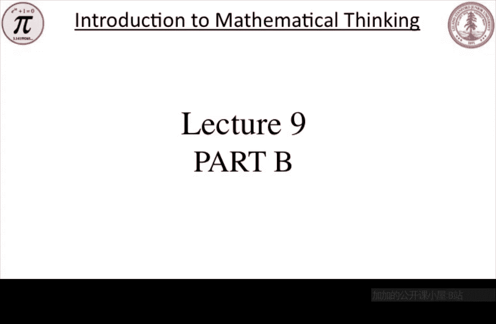
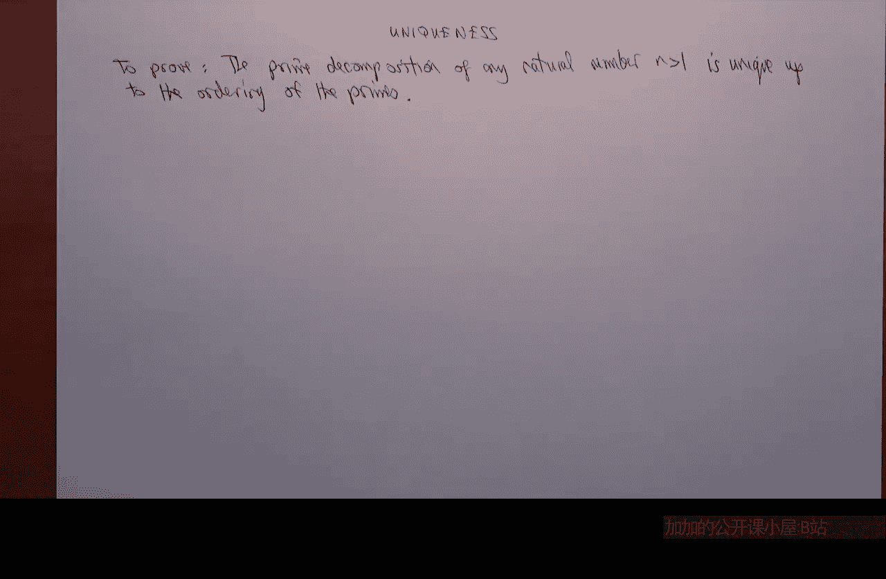
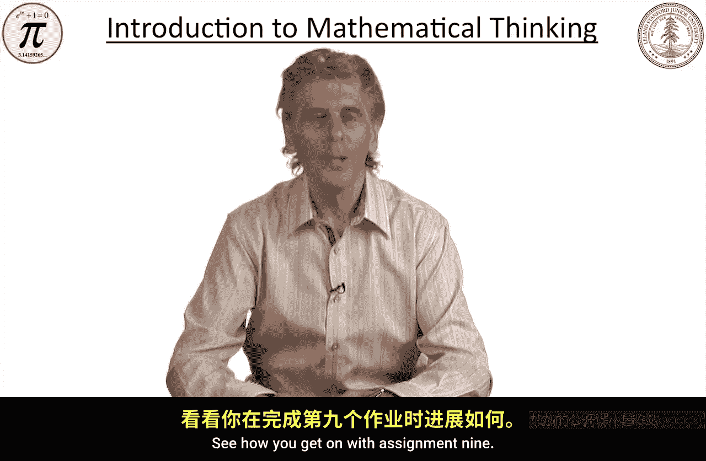

# 数学思维导论：9b：数论进阶2

在本节课中，我们将学习数论中的两个核心概念：**整除性**与**质数**。我们将从整除性的定义和基本性质开始，并最终证明算术基本定理，即每个大于1的自然数都可以唯一地分解为质数的乘积。

## 整除性的定义

上一节我们介绍了带余除法定理，本节中我们来看看基于该定理的一个重要数学性质：整除性。

如果整数 `a` 除以非零整数 `b` 的余数为0，我们就说 `a` 能被 `b` 整除。因此，`a` 能被 `b` 整除，当且仅当存在一个整数 `q`，使得 `a = b * q`。

例如，45能被9整除，因为 `45 = 9 * 5`。但44不能被9整除。

我们使用符号 `b | a` 来表示“`b` 整除 `a`”或“`a` 能被 `b` 整除”。这是一个关于两个整数之间关系的陈述，其结果为真或假。

**重要警告**：符号 `b | a`（竖线）与 `b / a`（斜线）完全不同。前者表示一个关系（整除），后者表示一个具体的数（`b` 除以 `a` 的结果）。初学者常常混淆这两者，需要特别注意。

## 质数的定义

在明确了整除性之后，我们可以定义至关重要的**质数**概念。

一个**质数**是一个大于1的整数 `p`，它只能被1和它自身整除。我们明确将1排除在质数之外。因此，第一个质数是2，接着是3、5、7、11，依此类推。

## 整除性的基本性质

以下是整除性的一些基本性质。设 `a`, `b`, `c`, `d` 为整数，且 `a ≠ 0`，则以下性质成立：

以下是整除性的七条基本性质：

1.  `a` 整除 `0`，且 `a` 整除 `a`。
2.  `a` 整除 `1`，当且仅当 `a = ±1`。
3.  如果 `a` 整除 `b` 且 `c` 整除 `d`（`c ≠ 0`），那么 `ac` 整除 `bd`。
4.  如果 `a` 整除 `b` 且 `b` 整除 `c`（`b ≠ 0`），那么 `a` 整除 `c`。
5.  `a` 整除 `b` 且 `b` 整除 `a`，当且仅当 `a = ±b`。
6.  如果 `a` 整除 `b` 且 `b ≠ 0`，那么 `|a| ≤ |b|`。
7.  如果 `a` 整除 `b` 且 `a` 整除 `c`，那么 `a` 整除 `(b*x + c*y)`，其中 `x` 和 `y` 是任意整数。

所有这些性质的证明都基于整除性的定义：`a | b` 当且仅当存在整数 `q` 使得 `b = a * q`。我们以性质4和6为例进行证明。

**性质4的证明**：假设 `a | b` 且 `b | c`。根据定义，存在整数 `d` 和 `e`，使得 `b = a*d` 且 `c = b*e`。因此，`c = (a*d)*e = a*(d*e)`。再次根据定义，这意味着 `a | c`。

**性质6的证明**：假设 `a | b` 且 `b ≠ 0`。根据定义，存在整数 `d`，使得 `b = a*d`。取绝对值，得 `|b| = |a| * |d|`。由于 `b ≠ 0`，可知 `d ≠ 0`，因此 `|d| ≥ 1`。所以，`|a| ≤ |b|`。

## 算术基本定理

现在，我们利用整除性的知识来证明数论的基石——**算术基本定理**。

**定理**：每个大于1的自然数，要么本身是质数，要么可以唯一地（除了因子的排列顺序外）表示为一系列质数的乘积。

例如：
*   4 = 2 * 2
*   6 = 2 * 3
*   8 = 2 * 2 * 2
*   9 = 3 * 3
*   10 = 2 * 5
*   12 = 2 * 2 * 3
*   3366 = 2 * 3 * 3 * 11 * 17

一个数的质数乘积表达式称为其**质因数分解**。

该定理的证明分为两部分：**存在性**和**唯一性**。

### 存在性证明（反证法）

假设存在一个合数（非质数）不能写成质数的乘积。那么，必然存在一个最小的这样的数，记作 `n`。

由于 `n` 是合数，存在介于1和 `n` 之间的整数 `a` 和 `b`，使得 `n = a * b`。

*   如果 `a` 和 `b` 都是质数，那么 `n = a * b` 本身就是 `n` 的一个质因数分解，与 `n` 的选取矛盾。
*   如果 `a` 或 `b` 是合数，由于它们都小于 `n`，根据 `n` 是最小反例的假设，它们各自都能分解为质数的乘积。将 `a` 或 `b` 的质因数分解代入 `n = a * b`，就得到了 `n` 的一个质因数分解，再次产生矛盾。

因此，假设不成立，每个大于1的自然数都存在质因数分解。

### 唯一性证明（反证法及欧几里得引理）

假设存在一个大于1的自然数 `n`，它有两种或多种不同的质因数分解。设 `n` 是最小的这样的数。

令 `n = p1 * p2 * ... * pr = q1 * q2 * ... * qs` 为两种不同的分解。

考虑质数 `p1`。由于 `p1` 整除 `n`，所以 `p1` 整除 `q1 * q2 * ... * qs`。

这里需要用到**欧几里得引理**：如果一个质数 `p` 整除两个整数的乘积 `a*b`，那么 `p` 至少整除 `a` 和 `b` 中的一个。

反复应用此引理可知，`p1` 必须整除某个 `qi`（`i` 从1到 `s`）。因为 `p1` 和 `qi` 都是质数，所以 `p1` 必须等于这个 `qi`。

于是，我们可以从等式两边同时消去这个相同的质因子 `p1`（和对应的 `qi`），得到一个比 `n` 更小的数，它也有两种不同的质因数分解。这与 `n` 是最小反例的假设矛盾。

因此，假设不成立，质因数分解是唯一的（除了顺序）。

## 总结

本节课中我们一起学习了：
1.  **整除性**的定义（`a | b` 当且仅当存在整数 `q` 使 `b = a*q`）及其与除法运算（`a / b`）的区别。
2.  **质数**的定义：大于1且只能被1和自身整除的整数。
3.  整除性的七条基本性质，并学习了如何基于定义进行证明。
4.  **算术基本定理**：每个大于1的自然数都有唯一的质因数分解。我们通过反证法证明了分解的存在性，并借助欧几里得引理证明了分解的唯一性。

理解这些概念是深入数论和更高级数学思维的基础。