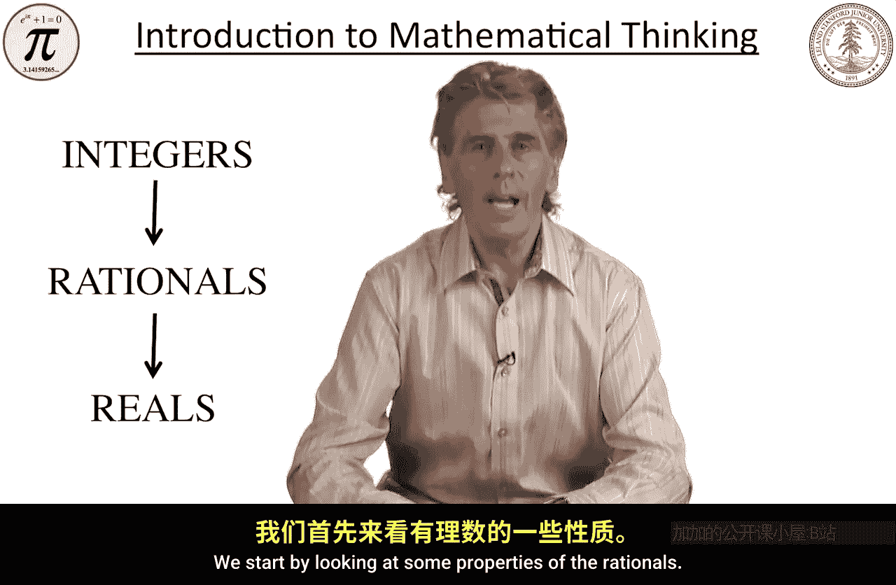
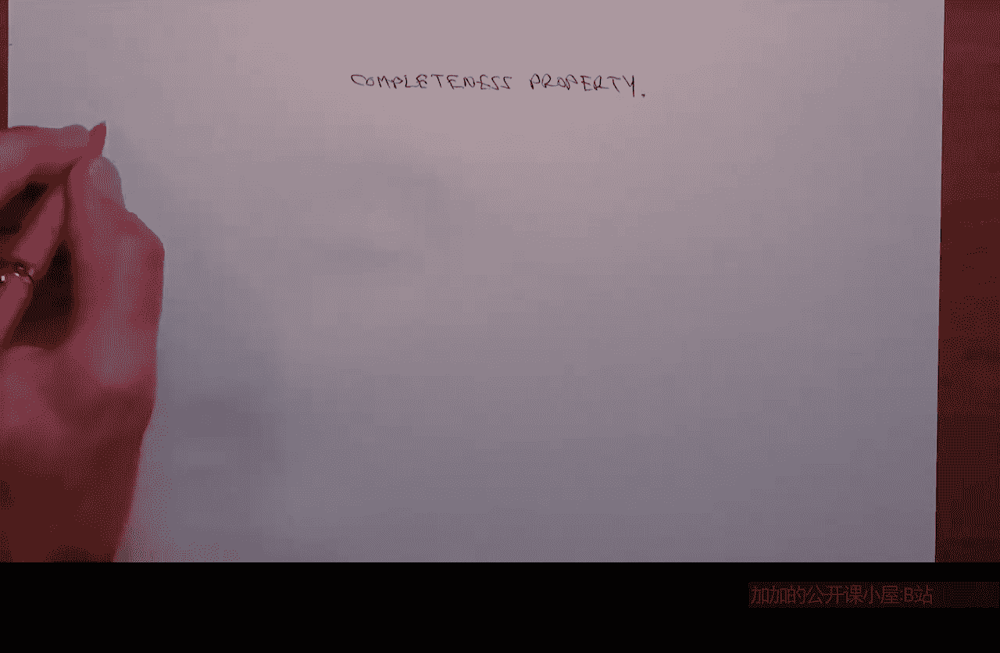

# 斯坦福大学【中英⚡数学思维导论｜Introduction to Mathematical Thinking】 p33 P33 01_讲座10a：实分析基础1 -BV1D44dzxEa7_p33-

How did you get on with assignment 9？There was a lot there。

 so you might not have been able to finish it yet。😊，Don't worry， you can finish that later。

You won't need any of it for this final lecture where we're going to apply our mathematical thinking to studying the real numbers。

Incidentally， if you're not familiar with elementary set theory。

 you should look at the special course freedom on the subject before you proceed with this lecture。😊。

Numbers arose from the formalization of two different human cognitive conceptions。

 counting and measurement。Based on fossil records， anthropologists believe that both concepts existed and were used many thousands of years before numbers were introduced。

As early as 35000 years ago， humans put notches into bones and probably wooden sticks as well。

 but none of those have survived or at least haven't survived and been found。To record things。

Possibly the Cys of the moon or the seasons。And it seems probable they use sticks or lengths of vine to measure lengths。

😡，Numbers themselves， however。Abstractions that stand for the number of notches on a bone or the length of a measuring device。

Appear to have first appeared much later around 10000 years ago in the case of counting collections。

These activities resulted in two different kinds of number。

The discrete counting numbers used for counting。And the continuous real numbers used for measurements。

The connection between these two kinds of numbers was not finally put onto a firm footing until the 19th century。

With the construction of the modern real number system。

The reason it took so long is that the issues that had to be overcome were pretty subtle。

Though the construction of the real numbers is beyond the scope of this course。

 I can explain what some of the problems were。The connection between the two conceptions of numbers was made by showing how starting with the integers。

😊，It's possible to define first rationals。And then use the rationals to define the real numbers。

Starting with the integers， it's fairly straightforward to define the rational numbers。😊。

A rational number is， after all， simply a ratio of two integers。😊，Well。

 it's actually not entirely trivial to construct the rational numbers from the integers。😊。

You want to define a larger system， the rationals that extends the integers。

By having a quotient A over B for every pair Ab of integers where B is nonze。

But how will you go about defining such a system？In particular。How would you respond to the question。

 what is the quoient A over B？😮，You can't answer in terms of actual quots since until the rationals have been defined。

You don't have quots。If you're interested， you can find an account of the construction of the rationals from the integers in many books and on the internet。

😊，But I'll mention once again that you should be cautious about mathematics found on the internet。😊。

The point is， constructing the rationals from the integers。

 while it has some subtleties is fairly straightforward。Constructing the res from the rationals。

 however， is a lot more difficult。InIn this final session。

 Ill look at some of the issues involved in constructing and using the real numbers。

We'll start by looking at some properties of the rationals。

Yeah。With the rationals， you've got a system of numbers that's adequate for all real world measurements。

This is captured by the following property of rational numbers。And I'll give it as a theorem。

 If our and us are rationals with our less and S。Then there's a rational T。

 so you I is less than T is less than S。Okay， before I prove that， let me give you a little note。

This property。He's called density。The rational line is dense。So。If we have the rational line。

What density says is that whenever you have a rational number R。And another rational number S。

We can find a rational number T in between our home and death。Okay， let's prove that。Well。😮。

Why don't we detect T to what he mean A and S？Well clearly， R is less than T is less than S。

And the only question is。Is T a rational number。What it obviously is， but let's prove it。

That I be equal to M over N。S equal to P over Q。Where M and P and Q。The vintages。And she。

Is equal to a half。And over in。Close P over Q。不籍公。M Q percent P。Over two and Q。Of course。😔，MQ plus N。

And2 and Q are integers。So that proves that tea is in H。Which was pretty obvious anyway。

 But since we are focusing on how we prove things in mathematics at this stage。

 I thought it was a good idea to actually go through a formal proof。That one could give。

And density means that the rationals are good for doing measurements。

 because what density tells us is that we can get rational numbers as close as we wish。

To any particular length。You know， if this is slightly to small。

 if this is slightly smaller than a particular ant and if this is slightly larger。

 then we can always find another rational that's even closer。On on the other hand。

 density does not mean that there are no holes in the rational line。

Let me just emphasize that the proof。Finished here。 So that was the end of the proof。

And with this remark。😊，We're on the edge of an abyss of understanding。

 At least it's an abyss if you haven't seen this before。This is some interesting stuff coming up。

 It's stuff that wasn't fully worked out until the late 19th and early 20th centuries。

As an example of a hall in the rational line。There's route， too。

And let me just make this a little bit more precise。Suppose Ill define a。

To be a set of all those rational act。Which are either negative or nonpo。Oh。😮。

X squared is less than 2。And let me define B。To be a set of all those rationals。

Such that X is positive。And。X squared is greater than equal to 2。Let me do little a diagram。Okay。

 we'll have zero here。😔，And a is a set that's going to go or is going to go out to the to infinity at the left。

And it's going to go to some point here。 That's going to be a。Lets。Delineate things here。

So a is going to be a set here， B。It's going to be a set also is's going to go to infinity。

And we're going to have every element of A to the left of every element of B。And here。

Is where route 2 would be if route 2 existed in the rational  line。 This is the rational line Q。Okay。

So we've got the rational numbers， and I've split the rational numbers into two sets， A。

 which is everything negative and anything who square is is strictly less than2。

And B is everything which is positive and whose square is greater or equal to 2。

And this splits the rational line into two pieces。Okay。So， clearly。A union B。Is a rational line。But。

 and here's the kicker。A has no。Greatest member。And B。Has no smallest member。No。

 it was by considering situations like this that mathematicians in the late 19th and early 20th century were finally able to figure out a rigorous construction of the real number system and a theory of real numbers。

But it took a couple of thousand years to get to that stage from the time when the ancient Greeks discovered that the square root of two was irrational。

What this tells us。😮，Is it the Russians。Inadate。Can't even spell inadequate though。Inadequate。

To do mathematics。Why do I say that？Because in Q。We cannot solve。The equation。

X squared minus2 equals 0。So the rationals are fine for measuring things。 I mean。

 they're fine for doing carpentry and， for doing various kinds of geometrical things and for building things and for tracking the stars and doing astronomy and so forth。

 That's fine。 So long as we can get by with， say 10 decial places of accuracy or whatever we need。

But if we want an actual solution of equations。Then the rationals aren't good enough because even a simple。

A simple quadratic， like x squared -2 equals 0 cannot be solved。The way out of this problem。

 And this was the work that was done in the late 19th，  early0，20th centuries， was to say， well。

 we've got several different systems of numbers。 We've got the natural numbers。

Then we've got the integers where we add negative numbers or we had。

Negative versions of the natural numbers。Then we have the rationals where we have quas of integers。

These are good for counting。These are good for doing arithmetic when wet want to have negative values like my bank account。

These are good if we want to measure things。If we want to do mathematics。

 we have to go one step further。To the rails， by the way， this was in in many ways。

 it was a historical progression。Not quite because Z sort of got in in a different way。

 but going from the natural numbers to the integers to the rational numbers to the real numbers。

 that was largely a historical progression。And it was done in order to have greater expressivity。

When when arithmetic began about 10，000 years ago， it was exclusively the natural numbers and it was introduced to provide a monetary system in some area in what was known as the Fertile crescent region present day Iraq essentially。

And then as as bankers came along and they wanted to keep track of people's negative bank accounts。

 I' been a little bit flippan， but that was pretty close to what happened。 Neatives were introduced。

 rationals were introduced to measure things in the world。

 And then the real numbers are required to do mathematics。

And to get the real numbers from the rational numbers。

What mathematicians in the late 19th century did。Was find a way to fill in the holes。

There were these holes in the rational line。And the wheels were constructed by filling in the holes。

Okay。Fill in the holes。In the rational line。Well， I'm going to give you a few more details about how this was done。

But， I should mention。That there were some mind blowing elements to this。

There were some really interesting surprises in store for the mathematicians that made this step。

1 was the fact that， however you count it。There were more holes in the rational line than there are rational numbers。

 Now， there were infinitely many rational numbers。Nevertheless。

The infinitude of the holes in the rational lie。Vastly outweighs on an infinite scale。

 the infiniteitude of the rational numbers themselves。It was a super infinity of holes。

 That meant that when those holes were filled in。The number system that was obtained。

 the real numbers contained。Uncomparably more numbers than the rational numbers。

 They're both infinite， but mathematicians had to develop systems for counting infinite collections in order to cope with this。

And it turned out that the right the real numbers。As was set。Has infinitely many in more。

Numbers and the rational numbers。In an infinite sense。Now。

 making that precise is definitely beyond the scope of， of this course。

But I will be able to get into the beginnings of the considerations that LED to those surprising conclusions。

Okay， well， that's all coming up within the next few minutes。Where。

 before I give you any details of how the real numbers were constructed。

I need to do a little bit of preliminary work。I need to introduce or reintroduce if you've seen it before。

 the notion of intervals of the real line。Let E B be real numbers with Air lesson B。

The open interval， A， B， written with parentheses this way， is a set。X in R， such as a， less than x。

 less than B。So a simple diagram would be this。 We've got a point A。 We've got a point B。

 This is now the real line。And the open interval， A B is a set of all the numbers。

Strictly bigger than A and strictly less than B。But the， the interval excludes。These two。

 So it's an interval of the line。 It's a segment of the line， but it excludes the two endpoints。

The closed intervalvalier B written with square brackets like this is the set X in R a less than equal to x。

 less than equal to B。Soaw the diagram for this。Would we've got A。And we've got B。This interval。

Actually includes the two endpoints。So the distinction between these two。

Is that A and B are elements？Of the closed interval。But A and B are not elements。

Give the open interval。Now， this may seem like splitting hers， after all。

This is a segment of the real lines。 So there are infinitely many numbers in here。 In fact。

 as I just indicated a moment ago on on that previous page。

 the infinitude of the real numbers in there is mind bogglingly bigger than the infinitude of the rational numbers in there。

 And the rational numbers in there is already an infinite set。

So we've got infinitely many numbers in here， infiniteitely many points in this line。 And yet。

 I'm splitting hairs between these two points at the end。That sounds like splitting hairs。

 but take it from me。This。Is a big。Big。😔，Big。Difference。Or distinction。

The distinction between these two turns out to be huge。And it's closely bound up。

With the reasons why the rationals are inadequate to do with mathematics。

 and the rails are actually good for doing mathematics。

We're going to use this notation in order to talk about what had to be done to go from the rational numbers to the V numbers。

 I'm not going to do the construction。 It's way too deep for a course like this。

 It's first and second year university level mathematics。

 and it takes most of us a long time to understand it。 But I will open the door to such a study。

There are some variations on the on the notation。 Let me give you those。

I'm not doing any mathematics here。 I'm just giving you some notation。Okay。

One of them is what's known as a half open。Or half closed intervals。

So we have half open intervals or half closed at the same thing really。Such as。A B。

 where that's closed。And that's open。Square brackets， parenthesis。That's a set of all X in R。

Such that a less than equal to x， less than B。And the other way would be A， B。This way。

Is a set of alls in our。Such today， less than x， less or equal to B。And this one。Is called。

Left closed。Right open。And this one。😔，Is called。Left open。Right， closed。

So the word closed means you include。The end point。And open means you exclude the endpoint。

 So if it's left closed， the left end point is included。If it's right open。

 the right end point is excluded。And one more bit of notation， we。

 we sometimes include intervals that stretch all the way to infinity。

And we write things like negative infinity。A。Is the set of all x in our， Well。

 such should x is straight left and A。 It's everything to the left of a。

Although I might write something like。Negative infinity A。With a closed bucket here。

 with a with a square bucket to denote a closed part of the interval。

That would be the set of as in our。Such that x less than equal to a。Similarly。

 I could have A going out to plus infinity。Will be the set of as in our。

So it should extract strictly greater than a。All I could have closed a infinity。

Which is a set of allecs in hour。Such should ex or equal to way。And with one final remark。

I'm done with this summary of notation。We don't have。Something together with infinity closed。

And we don't have infinishity closed together with something。You can't have infinity。

Next to a square per to a square bracket。Because infinity。Hes not a real number。

So there's no possibility of this guy， whatever it is being an element of the interval。

Notice that when I defined these， there was no mention of infinity。

 I just set all those x'es to the left of a。Dter头tter。Okay， with this notation available。

 we can now move ahead and look at how we go from the rational numbers to the real numbers。

 We can look at what goes wrong with the rational numbers in a deep， precise sense。

And I can give you some indication of how we would go about rectifying the。

 the deficiencies of the rational line。Okay， coming up next。😮，Were the key property。

That the real numbers have， that the rationals don't have。Is what's known。

There's a complete in this property。😔，In a nutshell， the completeness property。

Is what makes the real numbers great for doing mathematics。And the absence of which。

Makes the rationals inadequate for doing mathematics。

So it was a formulation of a system of numbers that satisfied the completeness property。

 and indeed a formulation of the completeness property itself。

 It was one of the crowning glories of late 19th century mathematics that set up the 20th century mathematics upon which most of modern science and technology depends。

So this is a big deal， folks。

Given a set a of reals， a number B such that for all A and A。

 A is less than equal to B is said to be an upper bound of a。We say B is at least a a bound of A， If。

 in addition， for any upper a bound C of a。We have B less than equal to C。Well， dear。

 what else would a least a mo be。It's the least one。 It's an upper bound， and it's the least one。

Why am I making such a big deal of this。Because it was by making a big deal of this。

That mathematicians were able to formulate this， and it was by formulating this that mathematicians were able to construct a real number system。

 which meant that after 2000 years of effort， mathematicians finally had a system of numbers that was adequate for doing modern science。

 physics， technology， et cetera， et cetera， et cetera。In mathematics。

 it's often the case that something that seems trivial。Turns out to be fundamental and。

 and have enormous consequences。 And this is one of those moments。O。

 some been very precise about the definition because mathematicians found that it was only about been precise that they were able to figure out how to proceed。

The notation we use for least upper a bounds。Is this least up a bound of a。

So the notation for the least upper bound of a setre is love a。Let me make a note。

 We can make the same definitions for N， for Z and for Q。

The completeness property of the real number system says that every non empty set of rails that has an upper bound。

As a least up bound。And let me stress。That that least took a bound。Is in the set of real numbers。

This one simple。Elegant statement。Is the key。So the real number system。

And to most of modern mathematics。Before I go any further。You really。

Ough to take a look at assignment 10。1。I see you should at least look at it。 Ially。

 you should try to do it， or at least try to do as many of the exercises as you can。

You need to be familiar with the background material about upper bounds and least upper bounds before we progress。

Were about to meet material that most beginners beginners at universal level mathematics find incredibly difficult。

You know， to go back to my favourite example about riding a bike。

 it's one of those transitions in life where it seems impossibly difficult until you get the hang of it。

And then it suddenly seems remarkably straightforward。 And you wonder why it took you so long。

 So it's not that we're facing something terribly difficult。

It's just that we need to go through some kind of a shift。

Going from thinking it's impossible to thinking， well， okay， that seems straightforward。

 It's one of those difficult transitions that when you look back of actually with retrospect。

 don't seem difficult at all。 we're facing one of those。

 And I strongly recommend that you take a look at that assignment before you go any further。

 Otherwise， you might very rapidly find yourself lost in the next few minutes of lecture。Okay。

 having said that， I'm going to take a pause now and then I'll come back in the second video connected with lecture 10 and I'll see you then。

