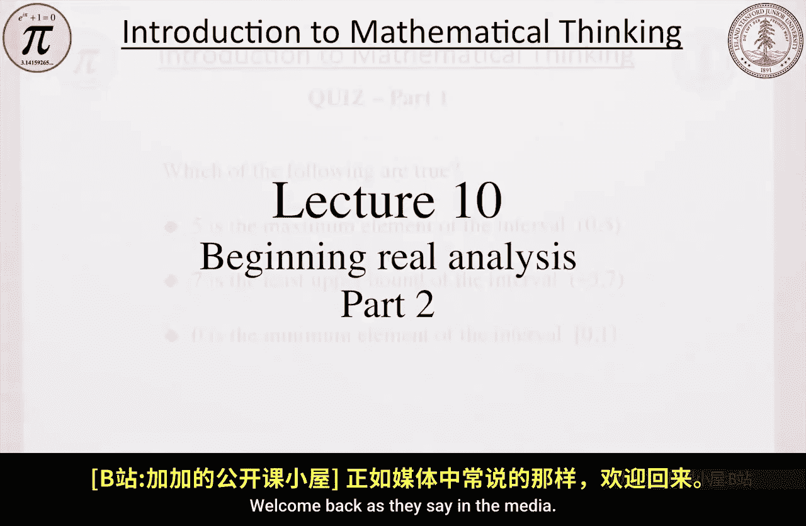
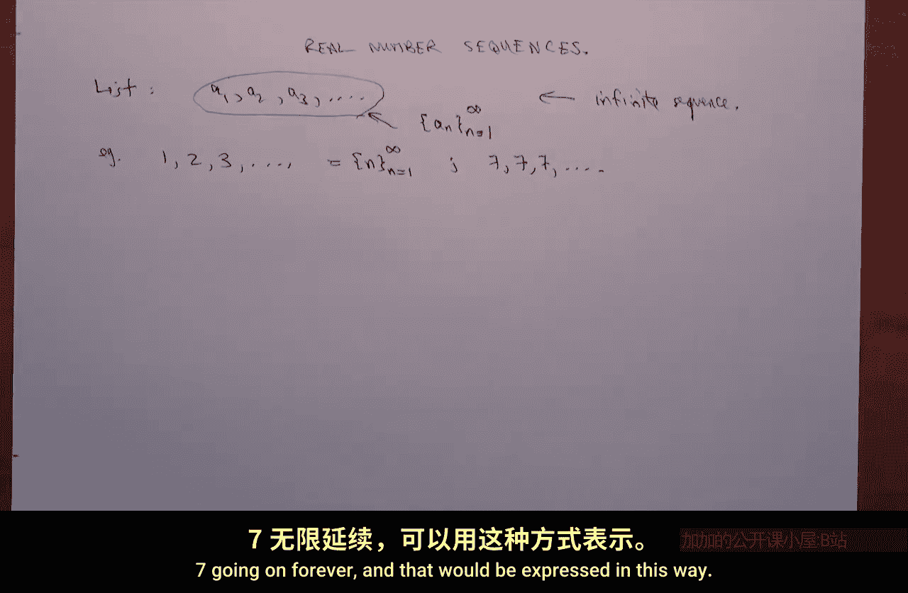
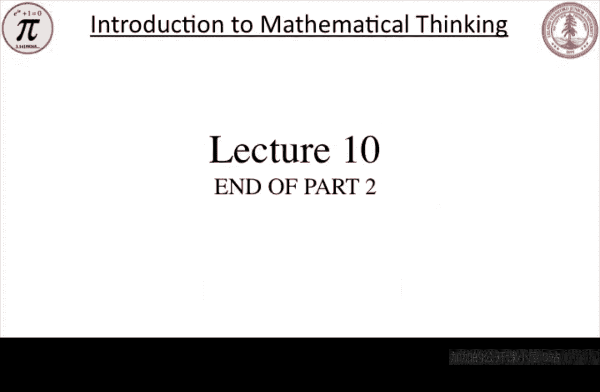

# 斯坦福大学【中英⚡数学思维导论｜Introduction to Mathematical Thinking】 p34 P34 02_讲座10b：实分析进阶2 -BV1D44dzxEa7_p34-

Welcome back， as they say in the media。

Were the correct answers。Number two。numberumber3。5 is not the maximum element of this interval。

 In fact，5 is not an element of the interval at all。This， remember， is a set of all x in the rails。

 so that 0 or strictly less than x， strictly less than 5。 So 5 itself is not a member of there。

 So not on is it not the maximum element。 It's not an element at all。

7 is actually not a member of this interval。For the same reason as 5 wasn't an element of this interval。

But nevertheless，7 is still the least top a bound。There is no smaller of a bound of that interval。

Than 7。 So it is at least up a boundce or at least up a boundce and not the same as maximums。

And in this case。Zero is。A member of that set。That interval is defined， remember， as a set of rails。

 so it a0 less than equal to x。Less than or equal to one。And in this case。

 the end point 0 and one of elements of the interval。So0 isn in there。

 and it's clearly the minimum elements of that interval。Where the answer is。The first one。Is correct。

This is what it means to say that the rational line is dense。Between any two rationals。

You can find a third one。The second one is actually true。😮，But it doesn't express density。

It doesn't express density because whether or not there is an irrational number between two rationals is is sort of irrelevant。

 It's's but the question is about the rational line been dense。

 This is actually making a statement about the real line。So it's true。

 but actually irrelevant to the notion of density of the rational line。So that one's not two。 I mean。

 that one's too， but it's not the answer to the question。And this one。

That's actually expressing the notion of completeness。Now， if by least up a bound。

 we mean least up a bound。In the rationals， in the rational9 Q。

Then that would say that the rational line is complete。Which is false。If， however。

 we interpreted this to mean。Every set of rationals that is bounded above has at least up a bound in the real numbers。

Then that would be an instance of the completeness of the rail line。

And this issue about the existence of least upper bounds is what distinguishes the reels from the rationals。

 And it's what makes the reels a very powerful system for doing advanced mathematics and calculus in particular。

And， and demonstrate and the the， the fact that the rationals is not complete is is what demonstrates the。

 the， the impoverished nature of the rationals in terms of mathematics and doing things like calculus。

Okay， how did you get on？What I want to do now is。Well。

 actually really what I want to do is introduce the beginnings。Of the subject。Known as Ra analysis。

Now， this isn't real analysis as opposed to fake analysis。Real here。

Is is is essentially short for real numbers。Or for the real number system， if you like。

It's the analysis of the real numbers。And I'm going to begin with a theorem。The rational line。

He's not complete。No， if you've done that assignment， a assignment 10。1 that I asked you to do。

You should be familiar with what that means， but let me remind you in case you。

Decided to play play risk skin and go ahead without doing that assignment。Well。

 let me just remind that completeness。Means。If a。Subset of rails。Has an upper bound。

Then it has at least up a bound。In the set of rails， that is。That was completeness， as applied to Vs。

But as I mentioned at the time。These notions also apply to any set。So in terms of the rationals。

 completeness would mean if there is a set of rationals。Having an upper bound。

Then it has at least up a bound in the rationals。What this theorem says。Is that this property。

Does not hold。For the rational numbers。Remember R stands for real numbers here。

 But if I replaced R by Q and talked about the rational numbers。Then this property would not hold。

It does， however， hold for the real numbers。That is the completeness property for the real line。

We won't be able to prove that， but I'll be able to indicate how it's possible to construct the bills。

In order to make it possible to prove that。O， here's the proof of the film。

 Let A with a set of all rationals are such that our is non negative and ask where it is less than2。

Now already you can probably sense what's going on。

This is going to hinge around that property that the square root of two is irrational。

So let me do a picture。Is there。Hiss two？A is going to be a set。Well。

 everything is going to be greater and equal to 0。And a is going to go up to some point less than two。

It only contains rationals less than two， whose square is less than two。

 so those rationals themselves are less than two。So it's going to be something like this。

 And we all know that lurking in there somewhere。Is a square root of two。

I should stress that throughout this argument， the argument I' about， I'm about to give。

We're talking purely about the rationals。So I'm not going to be talking about any reals。

 This is why I sort of。Put this down here， somewhat faintly。This is to help guide our intuition。

 This is to sort of motivate what's going to go on。 But the entire argument I give。

Is going to be in terms of rational numbers， not real numbers。 I deliberately did not write。

 less than the square root of2， because there is no such thing as a square root of two in the rationals。

I'm using sets of rationals in this argument。 It's an argument about the rational numbers。

 not about the real numbers。Okay， well， A' is bounded above。For example。Two is an upper bound。

We only need to find one。And two will do just fine。I will show that A has no least up bound。

That would mean the day is a set of rationals， which has an upper bound， but not least upper bound。

And hence， the rational line is not complete。Because completeness would say that any set of rationals with an upper bound in the rationals has at least upper bound in the rationals。

Well， how would I show that there's no lease up a bound？Well。That X in Q be any upper bound of A。

 I sure there's a smaller one。Again， let mere smaller one in the rationals。Remember。

 we use the lesser Q to deny rationals because Q stands for quotient。

And rational numbers are numbers that are quos of interview。We can't use the letter R for rational。

 because R is used for real numbers。 Unfortunately， I know， but there we are。Well。

 since we're talking about the rationals。😊，That's up our next。

You're going to be of the form P over Q。Where P and Q。Of introduced， in fact。

 there can be natural numbers because this set A is is positive In。

 It's non negative numbers this set A is non negative rationals。

 It's everythings to the right of the origin。So everything's positive。

 So I don't have to worry about negative numbers here。

So these two integers can be chosen and positive。And I want to show that there's a smaller upper bound。

Well， let's suppose x squared is less than 2。 It's either less than 2 or it's squared than equal to 2。

 is one of the two。Let's just see what happens if X is less than to。In that case。

 looking at this equation。2 Q squared。He's bigger than p squared。Now， as N gets larger。😮。

N squared divided by 2 n plus1 increases without bound。

So we can pick an n in N so large that n squared of a 2 n plus one is bigger than p squared。

Divided by 2 Q squared minus P squared。Now， you might not see where I'm going with this。

But hopefully， you can believe everything I've said。Okay， we're assuming x squared is less than 2。

We'll actually， in a moment， we'll arrive at a contradiction。

 So the conclusion I'm going to get out of this is that x squared is， in fact， not less than 2。

 but this is where we're starting。 If x squared is less than 2， then because of that definition。

2 Q squared is greater than p squared。Okay， so 2q squared minus p squared is positive。

 that means this number is a positive number。And what I'm seeing is that。

Because we've got an n squared here and a linear term involving n here， the bigger n gets。

This gets increasingly large。 It gets as s large as you want it to be。

 so I can pick an n big enough so that this number。Is bigger than that one。And if you rearrange that。

 you'll find that2 n squared， Q squared。He's bigger than n plus1 squared。😔，Pace squared。Okay。

 I'll leave you to do the algebra forgetting from there to there。Hence。N plus1。Over n squared。😔。

Times p squared over Q squared。I's less than two。Just rearranging that。

 taking those terms to the other side。No it why？😮，Be endless one。Over N。Ts P over Q。Well notice。

That why is a rational number？😮，It's a quot of integers。And why squared？He's lesson two。

Because this says that y squared is less than two。By the way this。

 by now you should have began to smell why I started looking at this term。

 I was trying to get this number Y。 Remember I started with an X as an upper bound and I wanted to show that there's a smaller one。

 and I'm going to work towards that。um。And now I've introduceds why。Okay。

So why is in Q and Y squared less than 2？So why？Is an element of that said A。But wait a minute， why？

😮，Is equal to a number slightly bigger than one。Times X。

So that means that y is actually bigger than X。So the number y that I've constructed is in the set a and yet is bigger than X。

Well， that's a contradiction。S sex。Isn't upper a bound of it。That supposition。😔，Must be false。

So x squared has to be greater or equal to 2。😔，Okay， so what I've done is I've taken an upper Bo be。

I'm going to sure there's a smaller one。 And there's a first step towards doing that。

Have shown by contradiction。That that upper bound has to have its square greater than equal to 2。

Now I'm going to go ahead using this extra information to show that there's a smaller upper a bound。

And hence， there's no chance of any X being a least up about。Let me re up where we've got to。

With it E。Be the set of all。Rationals。Did넌 zero？And for which R squared is less than 2。Willedex be。

And upper a bound of a。And we had X。In the form P over a Q。Where P and Q were introduced。Okay。

 so we have that。And I were Google。😊，Is to show that a has an upper a bound smaller than next。Hence。

 there cannot be a least up about。Which would show that the rationals are not complete。

And we just showed。That x squared is greaterd or equal to 2。Hence。

Since the square root of two is irrational。X squared is strictly bigger than2。X is irrational。

X squared can't be equal to 2。So's that strictly greater than2。Thus， since x equals as p over  Q。

P squared is bigger than2 Q squared。I'm going to use this fact。

To find an upper bound of a smaller than x。To do that。

 I'm going to pick N an integer so large that the following is true。

N squared divided by 2 n plus 1 is bigger than2 Q squared of a P squared minus-2 Q squared。

I E rearranging that P squared n squared greater than2 Q squared times m plus1 squared。

So you just rearrange this to a little bit of algebra and you get this。啊，异。

P squared over Q squared times n over n plus1 squared is greater than2。Again。

 you just rearrange that and do a little bit of algebra to get that。

Let y be N of event plus one That pure of a queue。Then why is an element of Q。

 why is a rational number？It's a quo of integers。So， I thank you。And moreover。😊，Why squared？

He's bigger than two。Moreover。😮，Since n divided by n plus 1 is less than 1。Y is less than X。

Because P of a Q is x and y is just this guy times x， so it sits less than x。But。For any a in any。

 a squared is less than 2 is less than y squared， So a is less than y。Hence。

 why isn't up a bound of a。Which is smaller than next。Thus， it does not have a least up a bound。

And this proves the theorem。I guess my mathematics is better than my handwriting。

 This proves the theme。Finally， Mark。The construction of R from Q can be done in several different ways。

But in all cases， the aim is to prevent an argument like the above going through for。And with that。

 you're at the very gateway to modern。Reaal analysis。For our final topic in this course。

 I'd like to say a little bit about real number sequences。

These are connected with one of the ways of constructing the real numbers from the rationals。

And they also give us a technique of a concept for doing an awful lot of work in real analysis。

To put it another way。Sequences of real numbers。Over a big deal。In modern real analysis。

 which means they're a big deal in calculus。And anything that's a big deal in calculus is a big deal in science and engineering and technology。

So whichever way you put it， sequences are a big deal。what is a sequence？Well。😮，In everyday terms。

 it's a list。😊，One，2， three， let's put some commas in here。Of numbers。 So we have a number， a number。

 a number going on to infinity。The way we normally express this。And try to capture this。

This infinite extent here。Is by writing it。He， Anne。Where n goes from1。To infinity。

And this is what's called an infinite sequence。If you look in textbooks。

 you'll find a more formal definition that the sequences of function from the set of natural numbers into the real numbers。

 but for the purposes of one of the kind of things I want to talk about here。

It's enough to think of it simply as an infinite list。A real numbers。For example。

The sequence of natural numbers，1，2，3。And so forth。That's an infinite sequence。

In terms of ournotation。And would just write that as n for n goes from one to infinity？

Or I could have。The sequence that consists simply of an infinite sequence of sevens。

7 going on forever。

That would be expressed。In this way。All I could have。The following sequence，3，1，4。1。5。9ine。Et ce。

Inummerating， the decimal did you supply。Well， there's no simple。Formula like this。

 to capture this one。I'll have to use some expression like this。Well。

 let me give you another example。I could have the sequence consisting of negative one to the n plus one。

For men， equals one to infinity。That's a sequence that consists of plus one。Negative one。Plus one。

Negative one。Plus one。Negative one， etc cetera。That's an example of what's known as an alternating sequence。

 meaning that the sign alternates as you go through the sequence。Okay， so that's what sequences are。

 Just infinite lists of numbers。Now， let's look at the following。Example。

Look at the sequence consisting of the numbers1 over N。For men， equals one to infinity。Okay。

 that's a sequence one。hu。The third。A quarter。And so on。And the thing to notice about this。😰。

Is it the numbers。closer。I'm closer。To0。😔，In fact。They get arbitrarily close as ever。😔，Oh this one。

One plus one over two to the n。For men equals one to infinity。That consists of the numbers what。

1 and a half。😔，1 and a quarter。One and8。😔，1 and 16th， etc cetera。And these numbers。

It's arbitrarily close。😔，To one。And going back to this example here。The sequence 3。3。1。3。14。3。141。😔。

3。1415。😔，3。14159。😔，3。141592。😔，3。1415926。😔，That sequence。It's aarily close。S pie。

Thus as far as I know， the decimal expansion， by the way。So these sequences。

Have the property that as you go along them， they get arbitrarily close to a fixed number。

0 in the first case， one in the second case and pine the third case。

And theres there's a general property here that we're going to capture in by way of a definition。

 If the numbers in the sequence A N n from one to infinity。

Get arbitrarily closer to some fixed number a。We say that sequence tenses to the limit a。

And write N hourss A as N hours infinity。An alternative notation。

Is we sometimes write it this way limit as n goes to infinity。Of A of N。Equals a。

Not all sequences tend to a limit。 Look at this one， for example， this alternating sequence。Plus 1。

 negative 1， plus 1， negative 1。That doesn't approach any particular number。

 It bounces back and forth between plus one and negative  one。This one， in a trivial sense。

 Does't tend to a limit。 This one tends to the limit 7。It doesn't just tend to win。

 It never gets away from it。 This one doesn't tend to eliminate at all。 These numbers get bigger。

 and bigger， and bigger。We would sometimes say that the sequence tends to infinity。

 but that's beyond the scope of the limited amount I want to talk about sequences in this course。

The point is， some sequences don't tend to eliminate。Other sequences do tend to an。

