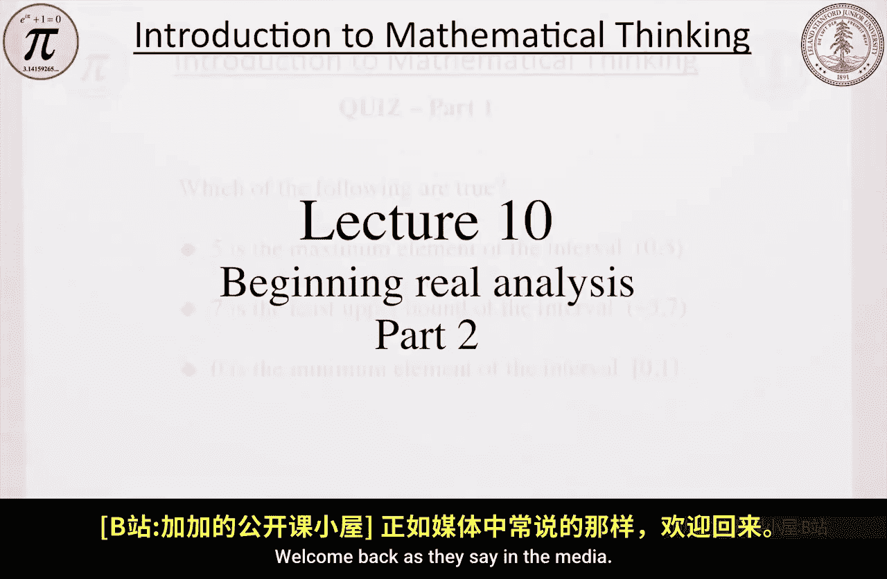
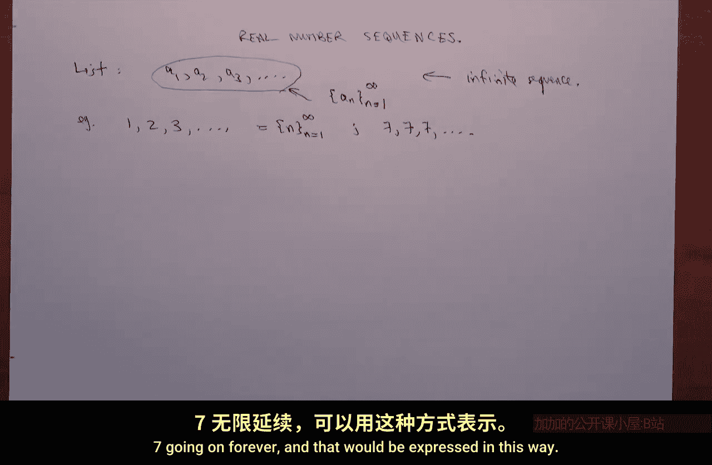
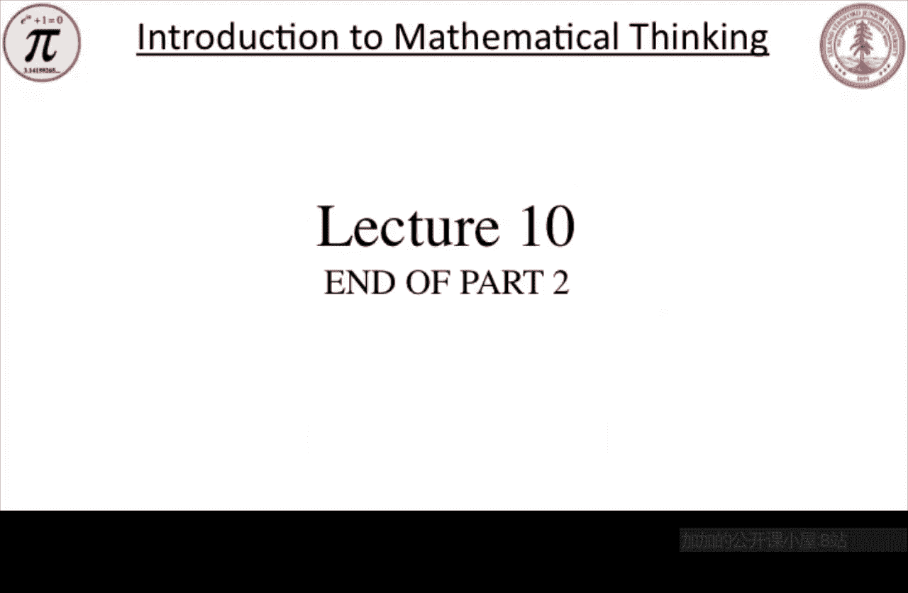

# 实分析入门：第10讲：实分析进阶2

## 概述
在本节课中，我们将学习实分析的核心概念，特别是**有理数的不完备性**以及**实数序列**。我们将通过严谨的数学论证来理解为什么有理数集不足以支撑高等数学，并初步探索实数序列及其极限的概念。

---

## 有理数的不完备性

上一节我们讨论了集合的上确界和最大元等概念。本节中，我们将利用这些概念来探讨有理数集的一个关键缺陷：**不完备性**。

### 定理：有理数集是不完备的
**定理**：有理数集 **Q** 是不完备的。这意味着存在一个**有上界的有理数子集**，但它在有理数集内**没有最小上界**。

**证明思路**：
我们通过构造一个具体的集合 **A** 来证明。定义集合 **A** 为所有满足以下条件的非负有理数 **r** 的集合：
\[
A = \{ r \in \mathbb{Q} \mid r \geq 0 \text{ 且 } r^2 < 2 \}
\]
这个集合包含了所有平方小于2的非负有理数。

1.  **A 有上界**：例如，数字 **2** 就是 **A** 的一个上界。
2.  **A 在 Q 中没有最小上界**：我们将证明，对于 **A** 在 **Q** 中的任何一个上界 **x**，我们总能找到另一个更小的有理数上界 **y**。因此，不存在一个“最小”的有理数上界。

以下是证明的关键步骤：

*   设 **x = p/q** 是 **A** 在 **Q** 中的任意一个上界，其中 **p** 和 **q** 是正整数。
*   首先，通过反证法可以证明 **x² ≥ 2**。因为如果 **x² < 2**，我们可以构造一个有理数 **y**，它既是 **A** 的元素，又大于 **x**，这与 **x** 是上界矛盾。
*   由于 √2 是无理数，所以实际上 **x² > 2**。
*   利用 **x² > 2** 这个事实，我们可以构造另一个有理数 **y = (n/(n+1)) * (p/q)**，其中 **n** 是一个足够大的整数。
*   可以证明，这个 **y** 满足 **y² > 2** 且 **y < x**。
*   因为 **A** 中所有元素的平方都小于2，而 **y² > 2**，所以 **y** 是 **A** 的一个上界，并且比 **x** 更小。

因此，**A** 在有理数集 **Q** 中没有最小上界。这证明了有理数集不具备**完备性**。

**结论**：正是这种“最小上界存在”的性质（即完备性）将实数集 **R** 与有理数集 **Q** 区分开来，使得实数成为进行微积分和高等数学的强大基础。

---

## 实数序列简介

理解了实数的完备性后，我们转向实分析中的另一个基本工具：**序列**。序列与从有理数构造实数的一种方法紧密相关，也是实分析中大量工作的核心概念。

### 什么是序列？
简单来说，一个**实数序列**就是一个**无穷的列表**。例如：
*   自然数序列：1, 2, 3, 4, ...
*   常数序列：7, 7, 7, 7, ...
*   圆周率小数位序列：3, 3.1, 3.14, 3.141, 3.1415, ...
*   交错序列：1, -1, 1, -1, ... （由公式 **(-1)^(n+1)** 生成）

我们通常用 **{a_n}**（n 从 1 到 ∞）来表示一个序列。

### 序列的极限
观察以下序列：
1.  **{1/n}**：1, 1/2, 1/3, 1/4, ... 这些数**越来越接近 0**。
2.  **{1 + 1/2^n}**：1.5, 1.25, 1.125, 1.0625, ... 这些数**越来越接近 1**。
3.  上面的圆周率小数位序列**越来越接近 π**。

当一个序列 **{a_n}** 的项**无限接近**某个固定的数 **a** 时，我们说这个序列**收敛于极限 a**。

**记法**：
*   \( a_n \to a \quad \text{当} \quad n \to \infty \)
*   \( \lim_{n \to \infty} a_n = a \)

**注意**：并非所有序列都有极限。
*   交错序列 **1, -1, 1, -1, ...** 在两个值之间振荡，没有极限。
*   自然数序列 **1, 2, 3, ...** 无限增大，不趋于任何有限数（虽然有时说它“趋于无穷”，但这超出了我们当前的讨论范围）。

序列及其极限的概念是微积分和实分析的基石，在科学和工程中有着广泛的应用。

---

## 总结
本节课中我们一起学习了：
1.  **有理数的不完备性**：我们通过构造集合 **A = { r ∈ Q | r ≥ 0, r² < 2 }**，并严谨地证明了它在有理数集内**有上界但没有最小上界**，从而表明有理数集 **Q** 不是完备的。
2.  **实数序列**：我们介绍了序列作为无穷列表的概念，并定义了**序列的极限**。我们看到了有些序列（如 **{1/n}**）会收敛于一个极限，而有些（如交错序列）则不会。

理解完备性是进入实分析大门的关键，而序列则是探索这个领域最有力的工具之一。