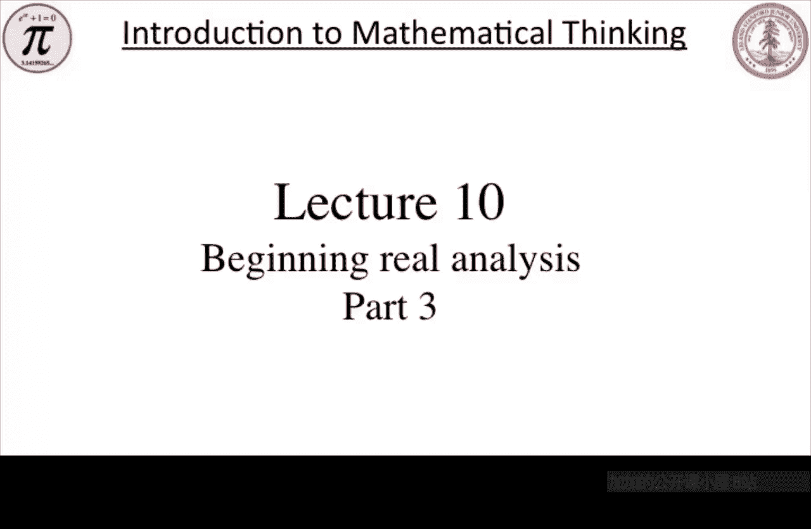
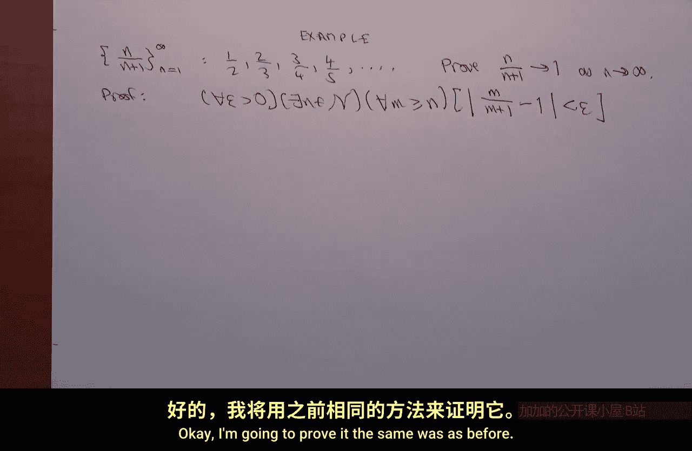
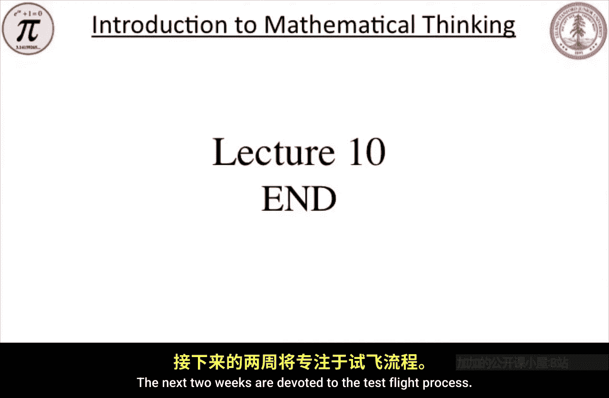

# 斯坦福大学【中英⚡数学思维导论｜Introduction to Mathematical Thinking】 p35 P35 03_讲座10c：实分析深化3 -BV1D44dzxEa7_p35-

Okay。Let's move on。Well， so far， everything's been very intuitive。

Let's get a little bit more formal now。We've got a sequence in。And from one to infinity。

The intuitive explanation or the intuitive description I gave。Of this。

TheThe sequence or the members of the sequence。Tend to eliminate A's and tends to infinity。

That sort of corresponds， fairly roughly。To the fact that the absolute value of n minus a。

Becomes arbitrarily close to 0。No my writing really is a problem， isn't it close？😔，Now。

 let me give you the formal definition and the formal definition。

Involves being precise about what that means。A N tends to A， as N tends to infinity。If and only if。

For all real numbers， epsilon。Greater than 0。There is a natural number N。😔，So said for all。

 m greater than equal to n。😔，Absolute value of M。Minus a。He's less than epsilon。😔，And now。

 perhaps for the first time。You see why we spent so much effort。Understanding quantifiers。

And been in particular about the order in which quantifiers appeared。

This definition is absolutely crucial。In real analysis。

 it's absolutely crucial to our definition and our understanding of the real numbers。

And that means it's absolutely crucial。To calculus。And hence， it's absolutely crucial。To physics。

 science， engineering， technology， et cetera， et cetera， et cetera。This is the real stuff， folks。

Okay， let's try and understand how that。Captures this intuition。The geometric intuition we have。

 I think， is fairly clear that you go along a sequence and the numbers get closer and closer and closer to some fixed number。

How does this somewhat complicated looking expression。Capture that in a precise， formal way。Well。😮。

Let's peel away this part for a minute。By the way， it sits traditional in mathematics to use epsilon in this context。

And at the back of your mind。You should think that Epsilon is not just positive。

 but it's very small and positive， like a 10th or a hundredth or a millionth or a zilth or whatever。

As we' you'll see when I go through this。It's， it's when an epsilon becomes small。

 but remains positive that this thing kicks into power。Okay， so let's forget a bit。

Let's look at the other part exists So N， such if for all M greater and the equal to n absolute value A M minus A is less than epsilon。

And I've avoided mentioning explicitly at the set end。 Now， Not that in the first place。

 I didn't mention that M was also a natural number because the context makes that clear。

 N is a natural number。 And we're talking about all M's width than equal to when。

And when we discuss quantifiers early on。I pointed out that mathematicians do this kind of simplification all the time。

So it makes it easier to read， that's all。Okay， what does this part mean。

 So we've been given an epsilon We'll assume we've given some positive number， Epsilon。

 And at the back of your mind， think of it as a small， positive number。What this means is that。

 from some point onwards。是吧。😔，From some point。En。😔，Onwards。

All the members of the sequence are within a distance， Epsilon of a。So， all the numbers。

In the sequence， A N。Then equals one to infinity。Within。A distance。Of epsilon。Fmei。😔。

You still with me？Now lets see what this thing means when we， when we have the whole expression。

 this says that for any epsilon greater than 0， this thing holds。So， for any epsilon 0。

There is a point。Such that from that point onwards。All the numbers are within a disception for May。

As I mentioned a moment ago。The intuition here。Is that we can tear capule greater than 0 as small as we want。

So let me do a picture now。😔，We've got some number A。

And there's a sequence bouncing around here somewhere。 you know， maybe it's coming in from the left。

 from the right or maybe it's bouncing around。 But that there are these numbers A1 a2 scattered along this line here。

Now， we're given an epsilon greater than 0。 So let's swift suppose it's down here。So his。

 let's say negative， his a。Minus epsilon。And here is a plus epsilon。😔，Okay。

I've just got a distance epsil on to the left and a distancecept on to the right。

And the argument I'm about to give will hold for any epsilon。 At least that's what this says。

So I'm given an epsilon， and I'll look at this interval。

And what the rest of this formula says is that from some point on。All the elements of the sequence。

Im in here。😔，If I take a smaller of epsilon。Let's do it so here。😔，And here。

Let's called it epsilon prime。😔，So it would be a minus epsilon prime。

 and here would be a plus epsilon prime。 So I'll take a smaller epsilon。Still positive。

 So the formula will hold for the epsilon prime。There will be some point。

From which all the elements of the sequence beyond that point are within this。Region。😔。

And then I could take an even smaller one and an even smaller one。Noticice that the N。

Depends on the epsilon。Remember that example about the American Melanoma Foundation。

Wasn't a problem for them getting the quantifiers wrong way around。

If we got the quantifier wrong way around here。Would be in big trouble。 This wouldn't work。

The point is。Given an epsilon， you could find an in。For each epsilon。

 you may have to go further out in the sequence。Until you come to a point where all the elements are within that distance。

But what this says。Is that you can always by going sufficiently far out in the sequence。

Reach a stage where all of the numbers in the sequence from then onwards。Within a given。

Distance of a。And you can do that for smaller and smaller and smaller a。Her nuts capturing。

This intuition。And it does it beautifully and elegantly。And with enormous power。Okay。

Let me give you a couple of examples。First example。Let's look at the sequence， one over。

And goes from one to infinity。Now we know。1 over in。T0s to zero。😔，in。😔，Tends to infinity。

Let's prove this rigorously in terms of the definition of limits that I just gave。Okay。

 so I would approve that fact。What I have to sure is that for all epsilon greater than 0。

 all real numbers epsilon greater than 0。There's an n in the natural numbers。

Such that for all natural numbers M greater them equal to n。Absolute value，1 over M minus is0。

Is less than excellentps。Well， let's simplify that。Fello。Real numbers absolute greater than0。

There rise an in。 And let me just drop that explicit mention of the natural numbers。For all m。

 greater and equal to n。😔，That just says absolute value of1 over M less than epsilon。

Which actually just means one of M。Les than optional。Because M is a positive integer。Okay。

 so I have to verify this。In order to prove that。Okay， so how do I verify that。Well。

The eon greater than 0， be given。Another way of saying it would be to say。

Les epsilon greater than 0 will be arbitrary。Different way of saying the same thing， essentially。

 at least in this circumstance。What do I need to do？He's fine in。Such that。

From all m greaterd or equal to n。1 over him。I's less an epsilon。Well。Pick any in。

Such that N is bigger than one over epsilon。EpsonIf epsil is a very small number。

 this will be a very large number。 so I might have to pick a large head。또 pixel chin네。Now。

 intuitively， you know that since the natural numbers go on forever ever。

 as it were getting bigger and bigger， that's always possible。

That actually uses a principle of mathematics。Call the Archimedian property。

 So named after Archimedes。Si。😔，Assignments。😔，10。2。For a little bit more about that。

So pick an n big enough so that N greater than one have Reps on then。If M greater and equal to n。

1 over M。He's less than equal to one other man。😊，Is that an epsilon？And we done？Notice。

That the choice of N。Depended on Epsilon。Given an epsilon， I picked my end in terms of the Epsilon。

Please note， American Melanoma Foundation。At least when you apply quantifiers in mathematics。

 it's a big deal if you get them in the wrong order。The end depends upon the epsilon。

The smaller the epsilon is。The bigger the end has to be。Intuitively。For this sequence。

The smaller the tolerance you impose on the number being close to 0。

The fair out in the sequence you have to go， the bigger the ennies。Before you， within that tolerance。

So quantify order the matters。The choice of N depended on Epsilon。Different epsilon。Different1。Okay。

 let me give you one more example。And let me look at this sequence， n over n plus 1。For men。

 equal equals one to infinity。That's the sequence a half。Two thirds。Three quarters。4， fifth。

And so on。And let me prove in terms of the definition that n over n plus one。Tends to one。

As then tends to infinity。And intuitively， obviously。

 does these numbers get closer and closer and closer to one。But to prove that。

What I have to show is the following。4 Epson greater than 0。Here's a natural number N。

Such is that for all natural numbers， M greater and equal to n。Absolute value。Of M。Over m plus1。-1。

Is less than Epsilon。Okay， I'm going to prove it the same way as before。

 I'm going to assume I'm given an epsilon。 Then I'm going to find an N。

Depenent on Epsilon that makes this thing true。The epsilon greater than0 will be given。

We need to find an N， such that。For all M greater than or equal to n。M of M plus1。

-1 in absolute value is S and epson。Well， I'm going to pick in。So large。

The then is bigger than one over epsilon。That's actually the same choice as in the previous example。

 it just works out that way because I'm using very simple examples。A more complicated examples。

The choice is perhaps not quite as simple as straightforward as this。Okay。

 but let's see why that one works in this case。Then for any M greaterd than equal to n。

I've got the following。M of m plus1。-1。In absolute value。Equals。-1。Of M plus one in absolute value。

Just work that out as a single fact。Which is just one of M plus one。Which is less than one over M。

Which is less than equal to1 over n， because M is greater than equal to n。Which is less than epsilon。

And we didn't。O， you should now be in a position to attempt the questions on assignment 10。2。

Bear in mind that the two examples I've given were particularly simple ones。

Where the choice of the end。It was very simple。You won't always be so lucky。

 You might have to work a little bit harder to find the end。But my focus here。

 as it's been throughout the course， wasn't so much on the details and on the procedures。

 And if you graduated from high school， I assume you can do mathematical procedures。

 You can do the algebra。 The focus is on the reasoning in particular， in the context of sequences。

The key thing is how given an epsilon， you have to choose an end that depends upon it。

It's disquifier switch。😔，That's really crucial。For all epsilon， there is an N。

If you go on to further studies in mathematics， in particular in real analysis。

You're going to see variances of this kind of definition， not just for for limits of sequences。

But for the definition of continuity and and then when you come to look at the formal definitions of integration and so forth。

 So you're going to come across this kind of a definitional lot。

Coming up with this formulation was one of the jewels in the crown of late 19th century mathematics。

Absolutely brilliant piece of work。 And it gave rise to pretty well all of modern mathematics。

 at least all of modern mathematics is to do with， with real numbers。Okay？Well。

 good luck with assignment 10。2。Well， you made it。All you have to do now is complete the final assignment and you should be well set for taking college level mathematics courses。

😊，Or for simpler reasoning more effectively in your job or in your everyday life。😊。

Since you've got this far， I'm sure you'll complete these last steps。

 so let me offer you my congratulations now。These massive online courses are still hugely experimental。

 so simply sticking with us and finishing the course。Is an accomplishment all by itself。

Future generations of students will surely have it easier in some ways。 What they won't find easier。

 however， is the material itself。Learning facts is relatively easy。😡。

Learning to think a whole new way is extremely difficult。

However well you think you've mastered the material？😊。

You should feel pleased with completing the entire process。Under your own motivation。

As a lifelong teacher， much of my motivation and reward has been getting to know each generation of students and working with them。

 helping them overcome difficulties。And then seeing them succeed。With a MOO。

 that regular close contacts absent and I miss it。😡，On the other hand。

Being able to reach tens of thousands of students as opposed to 25 brings its own reward。

The next two weeks are devoted to the test flight process。

See the website for details。