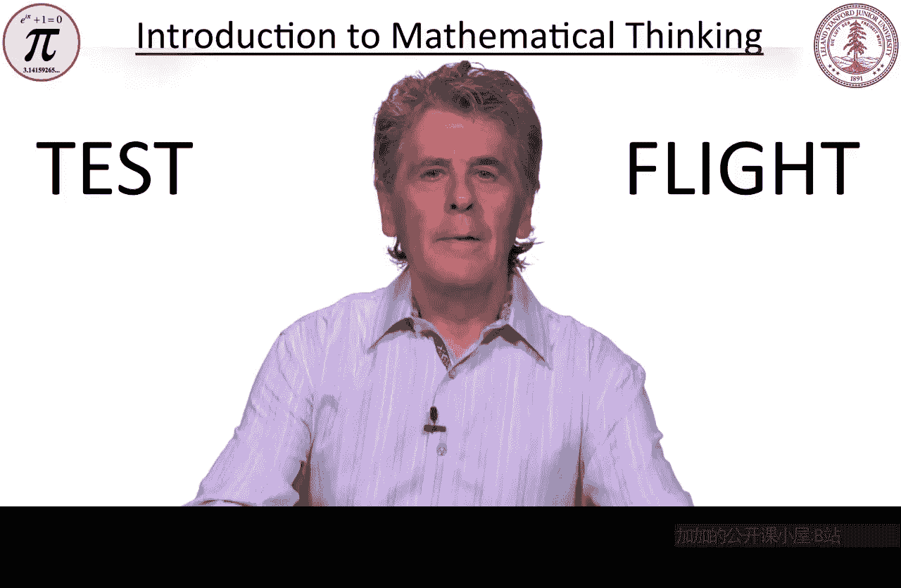
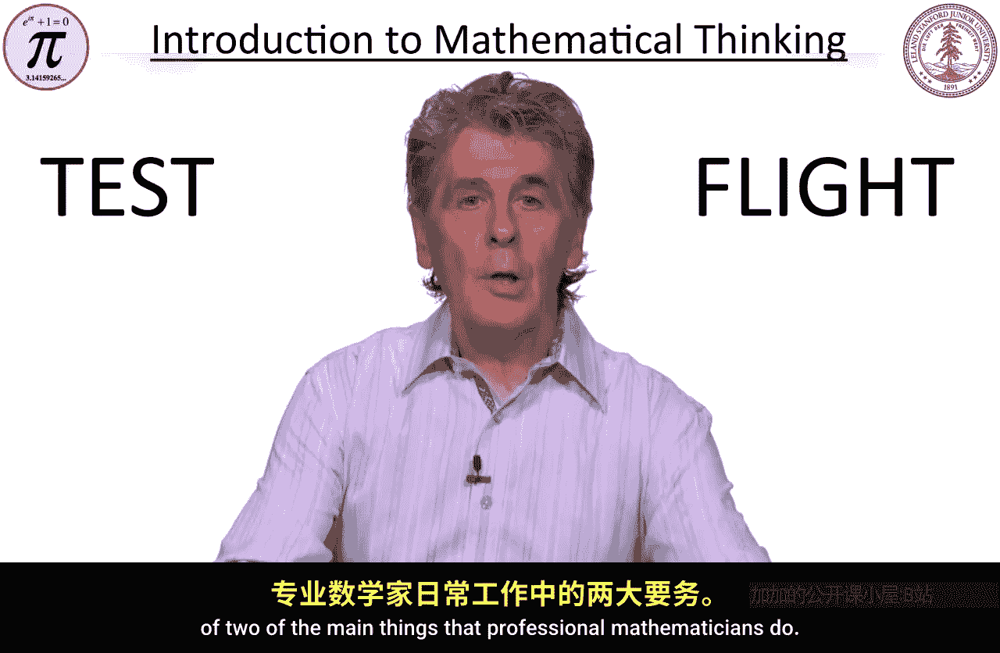
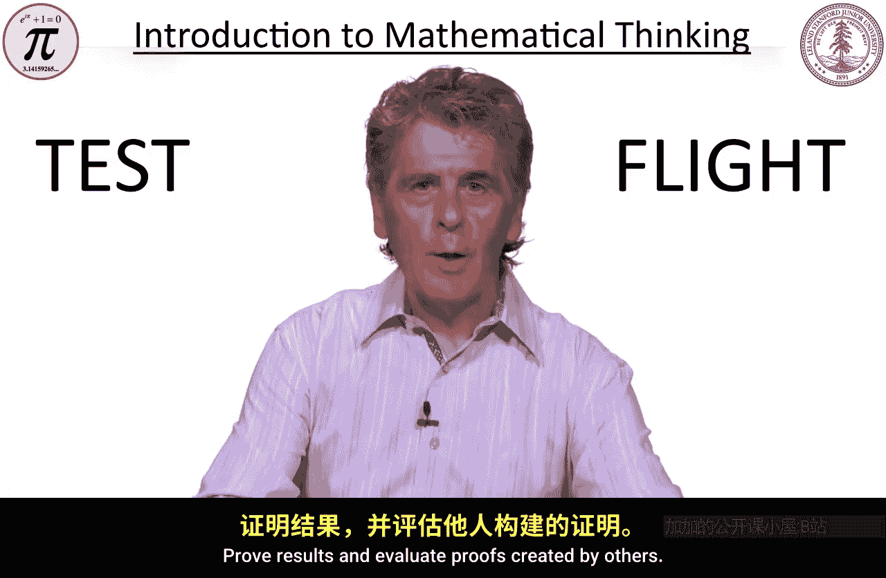

# 斯坦福大学【中英⚡数学思维导论｜Introduction to Mathematical Thinking】 p38 P38 01_试飞简介 -BV1D44dzxEa7_p38-

The idea behind test flight is to give you a brief experience of two of the main things that professional mathematicians do。

Prove results and evaluate proofs created by others。

