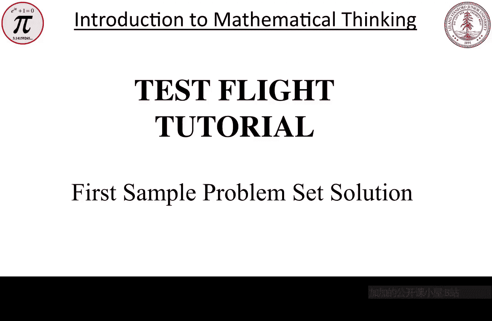
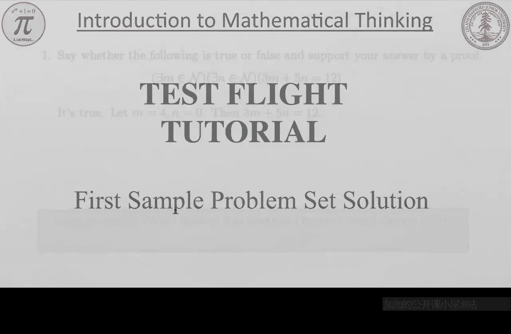
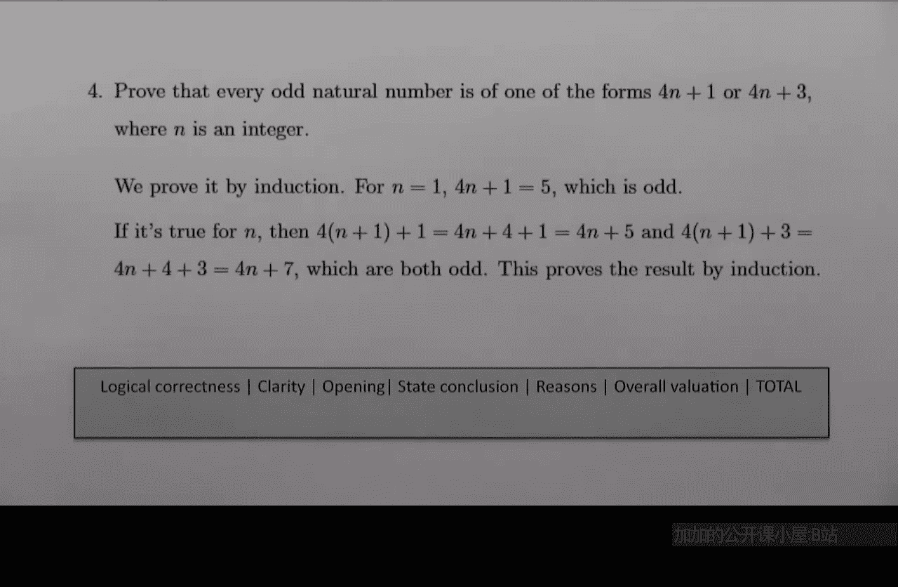

# 斯坦福大学【中英⚡数学思维导论｜Introduction to Mathematical Thinking】 p39 P39 01_试飞教程1 -BV1D44dzxEa7_p39-

When we're looking at the first sample problem set solution。 And in this one。

 the student's answer is wrong because the statement's false。

The problem is that this answer clearly assumes that 0 is a natural number。 And by definition。

 the natural numbers are 1，2，3 onward that's historically correct as well。

 So this is actually a false assumption。So I'm not going to give full max for logical correctness。

 on the other hand。You will find some mathematicians who do include 0 in the natural numbers。

 So I'm not going to be too strong on the penalization here。

But we're in a community and mathematics takes place in the community when we're writing proofs。

 we do so using the norms and practices of that community。

We design our proofs to match the audience that they're intended for。

 So writing a proof has to take account of which community you're in and who you're writing for。

 You know， I mean， when I write proofs for other mathematicians。

 I do them very differently from the kind of proofs that I write for students。

 when I write proofs for graduate students to say different。

 we have to adjust the kind of arguments we're giving。

 depending on on the community we're in and the people we're writing for。

 So's a community aspect of writing proofs。 It's not a matter of right or wrong always it's a matter of who we're trying to communicate to。

 So what I'm going to do is I'm going to put two for logical correctness。

 I'm going to give some credit for saying well， you know， if you do assume zero is a natural number。

 then this is a solution。 but in fact， we're in a community and we've got some accepted practices now we've established a convention zero is not a natural number。

 And in fact， that is the standard convention within mathematics。

 So I think I've been pretty generous here in giving to。 But I think that's fair。It's clear。

 it's absolutely clear。I mean， there really isn't an opening in this case。 It's， it's， it's just。

 you you're just doing it。 it's， it's so short and simple。 So I'll have to give four for that。

Conclusion is stated。Reasons are given， I mean into flowers have reasons to give。Overall。

 I think I would have to give0 because this is just from the from the point of view of of what we're doing in this class and the audience we're trying to communicate to when we write proofs。

 This is just not good。 It really doesn't answer the question。

Within the framework that we're working， okay。So that means I'm gonna give it a total of 18。

 I think that's a pretty good result。 I felt I think that's generous given that the students made what。

 what is a sort of fundamental mistake within the context of this course。

Let's move on to question two。Well， for number 2， the student gives the right answer。

But the proof is completely wrong。There's a fundamental misunderstanding here。

 The students has assumed that this is an existential quantifier。

 that there are five consecutive integers whose sum is divisible by 5。 In fact。

 this is a universal quantifier。What it means is that take any five consecutive integers。

 Then their sum is divisible by 5。So this is just not a proofof。

Student really doesn't understand universal quantification。So。

We're going have to give zero for everything here。 This is just a basic misunderstanding。

 There's nothing we can give any credit for。We have to give a0。

When you really misunderstand something fundamental。

 like what it means to have a universal quantifyifier as opposed to an existential quantifyifier。

This， we can't possibly give partial credit or anything like that。 This is just plain wrong。

 The student has no understanding。Of what we're trying to do。Pity， but there we are。Okay。

 number3 now。 Well， first of all， the student doesn't actually say whether it's true or false。

 not strictly speaking。 On the other hand， the student does start out and say， I'm going to prove it。

 So it's obvious that this person believes it's true， which it is。

 So I'm not going to deductt any maxs for not seeing whether it's true or false。 That's just a slip。

 And it's got nothing to do with sort of mathematical thinking about see。

 they just missed out saying it。 Okay， so so there's something missing here。

But we' not gonna worry about that。 Okay，' gonna prove it by induction。 Okay， let's see。n equals one。

True， okay。Suppose this is induction hypothesis。 Then following this through， This is all okay。

 This is all okay。Beginning to look a bit suspicious this one。

 because this argument doesn't actually use the induction hypothesis。

 which means its not an induction， it's not an induction proof， right？Let's see。

 But one of em plus one it oh， this is good。 This is good。

AndWe'll come back to talk about that in a minute。 because that's that's that's good。

 So that's even and。Well， it certainly。This appears to prove the result。

 but it's not by induction because there was no use of the induction hypothesis that was never used。

And you know there's another problem here？This actually sees for any integer。

That includes the negative intes。Induction only works with a positive inte。

 You can actually extend induction to work with the positive and negative intes。

 We haven't done it in this course， but you can do that。But if you do that。

 then you're going to have to sort of。Take account for the fact that it's a little bit different for the positive and the negative integers。

 So as we've set things up induction。 and this is， this is pretty standard。

 induction is usually introduce mean for the positive integers for the natural numbers。

 And the fact that you can use it for positive and negative is an extension of it。

 That's that's not what we're talking about， so。There's a problem here。Induction， as we've got it。

 standard induction， standard mathematical induction doesn't prove things for all integers。

So this is already wrong。 It hasn't proved it。 It's only proved it for the positive integers。

 and moreover。It hasn't。 It hasn't done it by using induction。

 So there are certainly problems with this。I is it's actually gonna be tricky to grid this one because there is I I'll come back to this one。

 though is there's something good going on here， okay。Logical correctness。

 I'm gonna give one because there's some， there is a logical flow to this。

 It's not an induction proof， except in some strictly formal， vacuous sense， but I'll give one， okay。

Clarity。😊，I'm going give two。In of itself， it's clear。

But as a demonstration of the truth of this guy， it's not clear。

This is not this doesn't have clarity。To knowing why this thing is true。Opening。Again。

 I'm going to give two。Because it sort of begins fine， it's just that it's not relevant。It's。

 you know， it's not totally irrelevant。 This is not completely off the wall。

 but it's not really addressing the issue。So I'm going to have two for that one。

 stay at the conclusion。No， that was well done， I'll be full on that one。A conclusion was stated。唉。

Reasons。Why this is not an easy one。 I'm going to give two for that。 sort of I'm on the fence here。

 reasonsas were given， but they just weren't always the， the right reasons。 on the other hand。

This guy。Veryally is， this is remarkable。Because the， if you' got better to hear， the real key。

To proving this。Is to take that guy and factor it as n times n plus 1。Plus one。

 and then observe that one of these is even and the other one is odd。Hence， their product is even。

 So when you add one， it's odd。 So the proof of the result really just amounts to factoring this。

Theres n times m plus one plus one and observing that that product is even。And then when you add one。

 it's odd， that is the proof。Now， the person has spotted that here。This is the key idea。

And that was why I was generous here。Ive， on all of these， I erred on the side of generosity。

 and I did it because the student had had the key the key， the key idea。 This was it。

 This was the key to the result。And I wanted to give credit for that。😊。

But everything else was just wall almost off the wall。Okay， overall。

 I'm going to have to give zero because this simply doesn't get at the issue the student had sort of seen it。

 but wasn't aware that he or she had seen it。So I can't give more than that。Okay。

 so I've got a total of waffles， let's 11。Okay， somewhat less than half marks， okay？

 but I think that's about right。 I mean， I couldn't even give 50% for this1。 I think that's。

 that's as good as I could give because I'm really just giving credit for this one。

Particular observation。Incidentally with these exam sample solutions。

 what I've done is I've compiled them for many solutions I've seen over the years giving this course and I've sort of simplified them so they fit neatly onto a single slide and that means we can use them as examples to look at but if this had been an actual student paper if these questions were all answered by the same student then at this point I'd actually get rather suspicious because questions one and two were answered very badly。

 I mean really badly。And then suddenly a student comes up with a key idea that this point。

 I'd begin to suspect that the student had actually copied something from another student。

 either copied it wrongly or copied something that had been done wrongly about other student。

 because making this observation just seems so strange。

 given what we've seen in questioners1 and two。as I said。

 this is not an exam solution from a single student。

 It's a compilation to illustrate points of grading and evaluation。But you know， in reality。

 if I was grading a paper， I'd be suspicious。 I， I' would still have to。

 I would still give the grade the same where you grade what's in front of you。

 But your suspicions are often aroused。 And sometimes， of course。

 with a real course where there's actual credit being given for certification and for a degree。

 college credit。 Then you often end up calling the student into the office and going through it and double checking if the student really knows what they're doing。

ok。We've given it them for that。 I think that's the student has shouldn't have any grounds to comp They。

 they've actually got as good a grade as they' like it to get for this one。

Okay， number4。We prove it by induction。Hm。What's going on？

It looks as though this student is trying to prove some sort of a converse， namely。

That every number of one of these forms is odd， Naly that 4 n plus1 is odd and 4 n plus 3 is odd。

 Well， that's trivial。 right，4 n is even So you add one， It's odd。 You add3。 It's odd。 And yet。

 that's what the student seems to be proving。 in which case they they've missed the fact that it's obvious。

So。What am I gonna to give for this。You know，All I can give is zero for this is just。😊。

just off the wall。 there's， there's no， no， nothing I can really to give credit for it。

 the student's trying to do something that's not asked for。 What you're trying to show is that。

If you take a number which is odd， then it has to be of one of these two forms。You're not showing。

That any number of one of these forms。Is odd。So the students not even answering the question。

The immancing the complete converse of the question， which is， in fact， trivial， so。

Nowhere can give any credit for that one。 Okay， you know whether or not this is， this is， this is。

 I'm actually， let's just check and see if this is a valid argument。If if it was induction。

 let's just see。Oh that that's okay。 if it's true for N。And head。Okay， but like。

 but since it's got nothing to do with what's been asked for。

 I'm not gonna even look for giving partial credit for that。I mean， in a different context。

 and I may well have looked for partial credit。 know。

 if this had something to do with what was been asked for， but it's not。

 this is just completely irrelevant to what's been asked for。And， and as I've indicated。

 when we set up the rubric。You can give partial credit。So long as it's relevant to the question。

But a valid argument that doesn't address the question at all just can't receive partial credit。

And that's what's going on here。Well， number 5， I have no idea what the student's trying to do here。

 It looks as though he or she has has used that technique。

 you often develop at high school of sort of trying to match to a template looked at the question looked through his or her notes to see something where this kind of thing is is dealt with and then throwing down expressions that seemed relevant at that time。

 In other words， using the template method， trying to match the question to a template and then apply the template。

 But as I've said many times in this course in the lectures already。

Templates tend not to work for this kind of material。 You've got to think of the actual question。

 So forget trying to match a template and and and apply a method that you've seen and then you've got in your notes。

 Think about the actual question。 And this has nothing to do with the actual question here。

 These might seem like。Rlevant statements， but they're not。

 This simply doesn't really address that at all。 There's nothing I can give here。

 except zeros throughout。 again， as in the previous question。

 you can't look for partial credit when what's written bears no real relationship to what's required。

 You know， for some relevance， then you can give partial credit， but。

 but not in a situation like this。Clutching it straws。

 hoping that by scattering some sentences down that were copied from notes or somebody else's notes。

 you're going to get some grade。No， isn't going to work。Well， this is very much like the last one。

 It looks， it's a clutching at straw's argument putting things down that look as though they might be relevant on the hope that。

They'll get some partial credit。 but it really just doesn't address the， you know， wait a minute。

There's something I kind of like about this。Suppose， Peter。Let's look at this first bit。

 This is the opening part。嗯。Now there's a period missing。

 I'm not going to deduct any marks for missing punctuation， but let's got a period in。You know。

 this actually shows。Some mathematical sophistication is something clever going on here。

 This makes sense as an attempt to start to prove something。

 Take a pair of twin primes and then show what with P greater than 5。

 and show that you can't extend them。 So in terms of establishing a method whereby you're going to try and prove something。

 this actually is kind of impressive。 surprisinglysly。

 so given the the other answers we've seen from the students。 And remember。

 this is actually a compilation。 It's not a single paper。

 But if it was from a single student's paper， then then this would make me。But admit me。

 I'd want to talk to the student because the students who starts off by saying this actually indicates some。

 some mathematical ability。 So I'd want to determine if it was that students or work because it was。

 I would work with him or here in order to try and improve their overall performance because this actually shows shows some ingenuity。

 In fact， what I'm gonna to do is I'm going to give marks。

 I'm going to give full marks for the opening because this impressive。

 I will give credit for a very good opening as a way of starting a proof。 Now。

 it turns out that the the students done nothing with this。 It makes no sense。

 And so it's not logically correct。 It's not clear at all what's going on。

 I have no idea what's going on here。 I mean， I can't give credit for startingating the conclusion because it's not addressing the question。

 I can't give credit for that either。 And I'm certainly not going to give credit for that。

 I'm just going to acknowledge the fact。 that this indicates。Some， some。

 some good mathematical sense， some ingenuity。 And I want to give credit for that。

But it's got nothing to do with what's being done。Okay， so you know。

 it sounds as I'm contradicting what I said earlier。 I'm actually not。

 I'm trying to make a fine distinction because this is not totally irrelevant to proving this kind of thing。

 It's， it's the kind of thing you might want to do。It makes， it makes sense to start up。

 But then it's not delivered。 It doesn't convert into anything sensible。

 So it's not an irrelevant thing to say。But it certainly doesn't establish the results。 So I'm just。

Giving the credit as an opening， because it's possible that that would have been an opening of a correct answer。

Well， the students obviously using induction to prove this result doesn't tell us that fact。

 So we're gonna be deducting marks for a whole variety of things here。 Let's just see if it is a。

The correct induction begins with n equals one。 That's okay。 Sch tools for n adding， oh。

 this is nice， explaining what's going on。 So I'm certainly gonna be giving partial credit for this one。

 And that's to imp one。 That's2 m plus one， brings them together。 simplifies that way。see advantage。

 Okay， so there's some really nice stuff here。 On the other hand， there are some glaring holes in in。

 in what's supposed to be approved。Okay， logically correct。 It's absolutely logically correct。

 No problems there。 It was clear there were states this part。 It tells what's going on here。

 It observes that that's the identity for M plus one。Complete approve。 So it was absolutely clear。

No statements of the fact that this was a method of induction。 And that's a big deal。 So the。

 the opening simply isn't there。 That's part of the opening and large part of the opening is to say we're going to prove this by a mathematical induction。

 And that's completely missing。 Okay， this is， this assumption here is part of the actual mechanics of induction。

Okay， stateating conclusion。😊，You know。I'm gonna go for 0。 I mean， maybe I'm been a little bit harsh。

不。Theres no first of all， there was no statement of the induction at the beginning。

 and the conclusion， in any case， should have said by the principle of mathematical induction or by induction。

 the result follows simply going straight from the identity at M1。

 which is proved on the assumption of the identity at N。Did it complete the proof。 Well， it doesn't。

 That on of itself doesn't complete the proof。 That completes the proof that if it's true for N。

 then it's true for N plus one。 It doesn't complete the proof of this guy at all。

That requires a principle of mathematical induction added to what you've just done。

 So this is just not。A good conclusion。 There is no conclusion。 I can't give。

Credit for the conclusion to the overall proof。um。I mean， on the other hand。

 I've been generous elsewhere， so I'm okay with that one。Reasons。

I'm certainly going to give two maxs because locally reasons were given the big thing that was missing was the induction。

 and that's a big reason that's involved in the argument。But within here。

 reasons we're nice to give them， so I'm going to give two for that。And that means overall。

 I'm going to give two。😊，So I'm going to give a total of 12 for this one。 And I think that's's。

 that's pretty good。 actually， half mark for for something like this。That's pretty good。

The trouble is the things that are missing are big things。

And so you're going to lose a lot of marks with that induction proofs draw on a very important principle。

 and you really have to state that you're using induction and you have to mention when you're using it。

Okay， incidentally， there was no mention of the of where the induction proof use the end use the inductions hypothesis。

But， you know， I agree that's okay because you're beginning with the identity and youre。

 and you're seeing what you're doing with it。 So even though there was no statement in here that says。

 bad the induction hypothesis， that sort of doesn't make sense in in this particular argument。

Already， let's go on and look at the8 now。Well， the answer to number 8， in many ways。

 is quite similar to the answer to number 7。 There's some good technical manipulations going on。

 but it doesn't have the right structure of a proof。First of all， what's key here？🤢。

Is the initial opening assumption that had epsilon greater than 0。Be given。That's just not there。😔。

And I'm really going to ding that。 in fact， I'll put this down now。The opening is missing。 Okay。

 what about logical correctness。But this is good。 this is good。

We can find an end such that that by the assumption a given assumption。

 then whenever that's scarce that all follows， that works fine， which shows that。

I'd be inclined to hear。 Want a student to put。Something like。By the definition。Of limits。U。

This level， when you're talking about introductory material， introduction to real analysis。

 introduction to the concepts of limits and so forth， I think you this really would need to be there。

 I mean， for a professional mathematician， you wouldn't because you can assume that they know what's going on。

Okay， so in it case for logical correctness， I'm going to go a before because logically it's correct。

😊，Clarity。I would have to give two， I think。Quite frankly， I don't think this is clear。

 It needs a little bit more explanation。 at this level， one would expect more explanation。

 a few reasons， a few hints。You know， okay， a professional mathematician can look at this and fill in the missing blanks and know what's going on。

But my guess is is most of you that the students in this class would have to struggle to follow the student at this stage and to see what they're doing。

 I mean， especially given especially given the fact that there's nothing in by way of an opener to the thing and there's no no reasons given。

Stating the conclusion。😔，I'm going to be general， I mean the conclusion is stated。😊。

I'll worry about that when I talk about giving Max for reasons， I think。

 but absolutely the conclusion is stated， know， arguably this is part of the conclusion。

 And so when I look at reasons。Then I'm just going to give two。

Because there's no reasons given anywhere in here。 And in particular。

 it's not explained why it shows it， you know， which shows that well。This level。

A student is reasonably entitled to say how come it shows that。

 Why does it show that what's going on， There's something missing。 So some reason beginning。

 But at the very least， you need to alert people that this is simply the definition of a limit that's been applied here。

So overall。I'm going to go three， I could have gone two。

 but I'm going three because this is actually correct， this is very slick。

 it's written very briefly and simply， you know there's explanations missing that could help a beginner。

😊，But this is actually pretty slick。😊，And again， if this was an actual paper from a student。

 I'd really suspect that that student had had help or had copied the material in doing so they'd missedbitits out and they hadn't fully understood it。

So this is a situation where in a physical class I'd want to sort of chat with the student and try and find out what he or she knew because if they were producing this themselves and making lots of s mistakes and I would want to work with them quite intensively actually。

 to try and bring out their mathematical ability。So what I've got now。

 I've got a total of 15 for this one。Okay。Let's go and look at number nine。😮，Well。

 the first thing I want to do here is get a a picture of the， of the student's answer。

 So let's see a1 is going to be one over 2。21。A2。😔，Is going to be a third。좋ha。A3。It is going to be。

A quarter。😔，To a third， et cetera。 So let me get a picture here and let me draw the unit interval from  zero to one。

A1 is a half。To one so this guy here。😔，<|OTHER|>Is a1， okay， a2 is a third to a half。

 so let's put a third in。And there's a two。😔，A3 is a quarter to a third so let's put a quarter in or the scale is off here but never mind we're just going conceptually A3 already now we see that the student's example doesn't work because it doesn't satisfy the condition that AN plus1 is a subset of AN。

I probably these are completely disjoint。So the example is plain wrong。Oh dear。Batder show。 Okay。

 so it's gonna have to be 0 here。 The example is wrong。 It doesn't satisfy the requirements。

Well remember we are trying to be helpful to a student。

 the point of evaluation is to provide feedback to give credit for relevant work this is appropriate。

Having seen that there's some stuff here that looks good。

 I'll see if I can give credit because what's going on here is the students carrying out the kind of argument that would be required to prove this result。

Now， admitted that they've made a mistake here。 and we're going to we've ding them for that quite significantly。

 If they've got 0 for that。 The example is incorrect。 But the rest of this。

Is this a kind of argument you would need to give or you could give if the example was correct。

 these if the student had given， if the student had given intervals。

That are satisfied this requirement。 Then this is the kind of argument that you would need to do。

 So if these A Ns satisfied that requirement， if there'd been different definitions。

 this is the kind of argument you'd want to do。So this this is not irrelevant work here。 You know。

 there's a fundamental mistake。But in terms of what's done， this is actually clear。😊。

Since it's not relevant， I can't give full marks for clarity， but I can't give two marks， I think。

 for that one。 It's clear in of itself。 It's just not clear within an example， it works。The opening。

 once you've got the example down， I mean， the opening， first of all。

 consists of defining the A N and then of carrying out some little arguments and that's done well。

 So again， I'm going to give two for that。Stay at the conclusion。

 the conclusion is absolutely stated again。This doesn't work for this example。

 so I'm just going to give two。🤢，Disso for reasons。Overall。Or I can give it 0。

 because the example is plain wrong。 The example does not。Satisfy the requirements。

So I'm giving you eight， which 33%。It's a shame， given that the student has done some decent stuff here。

But you know， the fact of the matter is if you're asked to prove an example。

 if you're asked to give an example to show something and if your example doesn't satisfy the requirements。

 then it doesn't show it。So a third， I think is probably as good as you could reasonably expect。

Given what were asked to do。Well， this answer to number 10 is perfectly correct。You know， one could。

One could argue that this student should have said。Clearly。8 plus one is a subset of end。😔。

For all in。But the argument itself is absolutely logical it's rock solid。

 So given the quality of the argument。I certainly wouldn't penalise for doing that。 I mean， you。

 you may differ on that one， but， you know。As it's pretty clear about now I'm sure grading even when you've got a rubric grading is pretty subjective now it is the case that professionals by this subjective grading actually achieve an objective result because professionals end up remarkably similar in the grades they give not exactly but look pretty close so it's a mixture of art and science going on here。

😊，But this is absolutely correct。 I'm going give I'll put the marks down first of all。

 and I'm going to give four for everything。Again， if this was a single student submission。

 I would be very suspicious one to talk to that students。

Because to have gone from some really bizarrely wrong。

Answers that suggest the students got no understanding to produce something of this level of sophistication that defies credibility as been a legitimate piece of work by on students。

 Well let's just look at what this thing does。 for any N So we observe that zeros in all of these sets so zeros in the intersection。

Also observe that anything other than Ze。Is eventually going to get missed out。

 And so anything other than 0 won't be in the intersection。 So the intersection consists purely of 0。

 This is slick。 It's slick， and it's as brief and succinct， but correct。 as it's possible to be。

 So grading what's in front of me。For me it straightforwards all the way through because given the slick nature of this proof。

 I would be forgiving for having missed that， Yeah， that should be in。

 I mean you should make that statement， especially given the audience that this is intended for。

 which is an introductory class so you should really observe things like that。But this is。

Straight across the board， correct。Okay， well that's the first sample exam solution done What have we given for this one。

 let's see we give the totals we've given for this one。For the， for the whole sheet， we've done。

 we gave 18。 We gave a 0 Looking back on our listener。 we've got an 11。 We gave a 0。 We gave a 0。

They get a full a 12。15。An 8， and a 24。Those are what we gave。

 so altogether we've given 92 out of a possible 240。🤢，嗯。So overall， for this paper。We have given 38%。

Slightly more than one third。Okay？W which actually would be a passing grid for material like this。

 anything of the order of 35 per more would， would definitely be a passing grid for an introductory course。

Remember that the grades are meant to indicate how close you are to being able to produce at the level of a professional。

 and no one expects someone in an introductory course。

To produce the kind of results that a professional does。

 So for this kind of course or this kind of level， anything over the the sort of 30。

35% mark is actually acceptable。And it would be unusual for a student to score sort of 70 or 80% if they were really genuinely a beginner。

 you do find students like that， you've sometimes found students who score 19 100% at the beginning。

They tend to end up becoming professors of mathematics， okay？😊。

That's the first problem solution done with。