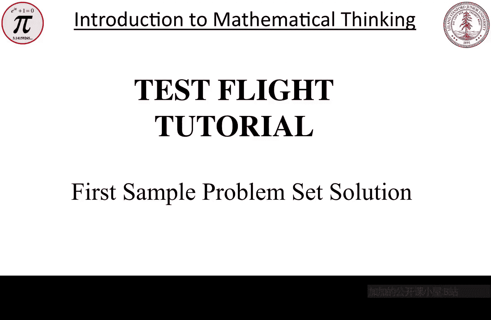
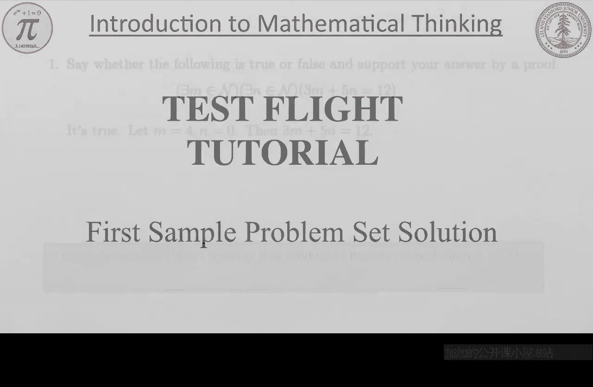
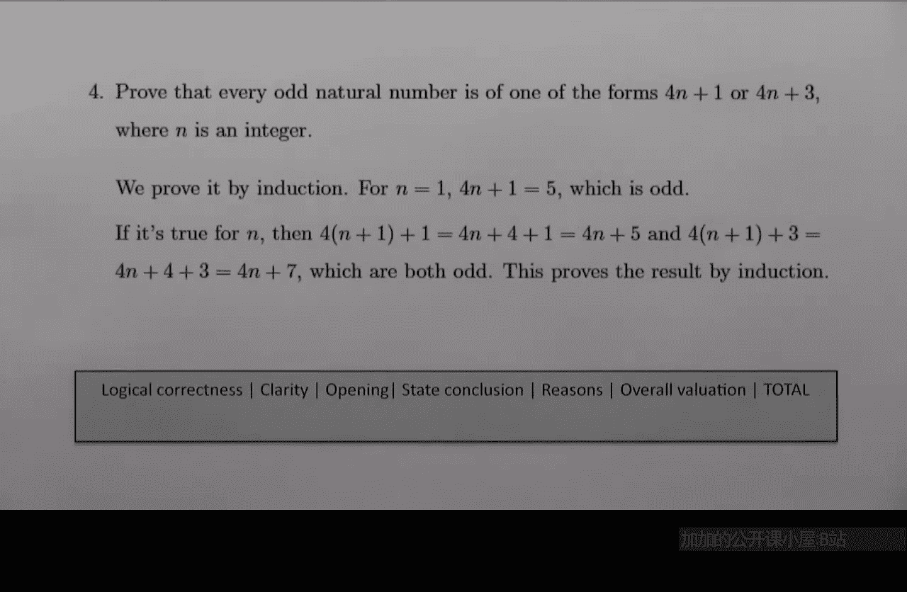

# 数学思维导论：第39讲：习题集1评阅分析 📝

在本节课中，我们将一起分析一份习题集的解答，并学习如何根据逻辑、清晰度、结构等标准进行评阅。我们将看到一些常见的错误，并理解在数学证明中，针对特定受众进行有效沟通的重要性。

## 问题1：关于自然数的假设

上一节我们介绍了课程背景，本节中我们来看看第一个问题。学生的解答是错误的，因为其陈述为假。

问题的核心在于，该解答明显假设了 **0 属于自然数**。而根据定义，自然数是 **1, 2, 3, ...** 开始的序列，这在历史上也是正确的。因此，这是一个错误的假设。

所以，在逻辑正确性上，我不会给满分。另一方面，确实有一些数学家将0包含在自然数中。因此，我也不会在此处扣太多分。

数学活动是在社群中进行的。当我们撰写证明时，我们遵循该社群的规范和惯例。我们设计的证明需要匹配目标受众。因此，撰写证明必须考虑你所在的社群以及你为谁而写。例如，我为其他数学家写的证明，与为学生写的证明截然不同；为研究生写的又有所不同。我们必须根据所在的社群和写作对象来调整论证方式。所以，撰写证明具有社群属性，它并不总是对错问题，而是关乎我们试图与谁沟通。

因此，对于逻辑正确性，我决定给 **2分**（满分4分）。我会给予一些肯定，因为如果你确实假设0是自然数，那么这是一个解答。但实际上，我们处在一个有既定惯例的社群中，我们已经确立了一个约定：0不是自然数。事实上，这是数学内的标准惯例。我认为给2分已经相当慷慨了。

以下是其他方面的评分：

*   **清晰度**：解答非常简短明了，因此给 **4分**（满分4分）。
*   **开头**：直接开始论证，没有多余铺垫，给 **4分**。
*   **陈述结论**：结论已陈述。
*   **给出理由**：给出了理由。

总体而言，考虑到本课程的目标和我们撰写证明时试图沟通的受众，这份解答并不好。它没有真正回答问题。因此，我给出总分 **18分**（满分40分）。考虑到学生在本课程背景下犯了一个根本性错误，这个分数已经相当慷慨了。

## 问题2：全称量词与存在量词的混淆

现在让我们来看问题2。学生给出了正确答案，但证明完全错误。

这里存在一个根本性的误解。学生假设这是一个**存在量词**问题，即*存在*五个连续整数，其和能被5整除。实际上，这是一个**全称量词**问题。它的含义是：*任意取*五个连续整数，它们的和都能被5整除。

因此，这根本不是一个证明。学生完全没有理解全称量词的含义。

所以，我们在这里的所有项都只能给 **0分**。这是一个基本误解，没有任何可以给予肯定的地方。当你像这样误解了根本性的概念（例如全称量词与存在量词的区别）时，我们不可能给予部分分数。这完全是错误的，学生没有理解我们要做什么。

## 问题3：归纳法证明中的问题

接下来是问题3。首先，学生没有明确说明陈述是真还是假。但学生开头说“我将证明它”，所以很明显此人认为它是真的（事实也确实如此）。因此，我不会因为没说明真假而扣分，这只是个疏忽。

学生试图用归纳法证明。基础步骤 n=1 是正确的。归纳假设也写出来了。论证过程看起来没问题，但开始有点可疑，因为这个论证实际上**没有使用归纳假设**，这意味着这不是一个归纳证明。此外，归纳法通常只适用于正整数（自然数）。虽然可以扩展到所有整数，但本课程没有涉及。所以这里有问题：标准的数学归纳法并不能证明对所有整数成立。

评阅这个答案有些棘手，因为其中有一个亮点。证明这个结果的关键是将表达式分解为 **n(n+1) + 1**，然后观察到 **n** 和 **n+1** 中必有一个是偶数，因此它们的积是偶数，再加1就是奇数。这位学生恰好发现了这一点，这是关键思路。

考虑到这一点，我在评分上倾向于宽容：

*   **逻辑正确性**：论证有逻辑流程，但不是归纳证明，给 **1分**。
*   **清晰度**：就其本身而言清晰，但作为证明并不清晰，给 **2分**。
*   **开头**：开头尚可，但不完全切题，给 **2分**。
*   **陈述结论**：结论陈述得很好，给 **4分**。
*   **给出理由**：给出了理由，但不总是正确的理由，给 **2分**。

总体评价，我必须给 **0分**，因为这没有触及问题核心。学生似乎看到了关键，但并未意识到。因此，总分是 **11分**。不到一半的分数，但考虑到那个关键观察，这大概是合理的。

## 问题4：证明方向错误

对于问题4，学生似乎在试图证明某种逆命题：即每个形如 4n+1 或 4n+3 的数都是奇数。但这是平凡的（4n是偶数，加1或3后是奇数）。然而，题目要求证明的是：如果一个数是奇数，那么它必须具有这两种形式之一。

学生没有回答所问的问题，而是证明了完全相反的、平凡的内容。这与问题无关。根据评分标准，只有当内容与问题相关时才能给予部分分数。一个有效但与问题完全无关的论证不能获得部分分数。

因此，这里所有项都是 **0分**。

## 问题5：模板式回答

问题5中，我不确定学生想做什么。看起来他/她使用了高中时常用的“模板匹配”技巧：浏览题目，在笔记中寻找处理类似问题的方法，然后写下看似相关的表达式。换句话说，就是试图将问题匹配到一个模板并应用模板方法。

但正如本课程多次强调的，模板往往不适用于这类材料。你必须思考具体问题本身。这里的回答与实际问题无关。这些陈述可能看起来相关，但并非如此。这根本没有真正解决问题。

除了 **0分**，没有其他选择。当所写内容与要求没有真正关联时，不能寻找部分分数。不能指望通过抄写笔记或他人笔记中的一些句子来获得分数。

## 问题6：有潜力的开头

问题6的解答与上一个非常相似。看起来像是“抓住救命稻草”式的论证，写下一些看似可能相关的东西，希望能得到部分分数。但等等，这里有些东西我有点喜欢。

开头部分写道：“假设 p 和 p+2 是一对大于5的孪生素数……” 这实际上显示出一定的数学敏锐度。作为开始证明某种方法的尝试，这令人印象深刻。这表明了一些数学能力。

因此，我决定在“开头”这一项上给予满分 **4分**，以肯定这个有潜力的开头。然而，学生后续没有做任何有意义的事情，没有得出任何合理的结论。所以，在其他所有项上，我都给 **0分**。

这听起来可能与我之前所说的矛盾，但实际上并非如此。我试图做一个细微的区分：这个开头与证明这类问题并非完全无关，它是一种合理的入手方式。但它没有转化为任何有意义的东西，因此不能证明结果。我只是将其作为一个可能导向正确答案的开头来给予肯定。

## 问题7：缺失归纳框架

学生显然在用归纳法证明这个结果，但没有说明这一点。正确的归纳法从 n=1 开始，这部分没问题。论证过程很清晰，技术处理也不错。然而，存在一些明显的漏洞。

最大的问题是**没有陈述使用了数学归纳法**。这是开头的重要组成部分。此外，结论部分也不完整。仅仅从假设 n 成立推导出 n+1 成立，并没有完成整个证明。这需要加上数学归纳原理。

因此，评分如下：

*   **逻辑正确性**：逻辑正确，给 **4分**。
*   **清晰度**：清晰，给 **4分**。
*   **开头**：缺少归纳声明，给 **0分**。
*   **陈述结论**：结论不完整，给 **0分**。
*   **给出理由**：局部给出了理由，但缺少归纳原理这个大理由，给 **2分**。

总体评价给 **2分**。总分是 **12分**。对于这样的解答，一半的分数已经不错了。缺失的部分（归纳框架）是非常重要的，因此会失去很多分数。

## 问题8：简洁但不够详尽

问题8的答案在很多方面与问题7相似。有一些很好的技术处理，但没有正确的证明结构。

首先，关键的开头假设——“设 ε > 0 给定”——缺失了。我会因此扣分。对于逻辑正确性，论证本身是好的、正确的。对于清晰度，我认为不够清晰。在这个入门阶段，需要更多的解释和提示。专业数学家可以看懂并填补空白，但本课程的学生可能需要努力才能跟上。

结论已陈述。理由方面，几乎没有给出理由，特别是没有解释为什么这“表明”了结论，也没有指出这里只是应用了极限定义。

总体评价，我给 **3分**。总分是 **15分**。这个解答实际上非常简洁利落，但缺少了对初学者有帮助的解释。

## 问题9：反例错误

首先，我需要理解学生的答案。学生定义了一个序列区间，但经过检查，这个例子不满足“A_{n+1} 是 A_n 的子集”这个条件。这些区间实际上是互不相交的。因此，这个例子是**错误**的。

例子错误，不满足要求，所以这一项得 **0分**。然而，学生后续进行的论证，是如果例子正确时所需的那种论证。所以这部分工作并非无关。虽然有一个根本性错误，但就所做的工作而言，实际上是清晰的。

因此，在其他项上我给予部分分数：

*   **清晰度**：给 **2分**。
*   **开头**：给 **2分**。
*   **陈述结论**：给 **2分**。
*   **给出理由**：给 **2分**。

总体评价，由于例子错误，给 **0分**。总分是 **8分**（约33%）。考虑到学生做了一些不错的工作，这很可惜。但事实是，如果要求给出一个例子来证明某事，而你的例子不满足要求，那么它就无法证明。三分之一左右的分数可能是合理的。

## 问题10：完美解答

问题10的答案完全正确。论证逻辑严密，无懈可击。解答非常简洁利落：0 在所有集合中，所以属于交集；任何非零数最终都会被“遗漏”，所以不属于交集。因此交集只包含 0。

鉴于论证的质量，即使可以争论说学生应该明确说明“显然 A_{n+1} 是 A_n 的子集”，我也不会因此扣分。在这个入门课程中，确实应该说明，但这个证明本身非常出色。

因此，所有评分项我都给 **4分**。总分是 **24分**（满分24分）。这是一份完美的解答。

---

本节课中我们一起学习了如何根据一份详细的评分标准（逻辑正确性、清晰度、开头、陈述结论、给出理由、总体评价）来评阅数学证明。我们分析了十个问题，看到了各种常见错误，如基本概念误解、证明方向错误、滥用归纳法、忽略受众等，也看到了优秀证明的特点。通过这次评阅练习，我们得到的总分是 **92分**（满分240分），约为 **38%**。在像这样的入门课程中，超过35%的分数通常被认为是可以通过的，因为评分旨在衡量你接近专业水平的程度，并不期望初学者就能达到专业水平。