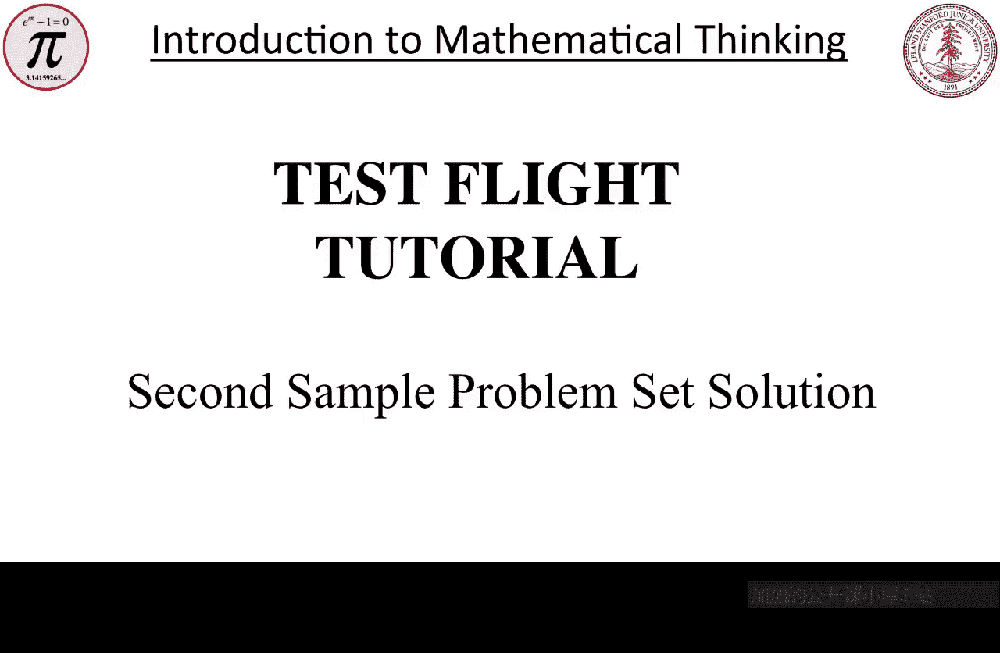
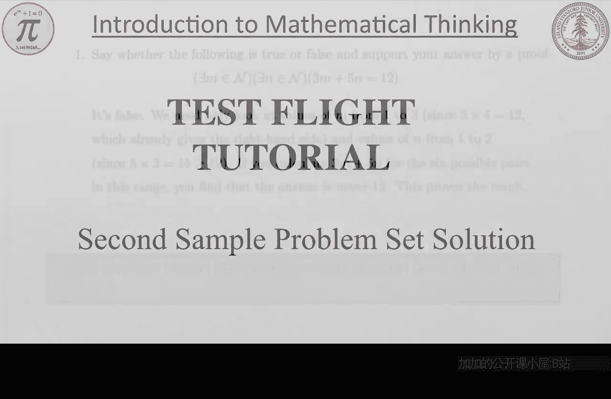

# 斯坦福大学【中英⚡数学思维导论｜Introduction to Mathematical Thinking】 p40 P40 02_试飞教程2 -BV1D44dzxEa7_p40-

Well， looking at the second sample problem set solution。

The answer to question one that this person gives is perfectly okay。Observs that you， first of all。

 makes the note that this thing is is false， which is correct。Then says， you have to look at。

These values of M for that reason。 Look at those values of M from that reason and then says if you calculate the value of all of those six possible pairs。

 you'll found that the answer is never 12。 And this proves the result。 So it's logically correct。

4 it's perfectly clear。There's a great opening。Conclusion is certainly stated。

Reassonons are given overall， full max。 So this is a 24。Incidentally。

 there's no need to actually carry out these calculations for this audience。

 only for any audience for someone who is able to read a proof of result like this。

 you can assume that they are able to carry out simple whole number of calculations like this。

 So there's no need to actually carry out those calculations。 That's now。 you can simply assume it。

 So no need to do the calculations。It's enough to state。That the calculations can be done。

Saying that you're doing the calculations is different from doing the calculations。

If you hadn't said that。Then you are leaving the reader in the lurch。

 But simply by saying that it follows by calculation， the reader can fit in the details。

Perfectly okay。Let's look at number two now。Oh。This person thinks it's false。 Well。

 something's gone wrong because this is actually true， okay。Let's see what's going wrong。that only。

 this is okay。 That's a good representation of an arbitrary sequence of five consecutive integers。

Then you add them all together。 That's fine。 You've got five n plus 1 plus 2 plus E plus 4。

 That's fine。 You've got five ends， and you've got a1 and a2 and a3 and a 4。

 So you've got five m plus。Aha， there's a problem。4 plus E plus 2 plus 1。It's actually 10。Oh， dear。

 That is a shame。How do we deal with this， Because this is clearly an utterly trivial mistake。

The person that's simply。Made a little ametly。So I'm not going to dig。

 I'm not going to take too many marks off that because clearly。

 anyone who can produce an argument like this， which is fine。

Is capable of adding four numbers together and getting the right answer。 They just made a slip。

And the experts sleep like that all the time。 I make sleep like that all the time。And， you know。

 mean， the， the world doesn't come to an end。 Of course， if you're。

 if you're an engineer building a bridge or something， then， then。

 then the consequences of a simple arimeical slip can be quite severe。 But at the moment。

 we're looking at people's ability to do mathematical thinking。

 And I'm not going to take an off lot out。of their result because they've made a simple alpharimet slip。

 And we have two for logical correctness。Because， it's actually not logically correct。

 because adding those four together is part of the logical argument。 So the argument is not correct。

 So I'm going to take that down to2。 It is， however clear。 There's a nice， clean opening。

A clear statement of a conclusion。Reasons are given。Okay。Even talking about the division ceremony。

Overall， though， I'm going to have to drop down to two for that。Because it's wrong。

 The result is wrong。 Okay， and， and there's an hour medical mis slip。Yes， it's tiny little slip。

 simple out medical slip。 We know that this person could ba those together and get the right answer if they were fully awake at the time。

But end of the day， it's wrong。 So this person only gets 20。

 I see only 20 out of 24 is actually this kind of material is a， is a good result。

 So we're just making note of the fact that there is an arithmetical Muslim and。Good me。Otherwise。

 we there congratulate the person on， on a nice， elegant little proof。😊，Well in question 3。

 what does this person do， First of all， they don't say whether it's going to be true or false。

And weer。We can't immediately infer that without meeting through thing。 So I。

I'm gonna be a little bit bit hard on this one。So this person is claiming that it's true。 Okay。

 whether they're not claiming it， but they， they were human it's true。

 That's that was their conclusion。 They simply didn't make a claim。 And I think on this occasion。

 given that you have to sort of read through to the end to find out whether they think it's true or false。

 I think that's， that's not a， not a good start。Okay， let me see。 This is good。

 This is really the key to this thing。 It's like the observation that a pair of successive vintages multied by together is always even because ones even and the're the one's aren。

And here is's a taper because that's meant to say plus one。

So there's some carelessness in writing this one down。 Good idea， but there's some carelessness。

In fact， it's even worse because that's really not what was claimed。 What was claimed。

Is that n squared plus n plus 1。Is odd。So what you would have to say is that this guy equals that guy plus one。

 So he matter her to say。Hence。Fross it out there。Is odd。As claimed， O。

 now we've sorted this guy out。Okay， this is a particular proof。

So there were some problems with this。 The person sort of obviously made the key insights。

 knew what the answer was。 So the issue with this person isn't that he or she doesn't isn't able to do the mathematics。

 They're not able to communicate it well。 This is not a proof。 We are looking for a proof。

 and this isn't one for a whole variety of reasons。

So what am I going to do in the well split it's logical correct。 I'm going to give four for that。

Andm I'm going to give three for clarity because it's， yeah， once we got into it。

 things were fairly clear。 There were some typos and so forth， but。

But I think it's sufficiently clear。Opening。Well， in terms of the proof。There's a good opening。

 I'm gonna have four for the opening。 I'm， I'm， I'm gonna sort of separate it。

 stating it's true is not really the opening。 It's just sort of announing the answer。And then for。

 for the opening， seeing that for any end， this is true。 not that's fine。Stating the conclusion。

I'm going to give three because he really didn't state this part of the conclusion。

 He left it in that that other form。Giving reasons。That， I think is fine。 Reaons are given。Overall。

I'm going to go down to two on that one， I think。So I've got a total of 20。

There's nothing really wrong。 It's just niggling little bits， Okay， and in fact。You know， if I was。

 if， if I was gring this while I had a headache， I might have even knocked it down a little bit more because I think this is a lot of carelessness here。

Yeah。The person just needs to they know what they're doing in a sense。

 but they just need to figure out or to learn or to acquire the ability in order to do。

They know what they're doing。What they need to do is learn how to express what they've done in a way that makes it a good argument。

 a good proof。If I was grading an actual paper from a student when that student had gotten marked into the 20s for the first three questions。

 I would not have expected to see an answer like this and in fact this is a consequence of the fact that I've put these solution sheets together from the kind of answers I've seen over the years and so this would have been produced by a student very different from the kinds of students who would have produced the answers to questions12 and3 that we' just looked at because this is just totally totally wrong it's a sort of trying to prove some kind of a converse the person is presumably trying to show that if you start with an integer then you get an odd natural number。

You start with an inch of by doing this。 And then they've said it's not true because under those circumstances。

 you get negative numbers， which are not natural numbers。

So there' it's just a total failure to understand what's required here and， and。

 and when you've got that degree of failure。The grading sort of becomes easy in terms of giving a numerical grade。

 you put zeros all the way through。Now if you're faced with a physical student and your job is to help that student do as as best they can。

 which is what we do with our students on the campus。

 then you're going to have to spend some time with that student because this is just totally confused and it certainly seems to be based on misunderstanding the implication。

You're supposed to start with any old natural number and deuce that it's of one of these forms。Not。😡。

Take an integer and look at the where these numbers follow from that integer。

 and by taking a negative integer。Results in you know。

 get get the result that these things are not natural numbers at all。 So in a sense。

 this is an easy one to grow and numerically， it's just zeros across the board。in number five。😮。

What's going on here， There's a bold statement here and can be expressed in one of the forms。Can it。

😮，Well， indeed it can。😮，But the reason we know that is because there's a very important theorem called a division theorem。

And without st that。We're just making a bold statement and leaving it up to the reader to figure out why。

 okay。So already， we've got problems with this one。 we've， we， weve。

 we suppose a proof is meant to be an explanation。 It's， it's meant to be a story， right。

 with a beginning， a middle and an end。This doesn't have a beginning。

And so that we're just jumping straight in。 So it's not a proof。

 It's not an argument to convince someone。 It's a challenge to someone。

 It's a puzzle to someone to figure out what's going on。 and that's not what proofs are about。Okay。

 we'll we'll we we'll we'll address that when I give the marks。 but let's read on through。

 It's certainly the case that by the division theorem， you do get that。

 the remainder is either 0 or1 or two when you've got three as the as the divisor。In the first case。

 it's divisible by3 in the second class， n plus 2。Is divisible by3。 And in the third case。

 and was one is divisible by 3， okay。So logical correctness。 Yeah， it's logically correct。 Okay。

 this everything this person does is is what's required in the terms of of the logical structure。

Clarity， I'm going to knock that down one in terms of clarity because that makes it somewhat unclear。

 I'm going to take more account of that in a minute。😊。

And I don't want to sort of double penalise someone。

 So this is an issue of reasons here and openings。 Nevertheless。

 having that missing means it's unclear it's also。You know， there's a bit of on clarityity。

Because there's no sort of conclusion at the end， saying。You might need to say something like this。呃。

What can we say this text cow？😔，Of all three possibilities。Something like that。

 just to sort of say that there are three possibilities。And we've taken care of them。Namely。

 possibility one possibility to but you know， that alone， I mean， this is the end of the story。

 if you like。You know， and so we could on maybe we， we could say and。Proves the result。You know。

 what could be。To awful open about that。 But I'm not too worried about that one because。

If it was a long， if this was a long argument， if there were 10 cases。

 the reader could have forgotten where they were。 but there were only three cases。

 there in three lines。 there right in front of the reader saw the reader who was read through this。

Having been established， having had it established at the rest of three cases。

 the reader would instantly， I think， recognize that that's the end of the proof。

 So I'm not too worried about this one。 But coupled with the fact that it didn't have an opening。

 we've now got a story。 There's just got a middle， No beginning and no end。

 So I'm going to knock it down first for Cla here。 I'm also going knock it down for opening。

 because it doesn't have a good opening。 In fact， there's really is no opening。

 This is just in your face statement。Ditter stated the conclusion was left a little bit vague。

Reasons， I'm going to put a 0 there。 I mean， this is， this is a huge reason。

 And this is a key to the whole result。 This is a consequence of the division theorem。

 So if you don't mention the division theorem， you haven't really said what's going on。

 You haven't said why this thing's true。 So this is huge。 there's no。

 there's no way I could give more than 0 for that。 And of course， I couldn't give less than 0。

So overall， I'm going to put a two here。😊，And I don't think I'm double penalizing here because。

There's no beginning and there's no end。 and arguments as suppose to have beginnings。

 middles and ends。 You know， it's at this level in mathematics when we're talking about proofs。

 it's not enough to be able to do the algebra。It's to be able to use the algebra。

In the course of giving an argument to establish a result。Okay。

 so I've got what I've got looks like 15， I think， right？😊，Yeah。

 so this person lost lost quite a few marks， but I think。In terms of proofs。These are big， big ofs。

Yep， I think that's a fair mark，15。Okay， number six proves that the only parameter triple。😊，嗯。Is 3，5。

7。So we want to take three successive integers and show that they they're not all primes。Okay。

 where N is bigger than three。Im sure that three div1。 This is a very good start。 Very good start。

 Very clear。 Look at three numbers。 Well， except。This person clearly meant to say odd because it's only it's about odd numbers。

 and they've picked them two apart。 So there's a little bit of carelessness here。 Okay， well。

 I'm inclined to let that go。 I it's just， it's clearly。I think it's clear。

 given the where this starts， it doesn't as's a taper。If these down bother to， that is good。

 N equals z plus1， V equal plus 1 or thinkq plus2 for some Q。 Well， again。

 the person maybe should have said integer Q here for some integer Q。That would have been nice。

 but it's really not required because we are doing number theory。 And in number theory。

 you can assume unless otherwise stated that everything is an interviewteger。

 because that's what number theory is about， so。Well， at least this kind of number theory。

 there's something else called analytic number theory。 but that's， that's sort a different。

 But in this this， this kind of number theory， basic number theory， if it's not stated。

 you can assume something's an integer。 You know， if it's， if it's a positive integer。

 you don't even need to say so， but intes are what it's about。So let's see in the first class。

 m plus2 equals 3 cube plus 1， and I think the person really wanted to put in here and missed it out three timesq plus 1。

😔，Okay， because they want to say that。Go， good Lord。 This is another typo。

 This has to be a typo right， The person surely meant to write n plus2 there because they've shown that M plus 2 equals 3 times something。

And indeed， they want to show that3 D。 The whole point is you want to show that one of these things is divisible by something like three。

 And so it's not a prime。 So， and three is what's going to stop it being a prime， by the way。

So this was wrong。 I mean， it's given the kind of argument that's going on， I'm sure this is atypo。

 But this is going to be a bit of a habit， okay。In the second guess， n plus 4 equals。 And again。

 I think we should have put in here 3。Into Q+ 2。So tell may。

 because then you've got n plus4 is a multiple of three， so that should now say n plus 4。Okay。

 this three must divide one of the three numbers。 That's why this person was absolutely doing the right thing。

 which means they can all be prime。 Okay， so the logic is really good。But boy。

 this person is careless。So let's see how I'm going to grade up。 logically correct， yes。Clarity。

I would have put four。Because I think these were so transparently tapers。So transparently typos。

 all of them。In fact， if I was grading a pile of papers and I wasn't thinking about recording myself。

 going through the grading。I， well， I' just read through these and not even noticed these things。

 I would have probably read what I thought I was reading。Because the structure is so good。

 so I think I'm only noticing these because I'm recording it for posterity。😊，Okay。

The opening is wonderful。 Start with threecept。 and they've absolutely stated the way they're going to prove it。

 okay。😊，The conclusion is stated correctly。The only key reason to state， it really。

 is the division theorem。And that's stated， so I'm going to give thought for that。On the other hand。

 this thing is littered with typos。 You know， now， I'llll， I'll overlook one typo and maybe two。

 But there are typos everywhere here。 Now， that just is， is is， is way too careless。

 I'm going to go right down to 0 here。You know， you can't get by if you're constantly making tys。

 The reason that， you know you might have thought that I should have been a bit harsher here。

 The reason I was very tolerant ofty or is that those of us who are doing mathematics。 you know。

 when we're proving things， we do make tys all the time。 we miswrite， we misstype。

 And the reason is we're concentrating on the hard stuff。We're concentrating on the logical flow。

 I mean， I do the same thing when I'm speaking。 You know， if you play some of these tips over again。

 you'll realize that I I often don't say quite when I'm writing or I misspeak。

 And that's because I'm focusing on the on the depth of the things。 I'm focusing on the concepts。

 not on what I'm saying。And after all， this is a course about mathematical thinking and communication。

😊，But in the case of， of communicating， if you wanted to see。You know。

 my attempts at at writing things down correctly with all the typos eliminated。

 Then you read my book。 you know， the book that goes with the course。

 there are maybe still one or two typos， but I worked hard and I took feedback from from other people to eliminate the typos。

 So when we're producing papers and books。 those of us in the business do take care to get rid of the typos。

 But when we're actually generating proof when we're thinking when we're doing something。

 Then typos crop up all the time。 And yes， we'll deductook marks because they do detract from being proof。

But in it themselves， typos are secondary at this stage in the game。

And so I just took the marks off right at the end。 Okay， I'll do it down to 20。

 We still have remarkably good results because this person clearly knew what to do。

 And it's actually a very good proof。 It's a good proof that spoils。

Because of total carelessness resulting in a lot of tapers。

And so I don't think I could have given more than Ze without。 It was just too many of them。Okay。

 let's take a look at number seven。😊，So number 7， prove that for any natural number n。

 this guy equals this guy。 Obviously， I think it's fairly obviously that you were going to do this by induction。

 But in any case， this person is doing it by induction and begins very appropriately by stating that。

Let's check that the proof is correct for n equals one。

 The left hand side reduces to just 2 to the 1， which is 2。 The right hand side is 2 to the 2-2。

 which is is this， which is also2。 So that's true。Assume it also， and then。Oh， well。

 now we've got a puzzle in our hands。😰，How， I mean， where did this come from？ What is a person doing。

 Where's the induction hypothesis being being applied。Well， if we stare at it for a few minutes。

 we realize that the induction hypothesis is what lies behind what's going on here。

 because what this person is doing is saying。This is the left hand side of the identity we're trying to prove。

And this is the race outside side of the identity。 So we're taking the original identity。

 which is that this equals this。 And we're adding。2 to the n plus one to both sides。

 So we're taking an assumed equation and adding the same thing to both sides。

And then we're doing a little bit of algebraic simplification。 And we're going to come down to this。

 which is the identity for n plus one。 And the result follows by induction。 Okay， so that's all fine。

But we had to puzzle that out because what this person should have said was something like。Then。😔。

Adding2 to the n plus 1。To both sides。Of the assumed identity。If we do that。

Then it's clear what's going on we're taking the assumedumar identity and we're adding the same thing to both sides。

 we don't really need to explain this it's fairly obvious that this is just algebra you could say bialic manipulation。

 by elementary algebra， say what you like but this is the key thing because this relates to the structure of the whole argument and that's the identity at M+ one。

And the result follows my induction。 Okay， so this is the， the problem。 And I'm。

 I'm not gonna be able to let this this。 I'm not gonna be able to overlook this because it was a big mess。

Quion is what I we going to say in terms of the grade。 Well， it's certainly logically correct。

 It wasn't clear。I had to work。 I had to sort of figure it out what was going on。

 So it's not a clear proof。They said had good， a good opening。 Pro it by induction。 That was good。

 Okay， The conclusion was there。In fact， you know， the inner conclusion。

 the the conclusion of the induction step was there。 And then the result falls by induction。

 That's wonderful。 I really like that。 This is where the the person steps to the front of the stage and takes a bow。

 takes the applause of the audience。 This is the end of the thing。 It's a grand finale。

 I' got a four for that。 Woful reasons， whooo。😊，Really， I mean， the the big one was there。 Okay。

 the one that's stating it by induction。 but this one is， is really important。

 And I'm going take it down to two for that。Yeah， I think two is about mate。You。

 you might want it to you， I mean， it， you may want to go a little bit lower than that。

 You may say this is really， really significant。 I'm inclined I think two is okay。

 I've sort of taken some account of it here。But but it， it is a， it is a major， a major whole。

 And as a result， I'm only gonna to give two， because this didn't read that smoothly as a result of that。

So， the total is 18。And I think that's just， that's， that's a good mark。 In a sense。 I mean， that's。

 that's the mark it should be because this was just， it just left it too， too difficult。Yeah。Okay。

 let's see if number 8 brings any more joy。And end。This is interesting。

This expression is one that you'll see professional mathematicians use。

 especially when they're sort of working among themselves， most of us。

 I think when we're teaching this kind of material to a， to an undergraduate audience。

 we would avoid saying that because that could be interpreted by a beginner as meaning just。

Pick one that you like or， you know， pull one off the shelf or something。

 And that's not really what it means unless you're saying， pull it off the shelf randomly。

 It's much better to say。Let epsilon greater than0 be given。 In other words。

 you have no choice whatsoever。In that epsilon， it's literally given to you arbitrarily。Now。

 mathematicians use this。 And when they do that， they're using this elliptically to represent。

Pick epsilon greater than ze arbitrarily。 They don't articulate the word arbitrarily。

 It's understood to mean， pick it arbitrarily。But as I said for a beginner， it could be confusing。

 And since proofs are meant to be devices that convey reasoning convey the truth of something to a particular audience。

 What classifies as an acceptable proof in when one group of people doesn't necessarily classifies an acceptable proof in another。

 You， we're not talking here about rigid proofs in mathematical logic that can be read by a computers of any of that。

 We're talking about one human talking to another。 know。

 the focus of the course is both human reasoning mathematics。 They're not just about mathematics。

 but about things in the world。 And communicating their reasons。 That's what we're we're looking at。

 That's why the course is called mathematical thinking。

 it's not called mathematics or mathematical logic。

 And so we have to be always conscious of who it is we're trying to convince and to convey a meaning to。

 And this， I think is is is not a good idea。 And I'm going to deduct a little bit for that。

 even though mathematicians would do that。Since that inum， there is an answer that that。 That's true。

嗯。You see， this is actually fine。 In effect， if this was a graduate course。In in real analysis。

 I would give full mark for this。 Abutely， because I would know that by that stage in their developments。

 every one in the class would know what that meant， and they would be able to read this。This is。

 actually， I think。Difficult for a beginner to read。

 partly because we're using lots of words rather than symbols。

 This is one of those occasions where I think some absolute value symbols and some。

 some minus signs and some less than signs would be would make it clearer。

AndTo to the outside of mathematics， mathematical symbols seem to make things more obscure。

 But once you're in mathematics， the symbols， I think we all found that the symbols are much clearer to read。

 Okay， and if you don't believe that， you should get hold of a medieval manuscript in mathematics。

 where they used almost no symbols。 and it was all written in words。

 and they're almost impossible to make sense of。 In fact， when I do that， when I do。

 when I look at ancient manuscripts and I do from time to time。

 I translate them into modern symbols in order to understand them。Okay。

 how am we going to assign assignang points to this？Well， it's logically correct。 Absolutely。

 it's logically correct。 So4 for that one。I'm gonna to say a3 for clarity。Co of reasons one is。

That I don't think is clear。 I think that just makes it obscure that the student might well think。

 well， what if I just randomly picked a number for which the proof worked。But it didn't always work。

 That would not be at all unjustifiable for a student for a beginner to say that。

 So I think there's some level of oncl here。 And I also think。This hence。

Would need some kind of an explanation， like。By a definition of limits。You know。

 just a pointer to the students as to what's going on you know， hence， well， why hence， Well。

 because it's about definition limits。The stuff in the middle。

 if it was written out in with absolute value symbols， minus signs， less than signs everywhere。

 you know， as inequalities in a standard way。 I think this would be relatively easy to follow the logic for a class at this level of development。

 sort of undergraduate level of development。So I think the， the， the， the confusion。

 if there isn any is probably caused by the fact reading words。

So I think I'll just take the one down here。 The opening， I'm going to take one off there as well。

 because although this is something that professionals do， they're doing knowingly。

 And I think in this， this group with this audience， that actually is not a good opening。

St at the conclusion。I think I give4。 I mean， I'll worry about that part。 I mean。

 the conclusion was absolutely stated。 You know， no， arguably this is part of the the the conclusion。

 but I'm gonna to take care of that when I talk about not all the good reasons there。

 I can't take this down by too many marks because this is technically all correct。

 I'm just sort of nudging it because of audience design issues really。And likewise。

 I'm going to take that down to3。I think it's just a little bit too brief， succinct， to crisp in in。

 in an advanced mathematical sense to function well as a proof in。

 in the community we're now working。So altogether， I've got I've lost， dont know which is 20。😊。

Of taking four marks of altogether。 So it's a good mark。

 And all of the deductions were based on the fact that this is not a good argument for the audience for which is intended。

 And in some sense， the audience for which is intended。

 are the students in this class who will be grading each other on the final exam。

 So one has to sort of provide a good example， a good illustration to a typical student of the class。

 or maybe not a typical student， a student who's still here at the end of the class。

 And as we all know， that's usually between 5% and 10% cent of the students who start in M mooc studies。

So with that intended audience， I think I'm justified in checking fours off。Okay。

 well this is interesting， the answer is a lot short than the question。

 but because the question contains the definition of this thing。Okay， what does this person do。

 Well the the begin bytypo there， I guess should be a comma。

 This person begins by sort of writing some explicit intervals They taking the unit interval。

 open unit of interval then the first half of that， then the first half of that。

 then the first half that sort they tick， you know， open interval。Between 0 and 1。

 then they're taking。It the the one between a half， then they're going down to a quarter。

 and they're going down down down。 and they're gonna squeeze in on the， on the origin there。Okay。

 and then they write down a general definition of the end interval， that's good。Since I was okay。

 right。 Well， I did my PhD in set theory。 I I worked solidly in research in set theory for 10。

15 years or so。 So when I read this， I have no trouble with it。 I know exactly what's going on。

 This works as a brilliant proof for me。 So if I'm the intended reader。Yep， full max。

But the intended reader for this。Proof this particular one in this course isn't me。

 It's other students in the course。 And for those， for that audience， this is just not good。

 It's just too obscure。 So I'm going to start taking some maxs off for making for the person making it just too difficult。

 to follow。I can't take Maxophological correctness because this is absolutely logically correct。

 I saw that the instant I looked at it。I'm want to take a mark off for clarity。😊。

Because it's really not clear。 It's obscure。Opening insarers of his opening。That's fine。 I mean。

 this person actually sort of even motivates it by looking at。

The sequence that that we're taking the definition for。 So I think that's's a good opening。

What about the conclusion， Well， the conclusion was stated absolutely crisply。

 So the conclusion was definitely stated。 we have no doubt that this person claims at this point。

To have proved the result。Okay。What about reasons？But I can only give two for that。

 as I say from if I'm the intended reader， there' all the reasons I need there。

 but for students in this class， I think we need a little bit more than that。 You need some。

 some some assistance as to why that tending to0o implies that。I mean。

 maybe I'm even been too generous with two， but Im， I'm inclined to sort to go with two here。

 And overall， I'm going to take it down by one because I just think it's。

 it's just too obscure for for the intended audience。So I'm down to 20。Still a good mark。But。

 I think。Just way， way too brief。For this audience， as I say。For a graduate course in set theory。

Absolutely fine。 for an undergrad， you would introduct a course like this where set theory is just an example at the end。

 Not fine。Unfair on the reader。And we've taken account of that。How can， finally。We've got this one。

 very similar sort of variant of the previous one if you like。And in this case。

 a person has taken the closed interval forms which one over to n and so there's a。

By the same argument as in question， that's fine。 If you've got an argument that you've already used and you established。

 you don't have to repeat the argument。 You can simply refer back to it。

 it's a bit like calling a suboutine in a computer programme。 You know。

 putting up a module or something like that。 you're entitled to do that。

 That's a perfectly valid thing to do。 Proly， the material is accessible。

 And within the context of the same exam。 That's fine。 And then it follows at at was that。Okay。

 so it's essentially the same argument as before， you know。

 with a closed interval and you get a slightly different outcome。 So I'm going to approach this。 I。

 I should mention what， I should mention one thing I've just noticed neither in the last case nor in the present case。

Did the person prove that， Well， you could say this should have prove that because you are supposed to show that it has the stated property and arguably that is part of the stated property。

 I mean， I think most of us probably ready as part of the setup。 but it really has to be verified。

 On the other hand， when you're looking at these kind of intervals。 it's obvious that they're nested。

 if you start drawing the intervals。 So I haven't I'm not going to ding any marks for that。

 I'm not going to go back to the question 9 and take a mark off。

 I think given that there's a degree of complexity in the reasoning here。

 that just pales into insignificance。 Okay， So in other circumstances。

 maybe we need to take more account of that。 but for here。

 I think we can just focus on the heart of the thing。

 since it's essentially the same argument as before， I'm going to approach the grading as before。

 it's logically correct。 Yes， I'll take one off for clarity because it's it's not clear to to the intended reader of this this argument。

There's a good opening。 There's a good clear statement of the conclusion。Some missing reasons。

 and overall， we need to take a point off because it was just too slick and short and brief for the intended audience。

 So that takes a me up to 20 in that one。So altogether on this paper。

 I give what did I give now I gave a total rv。24th， the first one，20， the second， then another 20。

 Then there was that 0， that disastrous question， that disastrous fourth question。

<|OTHER|>Then there was 15。Then there was a 20， there was an 18。😔，Then there was a 20， another 20。😔。

And。At another 20， there were 2s all the way through at the end， right？😊，Okay。

 so I've got total of 177 out of。😔，240， which is 74%。

So although this wasn't the work of a single student， it was an aggregate。

 by and large most of the questions were done pretty well。

 we got lots of results in the 20s and the 8s。If this had been a single student。

 and it's possible that it was even a single student and there was an aberration。

 you know who knows what would happen then， but but that would have been a pretty good result。

 74% for a beginner in this kind of material， it is really a very strong result。

