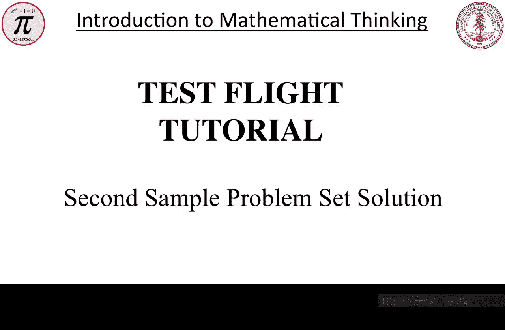
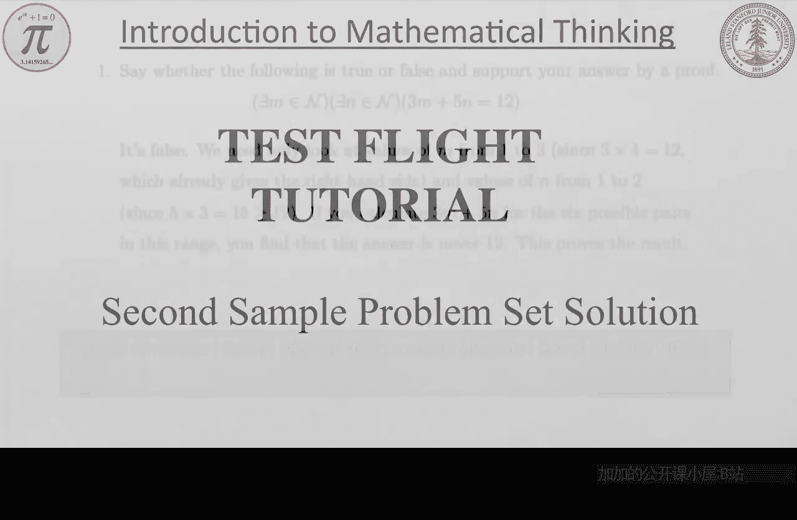

# 数学思维导论：第40讲：习题集2评讲

在本节课中，我们将一起学习如何评估和批改数学证明。我们将通过分析一份习题集的解答示例，来理解一个“好”的证明应具备哪些要素，以及常见的错误和扣分点在哪里。我们将重点关注逻辑结构、清晰度、开头与结尾的陈述，以及如何根据目标读者调整证明的详细程度。

---

## 逻辑正确性：证明的基石

上一节我们介绍了证明的基本概念，本节中我们来看看如何评判一个证明的逻辑正确性。逻辑正确性是证明的核心，它意味着论证的每一步都严格遵循数学规则，从前提能无误地推导出结论。

在第一个问题的解答中，答题者正确地指出了命题为假，并通过检查所有六种可能的情况得出结论：没有一种情况的结果是12。这个论证在逻辑上是完整的。

**核心概念**：对于一个全称命题“对于所有M，某性质成立”，只需找到一个反例即可证明其为假。答题者通过穷举所有可能的`M`值（即`M ∈ {1, 2, 3, 4, 5, 6}`），并验证每种情况下结果均不为12，从而完成了证明。

> 值得注意的是，对于能够阅读此类证明的读者，可以默认他们能完成简单的整数运算。因此，在证明中写明“通过计算可得”即可，无需展示每一步计算过程。陈述“可进行计算”与实际进行计算是不同的。如果不说，会让读者困惑；但只需说明“通过计算可证”，读者就能自行补充细节。

---

## 清晰度与沟通：让读者看懂

一个逻辑正确的证明，如果写得晦涩难懂，也不能算是一个好证明。清晰度关乎证明是否易于被目标读者理解和跟随。

在第二个问题中，答题者试图证明“任意五个连续整数之和能被5整除”这个真命题，但在加法计算中犯了一个小错误（将1+2+3+4算成了10，实际应为10）。这是一个简单的算术失误。

**评分考量**：虽然这是一个小错误，但它导致了整个论证在逻辑上不正确（因为计算是论证的一部分）。因此，在“逻辑正确性”上必须扣分。然而，从整体行文看，证明开头清晰，结论陈述明确，推理步骤也给出了。考虑到答题者显然具备正确的思路和能力，只是在紧张状态下出现了笔误，扣分不会太严厉。最终评分反映了论证因一个小错误而失效的事实。

> 在数学思维中，我们更关注思考过程。虽然工程师造桥时算术失误后果严重，但在此我们评估的是数学思考和交流能力。因此，对于明显的、不影响理解思路的笔误，扣分相对宽容，但逻辑错误必须指出。

---

## 结构与完整性：开头、中间与结尾

一个好的证明应该像一个完整的故事，有明确的开头（陈述要证明什么）、中间（推理过程）和结尾（得出结论）。

第三个问题的解答在这方面有所欠缺。答题者没有明确开头声明命题的真假，读者需要读完全文才能推断出答题者认为命题为真。此外，证明中存在一些笔误和表述不清的地方，例如没有清晰地写出 `n² + n = n(n+1)` 以及由此得出 `n² + n + 1` 为奇数的关键步骤。

以下是关键步骤的清晰表述：

**代码/公式描述**：
已知对于任意整数 `n`，`n` 和 `n+1` 必为一奇一偶，因此它们的乘积 `n(n+1)` 是偶数。于是 `n² + n + 1 = n(n+1) + 1` 必然是一个偶数加1，结果为奇数。

> 答题者展现了关键的数学洞察力，但未能将其有效地组织成一篇流畅的证明。这反映了“知道怎么做”和“知道如何清晰地表达出来”之间的区别。评分时，会在“开头”、“结论陈述”和“整体表达”等项目上扣分。

---

## 理解题意与根本性错误

有时，错误并非源于计算或表达，而是源于对问题本身的理解偏差。

第四个问题的解答就是一个根本性误解的例子。题目要求证明一个条件语句（如果…那么…），但答题者试图去证明其逆命题或否命题，并错误地使用了负数来论证，完全偏离了方向。

> 当出现这种程度的理解错误时，评分就变得简单明了：在所有评分项上都会给予很低的分数。对于教师而言，面对这样的学生，需要花费额外时间进行一对一辅导，从根本上澄清概念（例如，这里是对逻辑蕴含关系的误解）。

---

## 依赖定理与说明理由

在证明中，如果使用了重要的定理或结论，必须明确引用，不能将其视为理所当然。

第五个问题的解答声称“任何整数都可以表示为3k, 3k+1或3k+2的形式”，却没有提及这是**带余除法定理**的直接推论。对于初学者来说，这是一个跳跃，使得证明不完整，仿佛在挑战读者自己去寻找依据。

**核心概念**：根据带余除法定理，对于任意整数 `n` 和除数 `3`，存在唯一的整数 `q`（商）和 `r`（余数，且 `0 ≤ r < 3`），使得 `n = 3q + r`。当 `r=0, 1, 2` 时，即对应上述三种形式。

> 证明的目的是解释和说服，而不是出谜题。缺少开篇引入和关键理由的说明，使得这个证明虽然逻辑内核正确，但作为一个沟通作品是不合格的。评分时会在“清晰度”、“开头”、“陈述理由”等项目上大幅扣分。

---

## 严谨与避免笔误

即使是一个构思精巧的证明，过多的笔误和粗心错误也会严重影响其质量，给读者留下不专业的印象。

第六个问题的证明思路非常出色：利用带余除法定理，将大于3的整数分为三类，论证在任何一类中，三个连续的奇数里总有一个能被3整除，因此它们不可能全是素数。这个思路完美地解决了问题。

然而，答卷上出现了多处明显的笔误（如公式写错、变量遗漏），虽然专业人士能一眼看穿并理解本意，但对于评分和初学者读者来说，这种程度的粗心是不可接受的。

> 数学家们在专注思考深层逻辑时，也常犯笔误。但在最终呈现的论文或书籍中，我们会反复检查以消除它们。在这个阶段，笔误本身虽次要，但过多会严重影响证明的清晰度和严谨性印象，因此需要在“整体表达”上扣分。

---

## 归纳法证明的清晰表述

数学归纳法是强有力的证明工具，但在表述时，必须清晰地展示归纳基础、归纳假设以及归纳步骤是如何应用的。

第七个问题使用归纳法证明一个求和公式。答题者正确验证了基础步骤，但在归纳步骤中，直接写出了一个等式，没有明确说明是在归纳假设的等式两边同时加上 `2^(n+1)`。这迫使读者需要停下来思考这个等式是如何得来的。

**清晰的表述应类似**：
“假设当 `n = k` 时命题成立，即 `2 + 2² + … + 2^k = 2^(k+1) - 2`。在此等式两边同时加上 `2^(k+1)`，得到…，化简后即得到 `n = k+1` 时的形式。故由数学归纳法，命题得证。”

> 缺少这个关键的连接说明，使得证明的流畅性被打断。评分时，这会在“陈述理由”和“整体清晰度”上造成重大扣分，尽管证明的其余部分（如明确的结论）写得很好。

---

## 考虑目标读者

证明的写作必须考虑其目标读者。使用在高级数学圈内通用的简练表述，可能对初学者造成困惑。

第八个问题涉及极限的证明。答题者使用了“Pick ε > 0”这样的表述。在专业数学写作中，这隐含着“任意给定”的意思。但对于初学者，可能会误解为“可以随意选一个喜欢的ε”。

**对初学者更友好的表述是**：“设 ε 是任意给定的一个大于0的数。”

同样，证明中大量使用文字叙述不等式，而不是更清晰的标准数学符号（如绝对值、小于号），这也增加了初学者的阅读负担。

> 一个证明是否“可接受”，取决于它意图说服的受众。本课程的目标是培养数学思维和交流能力，因此我们需要始终以课程预期的学生受众为标准来评判证明的清晰度。基于此，即使论证在逻辑上无懈可击，也需要因“对目标读者不够友好”而适当扣分。

---

## 集合论证明的详略得当

对于涉及集合序列（如区间套）的证明，需要平衡严谨性与可理解性。过于简略的符号化证明可能只适合专业读者。

第九和第十个问题都涉及定义一列嵌套区间并求其交集。答题者给出了非常简洁、符号化的定义和结论（例如，直接写出第n个区间是 `(0, 1/2^n)`，并断言交集为 `{0}` 或空集）。

对于学过集合论的研究者，这非常清晰。但对于本课程的初学者，这种写法过于浓缩，没有解释为什么这些区间是嵌套的，也没有说明为什么极限趋于0就意味着交集是那个特定的点或空集。

> 在证明中，如果引用前面已证过的类似论证（如第十题引用第九题），是允许且高效的，就像计算机程序调用子程序。但前提是，被引用的内容对当前读者是易于获取和理解的。在这些题目中，由于证明本身对预期受众来说过于简略和抽象，因此在“清晰度”和“陈述理由”上需要扣分。

---

## 总结

本节课中，我们一起学习了如何评估数学证明。我们通过分析一份习题解答，深入探讨了以下几个关键评分维度：

1.  **逻辑正确性**：论证的每一步必须有效，结论必须从前提严格得出。
2.  **清晰度**：证明应易于被目标读者理解和跟随，避免模糊和跳跃。
3.  **结构完整性**：好的证明应有明确的开头、中间推理和结尾结论。
4.  **理由陈述**：使用重要的定理或事实时必须明确指明，不能默认为读者所知。
5.  **严谨性**：避免笔误和粗心错误，保持表述的精确。
6.  **受众意识**：证明的详细程度和表述方式应适合其预期读者。

最终，我们看到了如何将这些原则应用于实际评分，并计算出一份（虚拟的）综合答卷的总分。记住，撰写证明不仅是展示答案，更是与读者进行清晰、有说服力的逻辑交流。