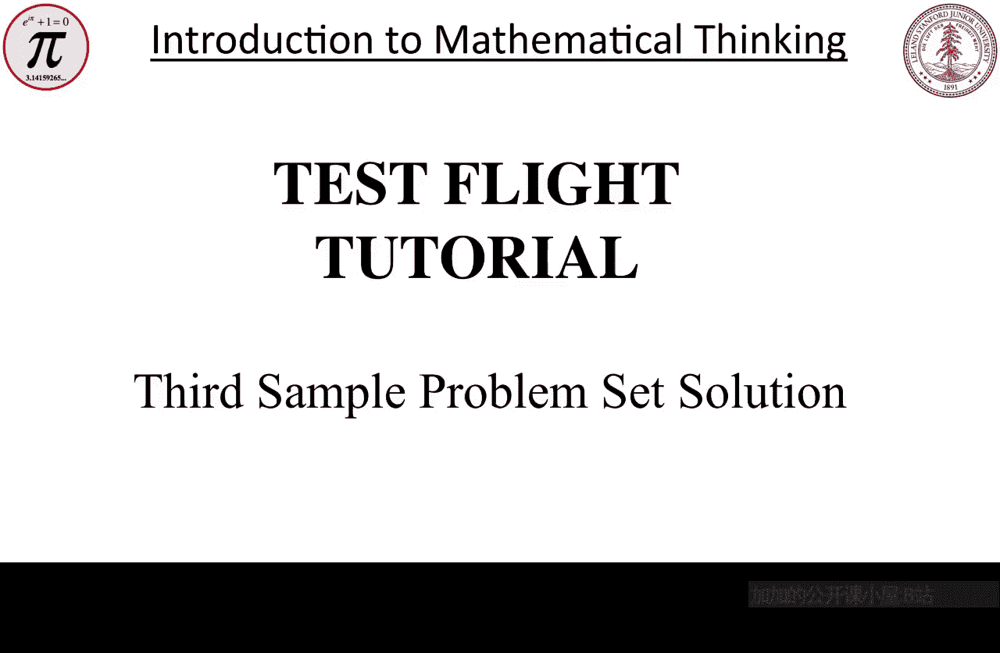
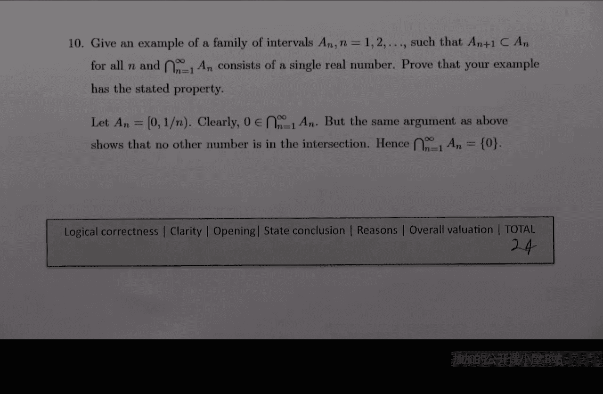

# 斯坦福大学【中英⚡数学思维导论｜Introduction to Mathematical Thinking】 p41 P41 03_试飞教程3 -BV1D44dzxEa7_p41-

Were turning to the third sample problem set solution。

 Let me tell you up front that all 10 answers are going to end up getting 24 maxs。 This is。

 if you're like a model solution sheets。 I mean， I don't give model solutions because you can't grade this kind of mathematics by comparing someone's work with the model solution。

 You have to look at the work they've done it evaluate it on its own terms。 You know。

 just as you can't do this kind of work by looking for templates。

 you can't grade it by templates either， you have to evaluate it in its own terms。

 So I don't give out model solution sheets on the other hand。

 this particular video that you're you're watching， will show you a。Good solution for each one。

 And in most cases， actually， actually， in all cases， a very slick solution。 So before we begin。

 we know that we're going to be able to congratulate whoever it is that did this solution。 Now。

 wait a minute。 That was me。 I did this solution。 And I can't really congratulate。

 me cause I'm the one putting the clause together。😊，Okay， let's just make some。

 what I' do is I'll go through。 and I'll just make some comments。

 so the grading is going to be fairly straightforward。 It's gonna be 4，4，4，4，4，4，24。

 And it's gonna look the same throughout。This is a very short proof， its certainly is false。

We observe that for any if is bigger than equal to2。

 then this comes bigger than this thing is bigger than equal to 13。

So we only need to show that there's no M。Which that' the case。Oh， you know enforce voice。

 that's the case， and that's immediate。Okay。Very short， Very sweet。 That's all you need。Full Max。

So I can just go， go straight in and put the。Numbers 4 in everywhere and a total of 24 for this one。

And this is very much like the solution we saw in sample exam solution2， except in that case。

 the answer had an element had an elementary mathematical mistake came now was a medical mistake。

Where the student put 8 rather than 10。 But other than that， this is essentially the same。

 same argument。 It's written extremely sl。 and everything's there that you need to be there。

 I wouldn't normally expect a typical student in the class to produce something quite as short and succinct as this。

But it's absolutely perfect proof。 All of the reasonings there， everything you need there。

 So very nice， little proof。I looking at number3 now， I'm not gonna put in all of the fours anymore。

 I just jump straight in and put the 24。Beautiful proof。 Consider the two cases。

 even and odd separately， very elegant， if it's even。Then that guy works out as being odd。

 And I've actually stated that it's odd。 I'm going to admit that I've was want to vote this out。

 If any is odd， same thing， you follow it through。 and you show that this， this guy is odd。

 And then you wrap the thing up by concluding that in both cases N squared plus N plus one is odd and。

The danger with this particular video is that it's going to go by too quickly for you to sort of take it in。

 so what I suggest you do is as we get to each one。

 you freeze the video and you just take a look at it and you see why it works incidentdentally some of the early research that was done at Stanford onto students doing MOCs showed that there was a very strong correlation between the number of times the students use the pause and rewind button and the success they had in the course in the long run。

And that's for a whole variety of reasons。 One is it， of course。

 if it shows that the studentss engaged。 if you have to keep stopping and rewinding。

 it shows you're engaged。 It shows you're inflecting on the work。

 It shows you understand when you don't understand what's going on。

 You know when you don't understand。 and you're taking control of your own of your own learning。

 So the correlation between using the pause and rewind button and success in the course is actually quite high。

 And indeed， one of the advantages that moocs have over classroom lectures is that you can do that。

 it's very hard when I'm lecturing in the class So freeze me and rewind me。 In fact。

 I wouldn't recommend you try to do that。 Okay， I certainly hope you wouldn't try anyway。 Okay。

 let's go to number before。Okay， so for question 4， we know we're going to give 24。

 Let's just go through it Emma's a actual number by the division theem。

 so stating the reason for for why this is going to be the case。

 There are unique numbers and analysis such that。 So actually giving a statement of the of the division theem。

 So Emmas Emma's got to be one of these four guys。Two of them are even so that if the number M is odd。

 the only possibilities are the other two。 And that's the proof。 Very slick argument。 Again。

 you might want to freeze the video at this point and look at this。

 but absolutely perfect little proof。 Everything's there that you need to be there。Number5， again。

 put down 24。 I think the only comment to make here is the fact that this solution doesn't state explicitly that Q is an integer。

 as I've mentioned before in the grading， when you're doing number theory。

 you can assume that any variable that's not explained or defined denote it's an integer In are the default case。

 So simply by by looking at the context you can get by without saying it's an integer't it's not wrong to say it's an integer。

 you might want to do that just to play extra safe。

 but in this context that's going to be an integer。

 if we were trying to make a claim where we were saying something about there been a positive integer。

 then we'd need to say it。 but the default case when you're doing number theory is that anything that's not specified can be taken to be an integer So there's no need to say that it's an integer。

This is fine。O，24， We know that。I think the only remark I want to make here is that and I've made this remark before。

 it's perfectly okay to cite previously established results。

 just as it's okay to cite standard results。 So it's okay in the context of putting together a piece of work to say by the answer to the previous question。

 you can refer back。 it's like using a lemma when you're proving a theorem。So perfectly good。

 Very short， very slick。Definitely worth full max。Whetherhi the way most people prove this is my induction。

This persons done it a different way。 And this is very nice。 Look what they doing with this here。

 Let S be the sum we're interested in。 Then double S。 and you multiply through it by two。

 So you get a two squared there， and that last one becomes a  two n plus1。

 Then you subtract the first one from the second one， and everything drops out。

 except you've got the 2 n plus1 at the beginning from the end。

 and you've got the -2 from from there。 So you've got  two n plus1-2。 But  two S- S is just S。😊。

So you've got S equals that guy， S。 this is S， remember。Equals 2 n was 1-2。 Isn't that nice。

 That is beautiful。In fact， this is so nice。 This is so elegant。 No need for the power of induction。

 I'm got to put a smiley stick on that。 That's a very， very nice proof。 Very clever。😊。

It's pleasing to see things like that。Okay， so let me put the 24 down and let's see how it works。

 that Epson Grenss0 are be given。 Very nice， starting as one should by the assumption we can find an end such that this。

 Why are we picking an n with this， What Because the whole thing is about multiplying by M。

And so in order to to make it work out at the end， we're going to start by dividing by M。

 because we're looking ahead。 we're going to say we're going to end up with an M times something。

 And we want to end up with an epsilon。 Well， how can you take M times something and end up with an epsilon。

 Well， there's something you multiplied by。 is's going to be epsilon over M。

 So that's where that came from， we get this by looking ahead to this last step。

 When you first meet this kind of this kind of structure， these kind of proofs are hard to do。

 But when you've seen a few of them。 you get pretty good at looking ahead and saying， yeah。

 I'm going to have to divide by M。 I'm going to have to take epsilon by  two or whatever it is。

And that gives you the the limit。 So if you almost certainly are having difficulty with this at this stage in the game。

 but you know， if you've spent a few more weeks looking at this kind of argument。

 you'd get very good at looking ahead。 It's not guesswork。

 It's literally looking ahead to see what you want to do。And if you can't look ahead。

 just work with anything you want and then go back and adjust it。

 You can just go back and change things， okay。This is about as slick as you can get。

 incidentdentally in a in the last sample exam solution， This one was written out in words。

 I think you'd agree with me， given that you're still in this course。

 that it's much clearer to write it like this in symbols than to write it in terms of words with saying things like air and is a distance less than epsil overmeval and so forth。

 So the modern reader symbols are much cleaner and easier to understand than than a lot of words。

This is a particularly nice proof。 Adit the person doesn't。Prove this part we've。

 we've talked about that with a previous sample exam solution。 I think it's okay not to do that。

 It would sort of be nice to have it there。 But， but it's okay， given that this is， this is so good。

😊，And unless just because it， it's obvious。 I mean， you you， you just these interval， you， it's。

 you arguably， you should state that。 Okay， but it's you know， we're， we're pushing the。

 the limit of where that's really necessary now when we get to this kind of sophistication。

 And this is sophisticated。 It's very slick。 You， You let those with the intervals。

You observe that and this is sort of almost it's getting very close to saying that。

 it's it's a little bit beyond that。 you're saying it's everything is within 01。

 So everything in the intersection is going to be in there。 And then then this is very nice。

 If x is anything in there， we can find a number such as it's going to be excluded from that interval。

This is very nice because that just nails the fact that nothing can possibly be in the intersection。

 So the intersection is empty。 So very， very nice。Economical， elegant truth。

This is what mathematicians mean when they talk about a proof being beautiful or elegant。

 It's just perfect。😊，Okay， let me put the 24 down。😊。

So this is almost exactly the same as the previous example， except that this is now left closed。

 So 0 is an element of all of these things。Observed here。

But now it's okay to refer to the previous argument， the one for question 9。

 because that shows that no element X strictly between 0 and 1 can be in the intersection。

 So the intersection consists only of the point。0。 it really is the same arguments as before that point we just included the initial point in there。

 So again， very elegant very slick and that really completes the three sample solutions。

 The first one was really a bit of a low end one There were all sorts of things wrong with that。

 you often get papers like that， In fact， you may get a fellow students paper like that。

 It's a kind of thing that you often get when students are really beginning and struggling the second sample solution that was the kind of thing that youd tend to get from pretty good students in a class where weve got sort of 74 75% that's probably as good as you'd get this solution set the third one where everything was perfect。

 that's something that only professionals like to produce。 I mean it really。

a pro job and you would be very I would be very surprised to see that coming from a student。

 it would be most unusual。But。There we are。So having done the three sample solutions。

 your next task will be grade three papers from your fellow students or at least three papers from your fellow students。

 Chances， are they not going to look as slick and as elegant as this。

 they're probably going to be a bit longer。 these are all compressed to fit on a slide carefully chosen and edited to make it look look neat。

 The real world is never as neat as that。 So you're probably going to find it challenging in different ways。

 but I hope having gone through these three sample solutions。

 You've got some degree of confidence as to the kind of things to look for。

 know it's clear that this is not an exact science by having a rubric we can sort of we can get some level of precision。

As I said， the professionals tend to agree by and large。

 but you're going to get variations of one or two points， absolutely。

 and sometimes even more than that。 you know this is qualitative stuff。

's not it's not quantitative and assigning numbers to something that's essentially based on judgments is not an easy thing to do。

Okay。Well， good luck on grading your fellow students work。😊。

