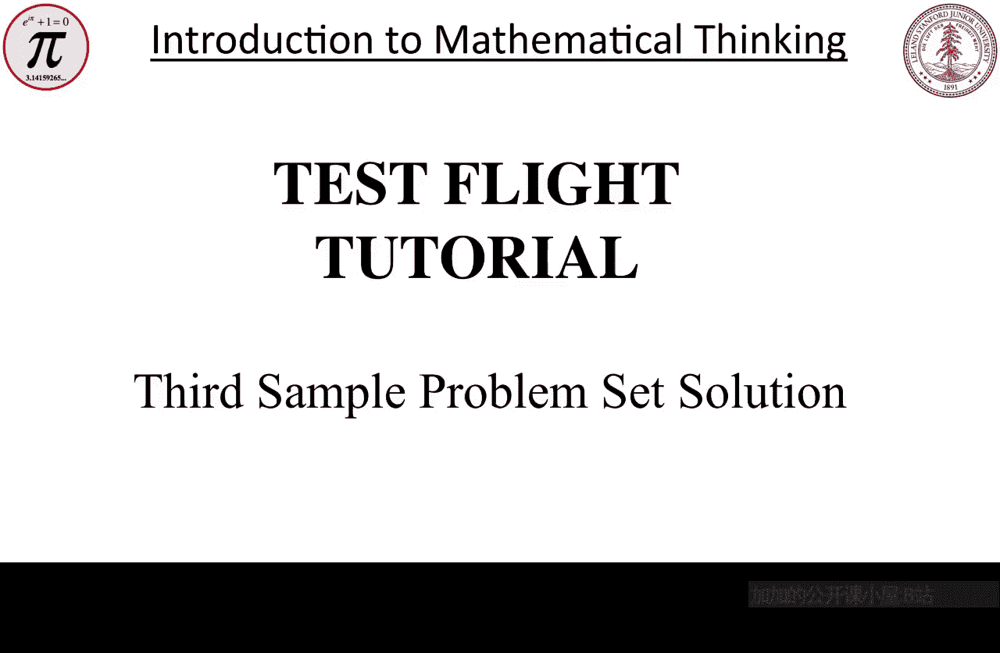
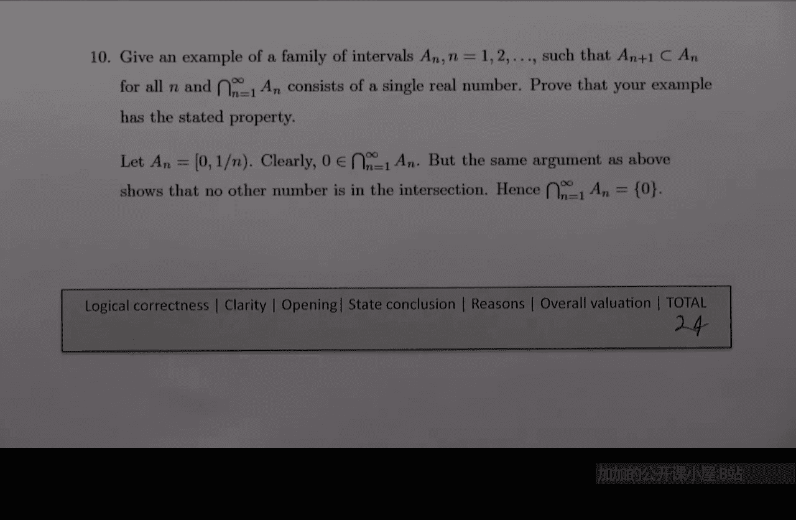

# 数学思维导论：03：试飞教程3

在本节课中，我们将一起学习第三套习题集的参考答案。我们将逐一分析每个问题的“完美”解答，理解其背后的逻辑和简洁性，并学习如何评价数学证明。

---

## 问题1：证明 `n^2 + n + 1` 对所有 `n ≥ 2` 都是奇数

上一节我们介绍了课程背景，本节中我们来看看第一个问题的解答。

这是一个非常简短的证明。我们观察到，对于任意 `n ≥ 2`，表达式 `n^2 + n + 1` 的值大于等于 `13`。因此，我们只需证明不存在整数 `M` 使得该表达式为偶数。这个结论是显而易见的。

**核心推理**：
对于 `n ≥ 2`，`n^2 + n + 1 ≥ 7`。我们只需论证其奇偶性。实际上，可以通过分析 `n` 的奇偶性来严格证明，但此解答采用了更直接的断言方式，因其简洁明了而获得满分。

这是一个完美的证明，所有必要的推理都已呈现。

---

## 问题2：证明 `n^2 + n + 1` 对所有整数 `n` 都是奇数

现在，我们来看一个更严谨的证明方法。

考虑 `n` 的两种情形：偶数和奇数。
*   如果 `n` 是偶数，设 `n = 2k`（`k` 为整数）。则：
    `n^2 + n + 1 = (2k)^2 + 2k + 1 = 4k^2 + 2k + 1 = 2(2k^2 + k) + 1`，这是一个奇数。
*   如果 `n` 是奇数，设 `n = 2k + 1`。则：
    `n^2 + n + 1 = (2k+1)^2 + (2k+1) + 1 = 4k^2 + 4k + 1 + 2k + 1 + 1 = 4k^2 + 6k + 3 = 2(2k^2 + 3k + 1) + 1`，这也是一个奇数。

综上所述，在所有情况下，`n^2 + n + 1` 都是奇数。

这个证明通过分情况讨论，清晰且优雅地解决了问题。

---

## 问题3：证明任何奇数的平方除以8余1

接下来，我们利用带余除法定理来证明。

根据带余除法定理，任何整数 `m` 除以4，存在唯一的整数 `q` 和 `r`，使得：
`m = 4q + r`，其中 `0 ≤ r < 4`。
因此，`r` 只能是 `0， 1， 2， 3`。

如果 `m` 是奇数，那么 `r` 不能是偶数（0或2）。所以 `r` 只能是 `1` 或 `3`。
*   若 `r = 1`，则 `m^2 = (4q+1)^2 = 16q^2 + 8q + 1 = 8(2q^2 + q) + 1`，除以8余1。
*   若 `r = 3`，则 `m^2 = (4q+3)^2 = 16q^2 + 24q + 9 = 8(2q^2 + 3q + 1) + 1`，除以8余1。

因此，任何奇数的平方除以8的余数都是1。

这个证明巧妙地运用了定理，论证非常精炼。

---

## 问题4：证明两个连续整数之积是偶数

这个问题可以直接引用上一个问题的结论，或者用更简单的方法。

设两个连续整数为 `n` 和 `n+1`。根据问题3的结论（或直接推理），两个连续整数中必有一个是偶数。偶数与任何整数相乘，积仍是偶数。因此，`n(n+1)` 是偶数。

在数学证明中，引用前面已建立的结论是完全合理的，就像在证明定理时使用引理一样。

---

## 问题5：计算和式 `S = 2 + 2^2 + ... + 2^n`

大多数人会使用数学归纳法证明这个公式，但这里展示了一个非常巧妙的方法。

设 `S = 2 + 2^2 + ... + 2^n`。
将等式两边乘以2：
`2S = 2^2 + 2^3 + ... + 2^{n+1}`。
用第二个等式减去第一个等式：
`2S - S = (2^2 + 2^3 + ... + 2^{n+1}) - (2 + 2^2 + ... + 2^n)`。
右边从 `2^2` 到 `2^n` 的项全部抵消，只剩下 `2^{n+1} - 2`。
因此，`S = 2^{n+1} - 2`。

这是一个极其优雅的证明，无需动用归纳法。

---

## 问题6：极限证明 `lim (M*a_n) = 0`

现在，我们进入涉及极限 `(ε-N)` 语言的证明。以下是标准而简洁的写法。

已知 `lim (a_n) = 0`。要证 `lim (M*a_n) = 0`。
设 `ε > 0` 为任意给定的正数。
因为 `lim (a_n) = 0`，对于 `ε/|M| > 0`（这里 `M ≠ 0`，若 `M=0` 结论显然成立），存在正整数 `N`，使得当 `n > N` 时，有 `|a_n - 0| < ε/|M|`。
于是，当 `n > N` 时：
`|M*a_n - 0| = |M| * |a_n| < |M| * (ε/|M|) = ε`。
根据极限定义，这正好证明了 `lim (M*a_n) = 0`。

这个证明的关键在于“向前看”：为了最终得到 `|M*a_n| < ε`，我们在最初选择 `N` 时，就需要让 `|a_n|` 小于 `ε/|M|`。

---

## 问题7：证明区间族 `(0, 1/n)` 的交集为空

我们来看一个关于集合交集的经典问题。

考虑区间族 `I_n = (0, 1/n)`，其中 `n` 为正整数。
断言：`∩_{n=1}^∞ I_n = ∅`（空集）。

证明如下：假设存在某个实数 `x` 属于所有 `I_n`。那么对于所有正整数 `n`，都有 `0 < x < 1/n`。然而，根据实数的阿基米德性质，总存在一个正整数 `N`，使得 `1/N < x`（例如，取 `N > 1/x`）。这意味着 `x` 不属于 `I_N`，与假设矛盾。因此，不存在这样的 `x`，交集为空。

这个证明简洁而有力，直接抓住了问题的核心矛盾。

---

## 问题8：证明区间族 `[0, 1/n]` 的交集为 `{0}`

这个问题是上一个问题的变体，区别在于区间是左闭右开的。

考虑区间族 `J_n = [0, 1/n)`。
首先，`0` 显然属于每一个 `J_n`。
其次，对于任意 `x > 0`，根据问题7的论证（或同样使用阿基米德性质），存在 `N` 使得 `1/N < x`，从而 `x` 不属于 `J_N`。因此，除了 `0` 之外，没有其他实数属于所有 `J_n`。
所以，`∩_{n=1}^∞ J_n = {0}`。

这个解答优雅地利用了前一个问题的结论，完成了证明。

---

## 总结

本节课中我们一起学习了第三套习题的参考答案。这些解答的共同特点是**简洁、严谨、优雅**，它们：
1.  直指问题核心，避免冗余步骤。
2.  合理运用已知定理和已证结论。
3.  在涉及 `ε-N` 语言的证明中，清晰展示了“向前看”的构造思想。
4.  在处理集合交集问题时，使用了反证法和实数基本性质。

与之前看到的“初学风格”或“良好风格”的解答相比，这套解答更接近专业数学写作的“完美风格”。在接下来的同伴互评中，你遇到的解答可能更长、更复杂，但希望本课的分析能帮助你把握评价证明质量的关键要素：逻辑的清晰性、推理的完整性和表述的准确性。