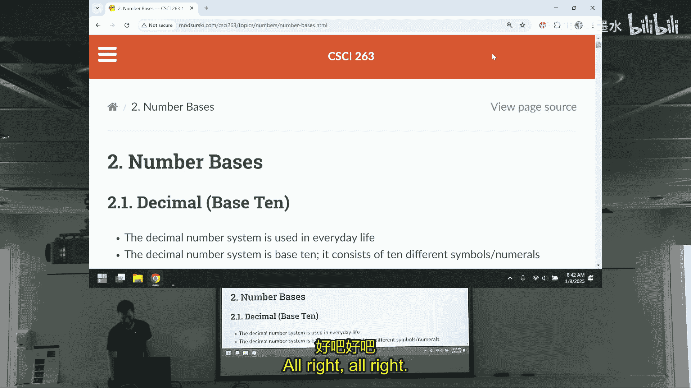

# 001：数制

在本节课中，我们将要学习数字系统的基础知识，特别是我们日常使用的十进制和计算机中使用的二进制。我们将从理解计数的本质开始，探讨不同进制下数字的表示规则和内在逻辑。

---

## 课程资源与概述

本课程唯一必需的资源是名为 **Digital** 的电路模拟器。这是一个理想化的模拟器，用于模拟我们将要学习的数字电路。它有意避免了现实世界中晶体管和导线带来的物理限制，使我们能够专注于理论构建。

我们的学期目标是构建一台8位计算机。虽然示例图中使用了集成电路芯片，但在本课程中，我们将更明确地构建寄存器等组件，并充分利用Digital工具提供的抽象能力。

课程还提供了一些推荐的补充资源，它们虽非必需，但能提供大量额外练习，帮助你快速掌握内容。

---

## 数字的本质：编码与含义

在深入数制之前，我们需要理解一个核心概念：数字模式本身只是一种**编码**。

例如，模式 `0 1 0 1` 是什么？它可能代表二进制下的数字5，但也可能代表其他任何信息，比如一个指令、一个状态或者一个标识。它的**含义**取决于我们如何**解码**它。

这就像单词“cat”、一张猫的图片，或者我们脑海中关于猫的概念，都是“猫”这一信息的不同编码方式。在计算机设计中，我们将为各种比特模式赋予我们定义的含义。

因此，请将比特模式（如`0`和`1`）与它们可能代表的数字**含义**分离开来。这一点至关重要。

---

## 十进制（Base-10）系统回顾

我们熟悉的十进制系统使用10个符号：`0, 1, 2, 3, 4, 5, 6, 7, 8, 9`。这些符号本身具有内在的顺序和大小意义。

### 十进制计数规则

以下是十进制计数的基本过程：

1.  从最小的符号 `0` 开始。
2.  每次递增时，将当前位的符号变为序列中的下一个符号。
3.  当某一位的符号已经是 `9`（序列中最后一个）时，将其**重置为 `0`**，并将其左侧的下一位**递增**（即遵循第2条规则）。
4.  所有数字前面都有无限个前导零（通常不写出）。

这个过程体现了“逢十进一”的规则。例如，从 `9` 到 `10`：个位 `9` 变为 `0`，十位（原本是前导零）递增为 `1`。

### 位置记数法

在十进制中，数字的位置决定了其实际的价值。这是一个**位置记数系统**。

例如，数字 `101` 中的两个 `1` 含义不同：最右边的 `1` 代表 **1个一**，而左边的 `1` 代表 **1个百**。每个位置对应的值是10的幂次：

*   个位：10⁰ = 1
*   十位：10¹ = 10
*   百位：10² = 100
*   千位：10³ = 1000
*   ...

因此，数字 `123` 可以表示为：
`123 = 1 × 10² + 2 × 10¹ + 3 × 10⁰`

### 位数限制

理论上数字可以无限大，但实际表示时我们受限于可用的位数（如纸张宽度、存储空间）。如果用8位十进制数，能表示的最大值是 `99,999,999`。超过这个值后，如果无法增加位数，就会发生溢出，回到 `0`。这是所有有限位数系统的共同特性。

---

## 二进制（Base-2）系统

现在，我们将完全相同的规则应用到二进制系统。唯一的区别是：我们只有两个符号：`0` 和 `1`。

### 二进制计数规则

二进制计数的规则与十进制完全一致：

1.  从 `0` 开始。
2.  递增：`0` -> `1`。
3.  当某一位已经是 `1`（序列中最后一个）时，将其**重置为 `0`**，并将其左侧的下一位**递增**。
4.  所有二进制数前面也有无限个前导零。

让我们从0开始计数：
`0` (零) -> `1` (一) -> `10` (二) -> `11` (三) -> `100` (四) -> `101` (五) -> `110` (六) -> `111` (七) -> `1000` (八) ...

这个过程就像汽车里程表（ODO meter）的滚动，只不过每个位只有0和1两个数字。

### 二进制的位置与数值

在二进制中，每一位称为一个 **比特（bit）**。每个比特位置的价值是2的幂次：

*   第0位（最右）：2⁰ = 1 （个位）
*   第1位：2¹ = 2 （二位）
*   第2位：2² = 4 （四位）
*   第3位：2³ = 8 （八位）
*   第4位：2⁴ = 16 （十六位）
*   ...

因此，二进制数 `1011` 可以转换为十进制：
`1011₂ = (1 × 2³) + (0 × 2²) + (1 × 2¹) + (1 × 2⁰) = 8 + 0 + 2 + 1 = 11₁₀`

### 二进制数的范围

如果我们用8个比特（即1个字节）来表示数字，那么可以表示的范围是：
从 `0000 0000` (0₁₀) 到 `1111 1111`。
`1111 1111₂ = 255₁₀`，所以8比特能表示 0 到 255 共256个不同的整数。

---

## 总结

本节课我们一起学习了数制的基础：
1.  我们理解了数字是信息的**编码**，其含义取决于解码方式。
2.  我们系统回顾了**十进制**系统的计数规则、位置记数法以及位数限制的概念。
3.  我们将完全相同的逻辑应用于**二进制**系统，学习了如何用仅有的两个符号（0和1）进行计数和表示数值，并掌握了二进制与十进制之间的转换原理。

这些关于数字表示和进制转换的基础知识，是理解计算机如何存储和处理数据的基石。下一节课，我们将进一步探讨如何利用这些比特进行运算。