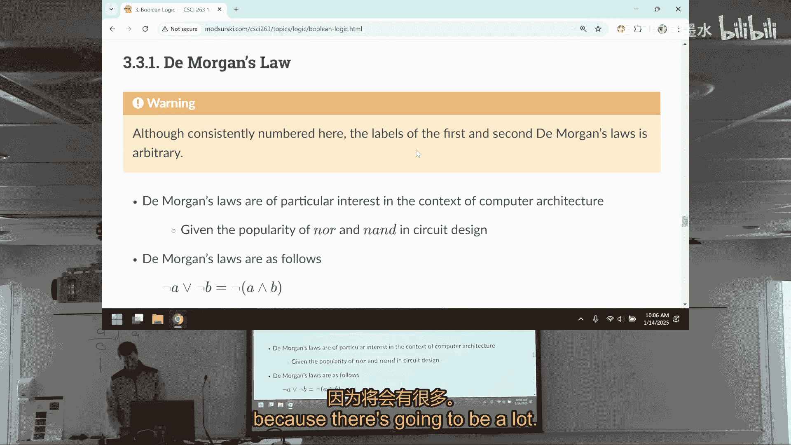

# 003：布尔代数 🧮

在本节课中，我们将要学习布尔代数的核心概念，包括基本的逻辑运算符、真值表以及逻辑运算的代数性质。我们将从最基础的“与”、“或”、“非”开始，逐步扩展到其他常用运算符，并理解如何通过它们构建复杂的逻辑表达式。

---

## 布尔值与布尔运算符

上一节我们介绍了计算机中信息表示的基础。本节中，我们来看看用于处理这些信息的基本逻辑工具——布尔代数和布尔运算符。

我们讨论了“非”（NOT）、“与”（AND）和“或”（OR）运算符。大家应该对它们非常熟悉。我们特别强调了“短路与”和“短路或”的概念，即如果已知表达式的一部分结果就能确定整个表达式的结果，则无需计算另一部分。

但有一点需要特别明确：仅凭“与”、“或”、“非”这三个逻辑运算符，我们就能在抽象层面构建出一台完整的计算机。计算机所做的所有功能，本质上都是这些运算符的庞大组合。这就是布尔代数的核心意义。

---

## 其他常用布尔运算符

除了基础的三个运算符，还有一些常见的复合运算符。它们之所以被单独讨论，是因为使用频率足够高。但本质上，它们都可以由“与”、“或”、“非”组合而成。

以下是几个重要的运算符：

*   **异或（XOR）**：这是一个二元运算符。给定布尔值 A 和 B，当且仅当 A 和 B 中**只有一个为真**时，结果为真。
    *   **公式**：`A XOR B = (A AND NOT B) OR (NOT A AND B)`
*   **或非（NOR）**：本质上是“或”运算后再进行“非”运算。当 A 和 B 都为假时，结果为真。
    *   **公式**：`A NOR B = NOT (A OR B)`
*   **与非（NAND）**：本质上是“与”运算后再进行“非”运算。当 A 和 B 都为真时，结果为假。
    *   **公式**：`A NAND B = NOT (A AND B)`

值得注意的是，“与非”（NAND）和“或非”（NOR）被称为**功能完备集**。这意味着，仅使用“与非”门或仅使用“或非”门这一种类型的逻辑门，就可以构造出“非”、“与”、“或”等所有其他逻辑功能，进而构建出完整的计算机。在实际芯片制造中，由于只生产一种类型的门电路更简单，因此常常大量使用“与非”门。

---

## 真值表

为了清晰地展示逻辑运算符在所有可能输入下的输出，我们使用真值表。真值表是一种标准化的、结构化的可视化方法，可以穷举所有可能的输入组合，从而无歧义地证明逻辑表达式的性质。

以下是一个使用 `TRUE` 和 `FALSE` 的真值表示例（为清晰起见，中间插入了空列分隔）：

| A     | B     | NOT A | A AND B | A OR B | A XOR B | A NAND B | A NOR B |
| :---- | :---- | :---- | :------ | :----- | :------ | :------- | :------ |
| FALSE | FALSE | TRUE  | FALSE   | FALSE  | FALSE   | TRUE     | TRUE    |
| FALSE | TRUE  | TRUE  | FALSE   | TRUE   | TRUE    | TRUE     | FALSE   |
| TRUE  | FALSE | FALSE | FALSE   | TRUE   | TRUE    | TRUE     | FALSE   |
| TRUE  | TRUE  | FALSE | TRUE    | TRUE   | FALSE   | FALSE    | FALSE   |

通常，为了简洁，我们会用 `0` 代表 `FALSE`，用 `1` 代表 `TRUE`。

---

## 构建复杂表达式

现在，让我们看看如何构建和计算更复杂的布尔表达式，例如 `(A AND NOT B) OR NOT C`。

处理复杂表达式时，关键是一步一步来，不要试图一次性得出最终结果。这不仅容易出错，而且不利于他人（或未来的自己）理解你的推导过程。清晰的、分步的推导过程至关重要。

首先，确定输入变量（A, B, C）的所有可能组合。对于3个变量，共有 `2^3 = 8` 种组合。然后，逐步计算中间结果：

1.  计算 `NOT B`。
2.  计算 `NOT C`。
3.  计算 `A AND (NOT B)`（使用步骤1的结果）。
4.  最后，计算 `(A AND NOT B) OR (NOT C)`（使用步骤3和步骤2的结果）。

通过为每一种输入组合执行这些步骤，并列出完整的真值表，我们就完成了一个穷举证明，无可辩驳地展示了该表达式的行为。

---

## 逻辑运算符的代数性质

与普通代数类似，布尔代数也有许多重要的代数性质。这些性质可以帮助我们简化逻辑表达式。

以下是一些核心性质：

*   **恒等律**：
    *   `A OR FALSE = A`
    *   `A AND TRUE = A`
*   **幂等律**：
    *   `A OR A = A`
    *   `A AND A = A`
*   **零元律**：
    *   `A OR TRUE = TRUE` （`TRUE` 是 OR 的零元）
    *   `A AND FALSE = FALSE` （`FALSE` 是 AND 的零元）
*   **互补律**：
    *   `A AND NOT A = FALSE`
    *   `A OR NOT A = TRUE`
*   **双重否定律**：
    *   `NOT (NOT A) = A`
*   **德摩根定律**（非常重要）：
    *   `NOT (A AND B) = (NOT A) OR (NOT B)`
    *   `NOT (A OR B) = (NOT A) AND (NOT B)`
*   **吸收律**：
    *   `A OR (A AND B) = A`
    *   `A AND (A OR B) = A`

如果对任何性质有疑问，最可靠的方法就是画出它的真值表进行验证。由于布尔值只有两种可能，这种穷举证明总是可行且明确的。

---

## 总结

本节课中我们一起学习了布尔代数的核心内容。我们从最基本的“与”、“或”、“非”运算符出发，了解了“异或”、“与非”、“或非”等其他常用运算符。我们掌握了使用真值表来分析和证明逻辑表达式的方法，并强调了分步推导的重要性。最后，我们回顾了布尔代数的一系列关键代数性质，如恒等律、德摩根定律等，这些是理解和简化复杂逻辑电路的基础。记住，所有这些复杂的数字系统，其根基都源于这些简单的布尔运算。