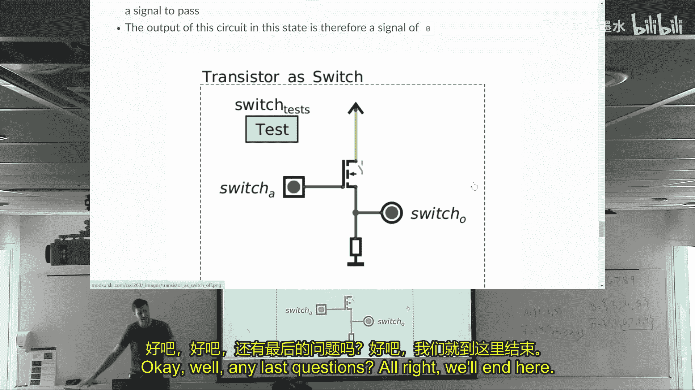

# 004：德摩根定律与晶体管

在本节课中，我们将学习布尔逻辑中的德摩根定律，并了解如何通过晶体管这一物理器件来实现逻辑运算。我们将从抽象的定律过渡到具体的电路实现。

## 布尔逻辑定律回顾

上一节我们介绍了布尔逻辑的基本概念。这些定律是我们在基本逻辑运算（与、或、非）和值（真、假）之上观察到的第一层抽象。它们并非定义，而是从基础规则中推导出的恒真陈述。

以下是一些重要的布尔定律：
*   **同一律**：`A AND True = A`；`A OR False = A`
*   **零元律**：`A AND False = False`；`A OR True = True`
*   **交换律**：`A AND B = B AND A`；`A OR B = B OR A`
*   **结合律**：`(A AND B) AND C = A AND (B AND C)`；`(A OR B) OR C = A OR (B OR C)`
*   **分配律**：`A AND (B OR C) = (A AND B) OR (A AND C)`；`A OR (B AND C) = (A OR B) AND (A OR C)`
*   **吸收律**：`A AND (A OR B) = A`；`A OR (A AND B) = A`

这些定律在构建复杂电路时非常重要。

## 德摩根定律

现在，我们来看看一个特别重要的定律——德摩根定律。它在计算机体系结构中，尤其是在构建与非门（NAND）和或非门（NOR）时，扮演着核心角色。

德摩根定律包含两个等式：
1.  **NOT (A AND B) = (NOT A) OR (NOT B)**
2.  **NOT (A OR B) = (NOT A) AND (NOT B)**

你可以通过真值表来验证这两个等式的正确性。

这两个定律非常有趣。观察第一个等式的右边：`(NOT A) OR (NOT B)`。这意味着，我们**不需要一个“与”门（AND）** 来实现“与非”运算（NAND）。我们只需要“非”门（NOT）和“或”门（OR）就可以实现它。

具体来说，如果我们有 `NOT A` 和 `NOT B`，将它们进行“或”运算，得到的结果就是 `NOT (A AND B)`。这展示了逻辑运算之间的等价性和可转换性。

如果你对定律的直观理解有困难，可以借助集合的文氏图来思考。将集合A和B的交集（AND）取补集（NOT），结果等于集合A的补集与集合B的补集的并集（OR）。第二个定律也可以用类似方式理解。

## 从抽象到物理实现：晶体管

到目前为止，我们讨论的“真”、“假”、“与”、“或”、“非”都是抽象概念。现在，我们来看看如何用物理器件来实现它们。这一切的起点是**晶体管**。

晶体管是人类历史上最重要的发明之一。本质上，它是一个**开关**。

在讨论电路时，我们会使用一些符号。在Digital软件（本课程使用的仿真工具）中：
*   上箭头 `↑` 表示电压源（高电平，代表逻辑1）。
*   单横线 `─` 表示接地（低电平，代表逻辑0）。
*   注意：**永远不要将电压源直接连接到地线**，这会导致电流无限大（短路），烧毁电路。我们需要用电阻来限制电流。

晶体管有多种类型，本课程主要关注 **MOSFET**（金属氧化物半导体场效应晶体管）。一个MOSFET有三个引脚：
*   **源极（S）**：信号输入端。
*   **漏极（D）**：信号输出端。
*   **栅极（G）**：控制端，像水龙头的阀门。

我们主要使用 **N沟道MOSFET**。它的工作原理很简单：
*   当栅极（G）施加正电压（逻辑1）时，开关“闭合”，允许电流从源极（S）流向漏极（D）。
*   当栅极（G）电压为0（逻辑0）时，开关“断开”，电流无法通过。

你可以把它想象成墙上的电灯开关。栅极就是你的手，控制着电路的通断，而电能本身来自电源。

## 构建一个晶体管开关电路

让我们在Digital中构建一个简单的开关电路来加深理解。

电路包含以下部分：
1.  一个N沟道MOSFET。
2.  一个始终提供高电平（1）的电压源，连接到MOSFET的源极（S）。
3.  一个下拉电阻，连接在MOSFET的漏极（D）和地之间。
4.  一个可切换的按钮（开关A），连接到MOSFET的栅极（G），用于控制通断。
5.  一个输出探针，用于观察漏极（D）的信号状态。

**电路工作原理分析：**
*   当开关A断开（栅极为0）时，晶体管关闭。输出端通过下拉电阻被“拉”到地电平，因此输出为 **0**。
*   当开关A闭合（栅极为1）时，晶体管导通。电压源的高电平可以通过晶体管到达输出端，因此输出为 **1**。

**下拉电阻的作用至关重要：**
如果没有这个电阻，当晶体管导通时，电压源将直接对地短路，造成大电流。电阻限制了电流大小，同时，当晶体管关闭时，它还能帮助将输出端的残余电荷缓慢释放到地，确保输出稳定在0。

可以用一个水槽模型来类比：
*   **电压源**是水龙头。
*   **晶体管**是水龙头阀门（由开关A控制）。
*   **地**是下水道。
*   **下拉电阻**是堵在下水道口的一块海绵。
*   **输出**是水槽的边沿。

当阀门打开（开关A=1），水（电流）流入水槽。由于下水道有海绵堵塞，水流下泄的速度变慢，导致水位（电压）上升并从边沿溢出（输出=1）。当阀门关闭（开关A=0），水源切断，水槽里的水通过海绵慢慢排空，水位下降至边沿以下（输出=0）。

## 总结

本节课中我们一起学习了：
1.  **德摩根定律**：`NOT (A AND B) = (NOT A) OR (NOT B)` 和 `NOT (A OR B) = (NOT A) AND (NOT B)`。这一定律揭示了逻辑运算间的深层关系，是构建基础逻辑门（如NAND、NOR）的关键。
2.  **晶体管**：作为实现逻辑的物理基础，晶体管本质上是一个由电压控制的开关。我们重点了解了N沟道MOSFET的工作原理——栅极高电平导通，低电平截止。
3.  **简单开关电路**：我们构建并分析了一个由晶体管控制的电路，理解了如何使用晶体管、电压源、电阻和开关来实现一个受控的逻辑输出（0或1），并掌握了下拉电阻在防止短路和稳定电平中的重要作用。

通过本节课，我们成功地将抽象的布尔逻辑与具体的物理电路联系了起来，为后续构建更复杂的逻辑门和运算部件打下了坚实的基础。