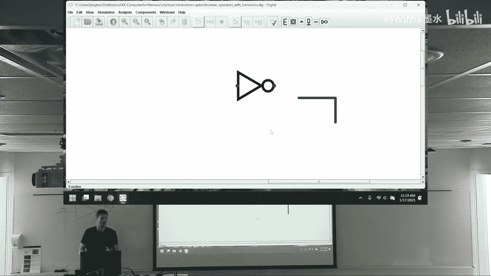

# 005：晶体管与逻辑门 🧠

在本节课中，我们将学习如何使用晶体管构建基本的逻辑门。我们将从回顾晶体管作为开关的基本概念开始，然后逐步构建出与门（AND）、或门（OR）和非门（NOT）。通过这个过程，我们将建立起计算机硬件设计的第一层抽象。

## 回顾：晶体管作为开关

上一节我们介绍了晶体管的基本工作原理。本节中，我们来看看如何将其视为一个受控开关。

一个N沟道晶体管就像一个阀门。当栅极（Gate）有电荷（逻辑1）时，开关闭合，允许电流从源极（Source）流向漏极（Drain）。当栅极没有电荷（逻辑0）时，开关断开，电流无法通过。

需要理解的关键点是，控制开关的电荷（栅极）与流经开关的电荷（源极到漏极）是**完全隔离**的。输出端的电荷并非来自输入端，而是来自一个独立的电源。输入端的状态仅控制着这个电源与输出端之间的通路是否打开。

## 构建逻辑门

有了晶体管作为开关的基本概念，我们就可以通过巧妙的配置来执行我们关心的逻辑运算。我们将从与（AND）、或（OR）和非（NOT）开始。

为了区分，我们将用大写表示布尔运算符（如 **AND**），用特殊字体表示逻辑门（如 `AND`）。

### 与门（AND Gate）

首先，我们思考 **AND** 运算的含义。它有两个输入（A和B），其真值表如下：只有当A和B都为1时，输出才为1；其他情况输出均为0。

那么，如何用晶体管开关实现这个功能呢？想象一下水流：只有两个阀门都打开时，水才能从源头流到出口。

以下是实现方式：

*   将两个晶体管**串联**放置。
*   只有当两个晶体管（即两个开关）都导通（输入均为1）时，电流才能从电源流经整个串联路径到达输出端，此时输出为1。
*   如果其中任何一个晶体管关闭（输入为0），电路就会断开，输出被下拉电阻“拉”到0。

这个电路完美地对应了 **AND** 运算，我们称之为 `AND` 门。

在数字电路中，我们不会每次都画出晶体管细节，而是使用一个抽象符号。`AND` 门的符号是一个左边带两条输入线、右边带一条输出线的半圆形。这个符号封装了所有必要的晶体管、电源和接地连接。

### 或门（OR Gate）

接下来看 **OR** 运算。其真值表是：只要A或B中至少有一个为1，输出就为1；只有两者都为0时，输出才为0。

实现思路与 `AND` 门相反：

*   将两个晶体管**并联**放置。
*   只要任意一个晶体管导通（输入为1），电流就可以从电源流经该路径到达输出端，输出为1。
*   只有当两个晶体管都关闭时，电路才完全断开，输出为0。

这个电路实现了 **OR** 运算，我们称之为 `OR` 门。其符号是一个左边带两条输入线、右边带一条输出线的尖角形。

### 非门（NOT Gate）

最后是 **NOT** 运算。它是一个一元操作，只有一个输入。其规则是：输入为0则输出1，输入为1则输出0。

如何用（我们一直使用的）N沟道晶体管实现“反转”功能呢？这里需要一个不同的配置。

观察以下电路：

*   输出点位于晶体管和上拉电阻之间。
*   当输入为0（晶体管关闭）时，电流从电源通过上拉电阻直接到达输出端，输出为1。
*   当输入为1（晶体管导通）时，输出端通过晶体管直接连接到地（0电位），电流被“吸入”地，导致输出变为0。

这个电路实现了逻辑反转，即 `NOT` 门。其符号是一个三角形（缓冲器）前面加一个小圆圈，圆圈就代表“非”操作。有时也简化为一个在输入端或输出端带圆圈的符号。

## 总结与抽象

本节课中我们一起学习了如何使用晶体管构建三种基本逻辑门：`AND`、`OR` 和 `NOT`。

*   `AND` 门通过**串联**晶体管实现。
*   `OR` 门通过**并联**晶体管实现。
*   `NOT` 门通过一种特殊的**上拉电阻**配置实现。

最重要的是，我们引入了硬件设计中的**关键抽象层**。在实际设计复杂电路时，我们不再关心门级内部的晶体管连接，而是直接使用这些逻辑门符号。这就像在编程中使用函数一样，我们只关心它的功能（真值表），而不必每次都重新实现其内部细节。这些逻辑门是构建所有更复杂数字电路的基石。