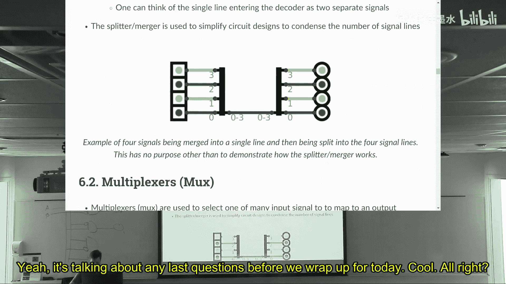

# 006：逻辑门与译码器 🧠

在本节课中，我们将学习逻辑门的基本概念，并探索如何利用它们构建更复杂的数字电路——译码器。我们将从回顾三种基本逻辑门开始，然后深入理解如何设计一个能够根据输入信号选择特定输出的电路。

## 逻辑门回顾 ⚙️

上一节我们介绍了布尔代数的基本概念。本节中，我们来看看这些概念在物理电路中的实现——逻辑门。

我们之前介绍了三种基本逻辑门：与门（AND）、或门（OR）和非门（NOT）。它们分别对应布尔代数中的“与”、“或”、“非”运算。

在数字电路中，这些门可以通过晶体管来构建。虽然实际工程设计中会考虑更多物理限制，但从计算数学的角度，我们可以用简化的模型来理解它们的工作原理。

*   **与门（AND）**：仅当所有输入都为高电平（1）时，输出才为高电平（1）。其布尔表达式为 `输出 = A AND B`。
*   **或门（OR）**：只要有一个输入为高电平（1），输出就为高电平（1）。其布尔表达式为 `输出 = A OR B`。
*   **非门（NOT）**：将输入反转。输入为高电平（1）则输出低电平（0），反之亦然。其布尔表达式为 `输出 = NOT A`。

利用这三种基本门电路，理论上我们可以构建出任何复杂的数字系统，包括整个计算机。

## 逻辑门符号与扩展 🔌

理解了基本门电路后，我们来看看它们的标准符号以及如何处理多个输入的情况。

逻辑门有通用的绘制符号。与非门（NAND）是与门后接一个非门，或非门（NOR）是或门后接一个非门。异或门（XOR）表示“有且仅有一个输入为真”。

以下是常见逻辑门符号及其扩展：
*   **多输入与门**：一个与门符号带有多个输入引脚，表示将所有输入进行“与”运算。例如，一个五输入与门意味着 `输出 = A AND B AND C AND D AND E`。
*   **多输入或门**：一个或门符号带有多个输入引脚，表示将所有输入进行“或”运算。
*   **多输入与非门/或非门**：在多输入与门/或门的基础上，输出端加一个小圆圈，表示对结果取反。
*   **多输入异或门**：对于两个以上的输入，异或门的功能变为奇偶校验。当输入中“1”的个数为奇数时输出1，为偶数时输出0。

由于布尔运算满足结合律，我们可以直接用多输入门来表示一系列两输入门的级联，这简化了电路设计。

## 组合逻辑与译码器概念 🧩

现在，我们将逻辑门组合起来，实现特定的功能。这就是组合逻辑。

组合逻辑电路的特点是，其输出仅由当前的输入组合决定，没有记忆功能。我们将要构建的第一个重要组合逻辑部件是译码器。

考虑一个场景：你有一个输入信号，需要用它来控制两个输出。具体要求是：
*   当输入为0时，输出A为0，输出B为1。
*   当输入为1时，输出A为1，输出B为0。

这可以用一个非常简单的电路实现：输出A直接连接输入，输出B连接输入但经过一个非门。这被称为 **1位译码器**。它根据1位输入，在2个输出中选择一个使其有效（高电平）。

## 构建多位译码器 🏗️

那么，如何控制多于两个的电路呢？这就需要更多输入位。

假设你需要控制四个独立的电路。一个输入位只有两种状态（0和1），不足以选择四个目标。因此，你需要两个输入位（A和B），它们可以组成四种状态：00、01、10、11。

我们的目标是设计一个电路，使得：
*   输入 `00` 时，只有输出0为高电平。
*   输入 `01` 时，只有输出1为高电平。
*   输入 `10` 时，只有输出2为高电平。
*   输入 `11` 时，只有输出3为高电平。

以下是实现这一功能的关键思路：
观察输出0，它只在输入A=0且B=0时为高。这正好可以用一个与门实现，但两个输入端都需要先接非门，即 `输出0 = (NOT A) AND (NOT B)`。

这个模式可以推广：
*   `输出1 = (NOT A) AND B`
*   `输出2 = A AND (NOT B)`
*   `输出3 = A AND B`

这样，我们就用四个与门（每个门的输入经过特定配置）构建了一个 **2-4译码器**。每个与门只对其对应的一种输入组合产生高电平输出。

## 译码器的通用性与符号 📐

译码器的设计模式具有高度的通用性，可以扩展到任意位数。

对于一个有n个输入位的译码器，它最多可以控制 2^n 个输出。每个输出都对应一个唯一的n位输入组合。与门在这里非常适用，因为它天生具有“仅当所有条件都满足时才输出真”的特性。

由于译码器在数字电路中非常常用，它拥有一个通用的简化符号，通常像一个矩形或梯形，内部标有“DECODER”。在仿真软件中，你可以直接调用这个组件，并通过“选择器位数”来配置其大小。

在连接时，需要注意将多个单比特输入线通过“合并器（Merger）”组合成一路多比特信号，再送入译码器的输入端口，并确保位序正确。

---

本节课中我们一起学习了逻辑门的基础知识及其符号，并深入探讨了如何利用与门构建译码器。译码器是一种核心的数字电路部件，它能够将二进制编码的输入“翻译”成对应的单个输出有效信号，这在后续构建更复杂的计算机组件（如内存寻址、指令解码）时至关重要。