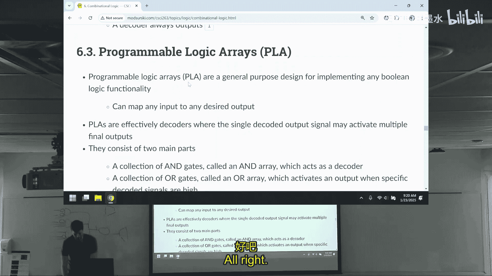

# 007：译码器与多路复用器 🧩


在本节课中，我们将要学习两种重要的组合逻辑电路：译码器和多路复用器。我们将了解它们的工作原理、符号表示以及如何利用它们来构建更复杂的数字系统。


---


## 译码器的工作原理


上一节我们介绍了基本的逻辑门。本节中我们来看看如何利用与门来构建一个译码器。


译码器的核心功能是：对于一个给定的二进制输入，激活唯一对应的输出线。例如，一个2位译码器有2个输入和4个输出。当输入为 `00` 时，只有第一个输出为高电平（1）；当输入为 `01` 时，只有第二个输出为高电平，依此类推。


以下是实现这一功能的关键：**与门非常适合在需要特定输入模式时使用**。因为只有当所有输入都满足特定条件时，与门才会输出1。


考虑一个2位输入（A和B）的译码器。我们希望当输入为 `00` 时，第一个输出为1。这可以通过一个与门实现，其输入是 **非A** 和 **非B**。其逻辑公式为：
`输出0 = (非 A) 与 (非 B)`


同理，对于其他输出：
*   当输入为 `01` 时，输出1为1：`输出1 = (非 A) 与 B`
*   当输入为 `10` 时，输出2为1：`输出2 = A 与 (非 B)`
*   当输入为 `11` 时，输出3为1：`输出3 = A 与 B`


通过这种方式，我们为四种可能的输入组合各配置了一个与门。在任何时刻，**有且只有一个**与门会输出1，其他所有门都输出0。


---


## 译码器的抽象符号


由于这种设计模式非常常见，我们将其抽象为一个单独的符号，以简化电路图。


译码器的符号通常是一个梯形或矩形，一侧是输入线，另一侧是多条输出线。对于一个2位译码器，其符号表示它有2个输入和4个输出。


在数字电路设计中，我们经常使用**分路器/合并器**来将多个信号合并到一条线上传输，或者从一条线上分离出多个信号。这对于管理具有大量输入/输出的复杂电路非常重要。


以下是一个在仿真软件中构建的2位译码器示例：
```
输入 A (位0) ──┐
输入 B (位1) ──┼─→ [2位译码器] ──→ 输出0、输出1、输出2、输出3
```
需要注意输入位的顺序（例如，哪一位是高位，哪一位是低位），这会影响哪个输出对应哪个输入组合。


---


## 从译码器到多路复用器


译码器根据输入选择激活一条输出线。现在，我们来看看功能相似但用途不同的多路复用器。

多路复用器（常简称为MUX）的功能是：从**多个输入信号**中选择一个，并将其传递到**单个输出**。除了多个数据输入外，它还有**选择线**，用于决定当前哪个输入信号被连接到输出。


可以将其想象成一个老式电话接线员：有多条输入线路（来电者），但只有一条输出线路（长途干线）。接线员根据选择，将其中一个来电者的信号接通到干线上。


---


## 多路复用器的实现


一个2选1多路复用器有两个数据输入（X和Y）、一个选择输入（S）和一个输出（O）。其功能如下：
*   如果 `S = 0`，则输出 `O = X`。
*   如果 `S = 1`，则输出 `O = Y`。


其真值表可以简化为：
| 选择 S | 输出 O |
| :---: | :---: |
| 0 | X |
| 1 | Y |


如何用逻辑门实现呢？我们可以利用与门和或门。思路是：用选择信号S及其反相信号作为“门控”，控制哪个输入信号能通过。

以下是2选1多路复用器的逻辑实现：
```
输入 X ────→ [与门1] ─┐
选择 S ──→ [非门] ──→ [与门1]   │
                              ├─→ [或门] ──→ 输出 O
输入 Y ────→ [与门2] ─┐       │
选择 S ───────────→ [与门2] ──┘
```
其逻辑公式为：`输出 O = (X 与 (非 S)) 或 (Y 与 S)`


当 `S=0` 时，`(非 S)=1`，上方的与门打开，输出O等于X；下方的与门因为S=0而关闭，输出为0。或门的结果就是X。
当 `S=1` 时，情况相反，输出O等于Y。


---


## 为什么需要或门？


你可能会问，既然每次只有一个与门有有效输出，为什么不直接把两个与门的输出线连在一起，而要经过一个或门呢？


这是因为在物理电路中，逻辑门的输出不是“什么都不连接”。输出0通常意味着该输出引脚被连接到**地（GND）**，即低电平。如果我们将两个与门的输出直接相连，当其中一个输出1（连接到高电平），而另一个输出0（连接到地）时，就会造成**高电平与地直接短路**，这是不允许的，会损坏电路或导致信号错误。


**或门**在这里起到了关键的安全作用。它内部的结构允许我们将多个输入信号“安全地”合并到一个输出，而不会造成短路。因此，或门在此处的功能不仅仅是执行逻辑“或”运算，更重要的是提供了信号合并的物理路径。


---


## 更多输入的多路复用器与解复用器

多路复用器的设计可以扩展。一个有2位选择线的多路复用器，可以选择 `2^2 = 4` 个输入信号中的一个。其实现方式类似于一个译码器（用于生成4个选择控制信号）加上一组与门和最终的或门。


与多路复用器相反的操作是**解复用器**。它有一个输入信号、多条输出线和选择线。根据选择线的值，它将唯一的输入信号引导到指定的输出线上。解复用器的符号看起来像多路复用器，但信号流向是相反的。


多路复用器和解复用器一起，构成了在有限通道上传输多路信号的基础，广泛应用于通信和数字系统内部的数据路由。


---


## 可编程逻辑阵列简介


最后，我们简要介绍一个强大的概念：**可编程逻辑阵列**。它是一种非常通用的结构，可以用来实现**任何**布尔逻辑函数。


其核心思想是：对于一个有N个输入、M个输出的真值表，PLA通过一个可编程的“与门阵列”来生成所有可能的输入组合项（最小项），然后再用一个可编程的“或门阵列”将这些项组合起来，形成最终的输出。


这意味着，只要你能够列出真值表，就可以用PLA来实现它。它之所以“可编程”，是因为我们可以决定哪些与门和或门之间的连接是存在的。然而，这种通用性的代价是电路规模可能非常庞大且效率不是最优的。在工程中，我们总是在通用性、复杂性和性能之间进行权衡。

---



本节课中我们一起学习了译码器和多路复用器这两种核心的组合逻辑模块。译码器将二进制编码转换为一条激活线，常用于地址选择和控制系统。多路复用器则实现了数据选择路由的功能，是构建复杂数据通路的基础。理解它们的原理和实现，是掌握数字系统如何组织和传输数据的关键一步。