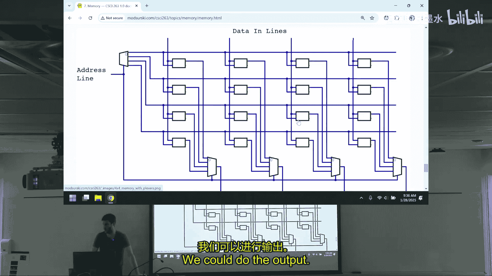
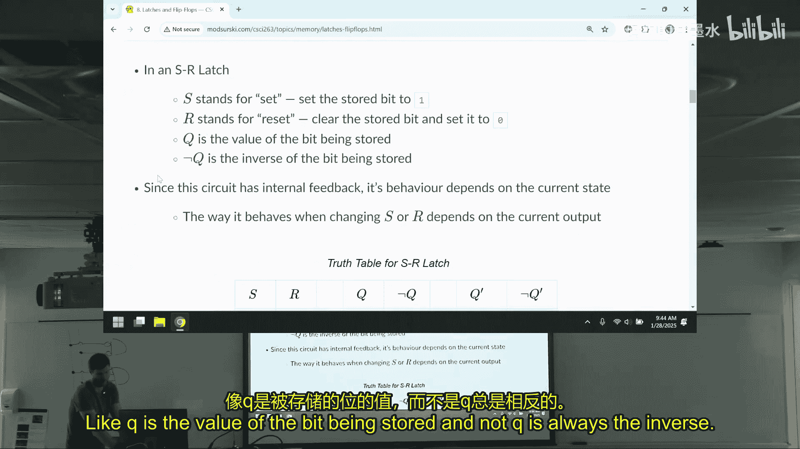
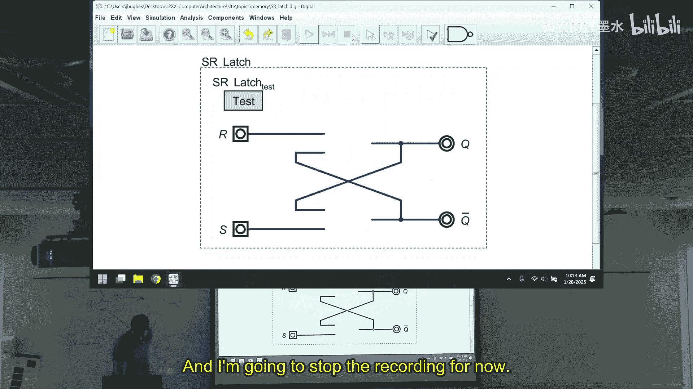

# 009：SR锁存器 🧠

在本节课中，我们将要学习如何存储信息。我们将从存储单个比特开始，逐步构建出能够存储多个比特序列的抽象概念，并最终介绍实现这一功能的基础电路单元——SR锁存器。

## 从1比特到多比特存储

上一节我们介绍了存储信息的基本需求。本节中我们来看看如何扩展存储能力。

存储1比特信息需要一个单元。如果想存储超过1比特的信息，方法并不复杂。我们只需要将多个这样的单元串联起来。例如，要存储4比特、8比特或28比特，只需将它们全部串联起来。

每个单元都需要一条信号线，因为每条导线在同一时刻只能承载一个高电平或低电平的信号。因此，每个单元都会有一条输入线和一条输出线。

如果想存储模式 `0110`，就需要让 `0110` 这个信号序列输入并保存起来。

但是，如果我想存储多组4比特数据呢？这正是我们构建RAM（随机存取存储器）的方向。我们需要能够存储大量不同的比特序列以供将来使用。

以下是实现方法：
*   将存储单元排列成网格状。
*   每个单元都有一条信号线输入。
*   系统需要一种方法来选择将数据存入哪一行。
*   同样，也需要一种方法来选择从哪一行输出数据。

这个抽象的高层概念就是构建存储器的基础。

让我们具体看看这个设计。我们暂时不关注每个方框的具体细节，只需知道它是一个能存储1比特信息的“神奇”单元。

观察这个结构，我们可以理解其工作原理。我们有数据线（信号线），假设最下面这条线代表最低有效位（LSB），越往上有效位越高。每条数据线都连接到每一列的对应单元。

如果我想输入模式 `0110`，那么每条线上就准备好了相应的值（0或1）。但我需要决定将这个值存入哪一行。这可以通过**解码器**来实现。解码器根据地址选择激活特定的行。

输出部分也类似。这些是输出线（同样，从下到上代表从低到高的有效位）。这里使用的是**多路复用器**。地址线下来选择具体要将哪一行的数据输出到对应的输出线上。

每一行的所有单元都连接到同一列的多路复用器，但每次只输出被选中的那一行的数据。

举例来说，假设第一行存储的是 `0001`，第二行是 `0010`，第三行是 `0100`，第四行是 `1000`。

在任何时刻，每个多路复用器都接收来自各行的信号。通过地址线，我们可以指定将哪一行的信号映射到输出端。这就是我们构建存储器的目标。

## 锁存器与触发器

现在，我们对目标有了清晰的认识。但关键问题是：我们如何实现那个存储信息的“神奇”单元？这正是接下来要学习的**锁存器**和**触发器**。

## SR锁存器详解

我们将要看的第一个电路是**置位复位锁存器**，简称**SR锁存器**。这是一个非常基础的锁存器，它能实现我们之前未见过的功能。

这是它的设计图（使用或非门）。还有其他实现方式（例如使用与非门），行为略有不同，但核心理念相同。

请注意，这个电路中存在一个**反馈回路**。当电路变得自引用时，有趣的事情就发生了。

SR锁存器的功能可以通过类似的设计实现，并不特指某一种具体电路。

### SR锁存器的行为

在SR锁存器中：
*   **S** 代表 **置位**：将存储的比特设置为1。
*   **R** 代表 **复位**：将存储的比特清除为0。
*   **Q** 代表存储比特的值。
*   **Q̅** 总是Q的反相。

这些命名有历史原因，不必过于纠结。

期望的行为是：
*   当S有效（高电平）时，Q输出1。
*   当R有效（高电平）时，Q输出0。
*   Q̅ 始终与Q相反。

### 状态表分析

由于电路存在反馈，其行为取决于当前状态。我们来看状态表。

这里有S、R、Q、Q̅四个变量，但只有8行，而不是16行。这是因为Q和Q̅并非独立，它们必须互为反相，因此 `Q=0, Q̅=0` 和 `Q=1, Q̅=1` 的状态不可能出现。

状态解读：
*   **S=0, R=0**：输出状态不变。
*   **S=1, R=0**：
    *   如果Q已经是1，则状态稳定不变。
    *   如果Q是0，则电路会进入一个**短暂的不稳定状态**，然后迅速稳定到Q=1, Q̅=0。表中用星号(*)标记。
*   **S=0, R=1**：
    *   如果Q已经是0，则状态稳定不变。
    *   如果Q是1，则电路短暂不稳定后稳定到Q=0, Q̅=1。
*   **S=1, R=1**：这是**未定义状态**。对于SR锁存器的抽象功能来说，同时置位和复位没有意义。在此具体实现中，它会导致Q和Q̅都输出0，这是一个无效且不稳定的状态。

### 不稳定状态与物理延迟

“不稳定状态”非常短暂，在纳秒级别。这是因为信号通过晶体管和门电路需要时间。

让我们分析一下当S=1, R=0且当前Q=0时发生了什么：
1.  初始：S=1, R=0, Q=0, Q̅=1。
2.  瞬间：上方或非门输入变为(0,1)，输出Q变为1。
3.  同时：下方或非门输入变为(1,0)，输出Q̅变为0。
4.  新的Q̅=0反馈回上方门，但此时输入已是(0,1)，输出保持Q=1，系统达到新的稳定状态 `Q=1, Q̅=0`。

这个从 `01` 到 `10` 的切换几乎瞬间完成，但物理上存在微小延迟。正是这个延迟限制了计算机的时钟速度。

### 未定义状态

当S和R同时为高电平时，输出Q和Q̅都变为0。这违反了它们必须互反的原则，是一个无效状态。对于SR锁存器，应避免同时置位和复位。

## 思考活动

考虑一个有趣的问题：当电路首次通电，且所有输入（S, R）都为0时，输出Q和Q̅会是什么？

理论上，初始状态 `S=0, R=0, Q=0, Q̅=0` 是不可能的。实际上，在通电瞬间，两个门电路的物理特性存在微小差异，导致其中一个会先于另一个改变状态，从而立即进入一个稳定状态（`01`或`10`）。最终状态是**不确定的**，取决于制造上的细微差别。

通过模拟可以观察到这一现象。

## 总结

本节课中我们一起学习了计算机存储的基础构建块。我们从存储多比特数据的抽象结构出发，深入探讨了最基本的存储单元——**SR锁存器**。我们了解了它的电路结构（使用或非门），分析了其状态表，明确了**置位**、**复位**和**保持**功能，并特别指出了**同时置位复位是未定义状态**。我们还讨论了由物理延迟导致的**短暂不稳定状态**以及电路上电时初始状态的不确定性。SR锁存器是理解更复杂时序逻辑电路（如D锁存器、触发器）的关键第一步。

